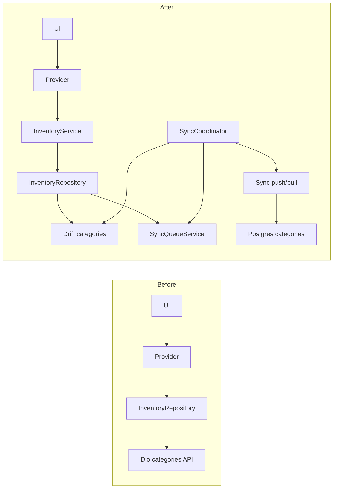
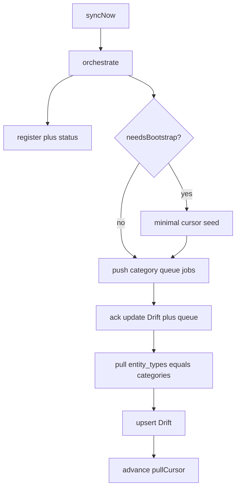

# First Offline Entity: Categories

## Why not Business Settings

Client “Business Settings” is [`CommerceSettingsRemoteDataSource`](apps/client/lib/features/business/data/commerce_settings_remote_data_source.dart) — Dio-only, **two fields** (`pricing_tier_labels`, `default_invoice_tax_rate`), no repository, no Drift. PG `business_settings` has seven domain columns already registered for sync. Using it first would force expanding the UI model, inventing a repo, and still only exercise singleton upsert—not list CRUD. It is also read-coupled across sales/inventory/parties.

**Locked entity: Categories** (`entity_type: categories`). Matches API registry (`name` only), has Remote → Repo → Service → Provider, and [`InventoryLocalDataSource`](apps/client/lib/features/inventory/data/inventory_local_data_source.dart) is an empty Phase-2 stub ready for Drift.

## Architecture before / after

Other inventory methods (items, brands, …) stay remote-only this milestone.

## Phase 1 — Audit (Categories)

| Piece | Location |
|-------|----------|
| Remote | [`inventory_remote_data_source.dart`](apps/client/lib/features/inventory/data/inventory_remote_data_source.dart) CRUD |
| Repo | [`inventory_repository.dart`](apps/client/lib/features/inventory/data/inventory_repository.dart) — all category methods → remote; `_local` unused |
| Service / provider | `inventory_service.dart`, `inventory_categories_provider.dart` |
| Models | Freezed `CategoryDto` (`id`, `name`, `item_count`, timestamps); domain `CategoryModel` |
| Drift | **none** |
| API sync | Registered in [`entity-registry.register.ts`](apps/api/src/modules/sync/apply/entity-registry.register.ts) |

## Phase 2 — Drift

Add table [`categories_table.dart`](apps/client/lib/core/database/tables/categories_table.dart) (name TBD under `core/database/tables/`):

- Align with PG: `id`, `businessId`, `name`, `syncVersion`, `updatedAt`, `createdAt`, `deletedAt`, `isDeleted`, `deviceId`
- Optional local-only: `itemCount` (denormalized; default 0; not pushed)
- Bump [`AppDatabase`](apps/client/lib/core/database/database.dart) **schemaVersion 9 → 10**, `onUpgrade` create table
- Run `build_runner`

No feature-specific sync queue table — reuse shared `SyncQueue`.

## Phase 3–4 — Repository cutover + queue

Implement `DriftInventoryLocalDataSource` (or `CategoryLocalSource`) for categories only:

**Read:** watch/list from Drift by `businessId`, exclude soft-deleted (unless needed).

**Write (create/update/delete):**
1. Write Drift first (UUID client-side on create; soft-delete on delete).
2. `SyncQueueService.enqueueRowMutation` with `entityType: 'categories'`, payload snake_case `{ name }`, `base_sync_version` + `client_updated_at` inside payload or job fields.
3. Return immediately — **never await Dio** for category mutations.

Extend [`SyncJob`](apps/client/lib/core/sync/models/sync_job.dart) / enqueue helpers so push can build contract mutations: `base_sync_version` (from local `syncVersion` before bump, or stored on enqueue), `client_updated_at`.

Wire [`InventoryRepository`](apps/client/lib/features/inventory/data/inventory_repository.dart) category methods through local; keep remote for optional hydrate/fallback **only** behind sync pull (not UI write path). Providers keep calling service/repo — no UI rewrite beyond loading from local stream if needed.

Initial hydrate: on first open / after login business select, if local empty, one-shot remote list → upsert Drift (bootstrap aid), then mark metadata if needed. Document as temporary until full bootstrap lands.

## Phase 5–8 — Coordinator: first real push + categories pull

Extend [`SyncCoordinatorTransport`](apps/client/lib/core/sync/coordinator/sync_coordinator.dart) (or inject `SyncClient`) with `push` + `pull`.

**Bootstrap gate (minimal):** if `needsBootstrap`, set `bootstrappedAt` + `pullCursor` to watermark/zero via existing stub bootstrap complete **or** metadata write — enough to leave `needsBootstrap` without downloading all entities. Full multi-entity bootstrap stays out of scope.

**When plan is ready (or after minimal bootstrap):**

1. **Push:** dequeue/list pending `kind=row` jobs for `categories` (or all registered row jobs that are categories this milestone); build `POST /sync/push` body; call `SyncClient.push`.
2. **Ack:** for `accepted`/`replayed` → update Drift `syncVersion`/`updatedAt` from response; `markCompleted` queue jobs. Do **not** change local domain fields from ack beyond sync meta.
3. **Conflict:** `markFailed` or status `conflict`; persist conflict payload in job `lastError` / small local conflict record — **do not** overwrite Drift row with server payload automatically.
4. **Pull:** `GET /sync/pull?entity_types=categories&cursor=…`; upsert rows into Drift; soft-delete when `is_deleted`; `SyncMetadataStore.setPullCursor(next_cursor)`; set `lastServerSchemaVersion` if present on status.

Touch [`SyncEngine.syncNow`](apps/client/lib/core/sync/engine/sync_engine.dart) only via coordinator (already delegates). Keep commands/media unimplemented.

## Phase 9 — Tests

- Unit/integration with in-memory Drift: offline create/update/delete → row in Drift + pending queue job
- Fake `SyncClient`: push success → job completed + sync_version updated; duplicate mutation → replayed; CONFLICT → local row unchanged + job conflict/failed
- Pull upsert + soft delete + cursor advance
- Restart: reopen DB → categories + pending jobs persist

## Before Items / Parties later

| Lesson to lock now | Why |
|--------------------|-----|
| Shared Drift sync column pack | Same as PG `syncedBusinessColumns` |
| Repo pattern: local write → enqueue → return | No Dio on write path |
| Payload = snake_case allowlisted fields only | Matches API registry |
| `base_sync_version` at enqueue time | Optimistic concurrency |
| Conflict = hold local + surface later | Never silent server overwrite |
| Pull apply by `entity_type` switch/registry on client | Mirror API entity registry |
| Don’t start bootstrap-from-empty with tiny pull limits in tests | Cursor pagination |
| Keep feature UI on providers; sync stays in `core/sync` | No SyncApi in features |

## Out of scope

Business Settings, Items, Parties, Sales, Purchases, Inventory stock, CRM, commands, media, full bootstrap chunks, migrating non-category inventory APIs.