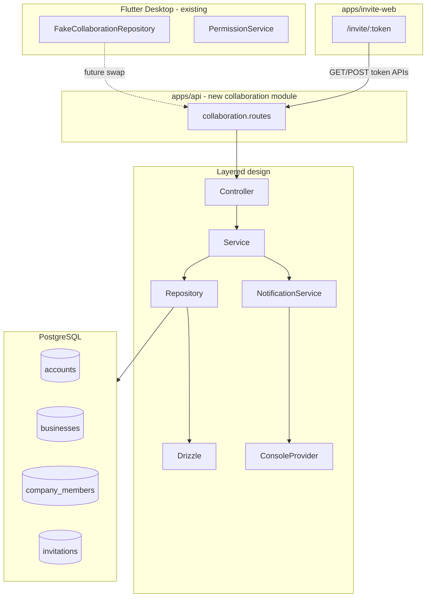
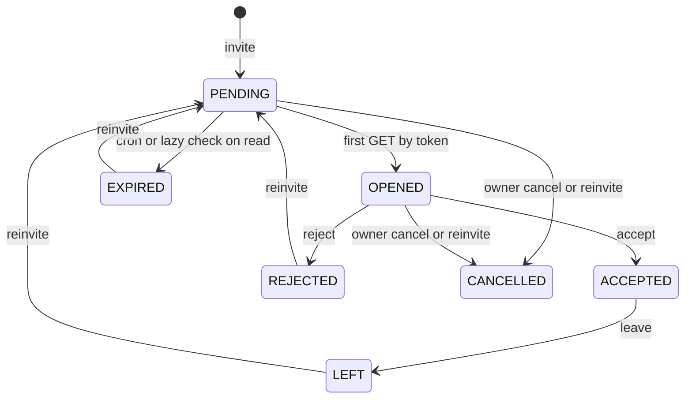

# Collaboration Backend + Invitation Website

## Architecture overview



**Table mapping (confirmed):**

| Spec concept | Existing / new table | Notes |
|---|---|---|
| Users | [`accounts`](apps/api/src/db/schema/identity/tables.ts) | Global identity by phone/email |
| Companies | [`businesses`](apps/api/src/db/schema/business/tables.ts) | Tenant root |
| Company Members | **new** `company_members` | Collaboration RBAC; separate from synced `users` (owner/manager/staff) |
| Invitations | **new** `invitations` | Token-based invite lifecycle |

Owners remain in existing `users` (`role = owner`). Shared collaborators live in `company_members`. This avoids breaking the sync model.

---

## 1. Database schema

Add to [`apps/api/src/db/schema/`](apps/api/src/db/schema/):

### New enums in [`enums.ts`](apps/api/src/db/schema/enums.ts)

```ts
collaborationRoleEnum: secondary_admin | salesman | biller | biller_and_salesman | accountant | accountant_edit_access | stock_keeper
companyMemberStatusEnum: active | left | removed
invitationStatusEnum: pending | opened | accepted | rejected | left | expired | cancelled
```

### `company_members` table (`schema/collaboration/tables.ts`)

| Column | Type | Constraints |
|---|---|---|
| id | uuid | PK, default random |
| company_id | uuid | FK → businesses.id |
| account_id | uuid | FK → accounts.id |
| role | collaboration_role | not null |
| status | company_member_status | default `active` |
| joined_at | timestamptz | set on accept |
| left_at | timestamptz | set on leave |
| created_at / updated_at | timestamptz | not null |

**Indexes:** `(company_id, account_id)` unique where status = active; `(account_id)`; `(company_id, status)`

### `invitations` table

| Column | Type | Constraints |
|---|---|---|
| id | uuid | PK |
| company_id | uuid | FK → businesses |
| phone | text | nullable |
| email | text | nullable |
| role | collaboration_role | not null |
| status | invitation_status | default `pending` |
| token | text | unique, not null — `crypto.randomBytes(32).toString('hex')` |
| created_by | uuid | FK → accounts.id |
| opened_at | timestamptz | nullable |
| accepted_at | timestamptz | nullable |
| rejected_at | timestamptz | nullable |
| expires_at | timestamptz | `created_at + 7 days` |
| superseded_by | uuid | nullable FK → invitations.id (for reinvite chain) |
| created_at / updated_at | timestamptz | |

**Constraints:** at least one of phone/email; unique partial index on `(company_id, phone)` where status in (`pending`, `opened`); index on `token`

**Migration:** `bun run db:generate` → `bun run db:migrate` (new `0020_*.sql`)

---

## 2. Backend module structure

New module at [`apps/api/src/modules/collaboration/`](apps/api/src/modules/collaboration/):

```
collaboration/
├── index.ts                    # Fastify plugin
├── collaboration.types.ts      # DTOs
├── collaboration.schema.ts     # Zod request/response schemas
├── collaboration.mapper.ts     # DB row → DTO (snake_case JSON)
├── collaboration.repository.ts
├── invitation.service.ts
├── company-member.service.ts
├── company-directory.service.ts
├── invitation.controller.ts
├── company-member.controller.ts
├── company-directory.controller.ts
├── routes/
│   ├── invitation.routes.ts
│   ├── company-member.routes.ts
│   └── company-directory.routes.ts
└── notifications/
    ├── notification.service.ts       # interface + orchestrator
    └── console-notification.provider.ts
```

Register in [`apps/api/src/modules/index.ts`](apps/api/src/modules/index.ts):

```ts
await api.register(collaborationModule, { prefix: '/collaboration' });
```

**Route prefixes under `/api/v1/collaboration`:**

| Method | Path | Auth | Handler |
|---|---|---|---|
| POST | `/invitations` | JWT + requireBusiness | Create invitation, send notification |
| GET | `/invitations/:token` | Public | Verify + **auto-mark OPENED** on first valid GET |
| POST | `/invitations/:token/accept` | Public | Create member, mark ACCEPTED |
| POST | `/invitations/:token/reject` | Public | Mark REJECTED |
| POST | `/invitations/:id/reinvite` | JWT + requireBusiness | Cancel old, create new |
| POST | `/company-members/:id/leave` | JWT | Mark LEFT |
| GET | `/companies/shared` | JWT | Active shared memberships |
| GET | `/companies/invitations` | JWT | Pending/opened invites for caller phone/email |

> **API path note:** Spec lists `/api/v1/invitations` etc.; we nest under `/collaboration` to match existing module conventions and the Flutter repository comment (`/collaboration/*`). Final paths: `/api/v1/collaboration/invitations`, etc.

> **Removed:** `POST /invitations/:token/view` — GET handles OPENED transition atomically in a transaction (read + conditional update where `status = pending` → set `opened_at`, `status = opened`).

### Config additions ([`app_config.ts`](apps/api/src/config/app_config.ts))

- `INVITE_BASE_URL` (default `https://invite.billingbaba.app`)
- `INVITATION_EXPIRY_DAYS` (default `7`)
- Add `invite.billingbaba.app` to CORS origins in dev

---

## 3. Invitation state machine (service layer)



**Service rules:**
- **Create:** validate role enum, normalize phone (E.164), reject duplicate active invite or active member for same contact+company
- **GET by token:** if `expires_at < now` and status is pending/opened → transition to EXPIRED, return 410; if pending → transition to OPENED in same tx
- **Accept:** only from `pending` or `opened`; find-or-create `accounts` by invitation phone/email; insert `company_members` (status `active`); set `accepted_at`
- **Reject:** only from `pending` or `opened`
- **Reinvite:** cancel prior (status → `cancelled`, set `superseded_by`); create fresh invitation with new token + 7-day expiry
- **Leave:** member status → `left`, set `left_at`; if linked invitation was accepted, optionally set invitation status → `left`

All transitions enforced in `InvitationService` / `CompanyMemberService` — routes only validate + delegate.

---

## 4. Response DTOs (Flutter-compatible snake_case)

### GET `/invitations/:token` (invite website)

```json
{
  "data": {
    "id": "uuid",
    "status": "opened",
    "company_name": "Sharma Traders",
    "owner_name": "Ramesh Sharma",
    "owner_phone": "+919876500001",
    "role": "biller",
    "expires_at": "2026-07-26T12:00:00Z",
    "invitation_url": "https://invite.billingbaba.app/invite/{token}"
  }
}
```

### POST `/invitations` (owner desktop)

Returns invitation DTO aligned with Flutter [`Invitation`](apps/client/lib/features/collaboration/domain/models/invitation.dart) model:
- `id`, `invite_code` (maps to **token**), `member_id` (company_member placeholder or generated id), `full_name`, `phone_or_email`, `role`, `channel` (derived: email vs sms), `sent_at`, `expires_at`, `status`

### GET `/companies/shared`

Array of entries matching [`CompanyListEntry`](apps/client/lib/features/collaboration/domain/models/company_list_entry.dart):

```json
{
  "id": "business-uuid",
  "name": "Gupta General Store",
  "owner_name": "Suresh Gupta",
  "owner_phone": "+919876500002",
  "relationship": "member",
  "role": "salesman",
  "sync_status": "on"
}
```

`relationship` derived from role: `secondary_admin` role → `secondary_admin`; all other active roles → `member`. **No permission preset in response** — Flutter derives via `RolePermissionRegistry`.

### GET `/companies/invitations`

```json
{
  "id": "invitation-uuid",
  "company_id": "uuid",
  "name": "Sharma Traders",
  "owner_name": "...",
  "relationship": "pending_invite",
  "role": "biller",
  "invitation_id": "uuid",
  "invitation_status": "pending",
  "expires_at": "...",
  "sync_status": "on"
}
```

Expired invites return `relationship: expired_invite`, `invitation_status: expired`.

### Session-level `relationship` (internal helper, not a separate endpoint)

When Flutter later wires `switchCompany`, map:
- Owner businesses → `relationship: owner` (from existing business list, not this module)
- Shared member → `relationship: member | secondary_admin` + `role`
- PermissionService treats owner as full access; shared uses role preset only

---

## 5. Notification service

```ts
// notifications/notification.service.ts
interface NotificationProvider {
  sendInvitation(payload: InvitationNotificationPayload): Promise<void>;
}

class NotificationService {
  constructor(private readonly provider: NotificationProvider) {}
  async notifyInvitationCreated(invitation, company, owner): Promise<void> { ... }
}
```

**`ConsoleNotificationProvider`** logs:

```
==============================
WHATSAPP INVITATION
Company: Sharma Traders
Role: Biller
Phone: +919876500001
Invitation URL: https://invite.billingbaba.app/invite/{token}
==============================
```

Wire provider in module factory; future providers (Meta Cloud, Twilio, MSG91) swap via env `NOTIFICATION_PROVIDER`.

---

## 6. Auth strategy (no new auth flows)

| Endpoint group | Middleware |
|---|---|
| Owner actions (create invite, reinvite) | Existing [`authenticate`](apps/api/src/middleware/auth.middleware.ts) + [`requireBusiness`](apps/api/src/middleware/require-business.middleware.ts); assert caller is business owner via `users.role = owner` |
| Invitee directory (shared, invitations list, leave) | `authenticate` only; scope by `request.phone` / account email |
| Token endpoints (GET/accept/reject) | **No auth** — token is the credential |

No OTP, login, or subscription work in this phase.

---

## 7. Error handling and HTTP codes

Reuse [`AppError`](apps/api/src/shared/errors/app-error.ts) + [`sendData`](apps/api/src/shared/http/response.ts):

| Code | HTTP | When |
|---|---|---|
| `INVITATION_NOT_FOUND` | 404 | Invalid token |
| `INVITATION_EXPIRED` | 410 | Past expiry |
| `INVITATION_ALREADY_ACCEPTED` | 409 | Double accept |
| `INVITATION_NOT_ACTIONABLE` | 409 | Reject/accept on terminal state |
| `MEMBER_NOT_FOUND` | 404 | Leave on unknown id |
| `FORBIDDEN` | 403 | Non-owner creating invites |
| `VALIDATION_ERROR` | 400 | Zod failures |

---

## 8. OpenAPI documentation

Add [`apps/api/src/openapi/paths/collaboration.paths.ts`](apps/api/src/openapi/paths/collaboration.paths.ts) with schemas for all 8 endpoints. Register in [`document.ts`](apps/api/src/openapi/document.ts). Swagger UI remains at `/docs`.

---

## 9. Invite website (`apps/invite-web`)

Scaffold with Vite + React + TypeScript + Tailwind + React Router + TanStack Query (Bun for package management).

### Structure

```
apps/invite-web/
├── index.html
├── vite.config.ts          # proxy /api → localhost:3000 in dev
├── tailwind.config.ts
├── src/
│   ├── main.tsx
│   ├── App.tsx
│   ├── api/
│   │   ├── client.ts       # fetch wrapper, VITE_API_BASE_URL
│   │   └── invitations.ts  # useQuery/useMutation hooks
│   ├── pages/
│   │   ├── InvitePage.tsx
│   │   ├── AcceptSuccessPage.tsx
│   │   ├── RejectSuccessPage.tsx
│   │   └── NotFoundPage.tsx
│   ├── components/
│   │   ├── InvitationCard.tsx
│   │   ├── LoadingState.tsx
│   │   └── ErrorState.tsx
│   └── lib/
│       └── deep-link.ts    # billingbaba://invite/{token}
```

### Routes

| Route | Behavior |
|---|---|
| `/` | Redirect → `/not-found` |
| `/invite/:token` | `useQuery` → GET invitation; render company/owner/role/expiry + Accept/Reject buttons |
| `/invite/:token/accepted` | Success + deep link attempt + download CTA |
| `/invite/:token/rejected` | Rejection confirmation |
| `*` | Not found |

### Invite page flow

1. Load → single GET (backend marks OPENED)
2. Accept → POST accept → navigate to success → `window.location.href = 'billingbaba://invite/{token}'` with 2s fallback to download links
3. Reject → POST reject → rejection page
4. Map API errors: 404 → not found, 410 → expired, 409 → already handled, 5xx → generic error

### Env

- `VITE_API_BASE_URL` (e.g. `http://localhost:3000/api/v1/collaboration`)
- `VITE_APP_DOWNLOAD_URL` (placeholder marketing link)

---

## 10. Testing

**Unit tests** (`tests/unit/collaboration/`):
- State machine transitions (pending→opened, accept, reject, reinvite, expire)
- Token generation uniqueness
- Phone normalization

**Integration tests** (`tests/integration/collaboration.integration.test.ts`):
- Full flow: dev-login → create business → POST invitation → GET token (assert OPENED) → accept → GET shared companies
- Reinvite cancels prior
- Leave marks member LEFT
- Expired invitation returns 410

Follow existing pattern in [`parties.integration.test.ts`](apps/api/tests/integration/parties.integration.test.ts) with `createTestApp` + `login`.

---

## 11. Future Flutter wiring (out of scope — no UI changes)

When ready, replace [`FakeCollaborationRepository`](apps/client/lib/features/collaboration/data/fake_collaboration_repository.dart) with `ApiCollaborationRepository` implementing the subset of [`CollaborationRepository`](apps/client/lib/features/collaboration/data/collaboration_repository.dart) backed by these endpoints. `CompanyDirectoryService` merges owned businesses (existing API) + `GET /companies/shared` + `GET /companies/invitations`.

Permission handling stays client-side: backend returns `role` + `relationship` only; [`PermissionService`](apps/client/lib/features/collaboration/application/permission_service.dart) + [`RolePermissionRegistry`](apps/client/lib/features/collaboration/domain/role_permission_registry.dart) unchanged.

---

## Implementation order

1. Schema + migration + enums
2. Repository + services + state machine
3. Notification interface + console provider
4. Routes/controllers + module registration
5. OpenAPI paths
6. Integration tests
7. Scaffold `apps/invite-web` + invite flow UI
8. CORS/env wiring for local dev (`api` on :3000, `invite-web` on :5173)
