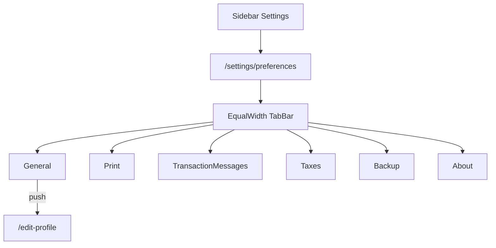

# Desktop V1 Settings Module

## Decisions (from audit)

- **General tab contents:** Business Profile (navigates to existing [`EditProfilePage`](apps/client/lib/features/business/presentation/edit_profile_page.dart)) + read-only **Currency: INR (₹)**. No landing page / date / number / language / auto-lock / welcome toggles — none exist in [`StorageKeys`](apps/client/lib/core/constants/storage_keys.dart) or prefs.
- **About:** Logo ([`assets/images/logo.png`](apps/client/assets/images/logo.png)), `PackageInfo` version + buildNumber, Drift `AppDatabase.schemaVersion` (20), Offline Sync protocol `SyncApi.protocolVersion` (`'1'`) / `kSyncLocalSchemaVersion`, copyright. **No Privacy Policy link** (no dedicated URL in repo).
- **Backup:** Keep local `.biba` export/restore only. No backup folder preference or last-backup timestamp exists — do not invent them. Fix copy that implies cloud.
- **WhatsApp:** Remove from Settings UI/routes/search. Keep providers/repos/auto-notify (messaging still works).
- **Tab switching:** In-page `TabController` + `IndexedStack` on `/settings/preferences` only — no `context.push`/`go` per tab. Optional `?tab=` query for deep links from search.

## 1. Tabbed Settings hub (desktop)

Replace list UI in [`desktop/settings_screen.dart`](apps/client/lib/features/settings/presentation/desktop/settings_screen.dart) with:

- Exactly 6 tabs, full width, equal flex, `isScrollable: false` (or custom `Row` of `Expanded` tabs if Material `TabBar` label overflow needs tighter control).
- Default index 0 (General).
- `AutomaticKeepAliveClientMixin` / `IndexedStack` so Print draft / message editors survive tab switches.
- Keyboard: standard Material tab focus + arrow keys.
- Persist selected index in the StatefulWidget (survives rebuilds); map `GoRouterState.uri.queryParameters['tab']` on first open for search deep links (`general|print|transaction-messages|taxes|backup|about`).

Update [`SettingsNavCatalog`](apps/client/lib/features/settings/application/settings_nav_catalog.dart) to the same 6 destinations (no WhatsApp / Users / Invoice Templates) so mobile list stays consistent without inventing a mobile tab bar.

## 2. Embed existing screens without redesign

Print / Taxes / Transaction Messages / Backup currently use full `Scaffold` + AppBar + back. Add an `embedded` (or `showAppBar`) flag on desktop bodies (default `true` for any leftover standalone routes):

| Tab | Reuse |
|-----|--------|
| Print | [`DesktopPrintSettingsScreen`](apps/client/lib/features/settings/presentation/desktop/print_settings_screen.dart) body as-is |
| Transaction Messages | [`DesktopTransactionMessagesScreen`](apps/client/lib/features/settings/presentation/desktop/transaction_messages_screen.dart) — delete `_comingSoonCheckbox` and Attach PDF / Image / Payment Link rows |
| Taxes | [`DesktopTaxesSettingsScreen`](apps/client/lib/features/settings/presentation/desktop/taxes_settings_screen.dart) — optional title “Taxes”; no GST CRUD |
| Backup | [`BackupRestorePage`](apps/client/lib/features/backup/presentation/desktop/backup_restore_page.dart) — embed body; labels “Create Backup” / “Restore Backup”; remove any cloud wording |

New widgets only where needed:

- `desktop/general_settings_tab.dart` — Business Profile row → `context.push(AppRoutes.editProfile)`; currency read-only row.
- `desktop/about_settings_tab.dart` — logo + version metadata via `PackageInfo.fromPlatform()`, `ref.read(databaseProvider).schemaVersion`, sync constants from [`sync_metadata_store.dart`](apps/client/lib/core/sync/engine/sync_metadata_store.dart) / [`sync_api.dart`](apps/client/lib/core/sync/network/sync_api.dart).

## 3. Route / search cleanup

In [`app_route_table.dart`](apps/client/lib/core/routing/app_route_table.dart) / [`app_routes.dart`](apps/client/lib/core/routing/app_routes.dart):

- Keep `/settings` → `/settings/preferences`.
- **Remove** route builders for `settingsUsers`, `settingsInvoiceTemplates`, `settingsWhatsapp` (and drop unused constants if nothing else references them).
- Redirect old `/settings/print`, `/settings/taxes`, `/settings/transaction-messages`, `/settings/backup` → `/settings/preferences?tab=...` so bookmarks/search still work without nested shells.
- Update [`search_registry.dart`](apps/client/lib/features/search/application/search_registry.dart): point Print / Messages / Backup / Taxes to tab query; remove WhatsApp settings search entry.

## 4. Dead gear / overflow cleanup (desktop)

Remove icons that do nothing, `debugPrint`, or “coming soon” — do **not** replace with dialogs.

**Settings gears (`Icons.settings_outlined` / `onSettingsTap`):**

- Sale/purchase/party title bars and add-* pages: stop passing empty/`debugPrint` callbacks; hide gear when `onSettingsTap == null` (already optional on several title bars — ensure all respect null).
- POS title bar / terminal toolbar settings button.
- CRM Leads / Contacts settings buttons.
- Payment In / Out dialog settings.
- Add Party / Add Item settings (snackbar stubs).
- Barcode generator settings.
- Report title bar settings.
- Sale line column picker “More Settings” row.

**Three-dot (`Icons.more_vert`) with empty `onPressed`:** remove only dead ones (CRM leads/contacts overflow, POS cart/terminal stubs, payment dialog calculator-adjacent dead overflows, inventory transactions empty more_vert, barcode empty more_vert, etc.). **Leave** menus that open real `MenuAnchor` / action sheets (sale document actions, party card menu, collaboration members, etc.).

## 5. Styling

Match existing tokens in [`app_theme.dart`](apps/client/lib/core/theme/app_theme.dart) / list panel borders. Tab bar full-bleed under the shell content area; content scrolls independently per tab.

## 6. Out of scope (explicit non-goals)

- WhatsApp settings UI, Theme, Notifications prefs, Developer, Team & Sync inside Settings, Invoice Templates, tax rate CRUD, cloud backup, new preference backends.

## Verification

- Open Settings → General default; switch all 6 tabs without route changes; Print/Messages drafts survive switch.
- Business Profile opens Edit Profile; back returns to Settings.
- No Coming Soon / WhatsApp / Users / Invoice Templates in Settings.
- Empty gears/more_vert gone on sampled sales, purchases, parties, POS, CRM, payments, barcode, reports.
- `flutter analyze` on touched files.