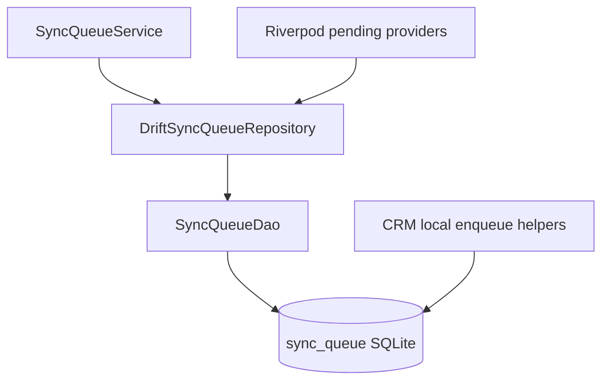

# Persistent Drift Sync Queue

## Decision: reuse, do not duplicate

CRM already writes to a shared Drift table [`SyncQueue`](apps/client/lib/core/database/tables/sync_queue_table.dart) (autoincrement `id` + `businessId` / `entityType` / `entityId` / `operation` / `payload` / `createdAt`). The offline runtime currently uses [`UnimplementedSyncQueueRepository`](apps/client/lib/core/sync/queue/sync_queue_repository.dart).

**Approach:** expand **that same table** into the generic contract-aligned queue (one table, one DAO, one repository). Do **not** add a second queue table.

Because the PK must become a UUID (today it is `INTEGER AUTOINCREMENT`), migration **v9** will:

1. `DELETE` / drop existing `sync_queue` (CRM rows were never flushed to `/sync/push`; discard is acceptable and documented).
2. Recreate `sync_queue` with the full column set.
3. Apply a **minimal compile fix** to CRM local `enqueueSyncOperation` helpers so they populate required new columns (UUIDs, `kind`, `status`, `priority`, etc.) with defaults — **not** a repository architecture migration and **not** new business enqueue APIs.

## Schema (Drift)

Update [`sync_queue_table.dart`](apps/client/lib/core/database/tables/sync_queue_table.dart):

| Column | Type | Notes |
|--------|------|-------|
| `id` | `text` PK | Row UUID |
| `mutationId` | `text` unique | Client mutation idempotency key |
| `kind` | `text` | `row` \| `command` \| `media` |
| `entityType` | `text` | Generic entity name (e.g. `parties`) |
| `entityId` | `text` nullable | Nullable for some media intents |
| `operation` | `text` | `create` \| `update` \| `delete` \| `command` \| `upload_media` |
| `payload` | `text` | JSON string |
| `businessId` | `text` | Tenant |
| `deviceId` | `text` nullable | Origin device |
| `commandId` | `text` nullable | Required when kind/operation is command |
| `status` | `text` | `pending` \| `running` \| `completed` \| `failed` \| `conflict` \| `cancelled` |
| `priority` | `int` | `0=high`, `1=normal`, `2=low` (consume ascending) |
| `attemptCount` | `int` default 0 | |
| `createdAt` | `dateTime` | |
| `scheduledAt` | `dateTime` nullable | |
| `lastAttemptAt` | `dateTime` nullable | |
| `nextRetryAt` | `dateTime` nullable | Persistence only; no retry runner |
| `lastError` | `text` nullable | |

Dart enums live under `lib/core/sync/models/` (`SyncQueueStatus`, `SyncQueueOperation`, `SyncQueueKind`, `SyncQueuePriority`) mapped to wire strings.

Bump [`database.dart`](apps/client/lib/core/database/database.dart) `schemaVersion` **8 → 9** with `onUpgrade` branch that recreates `sync_queue`.

Run `dart run build_runner build` for `database.g.dart`.

## DAO

Add [`lib/core/sync/queue/sync_queue_dao.dart`](apps/client/lib/core/sync/queue/sync_queue_dao.dart) (or `@DriftAccessor` on `AppDatabase` if preferred; keep DAO in sync module so features stay unaware):

- `insert`, `update`, `delete`
- `peek` / `nextPending` — `status=pending` and (`nextRetryAt` null or `<= now`), order by `priority ASC`, `createdAt ASC`
- `pendingCount`, `streamPendingCount`
- `markRunning`, `markCompleted`, `markFailed`, `retry` (reset to pending, bump attempt metadata only), `cancel`
- `clearCompleted` — delete `completed` / `cancelled` (optionally older than threshold later; v1 delete all completed/cancelled)
- `listPending` for providers

No Dio / SyncApi imports.

## Domain model + repository

Expand [`SyncJob`](apps/client/lib/core/sync/models/sync_job.dart) to carry queue fields (status, priority, payload map, commandId, retry metadata, kind, operation, businessId, deviceId, mutationId).

Replace interface in [`sync_queue_repository.dart`](apps/client/lib/core/sync/queue/sync_queue_repository.dart) with methods aligned to the DAO (keep enqueue/peek/count; add markRunning/cancel/clearCompleted/streamPendingCount/nextPending; map `id` ↔ row UUID).

Implement `DriftSyncQueueRepository` using `AppDatabase` from [`app_database_provider.dart`](apps/client/lib/core/database/app_database_provider.dart).

Remove / stop using `UnimplementedSyncQueueRepository` in providers.

## SyncQueueService

Expand [`sync_queue_service.dart`](apps/client/lib/core/sync/queue/sync_queue_service.dart):

- `enqueueRowMutation({ businessId, deviceId?, entityType, entityId, operation, payload, priority?, mutationId? })`
- `enqueueCommand({ businessId, deviceId?, command, commandId, entityType?, entityId?, payload, priority? })`
- `enqueueMedia({ businessId, deviceId?, entityType?, entityId?, payload, priority? })`

Service generates UUIDs when omitted, JSON-encodes `Map<String, dynamic>` payload, sets `status=pending`. Does not expose Drift types.

## Riverpod

Update [`sync_providers.dart`](apps/client/lib/core/sync/providers/sync_providers.dart):

- `syncQueueRepositoryProvider` → `DriftSyncQueueRepository(ref.watch(appDatabaseProvider))`
- keep `syncQueueServiceProvider`
- add `syncPendingCountProvider` (stream or future from DAO)
- add `syncPendingJobsProvider` (stream/list of pending `SyncJob`s)

Aliases `pendingCountProvider` / `pendingJobsProvider` / `queueRepositoryProvider` / `queueServiceProvider` as thin exports or identically named providers under `core/sync/providers/` per request (prefer `sync*` prefix to avoid global collisions; also export short aliases if needed).

## CRM compatibility (minimal)

Update only enqueue helpers in:

- [`lead_local_source.dart`](apps/client/lib/features/crm/data/sources/lead_local_source.dart)
- [`contact_local_source.dart`](apps/client/lib/features/crm/data/sources/contact_local_source.dart)
- [`deal_local_source.dart`](apps/client/lib/features/crm/data/sources/deal_local_source.dart)

to insert into the new schema (generate `id`/`mutationId`, `kind=row`, `status=pending`, `priority=normal`). Prefer routing through `SyncQueueService` later; for this milestone a direct companion insert that matches the new table is enough so CRM still compiles. **Do not** change CRM repository architecture or feature UI.

[`business_local_data_cleanup.dart`](apps/client/lib/core/services/business_local_data_cleanup.dart) continues deleting by `businessId` (column retained).

## Tests

Add unit tests with in-memory Drift executor:

- enqueue → pendingCount == 1
- nextPending respects priority (high before normal)
- markCompleted / markFailed / retry persistence
- streamPendingCount emits

## Out of scope

- SyncApi / push / pull / bootstrap
- Retry scheduler logic
- Feature repository cutover
- Entity-specific payload types

