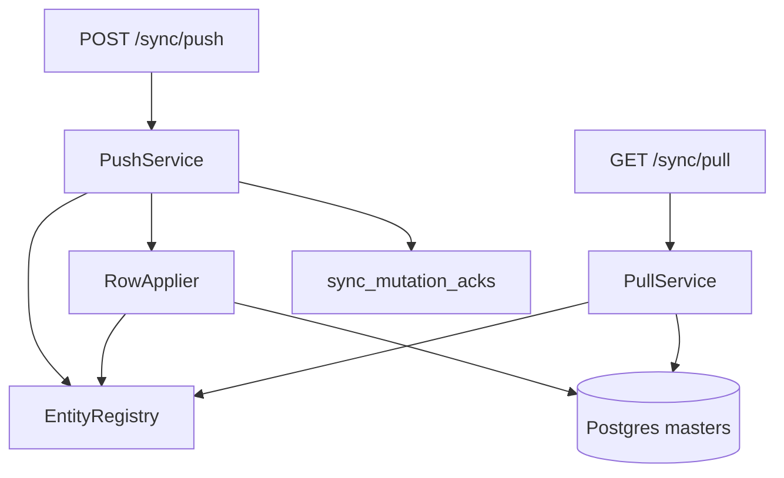

# Generic Row Synchronization (API)

## Phase 1 report — entity metadata (no silent schema edits)

All target masters already use [`syncedBusinessColumns`](apps/api/src/db/schema/columns.ts): `id`, `business_id`, `sync_version`, `updated_at`, `deleted_at`, `is_deleted`, `device_id` (nullable).

| User name | PG table | Metadata |
|-----------|----------|----------|
| Items | `items` | complete |
| Parties | `parties` | complete |
| Categories | `categories` | complete |
| Units | `unit_definitions` | complete |
| Settings | `business_settings` | complete |
| Taxes | `tax_rates` | complete |
| Warehouses | `godowns` | complete |

**Missing infra (not on entity tables):** no mutation-ack / idempotency store. **Explicit migration** (not silent): `sync_mutation_acks` for duplicate `mutation_id` → `replayed[]`. No entity-column migrations.

**Locked concurrency (contract, not LWW):** accept when `base_sync_version === row.sync_version` (create: no row / `base_sync_version === 0`); else `CONFLICT` with current row. After accept, set `sync_version = previous + 1`.

**Milestone entity set (registry):** only the seven tables above. Other Zod `entity_type` values that appear on push → `errors[]` with `NOT_IMPLEMENTED` (same as commands). Satellites (`party_phones`, `item_units`, …) and documents stay out.

## Architecture



New files under [`apps/api/src/modules/sync/`](apps/api/src/modules/sync/):

```
apply/
  entity-registry.ts      # entity_type → table, pk, serializers
  row-applier.ts          # create/update/delete + version check
  row-serializers.ts      # Drizzle row ↔ wire payload
  mutation-ack.repository.ts
entity-registry.register.ts  # registers the 7 masters
```

Update: [`push.service.ts`](apps/api/src/modules/sync/push.service.ts), [`pull.service.ts`](apps/api/src/modules/sync/pull.service.ts). Controllers stay thin.

## Entity registry

Each entry:

```ts
{
  entityType: 'parties',
  table: parties,           // Drizzle table
  primaryKey: parties.id,
  // sync columns via syncedBusinessColumns convention
  toPayload(row): Record<string, unknown>,
  fromPayload(payload, ctx): Insert/Update values, // strips sync meta; sets businessId/deviceId from auth
  allowedColumns: [...],    // whitelist — never trust arbitrary payload keys blindly
}
```

`EntityRegistry.get(type)` / `list()` / `isRegistered(type)`. Future entities call `registry.register(...)` in one place.

## Conflict algorithm

1. Load row by `(business_id, id)` (include soft-deleted for recreate/conflict).
2. **Create:** if row exists and not deleted → treat as update path or conflict if versions disagree; if exists deleted → allow revive as update semantics with version check. Prefer: create fails with CONFLICT if active row exists; identical replay via ack.
3. **Update/Delete:** if missing → `errors[]` (`NOT_FOUND` or validation). If `mutation.base_sync_version !== row.sync_version` → `conflicts[]` with `server_payload`, `server_sync_version`, `incoming_sync_version` (= base), `suggested_resolution: 'retry_with_server_version'`, `conflict_id`.
4. On accept: write row, `sync_version++`, `updated_at = now()`, set `device_id` from request device; soft-delete sets `is_deleted=true`, `deleted_at=now()` — **never** hard delete.

## Push flow

1. Auth + device gate (existing).
2. For each mutation in order:
   - If `kind === 'command'` → `errors[]`: `{ mutation_id, code: 'NOT_IMPLEMENTED', message }` — no execution.
   - If `kind === 'row'` and not registered → same `NOT_IMPLEMENTED`.
   - If `mutation_id` in `sync_mutation_acks` for business → append `replayed[]` (stored result), skip apply.
   - Else `RowApplier.apply` → `accepted[]` or `conflicts[]` / `errors[]`; on accept upsert ack.
3. Return `{ client_batch_id, server_time, accepted, replayed, conflicts, errors }` (HTTP 200 partial OK).

**Do not** call command handlers or inventory posting.

## Pull flow

1. Decode cursor (`cursor.ts`).
2. For each **registered** entity (or filter `entity_types` query if provided and registered):
   - `WHERE business_id = ? AND (updated_at, id) > (cursor.t, cursor.i)` ordered ASC, limit batch.
   - Include soft-deleted rows (`is_deleted` true) as tombstones: `payload: null` (or minimal), `is_deleted`, `deleted_at`.
3. Merge entity streams by `(updated_at, id)`, take `limit`, compute `next_cursor` from last change, `has_more`.
4. Unregistered entity_types in query → ignore or empty (no error).

## Mutation ack migration

New Drizzle table + migration (next number after `0043`):

`sync_mutation_acks`: `business_id`, `mutation_id` (unique together), `kind`, `result_json`, `created_at`.

Used only for row replay this milestone; commands still NOT_IMPLEMENTED (no command_id store yet).

## Response examples (deliverable)

**Accepted create:**
```json
{ "accepted": [{ "mutation_id": "...", "kind": "row", "entity_type": "parties", "entity_id": "...", "sync_version": 1, "server_updated_at": "..." }] }
```

**Conflict:**
```json
{ "conflicts": [{ "mutation_id": "...", "code": "CONFLICT", "entity_type": "items", "entity_id": "...", "incoming_sync_version": 2, "server_sync_version": 3, "server_payload": { }, "server_updated_at": "...", "suggested_resolution": "retry_with_server_version", "conflict_id": "..." }] }
```

**Command ignored:**
```json
{ "errors": [{ "mutation_id": "...", "code": "NOT_IMPLEMENTED", "message": "Command mutations are not implemented" }] }
```

## Tests

Add [`apps/api/tests/integration/sync-row.integration.test.ts`](apps/api/tests/integration/sync-row.integration.test.ts) using existing [`tests/helpers/app.ts`](apps/api/tests/helpers/app.ts):

- Register device → push create party/item → pull sees row
- Update with correct `base_sync_version` → accepted; wrong version → CONFLICT
- Delete → soft delete flags; pull tombstone
- Duplicate `mutation_id` → `replayed[]`, no second write
- Cursor incremental: second pull with `next_cursor` returns only newer
- Command mutation → `NOT_IMPLEMENTED`
- Unregistered row entity_type → `NOT_IMPLEMENTED`

## Out of scope

Flutter repository migration, commands, media, bootstrap fill, sales/purchases/payments/ledger/inventory posting, satellite tables, document drafts.