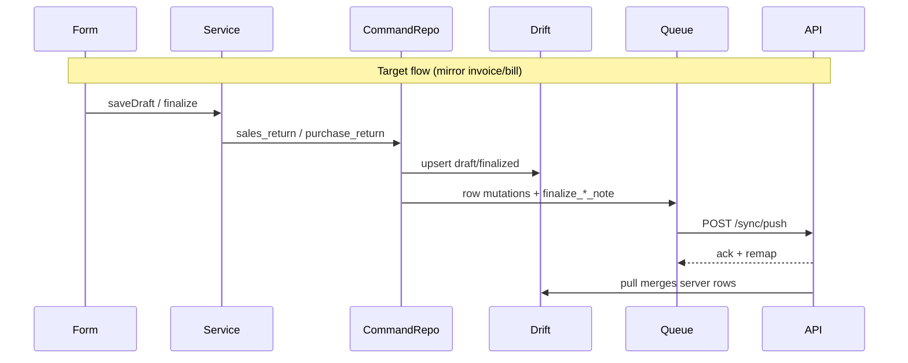
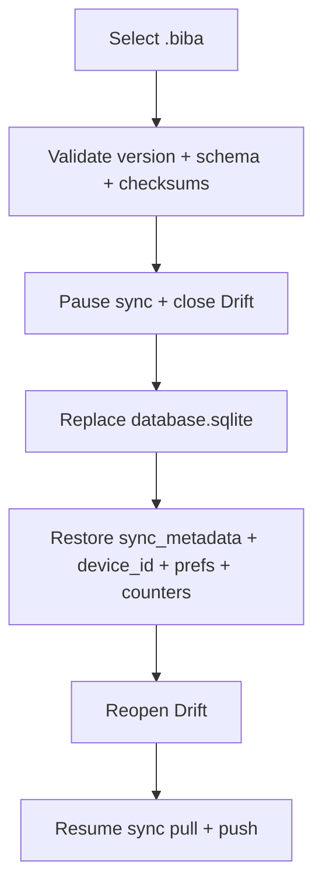

# Billing Baba MVP — Returns, Backup, Restore

## Current state

| Area | Status |
|------|--------|
| Sales Return / Purchase Return REST + finalize (stock, ledger) | Done in API domain services |
| Desktop list/form UI | Done |
| Offline sync (Drift + row mutations + finalize commands) | **Bill/invoice only** |
| Backup / restore | **Not started** (UI stub at `/settings/backup`) |

Returns today always hit REST via [`sales_service.dart`](apps/client/lib/features/sales/application/sales_service.dart) / [`purchase_service.dart`](apps/client/lib/features/purchases/application/purchase_service.dart) because command repos and sync handlers are gated to `tax_invoice` / `purchase_bill` only.



---

## 1. Sales Return — offline-first sync

### API (mirror [`finalize-sale.handler.ts`](apps/api/src/modules/sync/apply/commands/finalize-sale.handler.ts))

| File | Change |
|------|--------|
| [`finalize-credit-note.handler.ts`](apps/api/src/modules/sync/apply/commands/finalize-credit-note.handler.ts) | **New** — copy finalize-sale handler; validate `document_type === 'sales_return'`; call existing `finalizeSalesDocument()` |
| [`command-registry.ts`](apps/api/src/modules/sync/apply/commands/command-registry.ts) | Register `finalize_credit_note` |
| [`sync.types.ts`](apps/api/src/modules/sync/sync.types.ts) | Add to `SUPPORTED_SYNC_COMMANDS` |
| [`document-row-guards.ts`](apps/api/src/modules/sync/apply/document-row-guards.ts) | Extend `guardDraftDocumentRow` to accept **one or many** allowed types |
| [`row-entities.ts`](apps/api/src/modules/sync/apply/row-entities.ts) | `sales_documents` guard → `['tax_invoice', 'sales_return']` |
| [`row-applier.ts`](apps/api/src/modules/sync/apply/row-applier.ts) | `guardSalesLineParentDraft` → allow `sales_return` parent |
| [`sales-finalize-payment.service.ts`](apps/api/src/modules/sales/sales-finalize-payment.service.ts) | When parent doc is `sales_return`, record refund with `direction: 'paid'` (customer refund); keep `received` for invoices |

**Tests:** [`sales-return-sync.integration.test.ts`](apps/api/tests/integration/sales-return-sync.integration.test.ts) — mirror [`purchase-sync.integration.test.ts`](apps/api/tests/integration/purchase-sync.integration.test.ts):
- Row create header + line (`document_type: sales_return`, series `CN`)
- `finalize_credit_note` with optional refund payment
- Idempotent replay by `command_id`
- `DOCUMENT_ALREADY_FINALIZED` on second finalize / line edit after finalize
- Assert stock restore + ledger credit via existing domain behavior

### Client (mirror [`sales_invoice_command_repository.dart`](apps/client/lib/features/sales/data/sales_invoice_command_repository.dart))

| File | Change |
|------|--------|
| [`sales_return_command_repository.dart`](apps/client/lib/features/sales/data/sales_return_command_repository.dart) | **New** — `saveDraft`, `finalize` (command `finalize_credit_note`), `listSalesReturns`, `getDocument`, line delete on edit; series `CN` from [`sales_constants.dart`](apps/client/lib/features/sales/sales_constants.dart) |
| [`command_sync_providers.dart`](apps/client/lib/features/command_sync/application/command_sync_providers.dart) | Wire `salesReturnCommandRepositoryProvider`; inject into `SalesService` |
| [`sales_service.dart`](apps/client/lib/features/sales/application/sales_service.dart) | Branch `sales_return` in `saveDocumentDraft`, `finalizeDocumentDraft`, `loadSaleDocumentForm`, `fetchInvoicesPage` (local+remote merge + offline fallback), `_enrichInvoiceSyncState` |
| [`command_ack_applier.dart`](apps/client/lib/features/command_sync/application/command_ack_applier.dart) | Add `finalize_credit_note` case → `_salesLocal.applyFinalizeAck` |
| [`sales_sync_status.dart`](apps/client/lib/features/sales/data/sales_sync_status.dart) | Reuse `resolveSaleInvoiceSyncState` / `SalesSyncRecovery` for returns (filter jobs by `sales_return` doc type) |
| [`credit_note_form_provider.dart`](apps/client/lib/features/sales/application/credit_note_form_provider.dart) | Add `saveDraft()` path (like debit note); pass `payment` to finalize when `paymentAmount > 0`; wire `convertedFromId` from `originalInvoiceNo` lookup when available |
| [`sale_return_table.dart`](apps/client/lib/features/sales/presentation/desktop/widgets/sale_return_table.dart) | Show sync badges from enriched list model |

**Tests:** [`sales_return_offline_sync_test.dart`](apps/client/test/features/sales/sales_return_offline_sync_test.dart) — mirror [`purchase_offline_sync_test.dart`](apps/client/test/features/purchases/purchase_offline_sync_test.dart).

---

## 2. Purchase Return — offline-first sync (mirror sales)

### API

| File | Change |
|------|--------|
| [`finalize-debit-note.handler.ts`](apps/api/src/modules/sync/apply/commands/finalize-debit-note.handler.ts) | **New** — validate `purchase_return`; call `finalizePurchaseDocument()` |
| [`command-registry.ts`](apps/api/src/modules/sync/apply/commands/command-registry.ts) | Register `finalize_debit_note` |
| [`sync.types.ts`](apps/api/src/modules/sync/sync.types.ts) | Add command |
| [`row-entities.ts`](apps/api/src/modules/sync/apply/row-entities.ts) | `purchase_documents` guard → `['purchase_bill', 'purchase_return']` |
| [`row-applier.ts`](apps/api/src/modules/sync/apply/row-applier.ts) | `guardPurchaseLineParentDraft` → allow `purchase_return` |
| [`purchase-finalize-payment.service.ts`](apps/api/src/modules/purchases/purchase-finalize-payment.service.ts) | When parent is `purchase_return`, refund from supplier with `direction: 'received'` |

**Tests:** [`purchase-return-sync.integration.test.ts`](apps/api/tests/integration/purchase-return-sync.integration.test.ts).

### Client

| File | Change |
|------|--------|
| [`purchase_return_command_repository.dart`](apps/client/lib/features/purchases/data/purchase_return_command_repository.dart) | **New** — mirror bill repo; series `DN` |
| [`command_sync_providers.dart`](apps/client/lib/features/command_sync/application/command_sync_providers.dart) | Wire provider; inject into `PurchaseService` |
| [`purchase_service.dart`](apps/client/lib/features/purchases/application/purchase_service.dart) | Branch `purchase_return` in draft/finalize/load; **`fetchReturnsPage`** local+remote merge + sync enrichment (currently API-only at line 335) |
| [`command_ack_applier.dart`](apps/client/lib/features/command_sync/application/command_ack_applier.dart) | Add `finalize_debit_note` |
| [`purchase_sync_status.dart`](apps/client/lib/features/purchases/data/purchase_sync_status.dart) | Return-specific job filtering / recovery |
| [`debit_note_form_provider.dart`](apps/client/lib/features/purchases/application/debit_note_form_provider.dart) | Pass payment block on finalize (already has draft/finalize split) |

**Tests:** [`purchase_return_offline_sync_test.dart`](apps/client/test/features/purchases/purchase_return_offline_sync_test.dart).

---

## 3. Backup — `.biba` export

Per [`docs/10-offline-first-architecture-audit.md`](docs/10-offline-first-architecture-audit.md) §8/§12 and user spec. **Client-only** (out-of-band from sync v1 per [`docs/11-sync-api-contract.md`](docs/11-sync-api-contract.md)).

### New feature module: `apps/client/lib/features/backup/`

```
features/backup/
  models/backup_manifest.dart       # BillingBabaBackup Freezed model
  data/backup_exporter.dart         # Build .biba archive
  data/backup_importer.dart         # Validate + restore
  application/backup_service.dart   # Orchestration + Riverpod
  presentation/desktop/backup_restore_page.dart
```

### Format (ZIP container, extension `.biba`)

```
manifest.json                 # BillingBabaBackup root
database.sqlite               # Full Drift DB (schema v16)
meta/
  sync_metadata.json          # pull cursor, bootstrap timestamps, schema versions
  device.json                 # sync_device_id
  business_prefs.json         # print/tax prefs for business_id (no auth tokens)
  document_counters.json        # local_document_counters rows
```

`manifest.json` fields: `version`, `created_at`, `schema_version`, `business_id`, `app_version`, `checksums` (SHA-256 per file), `tables_included` (explicit list matching user scope).

### Export pipeline

1. Pause sync engine (avoid concurrent writes).
2. `PRAGMA wal_checkpoint(FULL)` + copy SQLite file via Drift executor path ([`database.dart`](apps/client/lib/core/database/database.dart) — `billing_baba`).
3. Serialize [`SyncMetadataStore`](apps/client/lib/core/sync/engine/sync_metadata_store.dart) + device identity + business-scoped prefs from [`storage_keys.dart`](apps/client/lib/core/constants/storage_keys.dart).
4. Export `sync_queue` (all statuses — pending **and** completed) + `local_document_counters`.
5. Zip with `archive` package (**add to** [`pubspec.yaml`](apps/client/pubspec.yaml)).
6. Save via existing [`platform_file_output.dart`](apps/client/lib/shared/utils/platform_file_output.dart).

**Exclude:** `access_token`, `refresh_token`, other accounts' data.

### UI

Replace `ComingSoonPage` on [`app_route_table.dart`](apps/client/lib/core/routing/app_route_table.dart) `/settings/backup` with export/restore screen; wire business-list backup menu snackbar.

---

## 4. Restore

### Pipeline ([`backup_importer.dart`](apps/client/lib/features/backup/data/backup_importer.dart))



**Anti-duplication rules (critical):**
- **Preserve `sync_device_id`** — same device identity server recognizes.
- **Preserve `sync_pull_cursor`** — do **not** call `clearBootstrapState()` on restore; only clear on explicit version mismatch.
- **Preserve full `sync_queue`** including `completed` jobs (push loop only processes `pending`).
- **Preserve `command_id` / `mutation_id`** — server idempotency returns `replayed[]` for already-applied commands.
- After restore: trigger `CommandAwareSyncEngine.syncNow()` (pull then push) — no forced re-bootstrap unless cursor invalid (`INVALID_CURSOR` → existing coordinator path).

### Schema migration on restore

If backup `schema_version` < current Drift `schemaVersion` (16): run normal Drift `onUpgrade` after file replace. If backup schema > app: reject with clear error.

---

## 5. Test matrix

### API integration

| Test file | Covers |
|-----------|--------|
| `sales-return-sync.integration.test.ts` | Return row push, finalize, replay, conflict |
| `purchase-return-sync.integration.test.ts` | Same for debit note |

### Client

| Test file | Covers |
|-----------|--------|
| `sales_return_offline_sync_test.dart` | Draft rows, finalize command enqueue, ack remap |
| `purchase_return_offline_sync_test.dart` | Mirror |
| `backup_export_test.dart` | Export produces valid manifest + checksums + required tables |
| `backup_restore_test.dart` | Export → wipe in-memory DB → restore → row/command counts match |
| `backup_restore_sync_test.dart` | Restore pending queue + cursor → mock push → verify idempotent replay (mirror [`row_sync_pipeline_test.dart`](apps/client/test/core/sync/row_sync_pipeline_test.dart) multi-device harness) |

### End-to-end validation scenario (manual + automated where possible)

Export → delete app data → fresh install → restore → sync → assert:
- No duplicate finalized documents on server
- `replayed[]` for restored command_ids
- Cursor advances without `INVALID_CURSOR`
- Pending row jobs drain exactly once

---

## 6. Constraints honored

- **No sync architecture redesign** — extend guards/handlers only; reuse `finalizeSalesDocument` / `finalizePurchaseDocument`.
- **No `core/sync` changes** unless restore needs a single `pauseSync()`/`resumeSync()` hook on existing engine (prefer calling public `CommandAwareSyncEngine` API from backup service).
- **No new abstractions** — separate `*ReturnCommandRepository` files mirror existing `*BillCommandRepository` / `*InvoiceCommandRepository` pattern.
- **Out of scope:** mobile return forms, POS, payments UI module, reports, cloud backup upload, media blobs.

---

## 7. Implementation order

1. API handlers + row guards + payment direction fixes + API integration tests (returns unblock client).
2. Client command repos + service wiring + form providers + client offline tests.
3. Backup export/import + settings UI.
4. Restore-then-sync test harness.
5. Document format version `1` in [`docs/09-decisions.md`](docs/09-decisions.md) (ADR entry for `.biba` v1).
