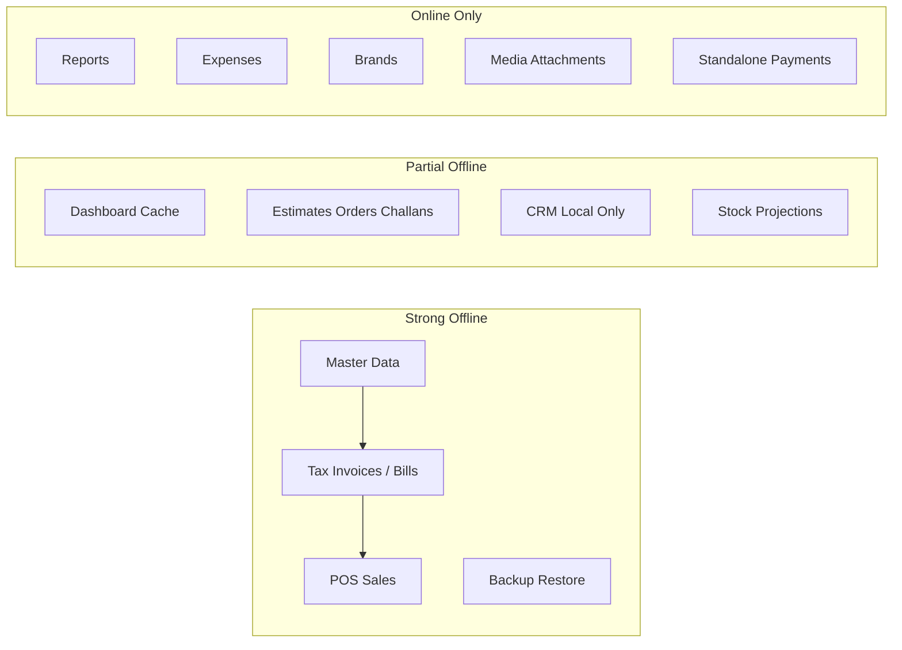
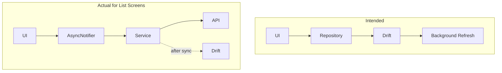

# Billing Baba — Comprehensive Offline Sync & Stability Audit

**Audit date:** 2026-07-29  
**Scope:** [`apps/client/`](apps/client/) (Flutter), [`apps/api/`](apps/api/) (sync endpoints), [`docs/`](docs/)  
**Method:** Static code analysis across 28 feature modules, sync engine, 22 Drift tables, ~113 Riverpod providers, media/cache/connectivity layers, and project-wide marker scan.

> **Note:** [`docs/10-offline-first-architecture-audit.md`](docs/10-offline-first-architecture-audit.md) (2026-07-26) is **stale**. It states the sync API is unimplemented and Drift is CRM-only. The codebase has since evolved significantly: row/command sync, 22 Drift tables, master data repositories, and `/api/v1/sync/*` endpoints are live. This audit reflects **current** code.

---

## 1. Executive Summary

Billing Baba has a **working offline-first foundation** for core POS/billing workflows, but is **not production-ready** as a fully offline application.

**What works well:**
- Master data (items, categories, units, godowns, parties) writes locally to Drift and enqueues row mutations
- Sales/purchase tax invoices, credit/debit notes, and POS sales use command-queue finalize flows with sync status badges
- Backup/restore, local document numbering, and centralized sync toolbar exist
- Business-switch provider invalidation is mature ([`business_scope_invalidation.dart`](apps/client/lib/core/providers/business_scope_invalidation.dart))
- Shared offline UX copy ([`offline_ui_messages.dart`](apps/client/lib/core/network/offline_ui_messages.dart))

**Critical risks (P0):**
1. **Global sync cursor/bootstrap** — not per-business; switching companies can miss or corrupt incremental pulls
2. **Sync queue not filtered by active business** on push — cross-company mutation leakage
3. **CRM queue jobs never pushed** — entity type mismatch (`lead` vs `leads`)
4. **No pull version guard** — stale server rows can overwrite newer local edits
5. **Media uploads have no offline queue** — `persistOfflineAttachmentMetadata()` defined but never called

**Maturity snapshot:**

---

## 2. Module-by-Module Offline Readiness Report

| Module | Status | Key Issues | Priority |
|--------|--------|------------|----------|
| **Authentication** | ⚠ Partial | Login/OTP/refresh require network; offline dev session restore works | P2 |
| **Business / Profile** | ⚠ Partial | List cache-first; create/update/branding uploads need API; direct API in [`edit_profile_page.dart`](apps/client/lib/features/business/presentation/desktop/edit_profile_page.dart) | P2 |
| **Business Switching** | ⚠ Partial | Provider invalidation good; sync cursor/queue/image cache not reset | **P0** |
| **Dashboard** | ⚠ Partial | Snapshot cache-first; live metrics need API; offline banner exists | P2 |
| **Items** | ✅ Ready | `ItemMasterRepository` → Drift + sync queue; seed catalog fallback masks empty state | P2 |
| **Categories** | ✅ Ready | Local-first via `InventoryRepository` | P3 |
| **Brands** | ❌ Online | Remote-only CRUD, no Drift table ([`inventory_repository.dart`](apps/client/lib/features/inventory/data/inventory_repository.dart)) | **P1** |
| **Units** | ✅ Ready | `UnitMasterRepository` | P3 |
| **Godowns** | ✅ Ready | `GodownMasterRepository` | P3 |
| **Taxes (settings UI)** | ⚠ Partial | `TaxRateMasterRepository` exists but unwired; UI uses `commerce_settings` API | P1 |
| **Customers / Suppliers** | ✅ Ready | `PartyMasterRepository`; ledger projected locally | P3 |
| **Sales — Tax Invoices** | ✅ Ready | `SalesInvoiceCommandRepository` + sync badges | P3 |
| **Sales — Returns** | ✅ Ready | `SalesReturnCommandRepository` | P3 |
| **Sales — Estimates/Orders/Challans** | ❌ Online | Remote-only via `SalesRepository` | P1 |
| **Sales — Payment In** | ❌ Online | Standalone payments remote-only | P1 |
| **Sales — Job Work / FA** | ❌ Online | Placeholder local data sources | P2 |
| **Purchases — Bills** | ✅ Ready | `PurchaseBillCommandRepository` | P3 |
| **Purchases — Returns** | ✅ Ready | `PurchaseReturnCommandRepository` | P3 |
| **Purchases — Orders** | ❌ Online | Remote-only | P1 |
| **Purchases — Payment Out** | ❌ Online | Remote-only | P1 |
| **Expenses** | ❌ Online | `ExpenseLocalDataSource` is empty placeholder | **P1** |
| **Inventory / Stock** | ⚠ Partial | Local stock projector; adjustments via command queue; no server stock pull | P1 |
| **Reports** | ❌ Online | `ReportsRepository` → API only; no local aggregation | P1 |
| **Settings — Print/WhatsApp/Messages** | ✅ Ready | Local storage | P4 |
| **Settings — Business Settings** | ✅ Ready | `BusinessSettingsMasterRepository` + sync | P3 |
| **Settings — Notifications** | ❌ Online | Remote dispatch only | P2 |
| **Notifications** | ❌ Online | API dispatch | P2 |
| **POS — Sales** | ✅ Ready | `PosSaleService` → command repo + local held bills | P3 |
| **POS — Returns** | ❌ Online | [`pos_return_service.dart`](apps/client/lib/features/pos/application/pos_return_service.dart) hits API directly | **P1** |
| **POS — Session** | ⚠ Partial | Online preferred; local fallback `local-pos-*` | P2 |
| **Printing** | ⚠ Partial | Local PDF render; cloud PDF cache needs API | P2 |
| **Backup / Restore** | ✅ Ready | Full Drift export/import; triggers sync post-restore | P3 |
| **CRM (Leads/Contacts/Deals)** | ⚠ Partial | Local Drift + enqueue; **no pull sync**; queue jobs stuck | **P0/P1** |
| **Media / Attachments** | ❌ Online | Direct presigned upload; no offline queue | **P0** |
| **Collaboration / Sync Share** | ⚠ Partial | API with cache fallback; `FakeCollaborationRepository` still active | P2 |
| **Search** | ✅ Ready | Static registry, no API | P4 |
| **Tasks** | ✅ Ready | `StorageService` JSON | P4 |
| **Loyalty** | ❌ Online | API + in-memory cache | P2 |
| **Subscription / Plans** | ❌ Online | Razorpay flow | P4 |
| **Hidden Ledger** | ❌ Online | Direct Dio | P2 |
| **Generated Documents** | ❌ Online | Cloud PDF storage | P2 |
| **Export (CSV/XLSX)** | ⚠ Partial | Client-side; underlying data often remote | P2 |
| **Utilities / Barcode** | ⚠ Partial | Import writes via local inventory; barcode lookup hybrid | P3 |
| **Pricing / Tiers** | ⚠ Partial | Local tier prices in storage; labels from API | P2 |
| **Item Alternatives** | ❌ Online | Remote-only | P2 |
| **Accounting** | ❌ Stub | `.gitkeep` only | P4 |
| **Documents (numbering)** | ✅ Ready | `LocalDocumentNumberService` in Drift | P3 |

**Summary counts:** ✅ 14 fully ready · ⚠ 16 partial · ❌ 18 online-only/stub

---

## 3. Sync Engine Audit

**Architecture:** `CommandAwareSyncEngine` → `SyncEngine` (triggers) → `SyncCoordinator` (register → status → bootstrap pull → push rows → pull) → `CommandSyncRunner` (finalize commands).

| Area | Status | Finding |
|------|--------|---------|
| Row push/pull | ✅ Implemented | 11 entity types aligned client ↔ API |
| Command queue | ✅ Implemented | `finalize_sale/purchase`, credit/debit notes, `stock_adjustment` |
| Replay protection | ✅ Server-side | `mutation_id` / `command_id` acks |
| Idempotency | ✅ Partial | Replay handled; no client enqueue dedup beyond `mutationId` unique |
| Ordering | ✅ Partial | Rows before commands in `syncNow()`; no per-entity ordering within batch |
| Delete handling | ✅ Implemented | Soft-delete via queue + pull `is_deleted` |
| Cursor sync | ⚠ Fragile | **Global** `sync_pull_cursor` key — not per-business |
| Bootstrap | ⚠ Partial | Client epoch-pull; API bootstrap is stub; `clearBootstrapState()` never called on switch |
| Pull version guard | ❌ Missing | Appliers always `insertOnConflictUpdate` |
| Conflict handling | ⚠ Partial | Row conflicts → `markConflict` dead-end; command `DOCUMENT_ALREADY_FINALIZED` has recovery |
| Retry/backoff | ❌ Missing | `nextRetryAt` column unused; failed jobs never auto-retry |
| Partial failures | ⚠ Fragile | Push exception marks **all** jobs failed |
| Stuck `running` jobs | ❌ Missing | Crash mid-sync orphans jobs |
| Large batches | ⚠ Capped | 50 pages × 200 = ~10k changes/sync pass |
| Transaction boundaries | ⚠ Partial | Server per-mutation; client pull apply not transactional |
| Connectivity recovery | ✅ Implemented | Startup, resume, 5-min timer, reconnect trigger |
| Cancellation | ❌ Missing | `_busy` guard only; no in-flight HTTP cancel on business switch |
| CRM entities | ❌ Broken | Enqueued but excluded from `_isRowEntity()` in [`sync_coordinator.dart:94-105`](apps/client/lib/core/sync/engine/sync_coordinator.dart) |
| Media sync | ❌ Missing | `SyncQueueKind.media` enum exists; no processor |
| Force sync | ✅ Implemented | Toolbar `syncNow()` bypasses auto-sync gate |

**Edge cases not handled:** business switch mid-sync, `has_more=true` with empty changes early-break, schema version bump with global cursor, connectivity "online" but API unreachable (no backoff), `IDEMPOTENCY_PAYLOAD_MISMATCH` permanent fail, line deletes missing `baseSyncVersion`.

---

## 4. Drift Database Audit

**Schema v17, 22 tables** in [`database.dart`](apps/client/lib/core/database/database.dart).

| Check | Status | Detail |
|-------|--------|--------|
| Repository pattern | ⚠ Partial | Master data + documents use repos; list UIs often API-first |
| Direct API from screens | ❌ 5 violations | edit profile, user profile, party image editor, clone alternatives, party ledger resolver |
| Indexes | ⚠ Partial | Only inventory stock tables indexed; no `businessId` indexes on items/parties/documents |
| Foreign keys | ⚠ Minimal | Only POS `sales_line_local.saleId`; document lines unlinked |
| Migrations | ✅ Good | v8 POS data wipe for tenant hygiene |
| Transactions | ❌ None | Zero `db.transaction()` — multi-step writes non-atomic |
| Watch streams | ⚠ Underused | CRM wired; parties/categories defined but list providers use API fetch |
| Pagination | ⚠ In-memory | Riverpod pagination; Drift loads all headers + N+1 lines |
| Company isolation | ⚠ Partial | List queries scoped; `getById`/`getDocument` omit `businessId`; `sync_queue.watchPending()` global |
| Document numbering race | ❌ Risk | `LocalDocumentNumberService` read-then-increment not atomic |

**Intended vs actual read path:**

---

## 5. Riverpod State Management Audit

| Check | Status | Detail |
|-------|--------|--------|
| Feature-scoped providers | ✅ Good | ~113 provider files, consistent layout |
| Circular dependencies | ✅ None found | Service → Repository layering clean |
| Duplicate providers | ⚠ Risk | `core/attachments` vs `shared/attachments`; duplicate `master_detail_split_layout`, mobile transaction providers |
| autoDispose | ❌ Rare | ~90+ `keepAlive: true`; only 2 autoDispose usages |
| Business invalidation | ✅ Good | 30+ providers in `invalidateAllBusinessScopedProviders()` |
| Mutation refresh | ✅ Good | `data_refresh.dart` with inventory race mitigation |
| Connectivity state | ✅ Wired | `connectivityMonitorProvider`, `syncStateProvider` |
| Sync UI state | ✅ Wired | `syncUiStateProvider`, toolbar controls |
| Auth/business chain | ✅ Good | `_businessSelectionChain` serializes selection |
| Race conditions | ⚠ Present | CRM stream + AsyncNotifier; refresh → `AsyncLoading()` flash (40+ providers); POS sales list not watched |
| Stale AsyncValues | ⚠ Risk | Heavy keepAlive without invalidation on some paths |
| Missing offline state | ⚠ Partial | Error mappers exist per feature; not all screens show offline-specific empty states |

**Sync/image providers NOT invalidated on business switch:** `imageServiceProvider`, `partyOptimisticProfileImagesProvider`, `mediaVariantUrlProvider`, sync metadata providers.

---

## 6. Connectivity Audit

| Check | Status | Detail |
|-------|--------|--------|
| Online/offline detection | ⚠ Interface-only | `connectivity_plus` — Wi-Fi without internet = "online" |
| Reconnect trigger | ✅ Implemented | `SyncScheduler` fires `connectivityRestored` |
| Background reconnect | ✅ Implemented | 5-min periodic + app resume |
| Manual sync | ✅ Implemented | Toolbar bypasses auto-sync gate |
| Automatic sync | ✅ Gated | `enableAutoSync` flag |
| Duplicate sync | ✅ Guarded | `_busy` in coordinator |
| Infinite retries | ✅ N/A | **No retries at all** — failed jobs stuck |
| Backoff strategy | ❌ Missing | Documented in `docs/11-sync-api-contract.md` §14, not implemented |
| Debounce on reconnect | ❌ Missing | Rapid flapping hammers API |

---

## 7. Cache Audit

| Cache | Scoped | Eviction | Business Switch Reset |
|-------|--------|----------|----------------------|
| Drift (primary) | Per `businessId` column | N/A | Rows persist (intentional multi-business DB) |
| Dashboard snapshots | Per `businessId\|period` | Overwrite on fetch | Partial |
| Business list/profile | Preferences | TTL via refresh | Cleared on switch |
| Party cache | Per business key | Manual | Cleared |
| Image disk (`billing_baba_images`) | **Global** | 30-day / 3500 objects LRU | **Not cleared** |
| Image memory | Global | OS pressure | Partial via `image_memory_handler` |
| Signed URL (`mediaVariantUrlProvider`) | Per provider | Invalidate on replace | **Not invalidated** |
| Optimistic images | Widget/provider state | Ephemeral | **Not invalidated** |
| Collaboration cache | Per business | On Dio error fallback | Partial |
| Generated PDFs | Server-side | Server TTL | N/A |
| Search | Static registry | N/A | N/A |
| Reports | None | N/A | N/A |

---

## 8. Media Queue Audit

| Asset Type | Offline Queue | Retry | Resume | Progress |
|------------|--------------|-------|--------|----------|
| Transaction attachments | ❌ | ❌ | ❌ (metadata store unused) | ❌ |
| Item gallery / rack photos | ❌ | ❌ | ❌ | ❌ |
| Business branding | ❌ | ❌ | ❌ | Optimistic UI only |
| Party profile images | ❌ | ❌ | ❌ | Optimistic provider |
| Purchase PDF parse | ❌ Online-only | — | — | — |
| Generated PDFs (print) | Server cache | — | — | — |

**Upload flow:** `MediaUploadClient` — intent → presigned PUT → complete. 60s timeout. No chunking, dedup, or background queue. `SyncQueueKind.media` unused.

---

## 9. Business Isolation Audit

| Check | Status | Detail |
|-------|--------|--------|
| DB isolation | ⚠ Column-scoped | Single SQLite, `businessId` on tables; not separate DBs |
| Repository isolation | ⚠ Partial | Queries filter by active business; single-row lookups omit filter |
| Cache reset | ⚠ Partial | Profile/party caches cleared; image disk/global sync cursor not |
| Queue reset | ❌ Gap | Queue not filtered on push; not paused during switch |
| Provider invalidation | ✅ Good | Central hub + warm-up pattern |
| Pending uploads | ❌ Risk | In-flight uploads not cancelled; may write to wrong JWT scope |
| Pending commands | ⚠ Risk | Survive switch; may push under wrong business |
| Cross-company leakage vectors | **P0** | Global sync cursor, unfiltered queue push, global image cache, optimistic image provider |

**Delete business path is correct:** [`business_local_data_cleanup.dart`](apps/client/lib/features/business/data/business_local_data_cleanup.dart) purges Drift rows + sync queue for that `businessId`.

---

## 10. Bug Report (Unfinished Implementation Markers)

| Category | Count | Notable Items |
|----------|-------|---------------|
| `TODO` in source | 13 files | Mobile mocks, party payment sheets, POS short payment, party reminders API |
| `FIXME` / `HACK` | 0 | — |
| `print()` / `debugPrint()` | ~50 files | **HIGH:** `out_of_stock_dialog.dart`, `item_alternatives_remote_data_source.dart` use raw `print()`; auth interceptor logs bodies |
| `mock` / `fake` | ~15 files | **HIGH:** `FakeCollaborationRepository` active; mobile transaction/party mock data; CRM deal mock data |
| `placeholder` local sources | 3 | `expense_local_data_source.dart`, `purchase_fa_local_data_source.dart`, `sale_fa_local_data_source.dart` |
| `deprecated` | ~5 source | Report row widgets, expense model, invoice PDF theme |
| Duplicate dead code | 2 trees | `core/attachments/` mirrors `shared/attachments/` (only shared imported) |
| Unused functions | 1 | `persistOfflineAttachmentMetadata()` — defined, never called |
| Unwired repositories | 1 | `TaxRateMasterRepository` — full impl, no provider/UI |

---

## 11. Technical Debt Report

1. **Stale architecture doc** — `docs/10-offline-first-architecture-audit.md` contradicts current implementation
2. **Dual code trees** — `core/` vs `shared/` duplicates (attachments, mobile widgets, master-detail layout)
3. **API-first list providers** despite Drift data existing (sales invoices, purchase bills, parties)
4. **InventoryCatalog seed data** — hardcoded fallback masks true offline empty state
5. **Fake collaboration layer** — production UI may use fake repo depending on provider wiring
6. **No Drift transactions** — document save, POS save, stock movement all multi-await
7. **Global sync metadata** — architectural debt blocking multi-business correctness
8. **Retry infrastructure scaffolded but unused** — `nextRetryAt`, `retry()`, `clearCompleted()`
9. **Mobile surfaces largely mock** — separate from desktop offline maturity
10. **Report module 100% online** — largest UX gap for offline users

---

## 12. Production Readiness Score

| Dimension | Weight | Score | Rationale |
|-----------|--------|-------|-----------|
| Master data offline | 20% | 85% | Items, parties, categories, units, godowns solid |
| Transactional documents | 25% | 72% | Invoices/bills/returns/POS sales work; many doc types online-only |
| Sync engine correctness | 20% | 55% | Works for happy path; P0 multi-business + CRM + version guard gaps |
| Media / attachments | 10% | 15% | No offline queue |
| Business isolation | 10% | 45% | Critical cursor/queue/cache gaps |
| UX / error handling | 10% | 62% | Good shared messages; inconsistent per-screen; reports/expenses break offline |
| State management | 5% | 68% | Mature invalidation; API-first lists, keepAlive dominance |

### **Overall Production Readiness: 58%**

Interpretation: **Safe for offline POS + core invoicing on a single business/device** after P0 sync fixes. **Not safe** for multi-business/multi-device production without addressing cursor isolation, queue filtering, and pull version guards.

---

## 13. Prioritized Stabilization Plan

### P0 — Critical (blocks production)

| # | Issue | Root Cause | Files | Risk | Effort | Fix |
|---|-------|------------|-------|------|--------|-----|
| 1 | Global sync cursor | Single `sync_pull_cursor` preference key | [`sync_metadata_store.dart`](apps/client/lib/core/sync/engine/sync_metadata_store.dart), [`storage_keys.dart`](apps/client/lib/core/constants/storage_keys.dart) | Wrong/missed data after business switch | 1-2d | Per-business cursor + bootstrap keys; reset on `openBusiness()` |
| 2 | Cross-business queue push | `listPending()` unfiltered | [`sync_coordinator.dart`](apps/client/lib/core/sync/engine/sync_coordinator.dart), [`sync_queue.dart`](apps/client/lib/core/sync/queue/sync_queue.dart) | Data corruption / wrong-tenant writes | 1d | Filter by active `businessId`; pause sync during switch |
| 3 | CRM jobs stuck | `_isRowEntity()` excludes CRM; API expects `leads/contacts/deals` | [`sync_coordinator.dart`](apps/client/lib/core/sync/engine/sync_coordinator.dart), CRM repos, API `row-entities.ts` | CRM writes never sync | 2-3d | Align entity types end-to-end OR stop enqueueing until API ready |
| 4 | Media offline data loss | `persistOfflineAttachmentMetadata` never called | [`transaction_attachment_actions.dart`](apps/client/lib/shared/attachments/transaction_attachment_actions.dart) | Attachment loss on kill-before-save | 2-3d | Wire metadata + byte persistence + resume on save/reconnect |
| 5 | Pull overwrites local | No version check in appliers | `features/*/data/*_sync.dart` | Silent data loss on conflict | 2d | Skip apply when `incoming.syncVersion <= existing` |

### P1 — Offline correctness

| # | Issue | Files | Effort | Fix |
|---|-------|-------|--------|-----|
| 6 | POS returns online-only | `pos_return_service.dart` | 2d | Route through command repo like POS sales |
| 7 | Brands online-only | `inventory_repository.dart` | 3d | Drift table + master repo + sync entity |
| 8 | Expenses placeholder | `expense_local_data_source.dart`, `expense_repository.dart` | 3-5d | Implement local source + queue or defer feature |
| 9 | Reports online-only | `reports_service.dart` | 5-8d | Local aggregation from Drift docs/stock (phased) |
| 10 | Standalone payments online | `sales_service.dart`, `purchase_service.dart` | 3d | `record_payment`/`record_receipt` commands (API + client) |
| 11 | Stuck `running` jobs | `sync_queue.dart`, `sync_engine.dart` | 0.5d | Reset `running` → `pending` on engine start |
| 12 | Failed job retry | `sync_coordinator.dart` | 2d | Implement backoff per `docs/11-sync-api-contract.md` §14 |
| 13 | Push batch failure over-marking | `sync_coordinator.dart` | 1d | Per-job failure; don't mark accepted as failed |
| 14 | Business switch cache leaks | `business_scope_invalidation.dart` | 1d | Invalidate image/sync/optimistic providers; optional image cache clear |
| 15 | Taxes UI bypasses local repo | `taxes_settings_screen.dart`, `tax_rate_master_repository.dart` | 1-2d | Wire existing master repo to UI |
| 16 | Presentation API bypasses | 5 files listed in §4 | 1d | Move to services/repos |

### P2 — Performance

| # | Issue | Effort | Fix |
|---|-------|--------|-----|
| 17 | Missing `businessId` indexes | 1d | Add indexes on high-volume tables |
| 18 | Document list N+1 queries | 2d | Batch line loads or SQL joins |
| 19 | Drift watch not wired to list UIs | 3-5d | Convert sale/purchase/party lists to Drift streams |
| 20 | No Drift transactions | 2-3d | Wrap document save, POS save, stock movement |
| 21 | Document number race | 1d | Atomic counter increment in transaction |
| 22 | Connectivity flapping | 0.5d | Debounce reconnect sync |
| 23 | 50-page pull cap visibility | 0.5d | Log/truncate warning; continue on next sync |

### P3 — UX improvements

| # | Issue | Effort | Fix |
|---|-------|--------|-----|
| 24 | Reports/expenses show generic errors offline | 1d | Use `OfflineUiMessages` + cached-last-view |
| 25 | Master data sync indicators missing | 2d | Extend badge pattern from sales/purchase tables |
| 26 | `AsyncLoading()` flash on refresh | 2d | Keep previous data during refresh (AsyncValue pattern) |
| 27 | Dashboard offline empty state | 1d | Show cached snapshot with staleness indicator |
| 28 | Row conflict resolution UI | 3-5d | Surface `markConflict` jobs; retry/rebase actions |
| 29 | Force re-bootstrap action | 1d | Dev/diagnostics "Reset sync" button |

### P4 — Code quality

| # | Issue | Effort | Fix |
|---|-------|--------|-----|
| 30 | Stale `docs/10-offline-first-architecture-audit.md` | 0.5d | Update or supersede with this audit |
| 31 | Remove `core/attachments/` duplicate tree | 0.5d | Delete dead tree |
| 32 | Remove production `print()` calls | 0.5d | Replace with logging service |
| 33 | Replace `FakeCollaborationRepository` | 2d | Wire real repo or gate behind dev flag |
| 34 | Remove `InventoryCatalog` seed fallback | 0.5d | Show proper empty state |
| 35 | Mobile mock data cleanup | 3d | Wire or hide mobile surfaces |

**Recommended stabilization sequence:** P0 items 1-2 first (same PR), then 5, then 3-4 in parallel tracks. Do not start new features until P0 + P1 items 6-12 are complete.

---

## 14. Desktop UI/UX Improvement Roadmap (Post-Stabilization)

**Do not implement until offline P0/P1 complete.** Observations from 483 desktop presentation files:

### Navigation & Layout
- Master-detail split used in parties, inventory, CRM — **inconsistent** adoption across sales/purchase lists (full-page tables dominate)
- Duplicate layouts: [`core/widgets/master_detail_split_layout.dart`](apps/client/lib/core/widgets/master_detail_split_layout.dart) vs [`shared/widgets/master_detail_split_layout.dart`](apps/client/lib/shared/widgets/master_detail_split_layout.dart)
- Many **placeholder pages** still routed ([`sale_placeholder_page.dart`](apps/client/lib/features/sales/presentation/desktop/sale_placeholder_page.dart), [`purchase_placeholder_page.dart`](apps/client/lib/features/purchases/presentation/desktop/purchase_placeholder_page.dart))
- Sidebar/toolbar sync controls exist ([`sync_toolbar_controls.dart`](apps/client/lib/features/dashboard/presentation/desktop/widgets/sync_toolbar_controls.dart)) but not universal across modules

### Information Density & Tables
- Sales/purchase tables are mature ([`sale_invoice_table.dart`](apps/client/lib/features/sales/presentation/desktop/widgets/sale_invoice_table.dart) with sync badges)
- Report tables use deferred loading ([`report_deferred_module_content.dart`](apps/client/lib/features/reports/presentation/desktop/widgets/shared/report_deferred_module_content.dart))
- Inventory hover tooltips rich but heavy ([`inventory_item_hover_tooltip.dart`](apps/client/lib/features/inventory/presentation/desktop/widgets/inventory_item_hover_tooltip.dart) — 11 placeholder refs)
- Filter bars inconsistent between sales, purchases, reports

### Forms & Dialogs
- Shared form components in [`shared/widgets/forms/`](apps/client/lib/shared/widgets/forms/) — good foundation
- Add-item, add-party, add-lead dialogs follow similar patterns but spacing/validation feedback varies
- Transaction form busy overlay exists for purchases — not universal

### Keyboard & Desktop Affordances
- [`keyboard_shortcut_badge.dart`](apps/client/lib/shared/widgets/keyboard_shortcut_badge.dart) exists; shortcuts wired in search ([`search_controller.dart`](apps/client/lib/features/search/application/search_controller.dart)), POS payment, task editor — **sparse elsewhere**
- No global shortcut registry documented
- Context menus: action menu buttons per table row; no consistent right-click pattern
- Drag & drop: not implemented for reordering (deals kanban excepted)

### Responsive & Window Behavior
- Desktop-first with mobile compatibility per project rules
- Window resize: tables use horizontal scroll; no column resize persistence
- Split pane widths not persisted

### Sync & Offline UX (Desktop)
- **Good:** Dashboard offline banner, party offline banners, sync toolbar, `OfflineUiMessages`
- **Gap:** No global offline banner; sync status not in status bar
- **Gap:** Reports show unavailable content — needs offline-specific design
- **Gap:** Loading skeletons exist for dashboard/collaboration; inconsistent elsewhere

### Recommended Desktop UX Phases (after stabilization)
1. **Consistency pass** — unify split layouts, table chrome, filter bars, empty/error states
2. **Global status bar** — connectivity, sync state, pending queue count, business name
3. **Keyboard shortcut map** — POS, search, new invoice, save, sync now
4. **Table upgrades** — column resize/reorder persistence, bulk actions, context menus
5. **Form density** — desktop-optimized multi-column forms vs mobile single-column
6. **Offline-first empty states** — per-module "working locally" vs "needs initial sync" variants

---

## Key Reference Files

| Area | Path |
|------|------|
| Sync coordinator | [`apps/client/lib/core/sync/engine/sync_coordinator.dart`](apps/client/lib/core/sync/engine/sync_coordinator.dart) |
| Sync queue | [`apps/client/lib/core/sync/queue/sync_queue.dart`](apps/client/lib/core/sync/queue/sync_queue.dart) |
| Command sync | [`apps/client/lib/features/command_sync/application/command_aware_sync_engine.dart`](apps/client/lib/features/command_sync/application/command_aware_sync_engine.dart) |
| Business invalidation | [`apps/client/lib/core/providers/business_scope_invalidation.dart`](apps/client/lib/core/providers/business_scope_invalidation.dart) |
| Drift schema | [`apps/client/lib/core/database/database.dart`](apps/client/lib/core/database/database.dart) |
| Offline messages | [`apps/client/lib/core/network/offline_ui_messages.dart`](apps/client/lib/core/network/offline_ui_messages.dart) |
| API push/pull | [`apps/api/src/modules/sync/push.service.ts`](apps/api/src/modules/sync/push.service.ts), [`pull.service.ts`](apps/api/src/modules/sync/pull.service.ts) |
| Sync contract | [`docs/11-sync-api-contract.md`](docs/11-sync-api-contract.md) |

---

## Next Step

Confirm this audit, then begin stabilization with **P0 items 1-2** (per-business sync cursor + queue filtering) as the first implementation PR. No feature work or architectural rewrites until P0/P1 offline correctness gaps are closed.
