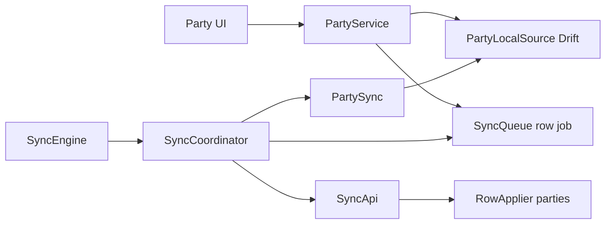

# Parties Offline-First Sync (Categories Template)

## Scope decision

**Party master row only** (`entity_type: 'parties'`). Mirror Categories (one Drift table, one sync applier).

Out of Phase 1 sync:
- `party_phones` / `additional_phones`
- UI-only `PartyLocalExtension` fields (addresses, gst_type, etc.) — keep in existing prefs cache if still needed for UI
- No new sync abstractions; no Party-specific endpoints

Server `parties` already has sync columns via `syncedBusinessColumns`. Client has **no** `parties_local` table and is still remote-first + prefs pending ops.



---

## 1. Client Drift: `parties_local`

Add [`apps/client/lib/core/database/tables/parties_table.dart`](apps/client/lib/core/database/tables/parties_table.dart) mirroring Categories shape + party domain columns that exist on PG `parties`:

- Sync meta: `id`, `businessId`, `syncVersion`, `isDeleted`, `createdAt`, `updatedAt`, `deletedAt`, `deviceId`
- Domain: `name`, `legalName`, `alias`, `mobile`, `email`, `partyGroup`, `areaCode`, `partyType`, `partyCategory`, `pricingTier`, `gstin`, `stateCode`, `areaId`, `creditLimit`, `openingBalance`, `hiddenLedgerBalance`, `profileImageUrl`, `profileMediaAssetId`, `connectedSince`, `notes`, `isActive`

Register in [`database.dart`](apps/client/lib/core/database/database.dart): bump `schemaVersion` **10 → 11**, `createTable(partiesLocal)` on upgrade. Run Drift codegen.

Do **not** store computed `balance` / derived `state` / `additional_phones` on the Drift row.

---

## 2. Local source + repository (local-first writes)

Copy Categories responsibilities:

| New file | Mirror of |
|----------|-----------|
| [`features/parties/data/party_local_source.dart`](apps/client/lib/features/parties/data/party_local_source.dart) | [`category_local_source.dart`](apps/client/lib/features/inventory/data/category_local_source.dart) — Drift CRUD only, **no enqueue** |
| Extend / introduce party write path on repository layer used by service | [`inventory_repository.dart`](apps/client/lib/features/inventory/data/inventory_repository.dart) category create/update/delete |

Mutation pattern (exact Categories order):

1. Write Drift (`syncVersion: 0` on create; keep current version on update)
2. `SyncQueue.enqueueRowMutation(entityType: 'parties', operation: create|update|delete, payload: domain map, baseSyncVersion: …)`
3. Return model to UI immediately — **never** call remote on the write path

Wire [`PartyService`](apps/client/lib/features/parties/application/party_service.dart) create/update/delete/setActive to this path. Remove the prefs pending-op / REST replay path for master CRUD (`_syncPendingOperations` create/update/delete for parties). Reads (list/get) come from Drift (`watch`/`list` active), with an optional Categories-style `_hydratePartiesIfEmpty` REST fallback until bootstrap has run.

Keep `PartyRepository` (Dio) for ledger/profile/non-master APIs that stay online-only.

---

## 3. `party_sync.dart`

New [`features/parties/data/party_sync.dart`](apps/client/lib/features/parties/data/party_sync.dart) — copy [`category_sync.dart`](apps/client/lib/features/inventory/data/category_sync.dart):

- `applyChange(...)` — upsert from pull payload or soft-delete; **never enqueue**
- `updateAckMeta(...)` — bump `syncVersion` / `updatedAt` / `deviceId` after push accept/replay

---

## 4. SyncCoordinator — minimal wire only (engine frozen)

Touch only what Categories already forces for a second entity. No architecture change.

In [`sync_coordinator.dart`](apps/client/lib/core/sync/engine/sync_coordinator.dart) + [`sync_providers.dart`](apps/client/lib/core/sync/providers/sync_providers.dart):

1. Inject `PartySync?` (same as `CategorySync`)
2. Expand push filter from categories-only to pending row jobs where `entityType` is `categories` **or** `parties` (reuse existing `_pushCategoryJobs` body — it already builds generic row mutations; rename to `_pushRowJobs` only if needed for clarity)
3. Pull: `entityTypes: 'categories,parties'` so bootstrap/incremental downloads both
4. Extend switches:

```dart
switch (entityType) {
  case 'categories': ...
  case 'parties':
    await _partySync?.applyChange(...); // or updateAckMeta
  default:
    break;
}
```

Do not add registries, adapters, or new folders under `core/sync`.

---

## 5. Server: register `parties` in RowApplier map

In [`row-entities.ts`](apps/api/src/modules/sync/apply/row-entities.ts):

```ts
parties: defineEntity({
  entityType: 'parties',
  table: parties,
  allowedColumns: [
    'name', 'legalName', 'alias', 'mobile', 'email', 'partyGroup', 'areaCode',
    'partyType', 'partyCategory', 'pricingTier', 'gstin', 'stateCode', 'areaId',
    'creditLimit', 'openingBalance', 'hiddenLedgerBalance', 'profileImageUrl',
    'profileMediaAssetId', 'connectedSince', 'notes', 'isActive',
  ],
}),
```

Also update [`sync.types.ts`](apps/api/src/modules/sync/sync.types.ts) `SUPPORTED_ROW_ENTITY_TYPES` to `['categories', 'parties']` (Zod/status catalogs).

Reuse existing `RowApplier` (version gate → CONFLICT). No Party sync routes.

---

## 6. Conflicts / bootstrap

Unchanged engine behavior:
- CONFLICT → `markConflict` on job; keep local Drift row; do not apply `server_payload`
- Bootstrap = existing pull-from-epoch; with `entityTypes: 'categories,parties'`, parties download automatically

---

## 7. Tests

Mirror Categories:

| Test | Assert |
|------|--------|
| New `party_offline_sync_test.dart` (copy [`category_offline_sync_test.dart`](apps/client/test/core/sync/category_offline_sync_test.dart)) | Offline create/update/delete → Drift + queue; push accepted → ack `syncVersion`; replayed; CONFLICT keeps local; pull upsert/soft-delete; cursor advance |
| Update [`sync_coordinator_test.dart`](apps/client/test/core/sync/sync_coordinator_test.dart) | Push includes parties; pull requests `categories,parties` |
| Extend [`sync-row.integration.test.ts`](apps/api/tests/integration/sync-row.integration.test.ts) | Push/pull/conflict/replay for `parties` (same assertions as categories) |

---

## Explicit non-goals

- No `core/sync` redesign or folder moves
- No OfflineRepository / entity registry / adapter framework
- No `party_phones` sync entity
- No conflict merge UI
- No Party-specific `/sync/*` endpoints

---

## Implementation order

1. Drift table + migration + codegen
2. `PartyLocalSource` + local-first repository writes + `PartyService` cutover
3. `party_sync.dart`
4. Coordinator/providers minimal wire
5. API `ROW_ENTITIES` + Zod types
6. Client + API tests
