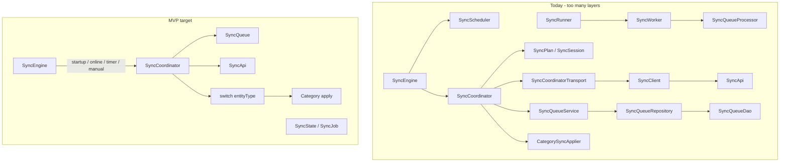
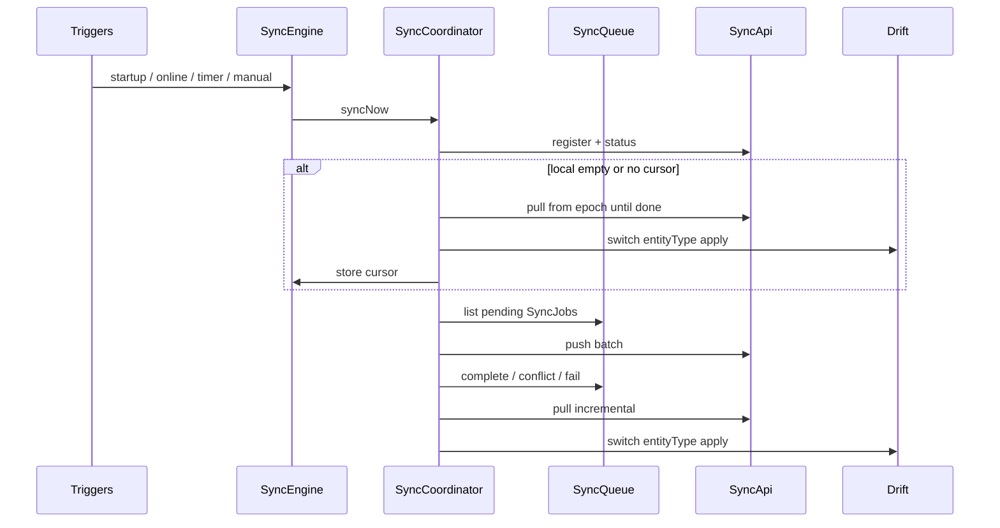

# Simplify Offline Sync for Billing Baba MVP

## Verdict

The client sync module is **framework-shaped for a problem we do not have**. Real work today is: categories push/pull via [`SyncCoordinator`](apps/client/lib/core/sync/engine/sync_coordinator.dart) (~770 lines) + Drift queue + Dio. Around that sit placeholders (`SyncRunner`/`SyncWorker`/`SyncQueueProcessor`), plan/session theater, and 3–4 wrappers per concern.

**Good news:** `OfflineRepository`, `OfflineMapper`, `OfflineEntityConfig`, `SyncEntityAdapter` **do not exist** — do not build them. Duplicate folders from earlier refactors (`apply/`, `coordinator/`, `transport/`, …) are already gone.

**Server side is closer to MVP:** devices/status/cursor/acks + version-gated `RowApplier` are solid. Premature parts: **7 masters registered** while client only syncs `categories`, Zod/status advertising the full catalog, and chunked bootstrap sessions that return empty rows.

Audits that informed this plan: [client sync audit](04a76373-a8f0-436a-aba5-1130dbf5640e), [API sync audit](a821c1a8-5bbd-486b-a55f-4a07bb4dff87).



---

## Classification — Client (`apps/client/lib/core/sync/`)

### 1. Required for Billing Baba MVP

| Type | File | Why |
|------|------|-----|
| **SyncEngine** | [`engine/sync_engine.dart`](apps/client/lib/core/sync/engine/sync_engine.dart) | Lifecycle + triggers → `syncNow`. Keep; currently **defers** auto-sync — must actually run on the 4 triggers. |
| **SyncCoordinator** | [`engine/sync_coordinator.dart`](apps/client/lib/core/sync/engine/sync_coordinator.dart) | Real workflow: register → status → bootstrap gate → push → pull. Keep as the only orchestrator. |
| **SyncQueue** | table + enqueue/dequeue | One Drift queue; every mutation = one **SyncJob**. |
| **SyncApi** | [`network/sync_api.dart`](apps/client/lib/core/sync/network/sync_api.dart) | HTTP to `/sync/*`. Keep one network class. |
| **SyncState** | [`models/sync_state.dart`](apps/client/lib/core/sync/models/sync_state.dart) | UI/debug status. Slim (drop `orchestrationPhase`). |
| **SyncJob** | [`models/sync_job.dart`](apps/client/lib/core/sync/models/sync_job.dart) | Queue unit. Keep enums `row` / `command` (drop `media` until needed). |
| **Device Identity** | [`engine/device_identity.dart`](apps/client/lib/core/sync/engine/device_identity.dart) | Stable `device_id` for headers. |
| **Sync Metadata** | [`engine/sync_metadata_store.dart`](apps/client/lib/core/sync/engine/sync_metadata_store.dart) | Cursor + bootstrappedAt + schema version in SharedPreferences. |
| **ConnectivityMonitor** | [`engine/connectivity_monitor.dart`](apps/client/lib/core/sync/engine/connectivity_monitor.dart) | Needed for “connectivity restored”. |
| **SyncScheduler** | [`engine/sync_scheduler.dart`](apps/client/lib/core/sync/engine/sync_scheduler.dart) | Exactly the 4 triggers you want — keep, but wire to real `syncNow`. |
| **Category apply logic** | today [`offline/category_sync_applier.dart`](apps/client/lib/core/sync/offline/category_sync_applier.dart) | Needed to write pull/ack into Drift. Keep as a **concrete helper**, not an “adapter framework”. |
| **Cursor helper** | [`engine/sync_cursor.dart`](apps/client/lib/core/sync/engine/sync_cursor.dart) | Small; keep. |
| **Providers** | [`providers/sync_providers.dart`](apps/client/lib/core/sync/providers/sync_providers.dart) | Riverpod wiring. Slim aliases. |
| **SyncResult / enums / payload meta** | `models/` | Keep lightweight models. (`SyncError` is unused — delete.) |

### 2. Can be merged

| Types | Merge into | Why |
|-------|------------|-----|
| `SyncApi` + `SyncClient` + `SyncHeaderProvider` + `SyncCoordinatorTransport` + `SyncClientCoordinatorTransport` | **one `SyncApi`** (headers inside) | Five types for “add headers and POST”. Coordinator should call `SyncApi` directly. |
| `SyncQueueRepository` (abstract) + `DriftSyncQueueRepository` + `SyncQueueDao` + `SyncQueueService` | **`SyncQueue`** (one class; Dao optional private) | One SQLite table — no port/adapter/plugin. Also migrate CRM local sources that insert Drift `sync_queue` rows directly. |
| `SyncStatusController` | methods on **SyncEngine** + `syncStateProvider` | Pure pass-through façade. |
| `BootstrapDecision` | private `bool _needsBootstrap(...)` in coordinator | 55-line class for 4 ifs. |
| `initializeSyncRuntime` (`sync_bootstrap.dart`) | `SyncEngine.start()` from `main` | One-liner helper file. |
| `SyncJobPayloadMeta` | static helpers on `SyncJob` or top-level functions in `sync_job.dart` | Tiny; no separate file needed. |
| `CategorySyncApplier` + parts of `CategoryLocalSource` | keep **one** write path: local source owns CRUD+enqueue; sync apply is either methods on local source or a small `category_sync.dart` next to it | Avoid “applier” vocabulary implying a registry. Coordinator: `switch (entityType) { case 'categories': ... }` |
| Provider aliases (`queueServiceProvider`, etc.) | delete | Noise. |

### 3. Can be deleted (now)

| Type | Why |
|------|-----|
| **SyncRunner** | Pass-through to Worker; unused by Engine. |
| **SyncWorker** | Explicit noop placeholder. |
| **SyncQueueProcessor** | Explicit noop; queue drain lives in Coordinator. |
| **SyncPlan** + **SyncPlanStep** | Built then ignored (`forceSteady: true`). Planning theater. |
| **SyncSession** + session/plan streams | Metrics can live on `SyncResult` / log lines. |
| **SyncOrchestrationPhase** | Duplicates `SyncLifecycleState`. UI does not need 14 micro-phases. |
| **currentSyncSessionProvider / currentSyncPlanProvider** | Die with Plan/Session. |
| **`offline/` folder name** | Move category helper; “offline framework” folder implies more types coming. |
| **`enqueueMedia` / `SyncQueueKind.media`** (client usage) | Not shipping media sync in MVP weeks. Keep DB column if already migrated; stop API surface. |
| **`SyncError`** | Defined, zero call sites. |
| Unused `sync.dart` barrel consumers | Barrel can stay thin for public API, or delete if everything deep-imports. |

### 4. Postpone until v2

| Idea | Why postpone |
|------|--------------|
| Client entity registry / adapters / mappers / OfflineRepository | Only pays off at dozens of entities. Use `switch`. |
| Chunked bootstrap client + bootstrap session state machine | Contract docs describe 12 chunks; API returns **empty** placeholder. Use “empty DB → pull from epoch until `has_more=false`” (or one simple bootstrap page). |
| Background isolates / WorkManager / OS background sync | Foreground triggers only. |
| Conflict resolution UI framework | Mark `conflict` on job, keep local row, show later. |
| Media sync pipeline | Separate later. |
| Command sync handlers (sales/purchases/POS) | Design stays (kind=`command`); implement after row masters work. |
| Generic “SyncEntityConfig” on client | Speculative. |

---

## Classification — API (`apps/api/src/modules/sync/`)

### Required (keep)

| Piece | Why |
|-------|-----|
| routes / controller / schema / auth / errors / constants / types | Thin HTTP shell — fine. |
| `device.service` + repository | Device register. |
| `status.service` | Schema/protocol handshake. |
| `push.service` + `pull.service` | Core. |
| `mutation-ack.repository` | Idempotent replay — required. |
| `cursor.ts` | Watermark cursor. |
| **`RowApplier` + thin entity map** | Shared create/update/soft-delete with **`base_sync_version` match** (optimistic concurrency → `CONFLICT`). Not silent LWW. Keep the pattern; register only what the client syncs. |

### Merge / simplify

| Piece | Action |
|-------|--------|
| `entity-registry.ts` + `entity-registry.register.ts` | Collapse to one `row-entities.ts`. **Register `categories` only** until the next entity cutover. |
| `status.service` / Zod `entity_type` | Advertise **registered** row types only — stop claiming ~40 entities / 9 commands. |
| `row-serializers.ts` | Keep small snake/camel helpers next to applier. |
| Controller vs services | Already thin enough; leave. |

### Delete or postpone

| Piece | Action |
|-------|--------|
| **`BootstrapService` in-memory sessions + chunk_index API** | Replace with MVP bootstrap: either (A) client pulls from epoch, or (B) `POST /bootstrap` returns paged rows + `initial_cursor` **without** multi-chunk job IDs. Update [`docs/11-sync-api-contract.md`](docs/11-sync-api-contract.md) to match. Current stub returns `rows: []` — useless complexity. |
| **`media.service.ts`** | Postpone; stub OK to leave returning 501 or remove from hot path. |
| Pre-registering parties/items/units/godowns/settings/taxes | Re-add when that client entity ships — not before. |
| Conflict “suggested_resolution” framework | Keep `CONFLICT` + `server_payload` in response; client marks job conflict and keeps local row. No resolution engine. |

**Server keeps a tiny entity map for registered masters.** **Client must not mirror it** — use `switch(entityType)`.

---

## Target MVP folder layout

```
core/sync/
  engine/
    sync_engine.dart          # lifecycle, triggers → syncNow
    sync_coordinator.dart     # register/status/bootstrap/push/pull + switch(entity)
    sync_scheduler.dart       # startup / online / resume / every N min
    connectivity_monitor.dart
    device_identity.dart
    sync_metadata_store.dart
    sync_cursor.dart
  queue/
    sync_queue.dart           # Drift enqueue/status (was Service+Repo+Dao)
  network/
    sync_api.dart             # Dio + headers (was Api+Client+Transport)
  models/
    sync_state.dart
    sync_job.dart             # + enums + payload meta helpers
    sync_result.dart
    sync_direction.dart       # optional; can fold into result
  providers/
    sync_providers.dart
  sync.dart                   # thin barrel (optional)

# Entity apply — NOT a framework folder:
features/inventory/data/category_sync.dart   # or methods on CategoryLocalSource
# later: party_sync.dart, item_sync.dart …
```

**Rough file count:** ~15 client sync files (from ~33). Coordinator stays the largest file; that is fine for MVP.

---

## Target runtime flow



**Bootstrap (chosen default):** no chunk planner. If `bootstrappedAt == null` or no cursor → pull with epoch cursor (paginate) → write Drift via `switch` → save cursor → mark bootstrapped. Align API/docs by deprecating multi-chunk bootstrap session for MVP (or implement bootstrap as a thin alias of pull).

**Conflicts:** server rejects when `base_sync_version` ≠ current `sync_version` → client `markConflict` on job; do **not** overwrite local Drift with `server_payload`. Show later. No merge framework.

**Modes only:**
1. **Row** — MVP live: `categories`. Next cutovers (same pattern): items, parties, settings, units, taxes, godowns  
2. **Command** — sales, purchases, payments, POS, ledger (queue kind ready; handlers later)

---

## Refactor steps (implementation order when approved)

1. **Delete dead code:** Runner, Worker, QueueProcessor, Plan, Session, OrchestrationPhase, StatusController, SyncError, provider aliases, unused exports.
2. **Collapse queue** to one `SyncQueue` class; update category enqueue call sites; migrate CRM local sources off raw Drift `sync_queue` inserts onto the same API.
3. **Collapse network** to one `SyncApi`; remove transport interface; coordinator takes `SyncApi`.
4. **Slim SyncState** (lifecycle + connectivity + pending + last error/result only).
5. **Wire SyncEngine** so scheduler triggers actually call `syncNow` (app open, connectivity restored, manual, periodic).
6. **Simplify bootstrap** in coordinator + API/docs: empty DB → pull-until-done; remove chunk session dependency from client path.
7. **Rename CategorySyncApplier** → concrete category apply; coordinator uses `switch (entityType)` (only `categories` today).
8. **API:** flatten registry to **categories-only**; narrow status/Zod catalogs; keep version-gate RowApplier; simplify bootstrap stub.
9. **Tests:** update [`sync_coordinator_test.dart`](apps/client/test/core/sync/sync_coordinator_test.dart), [`sync_queue_service_test.dart`](apps/client/test/core/sync/sync_queue_service_test.dart), [`category_offline_sync_test.dart`](apps/client/test/core/sync/category_offline_sync_test.dart); drop tests that only asserted Plan/Session.
10. **Docs:** short ADR in [`docs/09-decisions.md`](docs/09-decisions.md) — “MVP sync: no client registry; switch; two modes; simple bootstrap; version conflicts”; trim [`docs/11-sync-api-contract.md`](docs/11-sync-api-contract.md) chunk bootstrap to match.

---

## Explicit non-goals of this simplification

- Do not add OfflineRepository / Mapper / EntityConfig / client SyncEntityRegistry.
- Do not split Coordinator into strategy plugins.
- Do not build media or command pipelines yet.
- Do not optimize for “hundreds of entity types.”

Small duplication when adding Party/Item sync (copy category apply pattern) is **preferred** over a generic adapter layer.
