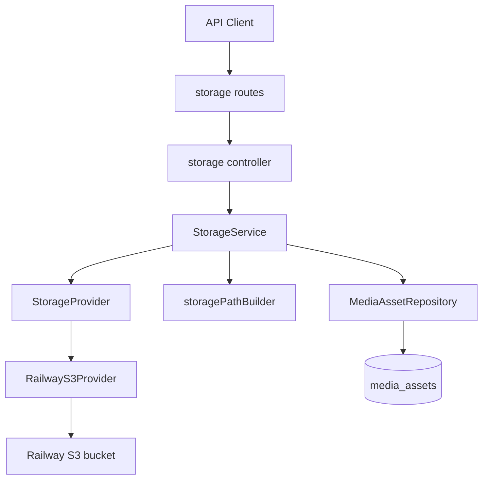

# Phase 1 — Object Storage Foundation

## Scope lock

**In:** API storage platform only (provider, service, `media_assets`, generic `/storage/*` routes, unit tests, docs).

**Out:** Company/items/parties/expenses/OCR/WhatsApp/PDF/Flutter/thumbnails/compression. No changes to existing business tables or domain upload UIs.

---

## Architecture



Domain modules will later call `StorageService` only. Controllers and business services must never import `@aws-sdk/*`.

Mirror the notification provider layout:

- Interface + factory under [`apps/api/src/providers/storage/`](apps/api/src/providers/storage/)
- HTTP module under [`apps/api/src/modules/storage/`](apps/api/src/modules/storage/)
- Table under [`apps/api/src/db/schema/storage/`](apps/api/src/db/schema/storage/)

---

## Dependencies and config

**Packages** (Bun in `apps/api`):

- `@aws-sdk/client-s3`
- `@aws-sdk/s3-request-presigner`

**Extend** [`apps/api/src/config/app_config.ts`](apps/api/src/config/app_config.ts):

| Env | AppConfig field | Notes |
|-----|-----------------|-------|
| `S3_ENDPOINT` | `s3Endpoint` | |
| `S3_BUCKET` | `s3Bucket` | |
| `S3_REGION` | `s3Region` | default `auto` |
| `S3_ACCESS_KEY_ID` | `s3AccessKeyId` | |
| `S3_SECRET_ACCESS_KEY` | `s3SecretAccessKey` | never logged |
| `S3_FORCE_PATH_STYLE` | `s3ForcePathStyle` | default `true` |
| `S3_SSL` | `s3Ssl` | default `true` for HTTPS clients |
| `S3_PUBLIC_BASE_URL` | `s3PublicBaseUrl` | optional; PUBLIC download URLs |
| `STORAGE_MAX_FILE_BYTES` | `storageMaxFileBytes` | default `10485760` (10 MB) |
| `STORAGE_UPLOAD_URL_TTL_SECONDS` | `storageUploadUrlTtlSeconds` | default `900` |
| `STORAGE_DOWNLOAD_URL_TTL_SECONDS` | `storageDownloadUrlTtlSeconds` | default `3600` |

**Fail-fast rule (all-or-nothing):** If any required `S3_*` credential field is set, all of `ENDPOINT`, `BUCKET`, `ACCESS_KEY_ID`, `SECRET_ACCESS_KEY` must be present or `loadAppConfig()` throws (same spirit as Twilio assert). If none are set, storage is disabled and `/storage/*` returns `503` with `STORAGE_NOT_CONFIGURED`.

Update [`.env.example`](apps/api/.env.example) with the new optional knobs + short comments. Wire dummy S3 values in [`tests/helpers/app.ts`](apps/api/tests/helpers/app.ts) so unit/integration boot does not break.

---

## Domain models and errors

New files under `apps/api/src/providers/storage/` and `apps/api/src/modules/storage/`:

**Enums**

- `StorageVisibility`: `private` | `authenticated` | `public`
- `StoragePurpose`: `branding` | `items` | `parties` | `sales` | `purchases` | `expenses` | `reports` | `backups` | `documents` | `payments` | `job_work` | `other`

**Models** (plain TS; no AWS types)

- `StorageAsset` — DB-facing metadata returned to API clients
- `UploadIntent` — `{ intentId, uploadUrl, storageKey, headers, expiresAt, maxBytes, mimeType }`
- `UploadResult` / `DownloadResult` — completion + signed/public URL payloads
- Provider-level request/response types for `createUploadUrl`, `createDownloadUrl`, `head`, `copy`, `move`, `delete`, `exists`

**Errors** (extend or wrap [`AppError`](apps/api/src/shared/errors/app-error.ts) so the global handler works):

- `StorageConfigurationError` → `STORAGE_NOT_CONFIGURED` / `STORAGE_CONFIG_INVALID` (503/500)
- `StorageValidationError` → `STORAGE_VALIDATION_ERROR` (400)
- `StorageNotFoundError` → `STORAGE_NOT_FOUND` (404)
- `StoragePermissionError` → `STORAGE_FORBIDDEN` (403)
- `StorageUploadFailedError` → `STORAGE_UPLOAD_FAILED` (400/502 when HEAD fails after complete)

---

## StorageProvider + RailwayS3Provider

```
apps/api/src/providers/storage/
  storage-provider.ts          # interface
  storage.types.ts             # provider DTOs
  create-storage-provider.ts   # factory from AppConfig
  railway-s3-provider.ts       # AWS SDK v3 implementation
  index.ts
```

`StorageProvider` methods (domain types only):

`createUploadUrl` · `createDownloadUrl` · `delete` · `head` · `copy` · `move` · `exists`

`RailwayS3Provider`:

- `S3Client` with custom endpoint, credentials, `forcePathStyle`, TLS from config
- Presign `PutObject` / `GetObject` via `@aws-sdk/s3-request-presigner`
- `HeadObject` for validation / etag / size / content-type
- `CopyObject` + `DeleteObject` for `copy` / `move`
- No MIME/size/path business rules inside the provider

---

## Path builder

Single utility: `apps/api/src/modules/storage/storage-path.builder.ts`

```
{env}/businesses/{businessId}/{purposeDir}/[{ownerType}/{ownerId}/]{assetId}.{ext}
```

- `env` from `AppConfig.environment` (`development` | `production` | `test`)
- `purposeDir` mapped from `StoragePurpose` (e.g. `branding`, `items`, …)
- Extension from MIME allowlist map (`png`/`jpg`/`webp`/`pdf`)
- No hardcoded path fragments outside this builder

---

## Database: `media_assets`

Add [`apps/api/src/db/schema/storage/tables.ts`](apps/api/src/db/schema/storage/tables.ts), export from [`schema/index.ts`](apps/api/src/db/schema/index.ts), generate migration `0023_media_assets` via `bun run db:generate`.

Columns (server-owned registry; soft delete; UUIDs):

| Column | Type |
|--------|------|
| `id` | UUID PK |
| `business_id` | UUID NOT NULL → `businesses.id` |
| `storage_key` | text NOT NULL UNIQUE |
| `bucket` | text NOT NULL |
| `purpose` | text NOT NULL |
| `visibility` | text NOT NULL |
| `mime_type` | text NOT NULL |
| `file_size` | bigint NOT NULL |
| `etag` | text nullable |
| `checksum` | text nullable |
| `owner_type` | text nullable |
| `owner_id` | UUID nullable |
| `status` | text NOT NULL (`pending` \| `ready`) — required for upload lifecycle |
| `uploaded_by` | UUID nullable → `accounts.id` |
| `created_at` / `updated_at` | timestamptz |
| `deleted_at` | timestamptz nullable |
| `is_deleted` | boolean default false |

Indexes: `(business_id)`, `(owner_type, owner_id)`, `(purpose)`, partial unique/active filters as needed.

**Do not** alter `businesses`, `items`, `parties`, `expenses`, etc.

---

## StorageService (business rules)

`apps/api/src/modules/storage/storage.service.ts`

Responsibilities:

1. Validate MIME against allowlist: `image/png`, `image/jpeg`, `image/webp`, `application/pdf`
2. Validate declared `file_size` ≤ `storageMaxFileBytes`
3. Assert business membership (reuse `BusinessMembershipRepository` / same pattern as job-work)
4. Build path via path builder
5. **Create upload intent:** insert `media_assets` with `status=pending`, call `createUploadUrl`, return intent
6. **Complete upload:** load pending row by id + `business_id`, `head()` object, verify size/MIME match (within policy), set `etag`/`file_size`, `status=ready`, return `StorageAsset`
7. **Get metadata / download URL:** only `ready` + not deleted; `private`/`authenticated` → signed GET; `public` → `S3_PUBLIC_BASE_URL` + key (or constructed path-style public URL)
8. **Delete:** soft-delete row + provider `delete` (best-effort object delete; log failures)
9. **Replace (service-only, no new HTTP route):** soft-delete old ready asset + create new intent bound to same purpose/owner — for later phases; covered by unit tests

Structured logs via Fastify/Pino child logger: intent created, complete success/fail, delete, replace — never credentials or secrets.

---

## HTTP API

Register in [`apps/api/src/modules/index.ts`](apps/api/src/modules/index.ts):

`createStorageModule(config)` → prefix `/storage`

Auth: `[authenticate, requireBusiness]` on all routes.

| Method | Path | Body / behavior |
|--------|------|-----------------|
| `POST` | `/storage/uploads` | `{ purpose, visibility, mime_type, file_size, owner_type?, owner_id?, checksum? }` → `UploadIntent` |
| `POST` | `/storage/uploads/complete` | `{ intent_id }` → `StorageAsset` |
| `GET` | `/storage/files/:id` | metadata |
| `GET` | `/storage/files/:id/url` | `{ url, expires_at? }` |
| `DELETE` | `/storage/files/:id` | soft-delete + object delete |

Responses use existing `{ data: ... }` / `{ error: { code, message } }` shapes.

Module files: `index.ts`, `storage.routes.ts`, `storage.controller.ts`, `storage.schema.ts` (Zod), `storage.repository.ts`, `storage.mapper.ts`, `storage.types.ts`, `storage.constants.ts`.

OpenAPI: add paths under [`apps/api/src/openapi/paths/`](apps/api/src/openapi/paths/) if other modules register there; keep consistent with existing polish.

---

## Tests (Bun, no network)

Under `apps/api/tests/unit/storage/`:

- Fake/`mock` `StorageProvider` (in-memory map of keys)
- Path builder purpose/env/owner cases
- MIME + file size validation
- Upload intent creates pending row + URL
- Complete requires successful `head`, rejects missing/wrong MIME/size
- Delete soft-deletes + calls provider delete
- Download URL: private → signed; public → public base
- Config assert: partial S3 env fails; empty disables

No real Railway calls. Prefer pure unit tests with injected repository/provider; skip DB integration unless a thin repository test is already the house style.

---

## Documentation

1. **Create** [`docs/04-backend/storage.md`](docs/04-backend/storage.md) — architecture, lifecycle, paths, visibility, provider abstraction, future providers (AWS/R2/MinIO/GCS/Azure), Phase 1 boundaries.
2. **ADR-023** in [`docs/09-decisions.md`](docs/09-decisions.md) — provider-agnostic object storage via `StorageService` / `StorageProvider` (presigned PUT, `media_assets` registry).
3. **Brief API table** in [`docs/05-api.md`](docs/05-api.md) for the five `/storage` endpoints.
4. Optional one-line pointer in [`docs/01-architecture.md`](docs/01-architecture.md) scalability “File storage” row → new doc.

---

## Implementation order

1. Config + deps + provider interface/factory/Railway impl  
2. Path builder + domain types + errors  
3. Drizzle `media_assets` + migration `0023`  
4. Repository + StorageService  
5. Routes/controller/Zod + register module  
6. Unit tests  
7. Docs + ADR-023  

---

## Acceptance checklist

- Business modules unchanged; no Flutter changes  
- No AWS types outside `railway-s3-provider.ts`  
- Presigned upload (API never proxies bytes)  
- Complete validates via `head` before marking `ready`  
- Soft-delete + signed/public download URLs  
- Tests green with mocked provider  
- `docs/04-backend/storage.md` + ADR-023 present  
