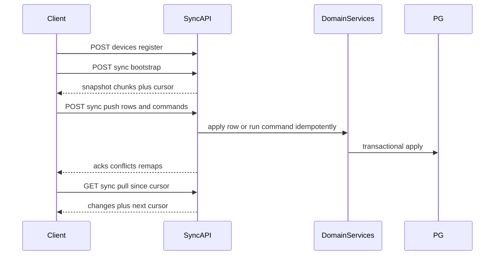

# Sync API Contract Design

## Locked decisions (non-negotiable in the contract)

1. **Hybrid push model**
   - **Row mutations** for masters: parties, items, categories, brands, units, taxes/areas/settings, godowns/warehouses, employees/users (business-scoped), bank-related masters as applicable, CRM leads/contacts/deals, **draft** sales/purchase documents + lines (pre-finalize).
   - **Commands** for invariant operations: `finalize_sale`, `finalize_purchase`, `record_payment`, `record_receipt`, `stock_adjustment`, `stock_transfer`, `post_journal_entry`, `finalize_credit_note`, `finalize_debit_note` (and equivalents already present in domain services).
2. **Document numbering (MVP):** UUID is stable forever; human-readable number may be `LOCAL-######` offline; server assigns real number on finalize ack and returns remapping. Client updates Drift display number only.
3. **Command idempotency:** every command carries a client-generated `command_id` (UUID). Server persists processed IDs per `business_id` and returns the **original success result** on replay (no double stock/ledger/number allocation).

**Stack note:** Contract targets the existing **Fastify** API under `/api/v1` (not FastAPI). Protocol is HTTP/JSON; transport-agnostic for a future WebSocket channel.

## Deliverable

Create **[docs/11-sync-api-contract.md](docs/11-sync-api-contract.md)** as the authoritative sync protocol.

Also update cross-links (docs only, no code):

- Add a pointer from [docs/05-api.md](docs/05-api.md) Offline Sync API section → “superseded by / detailed in 11-sync-api-contract.md”
- Add a short ADR stub entry in [docs/09-decisions.md](docs/09-decisions.md): **ADR-025 Sync Contract (Hybrid + LOCAL remap + command_id)** referencing the three locked decisions
- Link from [docs/10-offline-first-architecture-audit.md](docs/10-offline-first-architecture-audit.md) § numbering / sync proposal

**Out of scope:** any Fastify routes, Flutter SyncEngine, Drift tables, or refactors.

---

## Document structure (what will be written)

### A. Protocol overview

- Goals, non-goals, versioning (`Sync-Protocol-Version: 1`)
- Auth: Bearer JWT with `business_id`; device must be registered
- Envelope: `{ "data": ... }` / `{ "error": { "code", "message", "details?" } }` aligned with existing API style in [docs/05-api.md](docs/05-api.md)
- Common headers: `Authorization`, `X-Device-Id`, `X-App-Version`, `X-Sync-Protocol-Version`, optional `Idempotency-Key` on push batches
- Flow diagram:



### B. Entity catalog

Tables classifying each synced entity as:

- `row` (CRUD via push/pull)
- `command_only` (never raw-insert financial side effects)
- `server_only` (accounts, refresh_tokens, subscriptions, share tokens — never in bootstrap/push)
- `blob` (media via media sync, metadata may appear in pull)

Include explicit rule: **inventory_movements / ledger_entries are not client-authored row creates**; they appear on pull as server projections after commands.

### C. Endpoints (full contract per endpoint)

For **each** endpoint below, the doc will include: Purpose · Method · URL · Headers · Auth · Request JSON · Response JSON · Status codes · Error codes · Idempotency · Retry · Notes.

| Endpoint | Method | URL |
|----------|--------|-----|
| Device register / heartbeat | `POST` | `/api/v1/sync/devices` |
| Device list (optional self) | `GET` | `/api/v1/sync/devices` |
| Sync status / capabilities | `GET` | `/api/v1/sync/status` |
| Bootstrap start | `POST` | `/api/v1/sync/bootstrap` |
| Bootstrap chunk | `GET` | `/api/v1/sync/bootstrap/{bootstrap_id}/chunks/{chunk_index}` |
| Push | `POST` | `/api/v1/sync/push` |
| Pull | `GET` | `/api/v1/sync/pull` |
| Media upload intent | `POST` | `/api/v1/sync/media/uploads` |
| Media upload complete | `POST` | `/api/v1/sync/media/uploads/complete` |
| Media download URL | `GET` | `/api/v1/sync/media/{asset_id}/url` |

(Reuse existing storage intent/complete semantics from [apps/client/lib/core/storage/media_upload_client.dart](apps/client/lib/core/storage/media_upload_client.dart) but under sync namespace with checksum + `client_media_id`.)

### D. Concrete design choices locked in the contract

**Bootstrap**

- Snapshot scoped to JWT `business_id`
- Entity-ordered chunks (settings → masters → drafts → open balances projections), not one giant JSON
- `POST /bootstrap` returns `{ bootstrap_id, schema_version, chunk_count, compression, expires_at }`
- Chunks via GET; `Accept-Encoding: gzip` supported; each chunk `{ entity_type, rows[], tombstones[] }`
- Initial pull cursor returned at end (`cursor` opaque)
- Pagination: chunk_index + optional per-entity `page` inside large entity types
- Max chunk payload ~1–2 MB uncompressed guideline

**Push (hybrid)**

```json
{
  "device_id": "uuid",
  "client_batch_id": "uuid",
  "mutations": [
    {
      "mutation_id": "uuid",
      "kind": "row",
      "entity_type": "parties",
      "entity_id": "uuid",
      "operation": "create|update|delete",
      "base_sync_version": 3,
      "payload": {},
      "client_updated_at": "ISO-8601"
    },
    {
      "mutation_id": "uuid",
      "kind": "command",
      "command": "finalize_sale",
      "command_id": "uuid",
      "payload": {
        "document_id": "uuid",
        "local_document_number": "LOCAL-000001",
        "godown_id": "uuid?"
      },
      "client_updated_at": "ISO-8601"
    }
  ]
}
```

Response always **per-mutation results** (partial success allowed):

- `accepted[]` with new `sync_version`, optional `document_number_remap`
- `conflicts[]` with codes + server row + suggested resolution
- `errors[]` with sync error codes
- `replayed[]` for idempotent command hits (`command_id` already processed)

**Command idempotency store (spec only):** unique `(business_id, command_id)` → stored result JSON + status; TTL optional but financial commands retained indefinitely in v1.

**Pull**

- Opaque `cursor` (not raw timestamp alone) encoding `(updated_at, id)` continuity to avoid duplicates/skips
- Query: `cursor`, `limit` (default 200, max 500)
- Rows include soft-deleted (`is_deleted: true` / `deleted_at`) as tombstones
- Optional `entity_types` filter (selective sync extension point)
- Response: `{ changes[], next_cursor, has_more, server_time }`

**Conflicts**

```json
{
  "code": "CONFLICT",
  "entity_type": "parties",
  "entity_id": "...",
  "incoming_sync_version": 2,
  "server_sync_version": 5,
  "server_payload": {},
  "suggested_resolution": "accept_server|retry_with_server_version|manual",
  "conflict_id": "uuid"
}
```

Commands that conflict (e.g. already finalized): `COMMAND_CONFLICT` / `DOCUMENT_ALREADY_FINALIZED` with server document snapshot + remap if any.

**Media**

- Separate from row push; `client_media_id` + SHA-256 checksum + size + mime
- Intent → PUT to storage → complete; retries safe via same `client_media_id`
- Pull may include media metadata; blob fetch lazy via download URL
- Attachments reference `media_asset_id` after complete

**Status**

Returns: sync protocol version, schema_version, min_client_version, supported commands[], max_push_batch, compression, server_time, device.last_sync_at (if registered)

**Devices**

Register: `device_id` (client UUID, stable), `platform`, `app_version`, `device_name`; upsert by `(business_id, device_id)`

**Auth during sync**

- All sync routes: `authenticate` preHandler; require `business_id` in JWT else `BUSINESS_REQUIRED`
- 401 → client refresh via existing `POST /api/v1/auth/refresh`; if refresh fails → `AUTH_EXPIRED`, stop sync, re-login
- Business switch: new JWT; if push `device_id`/mutations for wrong business → `BUSINESS_CHANGED`
- Do not put refresh tokens in sync payloads

**Error codes (normative list)**

`CONFLICT`, `COMMAND_CONFLICT`, `DOCUMENT_ALREADY_FINALIZED`, `INVALID_CURSOR`, `SCHEMA_MISMATCH`, `PROTOCOL_MISMATCH`, `DEVICE_NOT_REGISTERED`, `BUSINESS_CHANGED`, `BUSINESS_REQUIRED`, `AUTH_EXPIRED`, `VALIDATION_FAILED`, `IDEMPOTENCY_PAYLOAD_MISMATCH`, `BATCH_TOO_LARGE`, `BOOTSTRAP_EXPIRED`, `MEDIA_CHECKSUM_MISMATCH`, `RATE_LIMITED`, `UNSUPPORTED_COMMAND`

**Retry rules**

- Network/5xx: exponential backoff; same `client_batch_id` / `mutation_id` / `command_id`
- 409 conflicts: do not blind-retry; apply resolution
- 401: refresh once then retry batch
- Partial push success: client acks accepted, retries only failed/conflicted items

### E. Number remapping contract

Finalize command ack includes:

```json
{
  "document_id": "uuid",
  "local_document_number": "LOCAL-000001",
  "server_document_number": "INV-2026-000452",
  "sync_version": 4
}
```

UUID unchanged. Later lease-range numbering is reserved as protocol extension (`numbering_strategy` in `/status`) without breaking v1 clients.

### F. Future compatibility (extension points only)

- `channel`: `http` | `websocket` in status capabilities
- Selective sync: `entity_types`, `since_entity_cursor`
- Backup: reference `.biba` as offline artifact (out of band); optional future `POST /sync/backup/complete`
- Realtime: WS subscribe to `business_id` change feed reusing pull change schema

### G. Compatibility with existing sketch

Replace the thin examples in [docs/05-api.md](docs/05-api.md) § Offline Sync API with a short summary + link to the full contract so implementers do not follow the outdated mutations-only shape.

---

## Acceptance criteria for the design doc

- All 10 user-requested areas covered with full endpoint specs
- Hybrid + LOCAL remap + `command_id` idempotency explicitly normative
- Example push batch containing both a party row mutation and a `finalize_sale` command
- Normative error code table and retry matrix
- No application code changes beyond documentation files listed above
