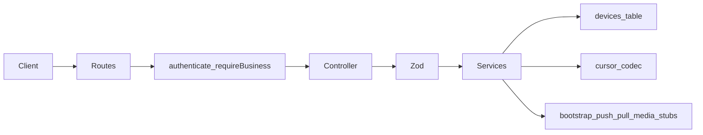

# Sync Backend Infrastructure (Fastify)

## Authority and stack

- **Contract:** [docs/11-sync-api-contract.md](docs/11-sync-api-contract.md) + [ADR-025](docs/09-decisions.md#adr-025-sync-contract-hybrid-local-remap-command-idempotency) are normative.
- **Runtime:** existing **Fastify + TypeScript** at [apps/api](apps/api) (not FastAPI/Python). Module layout follows current patterns (`*.routes.ts`, `*.schema.ts` Zod, `*.service.ts`, `*.repository.ts`, `sendData`, `AppError`).
- **Path prefix:** already registered as `/api/v1/sync` via [apps/api/src/modules/index.ts](apps/api/src/modules/index.ts) → replace stub [apps/api/src/modules/sync/index.ts](apps/api/src/modules/sync/index.ts).

**Phase-checklist shorthand → contract mapping (locked):**

| Checklist | Contract (implement this) |
|-----------|---------------------------|
| `POST /sync/register-device` | `POST /api/v1/sync/devices` (+ `GET /devices`) |
| `GET /sync/status` | `GET /api/v1/sync/status` |
| `POST /sync/bootstrap` | `POST /api/v1/sync/bootstrap` + `GET .../chunks/{i}` |
| `POST /sync/push` | `POST /api/v1/sync/push` with `mutations[]` (`kind: row \| command`) |
| `POST /sync/pull` | `GET /api/v1/sync/pull?cursor&limit` |
| `POST /sync/media` | `POST .../media/uploads`, `POST .../media/uploads/complete`, `GET .../media/{id}/url` |

Push validation covers hybrid row+command mutations (not separate top-level `rows[]`/`commands[]` arrays). Pull returns `changes` / tombstones via `is_deleted`, `next_cursor`, `has_more` per contract.

## Out of scope

- Flutter / Drift / repository cutover
- Real row apply, command execution, idempotency store persistence for commands
- Calling sales/inventory/accounting services
- Media blob storage integration beyond validated stubs
- Full bootstrap snapshot from Postgres

## Module file tree

```
apps/api/src/modules/sync/
  index.ts                 # register routes under /sync
  sync.routes.ts           # wire authenticate + requireBusiness + handlers
  sync.controller.ts       # thin: parse Zod → service → sendData
  sync.schema.ts           # Zod request/response shapes (contract)
  sync.types.ts            # TS types / constants (supported commands, entities)
  sync.constants.ts        # protocol_version, min_client_version, limits
  sync.errors.ts           # SyncError helpers → AppError with contract codes
  sync.auth.ts             # require device header + registered device checks
  cursor.ts                # opaque cursor encode/decode (updated_at + id)
  device.repository.ts     # Drizzle upsert/list against devices
  device.service.ts        # register/heartbeat + list
  status.service.ts        # capabilities / schema handshake
  bootstrap.service.ts     # start + chunk placeholders
  push.service.ts          # validate-only; empty accepted/conflicts
  pull.service.ts          # cursor validate + empty changes + next_cursor
  media.service.ts         # intent/complete/url placeholders
```

No imports from `modules/sales`, `inventory`, `parties`, etc. Sync stays an orchestrator shell.

## Schema / migration (devices)

Existing [`devices`](apps/api/src/db/schema/identity/tables.ts) has `deviceName`, `platform`, `lastSyncAt`, `userId`, sync columns — **missing `app_version`**.

- Add `appVersion: text('app_version')` to Drizzle `devices` table.
- New Drizzle migration (e.g. `0039_devices_app_version.sql`) adding `app_version`.
- Persist register fields: `id`/`device_id` (client UUID as PK `id`), `business_id`, `user_id` (from JWT when present), `platform`, `app_version`, `device_name`; set `last_sync_at` / `updated_at` on heartbeat (maps checklist `last_seen` → contract `last_sync_at`).
- Upsert on `(business_id, id)` where `id === body.device_id`.

Reject when JWT lacks `business_id` (`BUSINESS_REQUIRED` via existing [require-business.middleware.ts](apps/api/src/middleware/require-business.middleware.ts)).

## Endpoints (skeletons + real device/status/cursor)

All use `preHandler: [authenticate, requireBusiness]` and require headers per contract: `X-Device-Id`, `X-App-Version`, `X-Sync-Protocol-Version` (Zod/header checks in controller or `sync.auth.ts`).

| Method | Path | Behavior this phase |
|--------|------|---------------------|
| `POST` | `/devices` | **Real** upsert device; return contract device payload |
| `GET` | `/devices` | **Real** list devices for business |
| `GET` | `/status` | **Real** status JSON from constants + `schema_version` table/read + device `last_sync_at` |
| `POST` | `/bootstrap` | Validate; return placeholder `bootstrap_id`, `chunk_count: 1`, `expires_at` |
| `GET` | `/bootstrap/:bootstrap_id/chunks/:chunk_index` | Validate; return `_bootstrap_complete` chunk with `initial_cursor` from cursor util |
| `POST` | `/push` | **Validate** full hybrid batch; return empty `accepted`/`conflicts`/`errors`/`replayed` (or validation errors only) |
| `GET` | `/pull` | Validate cursor (empty cursor allowed only if documented — use bootstrap `initial_cursor` or accept missing as “start” only for infra tests: **require cursor string**; invalid → `INVALID_CURSOR`); return `changes: []`, decode/encode `next_cursor`, `has_more: false` |
| `POST` | `/media/uploads` | Validate; placeholder intent |
| `POST` | `/media/uploads/complete` | Validate; placeholder asset id |
| `GET` | `/media/:asset_id/url` | Placeholder URL payload |

## Cursor (`cursor.ts`)

- Opaque base64url JSON: `{ t: ISO updated_at, i: uuid }` (or HMAC-optional later; v1 unsigned is fine if documented as opaque).
- `encodeCursor` / `decodeCursor`; throw → `INVALID_CURSOR`.
- No page numbers. Pull uses this for resume metadata only (empty result set still returns a valid `next_cursor` watermark from `server_time` + zero UUID per contract note).

## Push validation (`sync.schema.ts` + `push.service.ts`)

Zod for:

```ts
{
  device_id: uuid,
  client_batch_id: uuid,
  mutations: array of discriminatedUnion kind:
    row: entity_type, entity_id, operation enum, base_sync_version, payload, client_updated_at, mutation_id
    command: command enum from supported list, command_id, payload, client_updated_at, mutation_id
}
```

Also: `X-Device-Id` must match `device_id`; device must be registered; protocol version `1`. No DB writes of mutations. Reject unknown commands (`UNSUPPORTED_COMMAND`), bad UUIDs (`VALIDATION_FAILED`), batch size over `max_push_mutations` (`BATCH_TOO_LARGE`).

## Sync errors (`sync.errors.ts`)

Map to `AppError(code, message, status)`:

| Code | Status |
|------|--------|
| `VALIDATION_FAILED` | 400 |
| `INVALID_CURSOR` | 400 |
| `UNSUPPORTED_COMMAND` | 400 |
| `BATCH_TOO_LARGE` | 400 |
| `AUTH_EXPIRED` / `UNAUTHORIZED` | 401 |
| `BUSINESS_REQUIRED` / `BUSINESS_CHANGED` | 403 |
| `DEVICE_NOT_REGISTERED` | 404 |
| `BOOTSTRAP_EXPIRED` | 410 |
| `CONFLICT` / `SCHEMA_MISMATCH` / `PROTOCOL_MISMATCH` / `MEDIA_CHECKSUM_MISMATCH` / `IDEMPOTENCY_PAYLOAD_MISMATCH` | 409 |
| `RATE_LIMITED` / `SERVER_BUSY` | 429 |

Reuse existing error middleware; do not invent a second envelope.

## Status payload

From [contract §6](docs/11-sync-api-contract.md): `protocol_version`, `schema_version` (read `schema_version` table or migration constant fallback), `min_client_version`, `server_time`, `numbering_strategy: "temp_local_remap"`, limits, `supported_commands[]`, `capabilities`, `device` block. Checklist names (`server_version`, `supported_features`, `supported_entities`) map into this shape as fields already defined by the contract (no alternate JSON).

## Independence rule

- Sync may use: auth middleware, Drizzle `devices` / `schema_version`, shared `AppError` / `sendData`.
- Sync must **not** import feature services. Future command execution will call services from thin adapters in a later phase.

## Tests (lightweight)

Add unit tests under `apps/api/tests/` for: cursor encode/decode round-trip; push Zod reject malformed batch; device upsert happy path if test DB available — or schema-only unit tests if DB tests are heavy. Prefer cursor + Zod tests at minimum.

## Deliverable notes (for PR / reply after implementation)

Document in the implementation summary (not a new long markdown unless useful): file tree, file roles, endpoints, validation covered, remaining work (real bootstrap/push apply/command idempotency/media storage), and any issues (e.g. devices lacked `app_version`).


