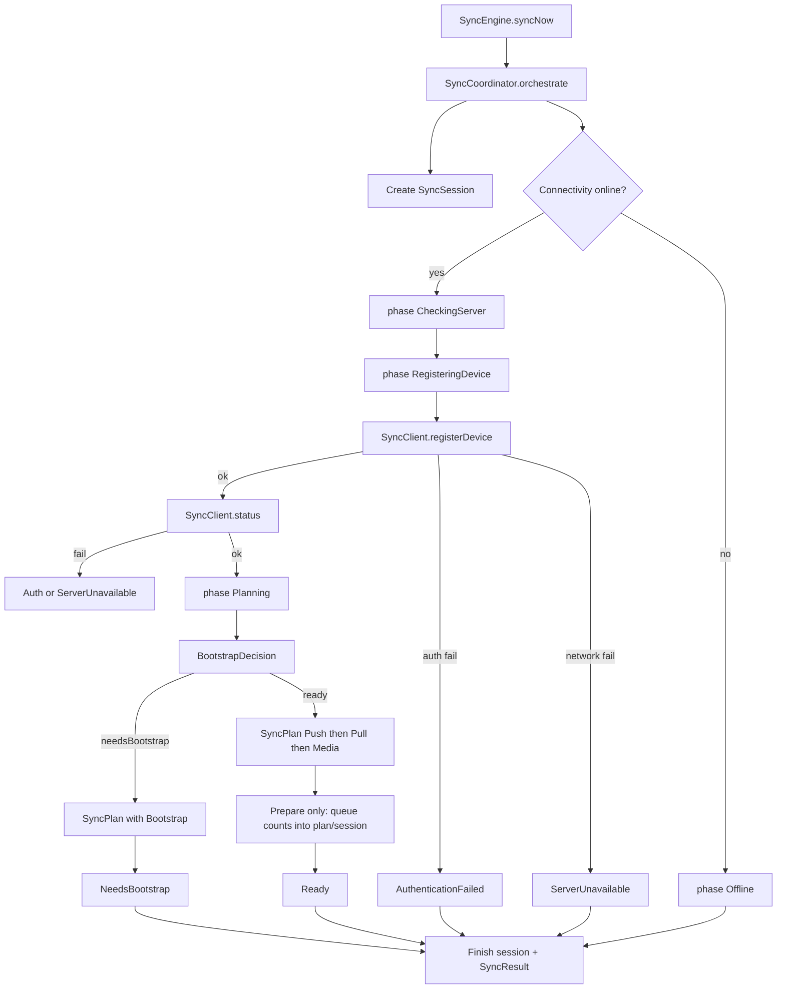

# SyncCoordinator (orchestration only)

## Defaults (locked for this milestone)

- **Device identity:** add [`SyncDeviceIdentity`](apps/client/lib/core/sync/identity/sync_device_identity.dart) — persist stable UUID via [`StorageService`](apps/client/lib/core/services/storage_service.dart) + new [`StorageKeys.syncDeviceId`](apps/client/lib/core/constants/storage_keys.dart); read `appVersion` from `PackageInfo` (already a Flutter dep pattern in the app). No feature-module imports.
- **Bootstrap local signal:** add [`SyncMetadataStore`](apps/client/lib/core/sync/metadata/sync_metadata_store.dart) on StorageService keys only (`pullCursor`, `bootstrappedAt`, `localSchemaVersion`, `lastServerSchemaVersion`). **No Drift schema bump.** Decision uses these + GET `/status`; does **not** call POST `/bootstrap`.
- **Network allowed:** real `registerDevice` + `status` via [`SyncClient`](apps/client/lib/core/sync/transport/sync_client.dart). **Forbidden:** dequeue, `push`/`pull` with mutations, bootstrap/chunk download, media upload, feature imports.

## 1. Folder tree (deliverable)

```
apps/client/lib/core/sync/
  coordinator/
    sync_coordinator.dart      # workflow owner
    sync_session.dart           # one run metrics + result
    sync_plan.dart              # ordered steps + flags
    sync_orchestration_phase.dart
    bootstrap_decision.dart
  identity/
    sync_device_identity.dart
  metadata/
    sync_metadata_store.dart
  engine/sync_engine.dart       # delegates syncNow → coordinator
  providers/sync_providers.dart # new providers
  models/sync_state.dart        # add orchestrationPhase
  sync.dart                     # export coordinator public types
```

## 2. Responsibilities

| Type | Owns | Does not own |
|------|------|----------------|
| **SyncCoordinator** | Workflow order, phase transitions, plan generation, session lifecycle, bootstrap *decision*, calling transport register/status, reading queue counts for plan flags, updating SyncState via engine callback | Entity payloads, dequeue, push/pull bodies, conflict apply, media bytes, feature repos |
| **SyncPlan** | Immutable list of steps + why bootstrap/push/pull/media are included | Execution |
| **SyncSession** | Per-run counters + terminal result | Persistence of cursor (metadata store does that later) |
| **SyncEngine** | Lifecycle (init/start/stop/schedule), connectivity wiring, exposing state stream | Endpoint order (moves to coordinator) |
| **SyncStatusController** | UI/status façade; can surface latest session/plan via engine/coordinator | Workflow |

## 3. Coordinator workflow



**Prepare push/pull/media** means: set plan flags + session placeholders from `queue.pendingCount()` / peek kinds if cheap; **do not** dequeue or call `SyncClient.push` / `pull` / `bootstrap`.

## 4. State machine

Add `SyncOrchestrationPhase` (new file) and field `orchestrationPhase` on [`SyncState`](apps/client/lib/core/sync/models/sync_state.dart):

`idle → checkingServer → registeringDevice → planning → ready | needsBootstrap | authenticationFailed | serverUnavailable | offline`

While phases advance, keep coarse `SyncLifecycleState`:
- mid-flight phases → `syncing`
- `offline` → `offline`
- `authenticationFailed` → `needsAuthentication`
- `serverUnavailable` → `failed`
- terminal `ready` / `needsBootstrap` → `idle` (with `lastResultMessage` explaining plan)

Coordinator never imports Inventory/Sales/CRM/Parties/Purchases/Reports/Settings.

## 5. SyncPlan structure

```dart
enum SyncPlanStep {
  registerDevice,
  fetchStatus,
  bootstrap,      // present only if decision says so; not executed
  pushQueue,      // prepare-only
  pullChanges,    // prepare-only
  media,          // prepare-only
  complete,
}

class SyncPlan {
  final String planId;
  final DateTime createdAt;
  final List<SyncPlanStep> steps; // ordered
  final bool needsBootstrap;
  final bool willPush;
  final bool willPull;
  final bool willUploadMedia;
  final int pendingRowCount;
  final int pendingCommandCount;
  final int pendingMediaCount;
  final String? reason; // e.g. 'no_local_cursor'
}
```

Generated **before** any “prepare” side effects other than register/status already done.

## 6. SyncSession structure

```dart
class SyncSession {
  final String sessionId;
  final DateTime startedAt;
  DateTime? finishedAt;
  Duration? get duration;
  int rowsUploaded;      // stay 0 this milestone
  int rowsDownloaded;
  int commandsUploaded;
  int mediaUploaded;
  int failures;
  int conflicts;
  SyncOrchestrationPhase terminalPhase;
  SyncResult? result;
  SyncPlan? plan;
}
```

## 7. How SyncEngine changes

[`SyncEngine`](apps/client/lib/core/sync/engine/sync_engine.dart):
- Constructor gains `SyncCoordinator` (or factory that receives `SyncClient` + deps and builds coordinator internally — prefer **inject coordinator** for testability).
- `syncNow()` becomes: ensure initialized → offline short-circuit → `_coordinator.orchestrate(onState: _emit)` → return session.result.
- **Remove** `_runner.run()` from the `syncNow` path (runner/worker remain in tree as future extension; engine no longer encodes endpoint order).
- Provide `SyncSession? currentSession` / `SyncPlan? currentPlan` getters (or read from coordinator) for providers/status controller.

[`sync_providers.dart`](apps/client/lib/core/sync/providers/sync_providers.dart):
- `syncDeviceIdentityProvider`, `syncMetadataStoreProvider`
- `syncCoordinatorProvider` (`FutureProvider` — needs `SyncClient`)
- Wire `syncEngineProvider` to inject coordinator
- `currentSyncSessionProvider` / `currentSyncPlanProvider` (stream or `Provider` reading coordinator; stream preferred if coordinator exposes `Stream`)

## 8. Bootstrap decision (Phase 5)

`BootstrapDecision` pure function/class inputs:
- registered device ok
- `businessId` from `StorageKeys.lastOpenedBusinessId` (empty → treat as not ready / skip business bootstrap with reason)
- local `schemaVersion` constant (e.g. `kSyncLocalSchemaVersion = 1` in metadata) vs server `schema_version` from status
- local `pullCursor` / `bootstrappedAt` from metadata store
- server status payload (`device.last_sync_at`, versions)

Outputs: `{ needsBootstrap: bool, reason: String }` — **no network bootstrap**.

Heuristic this milestone:
1. No `bootstrappedAt` or empty `pullCursor` → needsBootstrap
2. Server `schema_version` > local recorded server schema → needsBootstrap
3. Else ready for steady prepare push/pull

## 9. Future extension points (documented in code comments only)

| Hook | Later work |
|------|------------|
| After `willPush` | Queue processor drains pending → real `SyncClient.push` |
| Conflicts | Session.conflicts + apply remap/`replayed[]` |
| Media step | Drain `kind=media` jobs → upload/complete |
| Realtime | Scheduler/connectivity triggers `orchestrate` without changing plan builder |
| Bootstrap step | Execute bootstrap + chunks; write cursor into metadata store |

## 10. Tests

Add `test/core/sync/sync_coordinator_test.dart` with fakes:
- Fake `SyncClient` (register/status success/401/network)
- In-memory storage for identity + metadata
- Fake connectivity
- Assert phase order, plan steps for needsBootstrap vs ready, **zero** push/pull calls, session finished with counts 0

## Out of scope

Repository migration, Items/Sales sync, command execution, dequeue, real push/pull/bootstrap/media, UI screens, Drift migrations.
