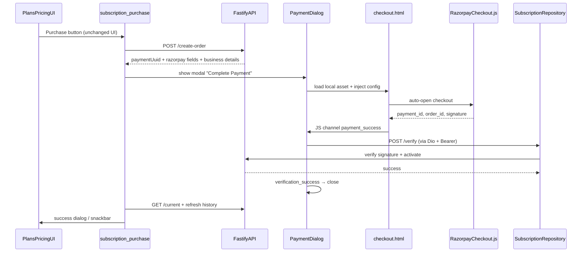

# Native Desktop WebView Subscription Checkout

## Current State

The purchase flow in [`subscription_purchase.dart`](apps/client/lib/features/subscription/application/subscription_purchase.dart) still:
- Builds a Razorpay embedded URL (`api.razorpay.com/v1/checkout/embedded`)
- Opens it in the **system browser** via `url_launcher`
- Polls activation in [`payment_pending_dialog.dart`](apps/client/lib/features/plans_pricing/presentation/widgets/payment_pending_dialog.dart)

The API already removed the hosted `/checkout/:paymentId` route. `POST /create-order` returns `{ paymentId, razorpayOrderId, razorpayKey, amount, currency }`. There is **no `/verify` endpoint** yet; activation is webhook-only.



---

## Backend Changes (`apps/api`)

### 1. Extend `create-order` response

**Files:** [`subscription.service.ts`](apps/api/src/modules/subscription/subscription.service.ts), [`subscription.types.ts`](apps/api/src/modules/subscription/subscription.types.ts)

Rename `paymentId` → **`paymentUuid`** and add business prefill fields from `businesses` table ([`business/tables.ts`](apps/api/src/db/schema/business/tables.ts)):

```json
{
  "paymentUuid": "<uuid>",
  "razorpayOrderId": "order_...",
  "razorpayKey": "rzp_...",
  "amount": 49900,
  "currency": "INR",
  "businessName": "...",
  "businessEmail": "...",
  "businessPhone": "..."
}
```

No `checkoutUrl`, no HTML, no redirect URLs.

### 2. Add `POST /subscription/verify`

**Files to add/modify:**
- [`subscription.routes.ts`](apps/api/src/modules/subscription/subscription.routes.ts) — `POST /verify` with `[authenticate, requireBusiness]`
- [`subscription.schema.ts`](apps/api/src/modules/subscription/subscription.schema.ts) — Zod body:
  ```ts
  { paymentUuid, razorpayOrderId, razorpayPaymentId, razorpaySignature }
  ```
- [`subscription.controller.ts`](apps/api/src/modules/subscription/subscription.controller.ts) — thin handler
- [`subscription.service.ts`](apps/api/src/modules/subscription/subscription.service.ts) — `verifyPayment()`
- [`razorpay.service.ts`](apps/api/src/modules/subscription/razorpay.service.ts) — add `verifyPaymentSignature(orderId, paymentId, signature)` using HMAC-SHA256 over `order_id|payment_id` with `RAZORPAY_KEY_SECRET`
- [`subscription.repository.ts`](apps/api/src/modules/subscription/subscription.repository.ts) — restore `getPaymentById()`; enforce `payment.businessId === token.businessId`

**`verifyPayment()` logic:**
1. Load payment by `paymentUuid`; 404 if missing or wrong business
2. Validate `razorpayOrderId` matches stored order
3. Reject if payment status is not `created` (unless already `paid` → idempotent success)
4. Verify Razorpay signature via `verifyPaymentSignature()`
5. Call shared activation helper (see below)
6. Return `{ activated: true, plan, expiresAt }`

### 3. Extract shared activation logic

Refactor [`handleWebhook()`](apps/api/src/modules/subscription/subscription.service.ts) to call a private method like `activatePaidPayment({ payment, razorpayPaymentId, paidAt, logger })` that performs the existing transaction steps:
- `markPaymentPaid`
- `expireActiveSubscriptionsForBusiness`
- `activateSubscription`
- `updateBusinessPlan`
- `insertHistory` via `resolvePurchaseEvent()`

Both `verifyPayment()` and `handleWebhook()` use this helper. Webhook remains **secondary reconciliation** for missed/duplicate events (existing idempotent `paymentStatus === 'paid'` check stays).

### 4. ADR update

Update [`docs/09-decisions.md`](docs/09-decisions.md): primary activation via `/verify`; webhook as backup; embedded WebView checkout (no browser, no backend HTML).

---

## Flutter Changes (`apps/client`)

### 1. Dependencies and platform setup

Add to [`pubspec.yaml`](apps/client/pubspec.yaml):
- `webview_flutter` + `webview_flutter_wkwebview` — **macOS** embedded `WebViewWidget` in dialog
- `webview_windows` — **Windows** embedded WebView2 texture in dialog

Register asset:
```yaml
assets:
  - assets/checkout/
```

**Platform notes:**
- **macOS** ([`macos/`](apps/client/macos/)): enable outgoing network for Razorpay script load; no separate window
- **Windows** ([`windows/`](apps/client/windows/)): WebView2 runtime check via `WebviewController.getWebViewVersion()`; set custom `userDataFolderWindows` under app support dir
- **Linux**: no `linux/` target exists today. Scaffold a `PaymentWebView` abstraction with a Linux stub that shows "not supported" until `linux/` is added with WebKitGTK deps

### 2. Local `checkout.html`

**New file:** `assets/checkout/checkout.html`

Minimal page (no Billing Baba branding):
- Loads `https://checkout.razorpay.com/v1/checkout.js`
- Reads config from `window.__PAYMENT_CONFIG__` injected by Flutter before load
- Auto-opens Razorpay on `DOMContentLoaded`
- Razorpay options: `key`, `order_id`, `amount`, `currency`, `name`/`email`/`contact` prefill from business fields
- `handler` (success): posts `payment_success` + credentials to `PaymentBridge` JS channel
- `modal.ondismiss`: posts `payment_cancelled`
- On `payment_failed` from Razorpay error callback: posts `payment_failed`

**No direct `fetch` to API** (per your choice). Flutter performs `POST /verify`.

### 3. Reusable `PaymentDialog`

**New file:** `lib/features/subscription/presentation/widgets/subscription_payment_dialog.dart`

Requirements:
- Native `Dialog`, title **"Complete Payment"**, `barrierDismissible: false`
- Embedded platform WebView (~480×640, responsive constraints)
- `JavaScriptChannel('PaymentBridge')` parsing JSON events:
  - `payment_started`, `payment_success`, `payment_failed`, `payment_cancelled`
  - `verification_started`, `verification_success`, `verification_failed` (emitted by Flutter after Dio verify)
- On `payment_success`: call `SubscriptionRepository.verifyPayment()` → emit verification events
- On `verification_success`: `Navigator.pop(true)`
- On failure/cancel/close: `Navigator.pop(false)` with reason
- Loading overlay while creating order / verifying
- 3-minute payment timeout with clear message
- User close (X) treated as `payment_cancelled`

**Platform wrapper:** `lib/features/subscription/presentation/widgets/desktop_payment_webview.dart` with conditional imports:
- `desktop_payment_webview_macos.dart` → `webview_flutter`
- `desktop_payment_webview_windows.dart` → `webview_windows`
- `desktop_payment_webview_stub.dart` → unsupported placeholder

Load HTML via `loadHtmlString(html, baseUrl: 'https://localhost/')` with injected config JSON (enables Razorpay script loading).

### 4. Data layer updates

| File | Change |
|------|--------|
| [`subscription_models.dart`](apps/client/lib/features/subscription/models/subscription_models.dart) | Rename `paymentId` → `paymentUuid`; add `businessName`, `businessEmail`, `businessPhone`; add `VerifyPaymentResponseModel` |
| [`subscription_repository.dart`](apps/client/lib/features/subscription/data/subscription_repository.dart) | Add `verifyPayment(...)` |
| [`api_endpoints.dart`](apps/client/lib/core/network/api_endpoints.dart) | Add `subscriptionVerify = '$subscription/verify'` |

### 5. Refactor purchase orchestration

**Rewrite [`subscription_purchase.dart`](apps/client/lib/features/subscription/application/subscription_purchase.dart):**

```
purchaseSubscriptionPlan()
  → createSubscriptionOrder()
  → showSubscriptionPaymentDialog(context, order, expectedPlan)
  → if success: refresh currentSubscriptionProvider, subscriptionHistoryProvider, subscriptionPlansProvider
  → showSubscriptionActivatedDialog() or SnackBar
```

**Remove:**
- `buildRazorpayCheckoutUrl()` (external Razorpay URL)
- `launchSubscriptionCheckout()` / `url_launcher` usage in subscription flow
- Polling-based [`payment_pending_dialog.dart`](apps/client/lib/features/plans_pricing/presentation/widgets/payment_pending_dialog.dart) from purchase path (file can be deleted or kept unused)

**Do NOT change:**
- [`plans_pricing_page.dart`](apps/client/lib/features/plans_pricing/presentation/pages/plans_pricing_page.dart) layout/visuals — only `_purchasePlan()` call stays the same
- [`upgrade_plan_dialog.dart`](apps/client/lib/features/plans_pricing/presentation/widgets/upgrade_plan_dialog.dart), plan cards, license info, history dialog

### 6. Post-purchase refresh

After dialog closes with success:
- `currentSubscriptionProvider.notifier.refresh()` → updates Current Plan, status, expiry, renew CTA labels via existing [`subscription_pricing_helper.dart`](apps/client/lib/features/subscription/application/subscription_pricing_helper.dart)
- `subscriptionHistoryProvider.notifier.refresh()`
- No manual screen reopen required

### 7. Error handling matrix

| Scenario | Behavior |
|----------|----------|
| User closes dialog | Cancel; no activation message |
| Razorpay cancelled | Show "Payment cancelled" in dialog, allow close |
| Razorpay failed | Show error, allow retry (re-open Razorpay from same order if still `created`) |
| Verify failed (bad signature) | `verification_failed` message; do not activate |
| Network error during verify | Retry button in dialog |
| Duplicate verify (already paid) | Treat as success (idempotent API response) |
| Webhook arrives first | Verify returns success; webhook no-ops |

---

## Files Summary

| Action | Path |
|--------|------|
| Modify | `apps/api/src/modules/subscription/subscription.{service,controller,routes,schema,types,repository}.ts` |
| Modify | `apps/api/src/modules/subscription/razorpay.service.ts` |
| Modify | `docs/09-decisions.md` |
| Add | `apps/client/assets/checkout/checkout.html` |
| Add | `apps/client/lib/features/subscription/presentation/widgets/subscription_payment_dialog.dart` |
| Add | `apps/client/lib/features/subscription/presentation/widgets/desktop_payment_webview*.dart` |
| Add | `apps/client/lib/features/subscription/presentation/widgets/subscription_activated_dialog.dart` |
| Modify | `apps/client/lib/features/subscription/application/subscription_purchase.dart` |
| Modify | `apps/client/lib/features/subscription/models/subscription_models.dart` |
| Modify | `apps/client/lib/features/subscription/data/subscription_repository.dart` |
| Modify | `apps/client/lib/core/network/api_endpoints.dart` |
| Modify | `apps/client/pubspec.yaml` |
| Remove usage | `payment_pending_dialog.dart`, `url_launcher` in subscription purchase |

---

## Verification Checklist

1. `bun run typecheck` in `apps/api`
2. `flutter analyze` on subscription + plans_pricing features
3. Manual test on macOS: Gold purchase → WebView dialog → Razorpay test payment → verify → Current Plan updates
4. Confirm browser never opens during purchase
5. Confirm webhook duplicate does not double-activate
6. Windows: verify WebView2 available message when runtime missing
