# Architecture

## Purpose

Define the system architecture for Billing Baba ERP Phase 1 (MVP). This document is the primary reference for how components interact, how domains are bounded, and how offline-first operation is achieved.

## Scope

Phase 1 only — desktop and mobile POS, billing, inventory, parties, purchases, payments, accounting, reports, staff attendance, Nazdikwala order intake, and cloud sync. AI automation, Karma Score, and third-party marketplace aggregation are out of scope (see [Future Architecture](#future-architecture)).

**Related docs:** [04-database.md](04-database.md) · [05-api.md](05-api.md) · [09-decisions.md](09-decisions.md) · [00-project.md](00-project.md)

## Table of Contents

- [Vision](#vision)
- [System Overview](#system-overview)
- [Business Domains](#business-domains)
- [Context Map](#context-map)
- [Business Capability Map](#business-capability-map)
- [Module Responsibilities](#module-responsibilities)
- [Module Dependency Diagram](#module-dependency-diagram)
- [Event Flow Diagram](#event-flow-diagram)
- [Folder Structure](#folder-structure)
- [Application Layers](#application-layers)
- [Client Architecture](#client-architecture)
- [Backend Architecture](#backend-architecture)
- [Offline Sync Overview](#offline-sync-overview)
- [Authentication Flow](#authentication-flow)
- [Request Flow](#request-flow)
- [Technology Decisions](#technology-decisions)
- [Scalability Considerations](#scalability-considerations)
- [Future Architecture](#future-architecture)
- [Glossary](#glossary)
- [Architecture Principles](#architecture-principles)
- [Phase 1 Coverage Matrix](#phase-1-coverage-matrix)
- [Non Goals](#non-goals)

---

## Vision

Billing Baba is the operational brain for Indian retailers, wholesalers, service providers, and micro-manufacturers. It delivers Vyapar-familiar workflows with differentiated capabilities: tier-based pricing, visual inventory mapping, deep party CRM, proactive alerts, and seamless sync with the Nazdikwala hyperlocal ecosystem.

The architecture prioritizes **offline resilience** — a shopkeeper processes 50+ transactions daily without network dependency. The cloud API is a sync and identity layer, not a real-time POS dependency.

---

## System Overview

Billing Baba is a **modular monolith** with an offline-first Flutter client and a **Fastify** REST API (Bun runtime) backed by **PostgreSQL on NeonDB** via **Drizzle ORM**. Each device holds a full local SQLite copy; writes are local-first; background sync reconciles with the cloud.

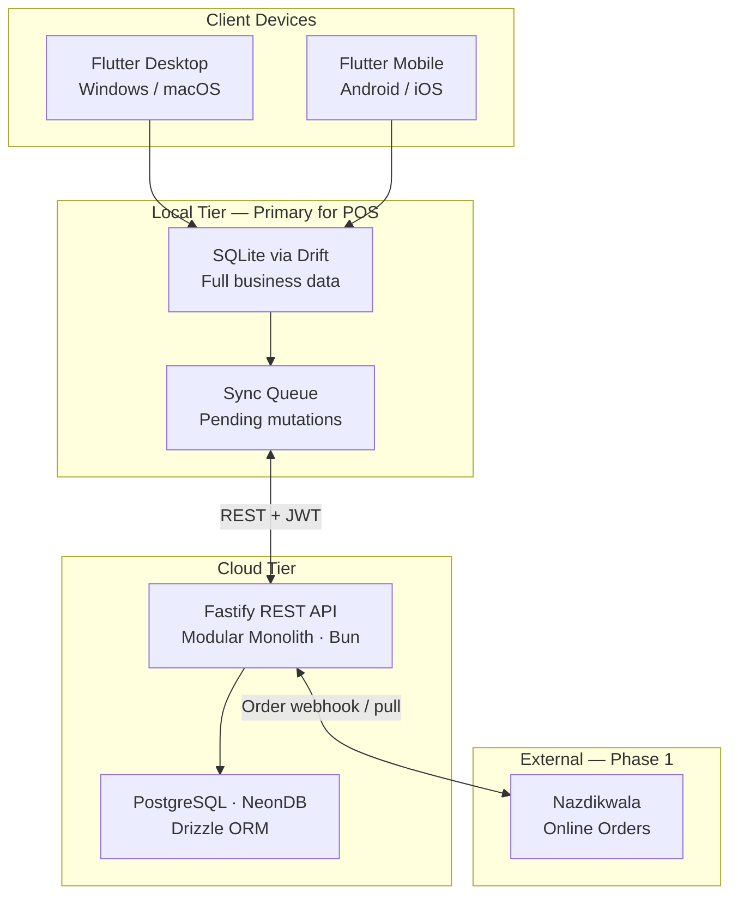

| Layer | Role | Availability requirement |
|-------|------|------------------------|
| Flutter client | UI, local business logic, SQLite writes | Must work with zero network |
| SQLite (Drift) | Primary data store on device | Always available |
| Fastify API | Auth, sync, backup, Nazdikwala bridge | Required only for sync and login |
| PostgreSQL (NeonDB) | Cloud source of truth, multi-device | Cloud availability |

---

## Business Domains

Domains represent **business capabilities**, not screens. Each PRD feature belongs to **exactly one domain**. Module names in code may differ (e.g. domain **CRM**, module `parties`).

| Domain | Module | Scope (Phase 1) | Owns |
|--------|--------|-----------------|------|
| **Identity** | `auth` | Login, sessions, staff, attendance | Users, devices, tokens, attendance |
| **Business** | `business` | Tenant profile, branches | Business, branches |
| **CRM** | `parties` | Party CRM, credit, loyalty balances, hidden ledger | Parties, visits, attachments, tags, links |
| **Inventory** | `inventory` | Catalog, stock, godowns, pricing engine | Items, brands, categories, units, movements, godowns |
| **Sales** | `sales` | Outward documents and POS | Sales documents, POS sessions |
| **Purchases** | `purchases` | Inward documents and expenses | Purchase documents, expenses |
| **Accounting** | `accounting` | Ledger, payments, receivable/payable | Ledger entries, payments, allocations |
| **Reports** | `reports` | Compliance and analytics (read-only) | — (queries only) |
| **Settings** | `settings` | Tax, numbering, loyalty rules, areas | Settings, tax rates, sequences, areas |
| **Notifications** | `notifications` | Alerts, todos, reminder dispatch | Alerts, todos |
| **Sync** | `sync` | Offline queue, Nazdikwala orders, backup | Online orders, sync infrastructure |

**Not a domain:** `dashboard` is a cross-domain presentation feature (omni-search, widgets, order feed). It reads from local SQLite across domains; it owns no entities.

### Domain feature ownership (single owner)

| Feature | Domain | Notes |
|---------|--------|-------|
| Items, units, categories, brands | Inventory | Includes bulk upload, MRP-only, tier prices |
| Price history, market price | Inventory | Append-only `item_price_history` |
| Godowns, shelf locations, photos | Inventory | Visual location management |
| Stock levels, inventory movements | Inventory | Event-sourced stock ledger |
| Parties, contacts, area assignment | CRM | `areas` table owned by Settings; CRM references |
| Loyalty points balance | CRM | Rules owned by Settings |
| Loyalty rules configuration | Settings | `loyalty_rules` |
| Credit limits, hidden ledger | CRM | `unrecovered_amount` seller-only |
| Estimates / quotations (proforma) | Sales | PRD "Estimate"; no separate proforma table |
| Delivery challans | Sales | |
| Tax invoices, bill of supply, kaccha | Sales | |
| POS | Sales | |
| Sales returns (credit notes) | Sales | |
| Purchase orders, bills, returns | Purchases | |
| Expenses | Purchases | P&L input; posts to Accounting |
| Payments (cash, UPI, card, cheque, bank) | Accounting | `payment_mode` enum — no separate cash/bank tables in Phase 1 |
| Party ledger, day book | Accounting | Double-entry `ledger_entries` |
| GSTR, P&L, stock valuation | Reports | Read-only aggregation |
| Staff clock-in/out, shifts | Identity | `attendance_records` |
| Smart alerts, todos | Notifications | Generated from domain events |
| Online orders (Nazdikwala) | Sync | Accept/reject → Sales on accept |
| Brand swap, price conflict, kaccha→pakka | Sales | Business rules in Sales service |

### Sales domain detail

| Submodule | Description | Stock impact | Financial impact |
|-----------|-------------|----------------|------------------|
| Estimate / Quotation | Non-binding quote; brand-swap bulk action | None | None |
| Delivery Challan | Goods dispatched, not yet billed | Deducted | None |
| Tax Invoice | GST invoice (CGST/SGST/IGST) | Deducted | Receivable created |
| Bill of Supply | Non-GST billing | Deducted | Receivable created |
| Normal Invoice (Kaccha) | Non-formal bill; convertible to GST invoice | Deducted | Receivable created |
| POS | Keyboard-first retail checkout mode | Deducted | Receivable / cash |
| Sales Return (Credit Note) | Customer returns goods | Restored | Receivable reduced |

### Purchases domain detail

| Submodule | Description | Stock impact | Financial impact |
|-----------|-------------|----------------|------------------|
| Purchase Order | Request stock from supplier | None | None |
| Purchase Bill | Record incoming inventory | Increased | Payable created |
| Purchase Return (Debit Note) | Return goods to supplier | Decreased | Payable reduced |
| Expense | Operational costs (rent, utilities, salaries) | None | P&L expense |

---

## Context Map

Canonical **bounded-context dependency map**. Arrows show upstream → downstream relationships (Customer-Supplier direction). Solid lines are synchronous service calls; dashed lines are in-process domain events (Phase 1 — no message broker).

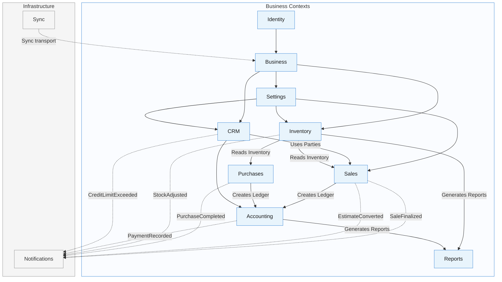

| Relationship | DDD pattern | Mechanism |
|--------------|-------------|-----------|
| Identity → Business | Customer-Supplier | Users scoped to `business_id` |
| Business → Settings / CRM / Inventory | Customer-Supplier | Tenant bootstrap |
| Settings → CRM / Inventory / Sales | Shared Kernel (config) | Tax rates, numbering, loyalty rules |
| CRM → Sales | Customer-Supplier | Party tier, credit limit, pricing tier |
| Inventory → Sales / Purchases | Conformist | Item master and stock rules |
| Sales / Purchases → Accounting | Customer-Supplier | Finalize posts ledger via Accounting service |
| Accounting → Reports | Conformist | Reports never mutate ledger |
| * → Notifications | Event notification | Dashed arrows — domain events only; no back-deps |
| Sync → Business | Infrastructure | Transport and conflict resolution; no domain rules |

---

## Business Capability Map

What each module **owns** — capabilities and sub-features, not context relationships. For upstream/downstream dependencies between bounded contexts, see [Context Map](#context-map).

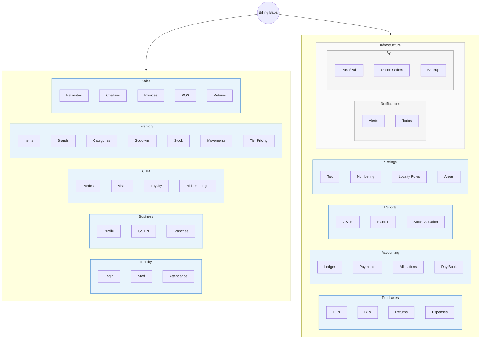

---

## Module Responsibilities

### Backend modules (`apps/api/src/modules/`)

| Module | Domain | Owns | Does not own |
|--------|--------|------|--------------|
| `auth` | Identity | Credentials, JWT, users, devices, attendance | Business data, ledger |
| `business` | Business | Tenant profile, branches | Permissions, item prices |
| `parties` | CRM | Party CRUD, visits, attachments, credit, loyalty balances, hidden ledger | Ledger posting, loyalty rules config |
| `inventory` | Inventory | Items, brands, categories, godowns, stock levels, inventory movements, tier prices, price history | Sales document creation |
| `sales` | Sales | Outward documents, POS, brand swap, kaccha→pakka, price conflict check | Payment recording, ledger posting |
| `purchases` | Purchases | Purchase documents, expenses | Supplier payment, ledger posting |
| `accounting` | Accounting | Ledger entries, payments, allocations, party balances | Report formatting, stock quantities |
| `reports` | Reports | Report queries and export payloads | Any source mutation |
| `settings` | Settings | Tax rates, sequences, loyalty rules, areas, business_settings | Item tier prices, party balances |
| `notifications` | Notifications | Alerts, todos, reminder dispatch metadata | Core business rules |
| `sync` | Sync | Change log, push/pull, conflicts, `online_orders` | Domain validation rules |

### Client features (`apps/client/lib/features/`)

| Feature | Domain | Local-first responsibility |
|---------|--------|----------------------------|
| `auth` | Identity | Token storage, session refresh, attendance |
| `dashboard` | Cross-domain | Omni-search, widgets, order feed — no owned entities |
| `business` | Business | Business profile screens |
| `parties` | CRM | Full party CRM offline |
| `inventory` | Inventory | Items, stock, godowns, bulk import |
| `sales` | Sales | All sales documents + POS |
| `purchases` | Purchases | Purchase workflow + expenses |
| `accounting` | Accounting | Payments, ledger views, short-payment prompts |
| `reports` | Reports | Cached report rendering |
| `settings` | Settings | Configuration, areas, tax |
| `notifications` | Notifications | Alerts, todos |
| `sync` | Sync | Queue, status indicator, reconnect |

---

## Module Dependency Diagram

Runtime **code module** import graph. Semantics match the [Context Map](#context-map); names here reflect `apps/api/src/modules/` folders.

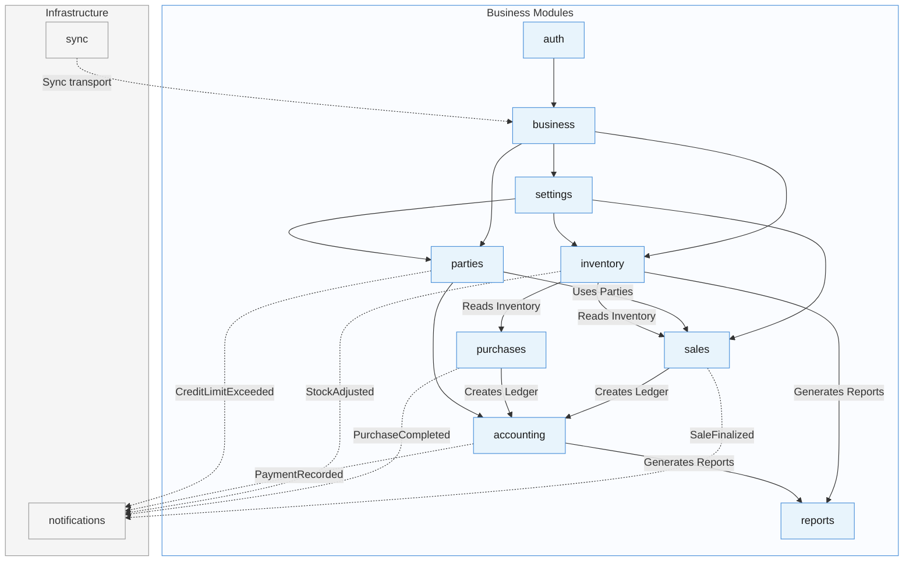

| If this module changes… | Downstream modules affected |
|-------------------------|----------------------------|
| `inventory` | `sales`, `purchases`, `reports`, `sync` |
| `parties` (CRM) | `sales`, `accounting`, `notifications`, `sync` |
| `sales` | `accounting`, `reports`, `notifications`, `sync` |
| `purchases` | `accounting`, `reports`, `notifications`, `sync` |
| `accounting` | `reports`, `notifications`, `sync` |
| `settings` | `parties`, `inventory`, `sales` (tax/numbering reads) |

**Forbidden:** `accounting` → `sales`, `reports` → `accounting` (writes), `inventory` → `parties`, any module → `auth` (except sync transport).

---

## Event Flow Diagram

Runtime business event propagation (not ER relationships). Each finalize creates append-only records.

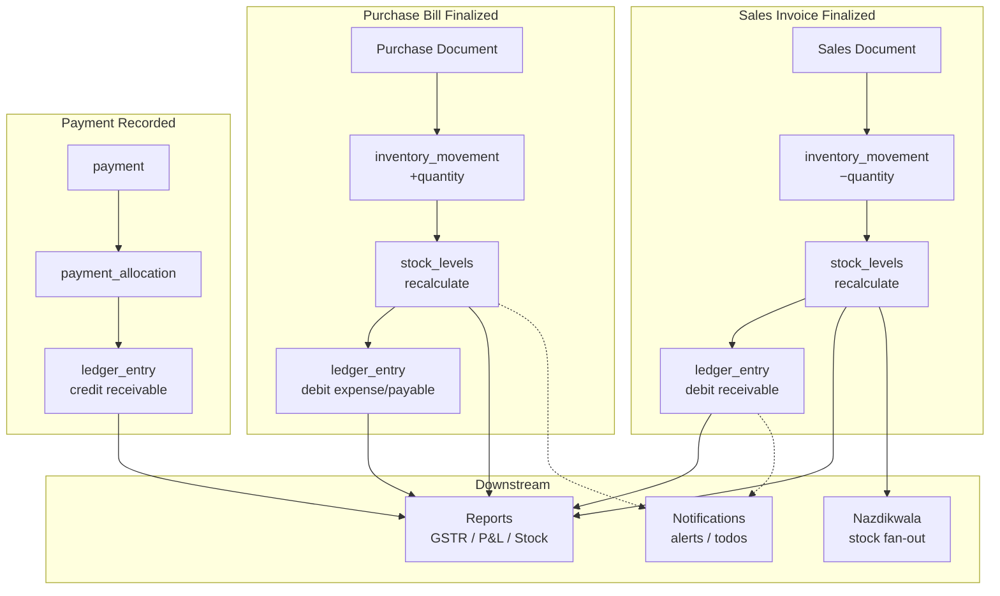

| Event | Producer | Consumers | Side effects |
|-------|----------|-----------|--------------|
| Document finalized | Sales / Purchases | Inventory, Accounting | `inventory_movement`, `ledger_entry` |
| Payment recorded | Accounting | Accounting (allocation), CRM (hidden ledger) | `ledger_entry`, optional `unrecovered_amount` |
| Stock below reorder | Inventory | Notifications | `alert` (low_stock) |
| Credit limit exceeded | CRM + Sales | Notifications | `alert` (credit_limit) |
| Online order received | Sync | Notifications, Sales (on accept) | `online_order`, optional `sales_document` |

See [ADR-016](09-decisions.md#adr-016-event-based-inventory-ledger), [ADR-017](09-decisions.md#adr-017-double-entry-accounting).

---

## Dependency Rules

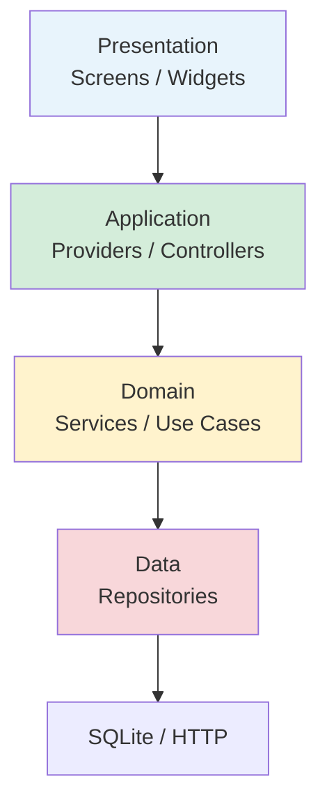

| Rule | Client | Backend |
|------|--------|---------|
| Presentation → Domain | Widgets call providers; never Drift/API directly | Routes call services; never Drizzle directly |
| Domain isolation | Sales → Inventory, Accounting services only | Cross-module via exported service interfaces |
| Data direction | Repositories are the only DB/API access point | Drizzle access only in module `db/` or `services/` |
| Sync boundary | Sync module reads change log; does not embed business rules | Sync service validates tenant scope only |
| No circular deps | Downstream never imports upstream transaction modules | `reports` and `notifications` never write ledger/stock |
| Accounting gate | All ledger writes via `accounting` module | Sales/Purchases call `AccountingService.post()` |
| Inventory gate | All stock writes via `inventory` module | Sales/Purchases call `InventoryService.recordMovement()` |

---

## Folder Structure

```
billing-baba/
├── apps/
│   ├── client/                    # Flutter — desktop + mobile
│   │   ├── lib/
│   │   │   ├── core/              # Router, theme, DB, network, sync engine
│   │   │   ├── features/          # Feature modules (see Client Architecture)
│   │   │   └── shared/            # Shared widgets, extensions
│   │   └── test/
│   └── api/                       # Fastify modular monolith (Bun)
│       ├── src/
│       │   ├── modules/           # Domain modules
│       │   ├── db/                # Drizzle schema + client
│       │   ├── shared/            # Middleware, errors, pagination
│       │   ├── app.ts             # Fastify app assembly
│       │   └── server.ts          # HTTP server entry
│       ├── drizzle/
│       │   └── migrations/        # Drizzle Kit migrations
│       └── drizzle.config.ts
├── docs/
└── scripts/
```

---

## Application Layers

| Layer | Client (Flutter) | Backend (Fastify) |
|-------|----------------|-------------------|
| **Presentation** | Screens, widgets, POS keyboard handlers | — |
| **Application** | Riverpod providers, navigation guards | Route handlers (thin) |
| **Domain** | Services, use cases, validators | Services, business rules |
| **Data** | Repositories, Drift DAOs, API client | Repositories, Drizzle queries |
| **Infrastructure** | SQLite, HTTP, file storage | NeonDB PostgreSQL, object storage |

Business logic lives in **Domain** on both sides. See [06-coding-standards.md](06-coding-standards.md).

---

## Client Architecture

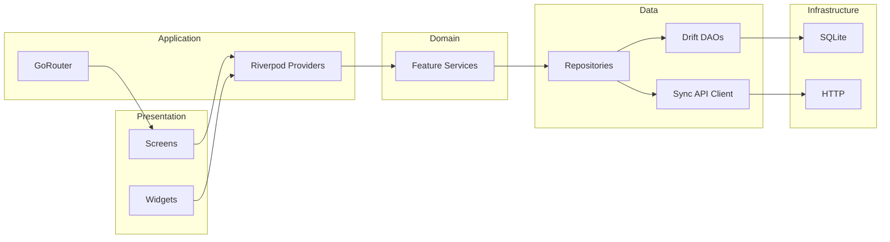

### Feature module layout

```
lib/features/sales/
├── presentation/
│   ├── screens/           # invoice_screen, pos_screen, ...
│   ├── widgets/           # line_item_row, tax_summary, ...
│   └── providers/         # invoice_list_provider, pos_cart_provider
├── application/           # Optional: complex orchestration
├── domain/
│   ├── models/            # Freezed entities
│   └── services/          # invoice_service, tax_calculator
└── data/
    ├── repositories/      # invoice_repository
    └── sources/           # invoice_local_source, invoice_remote_source
```

### Desktop-first UX constraints

- POS mode: full keyboard navigation (Tab, Enter, F-keys)
- Global shortcuts: Alt+N (invoice), Alt+P (purchase)
- Persistent sync status in header
- Modal-first quick actions from dashboard

See [03-design-system.md](03-design-system.md) for UI tokens.

---

## Backend Architecture

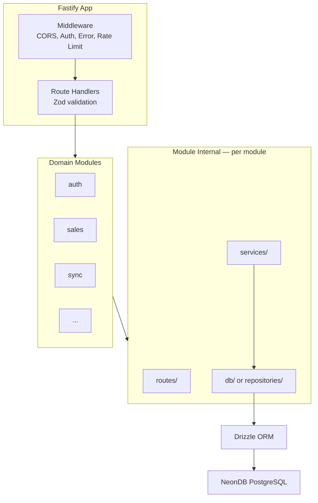

### Module internal layout

```
src/modules/sales/
├── routes/
│   └── sales-invoice.routes.ts    # Thin: validate → service → respond
├── services/
│   ├── sales-invoice.service.ts   # Business logic
│   └── kaccha-pakka.service.ts    # Kaccha → Pakka conversion
├── db/
│   └── sales-invoice.repository.ts
└── schemas/
    └── sales-invoice.schema.ts    # Zod request/response shapes
```

---

## Offline Sync Overview

Local SQLite is the **write path** for all POS operations. Sync runs in the background when network is available.

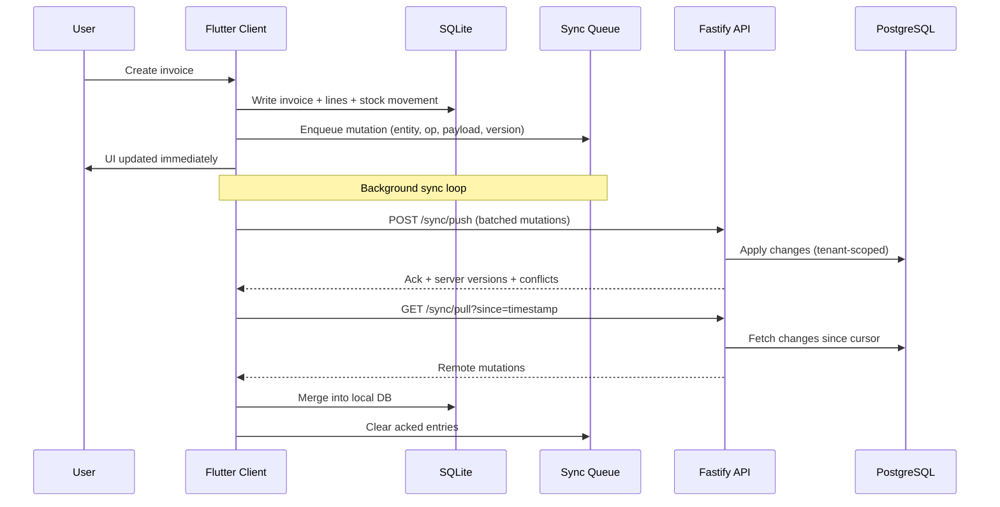

### Sync metadata (every mutable entity)

| Field | Purpose |
|-------|---------|
| `id` | UUID — global identity across devices |
| `business_id` | Tenant isolation |
| `sync_version` | Monotonic per-entity version for optimistic locking |
| `is_deleted` | Boolean tombstone flag; paired with `deleted_at` |
| `updated_at` | Server/client timestamp |
| `deleted_at` | Soft delete — tombstone for sync |
| `device_id` | Originating device for conflict diagnostics |
| `sync_status` | Local-only: `synced`, `pending`, `conflict` |

### Conflict resolution (Phase 1)

| Scenario | Strategy |
|----------|----------|
| Same entity, different fields | Last-write-wins by `updated_at` with audit log |
| Stock quantity conflict | Server reconciles from `inventory_movements` ledger; client refreshes |
| Invoice number collision | Server-assigned sequence wins; client renumbers locally |
| Delete vs update | Tombstone wins if `deleted_at` is newer |

Full entity list and indexes: [04-database.md](04-database.md#sync-metadata). API contract: [05-api.md](05-api.md#offline-sync-api).

### Network behavior

| Scenario | Behavior |
|----------|----------|
| No network on launch | Full app from SQLite; POS fully available |
| Network lost during use | Continue locally; queue grows |
| Reconnect | Push pending → pull remote → update sync indicator |
| Nazdikwala online order | Queued locally if offline; accept/reject when synced |

---

## Authentication Flow

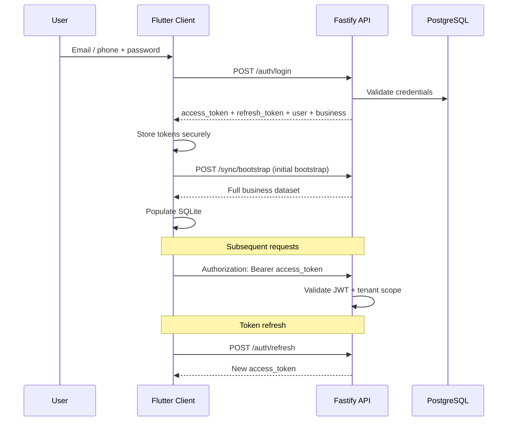

| Token | Lifetime | Storage |
|-------|----------|---------|
| Access token | Short (e.g. 15 min) | Secure storage |
| Refresh token | Long (e.g. 30 days) | Secure storage, rotatable |

Auth endpoints: [05-api.md](05-api.md#authentication-apis). ADR: [ADR-004](09-decisions.md#adr-004-why-rest), [ADR-007](09-decisions.md#adr-007-offline-first).

---

## Request Flow

### Cloud API request (sync or authenticated read)

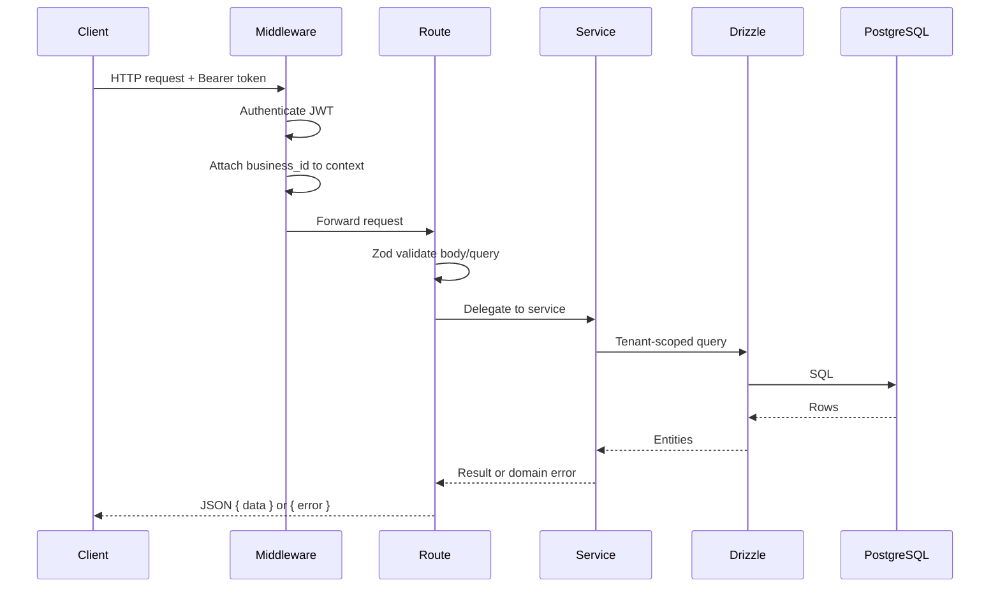

### Local write (no network)

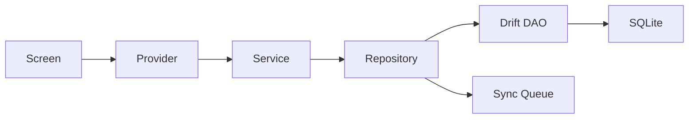

---

## Technology Decisions

| Area | Choice | Rationale | ADR |
|------|--------|-----------|-----|
| Client | Flutter | Single codebase for desktop + mobile | [ADR-006](09-decisions.md#adr-006-why-flutter) |
| Local DB | SQLite + Drift | Offline-first, type-safe queries | [ADR-012](09-decisions.md#adr-012-why-drift) |
| Client state | Riverpod | Testable, composable state | [ADR-013](09-decisions.md#adr-013-why-riverpod) |
| API style | REST | Predictable, cacheable, sync-friendly | [ADR-004](09-decisions.md#adr-004-why-rest) |
| API framework | Fastify + TypeScript + Bun | Performance, schema validation, plugin ecosystem | [ADR-011](09-decisions.md#adr-011-why-fastify) |
| Cloud DB | PostgreSQL (NeonDB) + Drizzle | Relational integrity, SQL-transparent ORM | [ADR-001](09-decisions.md#adr-001-why-postgresql), [ADR-005](09-decisions.md#adr-005-why-drizzle) |
| Architecture | Modular monolith | Team size, deployment simplicity | [ADR-003](09-decisions.md#adr-003-why-modular-monolith) |
| Identity | UUID primary keys | Multi-device sync without collision | [ADR-002](09-decisions.md#adr-002-why-uuid) |
| Deletion | Soft delete | Sync tombstones, audit recovery | [ADR-008](09-decisions.md#adr-008-soft-delete) |
| Sales docs | Unified `sales_documents` | One polymorphic table per ADR-014 | [ADR-014](09-decisions.md#adr-014-unified-sales-documents) |
| Purchase docs | Unified `purchase_documents` | One polymorphic table per ADR-015 | [ADR-015](09-decisions.md#adr-015-unified-purchase-documents) |
| Stock ledger | Event-based movements | Append-only `inventory_movements` | [ADR-016](09-decisions.md#adr-016-event-based-inventory-ledger) |
| Accounting | Double-entry ledger | Balanced debit/credit entries | [ADR-017](09-decisions.md#adr-017-double-entry-accounting) |
| Navigation | GoRouter | Declarative deep linking | — |
| Validation | Zod (API), Freezed (client) | Runtime + compile-time safety | — |

---

## Scalability Considerations

Phase 1 ships multi-tenant SaaS infrastructure (`business_id` on every row). Each account maps to one business; the schema supports millions of businesses on shared PostgreSQL.

| Dimension | Phase 1 | Growth path |
|-----------|---------|-------------|
| Tenants | Multi-tenant SaaS; one business per account; `business_id` row isolation | Shard by `business_id` or read replicas at scale |
| Devices | 2–5 devices per business | Sync queue scales with batch push |
| Data volume | Millions of invoices across platform; ~100k/year per business | Partitioning by `business_id` + `entry_date`; indexes per [04-database.md](04-database.md#indexes) |
| Read load | Reports run on client SQLite | Heavy reports can move to API read replicas |
| File storage | Party attachments, item images | Object storage (S3-compatible) behind API |
| API throughput | Sync bursts on reconnect | Rate limiting, batch endpoints |

Modular monolith allows extracting **Sync** or **Reports** into separate services if load demands — boundaries are already module-aligned.

---

## Future Architecture

Brief pointers only — not Phase 1 scope.

| Capability | PRD reference | Architectural note |
|------------|---------------|-------------------|
| AI document parsing (OCR purchase bills) | Section 9.1 | Async job queue + ML service; client uploads image |
| Karma Score / defaulter database | Section 9.2 | External trust API; read-only enrichment on Parties |
| AI voice payment recovery | Section 9.3 | Outbound telephony integration; results → Notifications todos |
| Marketplace aggregation | Section 10 | Webhook ingress + inventory fan-out service |
| WebSocket real-time | — | Supplements REST for live Nazdikwala order stream |
| Facial recognition checkout | Parties face capture | On-device ML; no cloud dependency in v1 |

---

## Glossary

| Term | Definition |
|------|------------|
| **Context Map** | Canonical bounded-context dependency diagram — who depends on whom |
| **Business Capability Map** | Module ownership of features — what each module owns, not how contexts relate |
| **Party** | Customer or supplier — any counterparty with a ledger balance |
| **Kaccha** | Normal (non-GST formal) invoice or estimate |
| **Pakka** | Formal GST tax invoice |
| **Challan** | Delivery challan — goods dispatched, not yet billed |
| **Hidden ledger** | Seller-only `unrecovered_amount` from short payments; never customer-visible |
| **Tier pricing** | Price level (Tier 1–3) applied per party type or assignment |
| **MRP-only** | Fixed price items — no discounts or tier overrides |
| **Godown** | Warehouse storage location; parent for shelf positions and per-godown stock |
| **Movement** | Immutable inventory event in `inventory_movements` |
| **Tombstone** | Soft-deleted record propagated via sync (`deleted_at`) |
| **Nazdikwala** | Hyperlocal consumer marketplace receiving catalog and orders |

---

## Architecture Principles

1. **Offline-first** — Local write path never blocked by network.
2. **Local source of operational truth** — Device SQLite drives POS; cloud reconciles. See [ADR-009](09-decisions.md#adr-009-single-source-of-truth).
3. **Thin edges, thick domain** — Routes and widgets stay thin; services own rules.
4. **Tenant isolation** — Every query scoped by `business_id`.
5. **Immutable audit** — Price history and inventory movements are append-only.
6. **Sync-ready entities** — UUID, version, soft delete on all mutable tables.
7. **Domain separation** — Modules align to business domains. See [ADR-010](09-decisions.md#adr-010-business-domain-separation).
8. **Vyapar parity, PRD authority** — Familiar workflows; features only if PRD-defined.
9. **Seller control on sensitive flows** — Hidden ledger recovery is always manual.
10. **Desktop-first** — Keyboard POS; mobile compatible layouts.

---

## Non Goals

| Non-goal | Reason |
|----------|--------|
| Real-time cloud-dependent POS | Offline-first mandate |
| Microservices in Phase 1 | Modular monolith sufficient for MVP team |
| AI/OCR purchase entry | Phase 2 per PRD |
| Karma Score / shared defaulter DB | Phase 2 per PRD |
| Swiggy/Zomato/Amazon inventory sync | Future; Nazdikwala only in Phase 1 |
| Automatic hidden ledger recovery | PRD requires manual seller control |
| Customer-visible hidden ledger | Strict visibility rules in PRD |
| Multi-business holding company UI | One business per account in Phase 1 |
| Balance sheet report | Not in PRD Phase 1; party outstanding covers receivable/payable |
| Separate cash/bank account tables | `payment_mode` enum sufficient for Phase 1 |
| GraphQL or gRPC API | REST chosen for sync simplicity |

---

## Phase 1 Coverage Matrix

Every PRD Phase 1 requirement mapped to domain, entity, and API module. Phase 2 items (§9) excluded.

| PRD Feature | Business Domain | Database Entity | API Module | Status |
|-------------|-----------------|-----------------|------------|--------|
| Omni-search & quick actions | Dashboard (presentation) | — (queries local SQLite) | — | Covered |
| Global transaction search | Dashboard | parties, sales_documents, payments, items | parties, sales, accounting, inventory | Covered |
| Financial snapshot (receivable/payable) | Accounting | ledger_entries, parties | accounting, reports | Covered |
| Recent orders (Nazdikwala + offline) | Sync + Sales | online_orders, sales_documents | sync, sales | Covered |
| Sync engine indicator | Sync | sync_queue (local) | sync | Covered |
| Actionable todo list | Notifications | todos | notifications | Covered |
| Smart alerts panel | Notifications | alerts | notifications | Covered |
| Customizable dashboard widgets | Dashboard | — (aggregates) | reports | Covered |
| Estimates / quotations | Sales | sales_documents (`estimate`) | sales | Covered |
| Delivery challans | Sales | sales_documents (`delivery_challan`) | sales | Covered |
| Tax invoices & bill of supply | Sales | sales_documents | sales | Covered |
| Sales returns (credit notes) | Sales | sales_documents (`sales_return`) | sales | Covered |
| POS (keyboard-first) | Sales | sales_documents (`pos`), pos_sessions | sales | Covered |
| Purchase orders | Purchases | purchase_documents (`purchase_order`) | purchases | Covered |
| Purchase bills | Purchases | purchase_documents (`purchase_bill`) | purchases | Covered |
| Purchase returns (debit notes) | Purchases | purchase_documents (`purchase_return`) | purchases | Covered |
| Expense tracking | Purchases | expenses, expense_categories | purchases | Covered |
| Party quick creation | CRM | parties | parties | Covered |
| Area tagging | Settings + CRM | areas, parties.area_id | settings, parties | Covered |
| Party type / category / tags | CRM | parties, party_tags | parties | Covered |
| Party linking (family credit) | CRM | party_links | parties | Covered |
| Business LTV / connected since | CRM | parties.connected_since | parties | Covered |
| Smart unpaid tracking | Accounting + CRM | ledger_entries, payments | accounting | Covered |
| Visit tracking | CRM | party_visits | parties | Covered |
| File attachments | CRM | party_attachments | parties | Covered |
| Face image capture | CRM | parties.face_image_url | parties | Covered |
| Credit limits | CRM | parties.credit_limit | parties | Covered |
| Payment reminders (WhatsApp/SMS) | Notifications | — (dispatch metadata) | parties, notifications | Covered |
| Loyalty points | CRM + Settings | party_loyalty_balances, loyalty_rules | parties, settings | Covered |
| Bulk item upload | Inventory | items | inventory | Covered |
| Product/service toggle | Inventory | items.item_type | inventory | Covered |
| Media management (item images) | Inventory | item_images | inventory | Covered |
| Market price on invoice | Inventory + Sales | items, sales_document_lines | inventory, sales | Covered |
| Tier-based pricing | Inventory + CRM | item_tier_prices, parties.pricing_tier | inventory, parties | Covered |
| MRP-only rule | Inventory | items.is_mrp_only | inventory | Covered |
| Price history tracking | Inventory | item_price_history | inventory | Covered |
| Opening stock, avg purchase price | Inventory | stock_levels, inventory_movements | inventory | Covered |
| Low-stock alerts | Inventory + Notifications | stock_levels, alerts | inventory, notifications | Covered |
| Visual location management | Inventory | godowns, item_locations | inventory | Covered |
| Multi-unit conversions | Inventory | item_units | inventory | Covered |
| GSTR-1, GSTR-2, GSTR-3B | Reports | — (queries) | reports | Covered |
| Profit & loss | Reports | — (queries) | reports | Covered |
| Stock summary & valuation | Reports | stock_levels, inventory_movements | reports | Covered |
| Day book | Reports | ledger_entries | reports | Covered |
| Bulk brand swapping | Sales | items (category + brand) | sales | Covered |
| Historical price conflict alerts | Sales | sales_document_lines (history query) | sales | Covered |
| Kaccha to Pakka converter | Sales | sales_documents.converted_from_id | sales | Covered |
| Clock-in/out & shift tracking | Identity | attendance_records | auth | Covered |
| Hidden ledger (short payments) | CRM + Accounting | parties.unrecovered_amount, payments | parties, accounting | Covered |
| Hidden ledger recovery prompt | CRM + Sales | parties.unrecovered_amount | parties, sales | Covered |
| Nazdikwala online orders | Sync | online_orders | sync | Covered |
| Barcode scanner support | Sales + Inventory | items.barcode | inventory, sales | Covered |
| CGST/SGST/IGST auto-calc | Sales | sales_document_lines | sales | Covered |

**Phase 2 — not covered (by design):** AI document parsing (§9.1), Karma Score (§9.2), AI voice recovery (§9.3), Swiggy/Zomato/Amazon aggregation (§10).
