# Database

## Purpose

Canonical Phase 1 database design for Billing Baba. Defines logical schema, constraints, relationships, and ownership for cloud PostgreSQL (NeonDB + Drizzle) and local SQLite (Drift). No application code — Drizzle schema generation follows this document.

## Scope

Phase 1 MVP only. Phase 2 tables (AI parsing jobs, Karma Score) excluded.

**Stack:** PostgreSQL (NeonDB) · Drizzle ORM · Drizzle Kit · Zod (API validation) · Flutter Drift (client)

**Related docs:** [01-architecture.md](01-architecture.md) · [05-api.md](05-api.md) · [09-decisions.md](09-decisions.md)

## Table of Contents

- [Database Philosophy](#database-philosophy)
- [Technology Stack](#technology-stack)
- [Common Columns](#common-columns)
- [Naming Conventions](#naming-conventions)
- [Tenant Isolation](#tenant-isolation)
- [Enums](#enums)
- [Domain Entity Map](#domain-entity-map)
- [Entity Ownership](#entity-ownership)
- [ER Diagrams](#er-diagrams)
- [Unified Document Model](#unified-document-model)
- [Inventory Design](#inventory-design)
- [Accounting Design](#accounting-design)
- [Business Event Flows](#business-event-flows)
- [Entity Schemas](#entity-schemas)
- [Constraints](#constraints)
- [Performance Indexes](#performance-indexes)
- [Migration Strategy](#migration-strategy)
- [Consistency Review](#consistency-review)

---

## Database Philosophy

| Principle | Implementation |
|-----------|----------------|
| **Offline-first** | Device SQLite is the POS write path; NeonDB reconciles on sync |
| **Schema parity** | Same logical tables on Drift and Drizzle; this doc is the contract |
| **Multi-tenant SaaS** | Every business row scoped by `business_id`; no cross-tenant FKs |
| **Unified documents** | `sales_documents`, `purchase_documents` — polymorphic by enum, not per-type tables |
| **Event inventory** | `inventory_movements` is source of truth; `stock_levels` is derived cache |
| **Double-entry ledger** | `ledger_entries` with debit/credit; polymorphic `reference_type` + `reference_id` |
| **Append-only audit** | `inventory_movements`, `item_price_history`, `ledger_entries` — no updates |
| **Sync-ready rows** | UUID PKs, `sync_version`, soft delete tombstones |
| **High volume** | Composite indexes lead with `business_id`; partial indexes for active rows |
| **Report-friendly** | Normalized core + denormalized caches only where read latency demands |

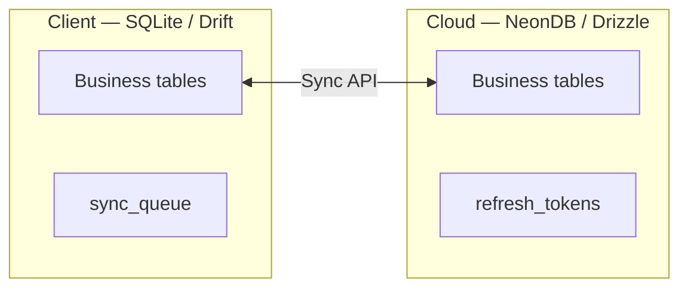

### Design goals by workload

| Workload | Strategy |
|----------|----------|
| POS / invoicing | Local writes; UUID PKs; minimal joins on hot path |
| Inventory | Event ledger + cached `stock_levels` per godown |
| Accounting | Append-only ledger; party balance from entries |
| Reporting | Index on `entry_date`, `document_date`, `business_id` |
| Omni-search | Indexes on `mobile`, `barcode`, `document_number`, `name` |
| Sync pull | Index on `(business_id, updated_at)` |

---

## Technology Stack

| Layer | Technology | Role |
|-------|------------|------|
| Cloud DB | PostgreSQL on NeonDB | Multi-tenant SaaS, branching for staging |
| Cloud ORM | Drizzle ORM | Type-safe queries, schema definitions |
| Migrations | Drizzle Kit | `generate`, `migrate`, `studio` |
| API validation | Zod | Request shapes aligned to Drizzle insert types |
| API runtime | Fastify + Bun | Long-running sync batches |
| Client ORM | Drift | Type-safe SQLite on Flutter |
| Client DB | SQLite | Offline-first local store |

**Drizzle layout (planned):**

```
apps/api/
├── src/db/
│   ├── schema/           # Table definitions per domain
│   ├── index.ts          # Drizzle client export
│   └── migrate.ts
├── drizzle/
│   └── migrations/       # Drizzle Kit output
└── drizzle.config.ts
```

---

## Common Columns

Applied to every **synced business table**. Server-only tables (`refresh_tokens`) use a reduced set.

| Column | PostgreSQL type | Nullable | Default | Description |
|--------|-----------------|----------|---------|-------------|
| `id` | `UUID` | No | `gen_random_uuid()` | Global PK; client-generated on offline create |
| `business_id` | `UUID` | No | — | Tenant isolation; FK → `businesses.id` |
| `created_at` | `TIMESTAMPTZ` | No | `now()` | Row creation time |
| `updated_at` | `TIMESTAMPTZ` | No | `now()` | Last mutation; sync pull cursor |
| `deleted_at` | `TIMESTAMPTZ` | Yes | `NULL` | Tombstone timestamp; `NULL` = active |
| `is_deleted` | `BOOLEAN` | No | `false` | Fast filter + partial indexes; `true` when `deleted_at` set |
| `created_by` | `UUID` | Yes | — | FK → `users.id`; null for system/bootstrap |
| `updated_by` | `UUID` | Yes | — | FK → `users.id` |
| `sync_version` | `INTEGER` | No | `1` | Optimistic locking; increment on each update |
| `device_id` | `UUID` | Yes | — | Originating device; FK → `devices.id` |

### Why each column exists

| Column | Reason |
|--------|--------|
| `id` | Offline-safe identity without server round-trip ([ADR-002](09-decisions.md#adr-002-why-uuid)) |
| `business_id` | Multi-tenant SaaS row isolation |
| `created_at` / `updated_at` | Audit + `updated_at` drives incremental sync pull |
| `deleted_at` | Tombstone propagation to all devices ([ADR-008](09-decisions.md#adr-008-soft-delete)) |
| `is_deleted` | Partial index `WHERE is_deleted = false` without `IS NULL` on timestamps |
| `created_by` / `updated_by` | Staff accountability; day book attribution |
| `sync_version` | Conflict detection on push; server rejects stale versions |
| `device_id` | Diagnostics when two devices edit same entity |

**Immutable tables** (`inventory_movements`, `item_price_history`, `ledger_entries`): `created_at`, `created_by` only — no `updated_at`, `sync_version` updates, or soft delete.

**Local-only** `sync_queue`: auto-increment `id`, no `business_id` on queue row (payload contains tenant).

---

## Naming Conventions

| Element | Rule | Example |
|---------|------|---------|
| Tables | `snake_case`, plural | `sales_documents` |
| Columns | `snake_case` | `party_id` |
| PK | `id` | UUID |
| FK | `{entity}_id` | `item_id` |
| Booleans | `is_` / `has_` | `is_gst_formal` |
| Money | `NUMERIC(18,4)` | `total_amount` |
| Quantity | `NUMERIC(18,4)` | `quantity` |
| Timestamps | `_at` suffix | `document_date` uses timestamptz |
| Enums | PostgreSQL `pgEnum` | `sales_document_type` |
| Polymorphic ref | `reference_type` + `reference_id` | No FK to multiple tables |

---

## Tenant Isolation

| Rule | Implementation |
|------|----------------|
| Tenant key | `business_id` on all business tables |
| JWT | Middleware attaches `business_id` to every request |
| Queries | `WHERE business_id = $tenant AND is_deleted = false` |
| Indexes | Composite indexes **start with** `business_id` |
| FK | Child `business_id` must match parent (enforced in service layer + composite FKs where used) |
| NeonDB | Single database; no per-tenant databases in Phase 1 |

---

## Enums

| Enum | Values | Used in |
|------|--------|---------|
| `user_role` | `owner`, `manager`, `staff` | `users` |
| `party_type` | `customer`, `supplier`, `both` | `parties` |
| `party_category` | `customer`, `retailer`, `wholesaler`, `manufacturer`, `custom` | `parties` |
| `pricing_tier` | `tier_1`, `tier_2`, `tier_3` | `parties`, `item_tier_prices` |
| `item_type` | `product`, `service` | `items` |
| `document_status` | `draft`, `finalized`, `cancelled`, `converted` | documents |
| `sales_document_type` | `estimate`, `delivery_challan`, `tax_invoice`, `bill_of_supply`, `normal_invoice`, `pos`, `sales_return` | `sales_documents` |
| `purchase_document_type` | `purchase_order`, `purchase_bill`, `purchase_return` | `purchase_documents` |
| `tax_type` | `cgst_sgst`, `igst`, `exempt`, `none` | line items |
| `payment_mode` | `cash`, `upi`, `card`, `cheque`, `bank_transfer`, `other` | `payments`, `expenses` |
| `payment_direction` | `received`, `paid` | `payments` |
| `short_payment_handling` | `official_balance`, `unrecovered` | `payments` |
| `inventory_movement_type` | `opening`, `purchase`, `sale`, `sales_return`, `purchase_return`, `challan`, `adjustment` | `inventory_movements` |
| `ledger_entry_type` | `sale`, `purchase`, `payment`, `return`, `expense`, `opening` | `ledger_entries` |
| `valuation_method` | `fifo`, `average` | `businesses`, `business_settings` |
| `attendance_status` | `present`, `late`, `half_day`, `overtime`, `absent` | `attendance_records` |
| `todo_priority` | `low`, `medium`, `high` | `todos` |
| `alert_type` | `payment_overdue`, `low_stock`, `credit_limit`, `price_conflict` | `alerts` |
| `online_order_status` | `pending`, `accepted`, `rejected`, `completed` | `online_orders` |
| `credit_limit_action` | `block`, `warn` | `business_settings` |
| `visit_purpose` | `purchase`, `inquiry`, `payment_collection`, `casual` | `party_visits` |
| `sync_operation` | `create`, `update`, `delete` | `sync_queue` (local) |

---

## Domain Entity Map

Every PRD Phase 1 feature maps to exactly one domain.

| Domain | Tables |
|--------|--------|
| **Identity** | `users`, `refresh_tokens`, `devices`, `attendance_records` |
| **Business** | `businesses`, `branches` |
| **CRM** | `parties`, `party_links`, `party_visits`, `party_attachments`, `party_tags`, `party_tag_assignments`, `party_loyalty_balances` |
| **Inventory** | `categories`, `brands`, `items`, `item_images`, `item_units`, `item_tier_prices`, `item_price_history`, `godowns`, `item_locations`, `stock_levels`, `inventory_movements` |
| **Sales** | `sales_documents`, `sales_document_lines`, `pos_sessions` |
| **Purchases** | `purchase_documents`, `purchase_document_lines`, `expenses`, `expense_categories` |
| **Accounting** | `ledger_entries`, `payments`, `payment_allocations` |
| **Reports** | — (queries only) |
| **Settings** | `business_settings`, `tax_rates`, `document_number_sequences`, `loyalty_rules`, `areas` |
| **Notifications** | `alerts`, `todos` |
| **Sync** | `online_orders`, `sync_queue` (local only) |

---

## Entity Ownership

| Table | Domain | API Module | Flutter Feature | Drift Table |
|-------|--------|------------|-----------------|-------------|
| `businesses` | Business | `business` | `business` | `Businesses` |
| `branches` | Business | `business` | `business` | `Branches` |
| `users` | Identity | `auth` | `auth` | `Users` |
| `devices` | Identity | `auth` | `sync` | `Devices` |
| `refresh_tokens` | Identity | `auth` | — (server only) | — |
| `attendance_records` | Identity | `auth` | `auth` | `AttendanceRecords` |
| `parties` | CRM | `parties` | `parties` | `Parties` |
| `party_links` | CRM | `parties` | `parties` | `PartyLinks` |
| `party_visits` | CRM | `parties` | `parties` | `PartyVisits` |
| `party_attachments` | CRM | `parties` | `parties` | `PartyAttachments` |
| `party_tags` | CRM | `parties` | `parties` | `PartyTags` |
| `party_tag_assignments` | CRM | `parties` | `parties` | `PartyTagAssignments` |
| `party_loyalty_balances` | CRM | `parties` | `parties` | `PartyLoyaltyBalances` |
| `areas` | Settings | `settings` | `settings` | `Areas` |
| `categories` | Inventory | `inventory` | `inventory` | `Categories` |
| `brands` | Inventory | `inventory` | `inventory` | `Brands` |
| `items` | Inventory | `inventory` | `inventory` | `Items` |
| `item_images` | Inventory | `inventory` | `inventory` | `ItemImages` |
| `item_units` | Inventory | `inventory` | `inventory` | `ItemUnits` |
| `item_tier_prices` | Inventory | `inventory` | `inventory` | `ItemTierPrices` |
| `item_price_history` | Inventory | `inventory` | `inventory` | `ItemPriceHistory` |
| `godowns` | Inventory | `inventory` | `inventory` | `Godowns` |
| `item_locations` | Inventory | `inventory` | `inventory` | `ItemLocations` |
| `stock_levels` | Inventory | `inventory` | `inventory` | `StockLevels` |
| `inventory_movements` | Inventory | `inventory` | `inventory` | `InventoryMovements` |
| `sales_documents` | Sales | `sales` | `sales` | `SalesDocuments` |
| `sales_document_lines` | Sales | `sales` | `sales` | `SalesDocumentLines` |
| `pos_sessions` | Sales | `sales` | `sales` | `PosSessions` |
| `purchase_documents` | Purchases | `purchases` | `purchases` | `PurchaseDocuments` |
| `purchase_document_lines` | Purchases | `purchases` | `purchases` | `PurchaseDocumentLines` |
| `expense_categories` | Purchases | `purchases` | `purchases` | `ExpenseCategories` |
| `expenses` | Purchases | `purchases` | `purchases` | `Expenses` |
| `ledger_entries` | Accounting | `accounting` | `accounting` | `LedgerEntries` |
| `payments` | Accounting | `accounting` | `accounting` | `Payments` |
| `payment_allocations` | Accounting | `accounting` | `accounting` | `PaymentAllocations` |
| `business_settings` | Settings | `settings` | `settings` | `BusinessSettings` |
| `tax_rates` | Settings | `settings` | `settings` | `TaxRates` |
| `document_number_sequences` | Settings | `settings` | `settings` | `DocumentNumberSequences` |
| `loyalty_rules` | Settings | `settings` | `settings` | `LoyaltyRules` |
| `alerts` | Notifications | `notifications` | `notifications` | `Alerts` |
| `todos` | Notifications | `notifications` | `notifications` | `Todos` |
| `online_orders` | Sync | `sync` | `sync` | `OnlineOrders` |
| `sync_queue` | Sync | — | `sync` | `SyncQueue` |

---

## ER Diagrams

### Overall ERP

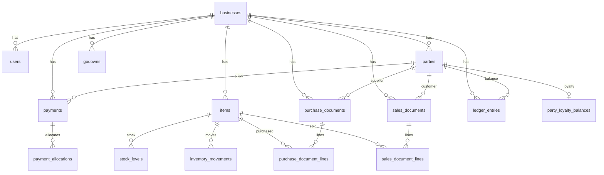

### Identity

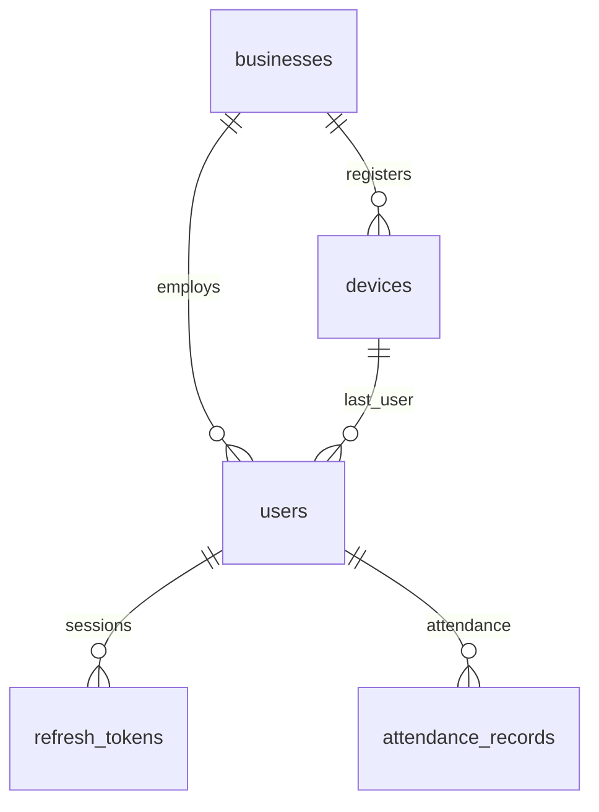

### CRM

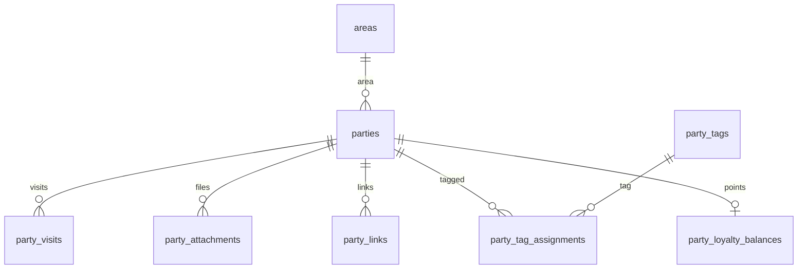

### Inventory

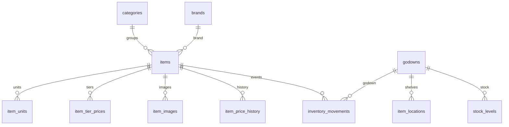

### Sales

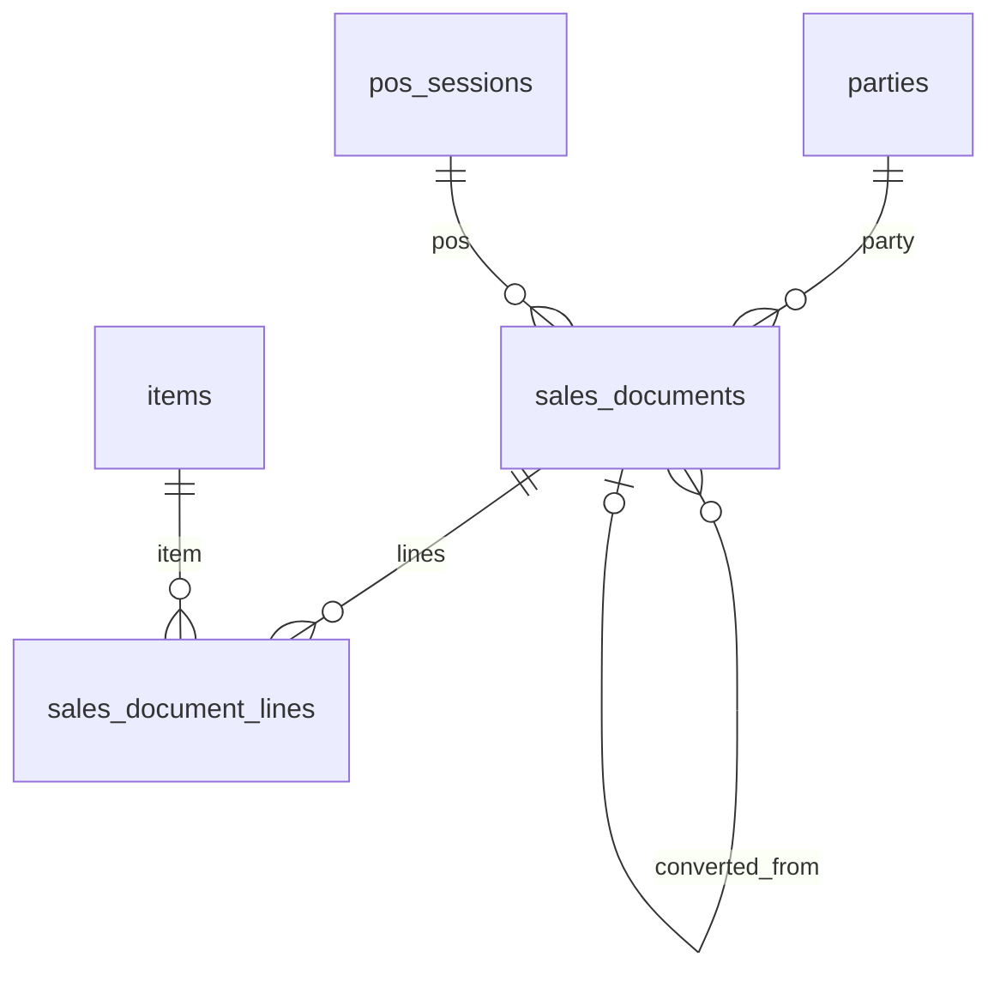

### Purchases

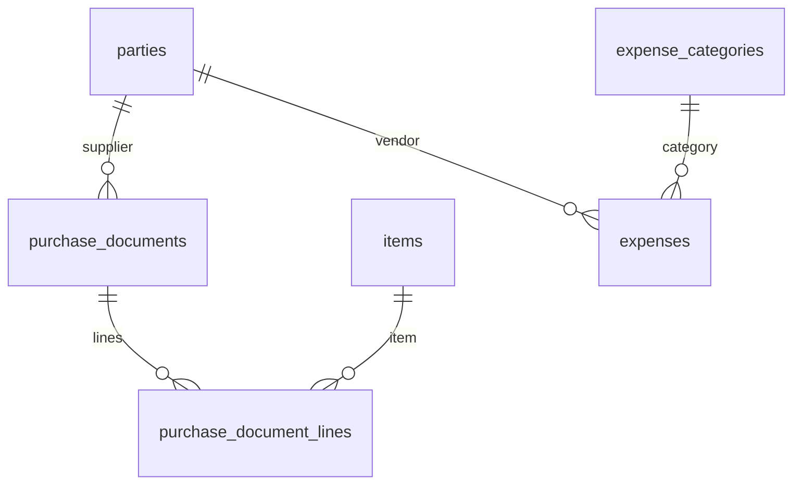

### Accounting

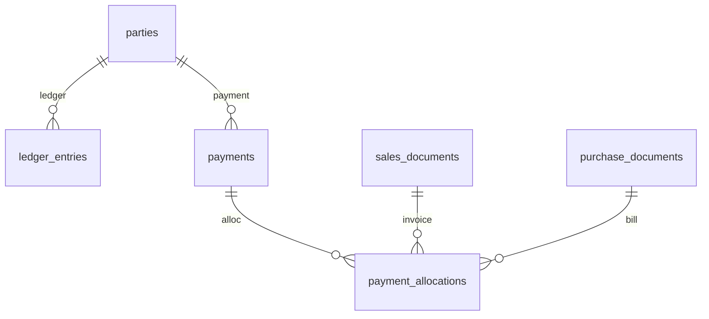

### Reports

Reports have no tables. Read paths:

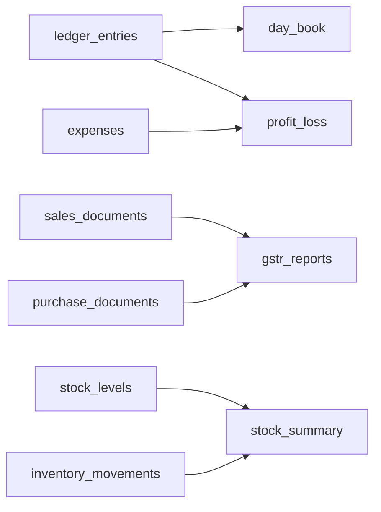

---

## Unified Document Model

Single polymorphic tables per outward/inward flow ([ADR-014](09-decisions.md#adr-014-unified-sales-documents), [ADR-015](09-decisions.md#adr-015-unified-purchase-documents)).

### `sales_documents`

| `document_type` | PRD name | Stock on finalize | Ledger on finalize |
|-----------------|----------|-------------------|---------------------|
| `estimate` | Quotation / proforma | No | No |
| `delivery_challan` | Delivery challan | Yes (`challan`) | No |
| `tax_invoice` | GST invoice (pakka) | Yes (`sale`) | Yes (receivable) |
| `bill_of_supply` | Bill of supply | Yes (`sale`) | Yes (receivable) |
| `normal_invoice` | Kaccha invoice | Yes (`sale`) | Yes (receivable) |
| `pos` | POS sale | Yes (`sale`) | Yes (receivable) |
| `sales_return` | Credit note | Yes (restore) | Yes (reduce receivable) |

**Conversion chain:** `converted_from_id` → prior document. Kaccha→pakka does not double-count stock.

### `purchase_documents`

| `document_type` | PRD name | Stock on finalize | Ledger on finalize |
|-----------------|----------|-------------------|---------------------|
| `purchase_order` | Purchase order | No | No |
| `purchase_bill` | Purchase bill | Yes (`purchase`) | Yes (payable) |
| `purchase_return` | Debit note | Yes (reduce) | Yes (reduce payable) |

**Expenses** remain in `expenses` — not merged into purchase documents (no line-item structure).

---

## Inventory Design

Source of truth: **append-only `inventory_movements`**. `stock_levels` is a **read cache** updated transactionally when movements are recorded.

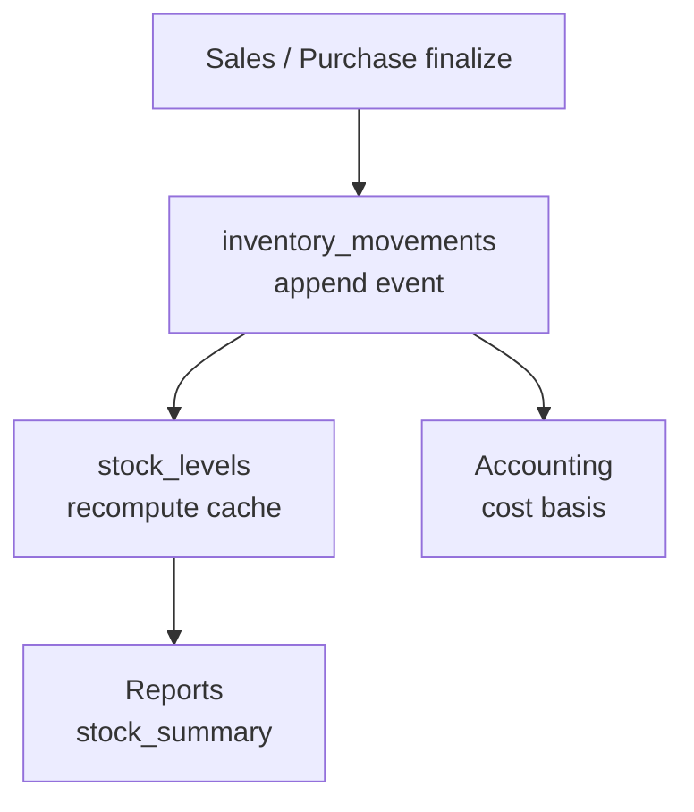

| Rule | Detail |
|------|--------|
| Never update quantity directly | All changes via `inventory_movements` |
| Godown scope | Every movement has `godown_id` |
| Reconciliation | `SUM(quantity_delta)` per item+godown = `stock_levels.quantity` |
| Sync conflict | Server replays movements; cache refreshed |
| Opening stock | `movement_type = opening` |

---

## Accounting Design

Double-entry party ledger ([ADR-017](09-decisions.md#adr-017-double-entry-accounting)). Phase 1: **party ledger** (not full GL chart of accounts).

### `ledger_entries`

| Side | Meaning (customer) | Meaning (supplier) |
|------|-------------------|-------------------|
| `debit > 0` | Increases receivable (they owe more) | — |
| `credit > 0` | Reduces receivable (payment) | Increases payable |

**Constraint:** Exactly one of `debit` or `credit` is non-zero per row.

### Receivables / payables

No separate tables. Derived:

| Metric | Query |
|--------|-------|
| Receivable | `SUM(debit - credit)` for customer parties where balance > 0 |
| Payable | `SUM(credit - debit)` for supplier parties where balance > 0 |
| Party balance | Latest `balance_after` on `ledger_entries` per party |

### Polymorphic references

| `reference_type` | Source |
|------------------|--------|
| `sales_documents` | Sale, return |
| `purchase_documents` | Purchase, return |
| `payments` | Payment received/paid |
| `expenses` | Expense entry |

No FK to polymorphic parent — integrity enforced in application transaction.

### `payment_allocations`

Links `payments` to `sales_documents` or `purchase_documents`. Unallocated payment amount remains as party credit.

---

## Business Event Flows

### Purchase bill finalized

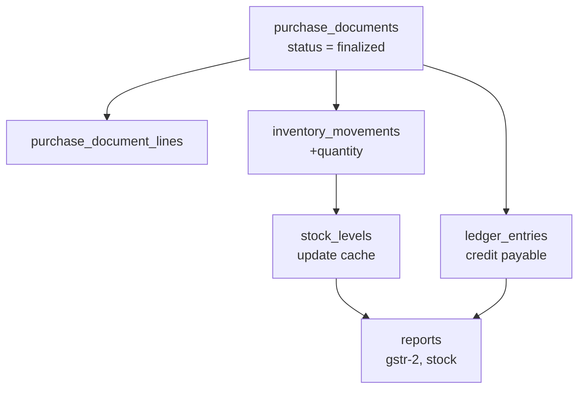

### Sale invoice finalized

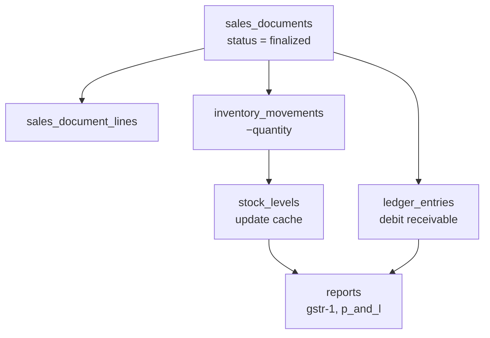

### Payment received

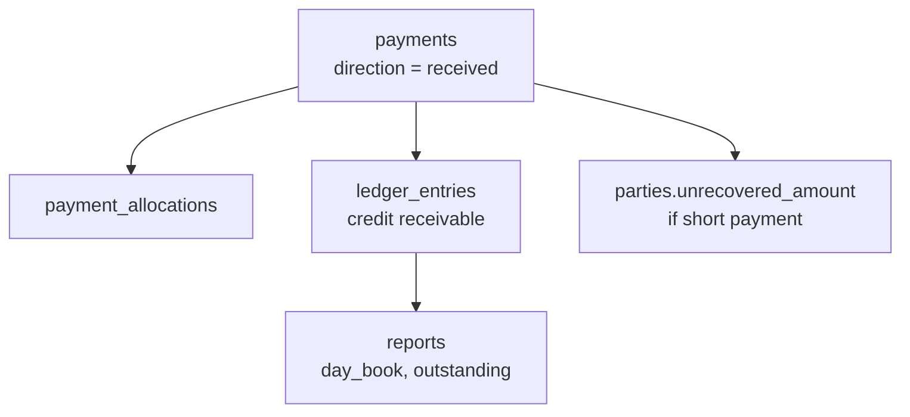

### Sales return finalized

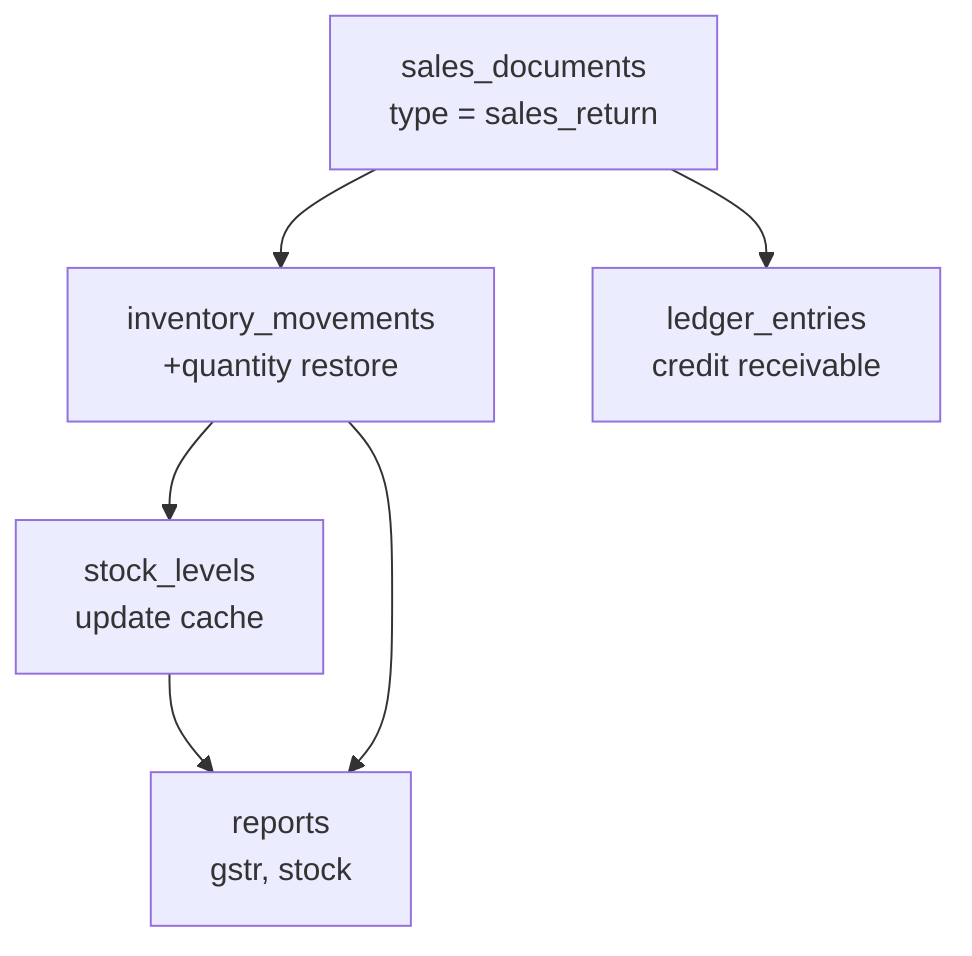

---

## Entity Schemas

Standard column block omitted in tables below when **Common Columns** apply. Listed fields are **in addition** to common columns unless noted.

### Identity

#### `users`

**Purpose:** Staff and owner accounts.

| Field | Type | Nullable | Default | Description |
|-------|------|----------|---------|-------------|
| `name` | `TEXT` | No | — | Display name |
| `email` | `TEXT` | Yes | — | Login email |
| `phone` | `TEXT` | Yes | — | Login phone |
| `password_hash` | `TEXT` | No | — | Server only; not synced to peers as readable |
| `role` | `user_role` | No | `staff` | `owner`, `manager`, `staff` |
| `is_active` | `BOOLEAN` | No | `true` | Deactivated staff |

**Constraints:** CHECK `(email IS NOT NULL OR phone IS NOT NULL)`

**Indexes:** UNIQUE `(business_id, email)` WHERE `is_deleted = false` AND `email IS NOT NULL`; same for `phone`

**Used by:** Identity · `auth` · `auth` · `Users`

---

#### `devices`

**Purpose:** Registered sync devices.

| Field | Type | Nullable | Default | Description |
|-------|------|----------|---------|-------------|
| `user_id` | `UUID` | Yes | — | FK → `users.id` last login |
| `device_name` | `TEXT` | No | — | e.g. "Counter PC" |
| `platform` | `TEXT` | No | — | `windows`, `macos`, `android`, `ios` |
| `last_sync_at` | `TIMESTAMPTZ` | Yes | — | Last successful sync |

**Used by:** Identity · `auth` · `sync` · `Devices`

---

#### `refresh_tokens` (server-only)

**Purpose:** Rotatable refresh credentials. Not synced.

| Field | Type | Nullable | Default | Description |
|-------|------|----------|---------|-------------|
| `id` | `UUID` | No | `gen_random_uuid()` | PK |
| `user_id` | `UUID` | No | — | FK → `users.id` |
| `token_hash` | `TEXT` | No | — | Hashed token |
| `expires_at` | `TIMESTAMPTZ` | No | — | Expiry |
| `revoked_at` | `TIMESTAMPTZ` | Yes | — | Revocation time |
| `created_at` | `TIMESTAMPTZ` | No | `now()` | — |

---

#### `attendance_records`

**Purpose:** PRD clock-in/out and shift tracking.

| Field | Type | Nullable | Default | Description |
|-------|------|----------|---------|-------------|
| `user_id` | `UUID` | No | — | FK → `users.id` |
| `clock_in_at` | `TIMESTAMPTZ` | No | — | Clock in |
| `clock_out_at` | `TIMESTAMPTZ` | Yes | — | Clock out |
| `status` | `attendance_status` | No | `present` | Late, half-day, OT |
| `notes` | `TEXT` | Yes | — | — |

**Indexes:** `(business_id, user_id, clock_in_at)`

**Used by:** Identity · `auth` · `auth` · `AttendanceRecords`

---

### Business

#### `businesses`

**Purpose:** Tenant root.

| Field | Type | Nullable | Default | Description |
|-------|------|----------|---------|-------------|
| `name` | `TEXT` | No | — | Shop name |
| `gstin` | `TEXT` | Yes | — | GST registration |
| `state_code` | `TEXT` | No | — | CGST/SGST vs IGST |
| `address` | `TEXT` | Yes | — | — |
| `phone` | `TEXT` | Yes | — | — |
| `email` | `TEXT` | Yes | — | — |
| `valuation_method` | `valuation_method` | No | `average` | Stock valuation |

**Constraints:** UNIQUE `gstin` WHERE `gstin IS NOT NULL` (global per SaaS)

**Note:** `businesses` uses `id` + audit timestamps only — no `business_id` self-FK.

---

#### `branches`

| Field | Type | Nullable | Default | Description |
|-------|------|----------|---------|-------------|
| `name` | `TEXT` | No | — | Branch name |
| `address` | `TEXT` | Yes | — | — |
| `is_default` | `BOOLEAN` | No | `false` | Default branch |

---

### CRM

#### `parties`

**Purpose:** Customers and suppliers with CRM, credit, hidden ledger.

| Field | Type | Nullable | Default | Description |
|-------|------|----------|---------|-------------|
| `name` | `TEXT` | No | — | Party name |
| `mobile` | `TEXT` | Yes | — | Omni-search |
| `email` | `TEXT` | Yes | — | — |
| `party_type` | `party_type` | No | `customer` | Customer/supplier/both |
| `party_category` | `party_category` | Yes | — | Retailer, wholesaler, etc. |
| `pricing_tier` | `pricing_tier` | No | `tier_1` | Auto tier pricing |
| `gstin` | `TEXT` | Yes | — | Party GSTIN |
| `state_code` | `TEXT` | Yes | — | Tax jurisdiction |
| `area_id` | `UUID` | Yes | — | FK → `areas.id` |
| `credit_limit` | `NUMERIC(18,4)` | No | `0` | Max credit |
| `opening_balance` | `NUMERIC(18,4)` | No | `0` | Onboarding balance |
| `unrecovered_amount` | `NUMERIC(18,4)` | No | `0` | Hidden ledger (seller only) |
| `face_image_url` | `TEXT` | Yes | — | Face capture |
| `connected_since` | `DATE` | Yes | — | LTV display |
| `notes` | `TEXT` | Yes | — | — |

**Constraints:** `credit_limit >= 0`; `unrecovered_amount >= 0`

**Indexes:** `(business_id, mobile)`; `(business_id, name)`; `(business_id, gstin)`; partial unique `(business_id, mobile)` WHERE `is_deleted = false`

**Business rules:** Hidden ledger never on customer exports. Credit limit checked on sales finalize.

**Used by:** CRM · `parties` · `parties` · `Parties`

---

#### `party_loyalty_balances`

| Field | Type | Nullable | Default | Description |
|-------|------|----------|---------|-------------|
| `party_id` | `UUID` | No | — | FK → `parties.id` UNIQUE per business |
| `points_earned` | `NUMERIC(18,4)` | No | `0` | Lifetime |
| `points_available` | `NUMERIC(18,4)` | No | `0` | Redeemable |

---

#### `party_visits`, `party_attachments`, `party_links`, `party_tags`, `party_tag_assignments`

Standard junction/child tables per [Entity Ownership](#entity-ownership). See prior architecture for field shapes — unchanged logically.

---

### Inventory

#### `items`

**Purpose:** Product and service catalog.

| Field | Type | Nullable | Default | Description |
|-------|------|----------|---------|-------------|
| `name` | `TEXT` | No | — | Item name |
| `description` | `TEXT` | Yes | — | — |
| `item_type` | `item_type` | No | `product` | Product or service |
| `has_stock_tracking` | `BOOLEAN` | No | `true` | False for services |
| `category_id` | `UUID` | Yes | — | FK → `categories.id` brand-swap |
| `brand_id` | `UUID` | Yes | — | FK → `brands.id` |
| `hsn_code` | `TEXT` | Yes | — | HSN/SAC |
| `barcode` | `TEXT` | Yes | — | POS scan / SKU |
| `base_unit` | `TEXT` | No | `piece` | Base unit |
| `mrp` | `NUMERIC(18,4)` | Yes | — | Maximum retail price |
| `is_mrp_only` | `BOOLEAN` | No | `false` | Lock to MRP |
| `market_price` | `NUMERIC(18,4)` | Yes | — | Reference on invoice |
| `sale_price` | `NUMERIC(18,4)` | No | `0` | Default tier-1 price |
| `purchase_price` | `NUMERIC(18,4)` | No | `0` | Reference cost |
| `reorder_level` | `NUMERIC(18,4)` | Yes | — | Low-stock threshold |
| `primary_image_url` | `TEXT` | Yes | — | Nazdikwala primary |

**Indexes:** `(business_id, barcode)`; `(business_id, name)`; GIN/trigram on `name` at scale

**Used by:** Inventory · `inventory` · `inventory` · `Items`

---

#### `godowns`

| Field | Type | Nullable | Default | Description |
|-------|------|----------|---------|-------------|
| `name` | `TEXT` | No | — | e.g. "Warehouse B" |
| `address` | `TEXT` | Yes | — | — |
| `is_default` | `BOOLEAN` | No | `false` | Default godown |

---

#### `inventory_movements` (immutable)

**Purpose:** Event ledger — source of truth for stock.

| Field | Type | Nullable | Default | Description |
|-------|------|----------|---------|-------------|
| `item_id` | `UUID` | No | — | FK → `items.id` |
| `godown_id` | `UUID` | No | — | FK → `godowns.id` |
| `movement_type` | `inventory_movement_type` | No | — | Event type |
| `quantity_delta` | `NUMERIC(18,4)` | No | — | Signed (+ in, − out) |
| `cost_per_unit` | `NUMERIC(18,4)` | Yes | — | Cost at movement |
| `reference_id` | `UUID` | Yes | — | Polymorphic source |
| `reference_type` | `TEXT` | Yes | — | Table name |
| `created_at` | `TIMESTAMPTZ` | No | `now()` | — |
| `created_by` | `UUID` | Yes | — | FK → `users.id` |

**No** `updated_at`, `sync_version`, soft delete.

**Indexes:** `(business_id, item_id, godown_id, created_at)`

---

#### `stock_levels` (derived cache)

| Field | Type | Nullable | Default | Description |
|-------|------|----------|---------|-------------|
| `item_id` | `UUID` | No | — | FK → `items.id` |
| `godown_id` | `UUID` | No | — | FK → `godowns.id` |
| `quantity` | `NUMERIC(18,4)` | No | `0` | On-hand cache |
| `average_cost` | `NUMERIC(18,4)` | No | `0` | Moving average |
| `reorder_level` | `NUMERIC(18,4)` | Yes | — | Override |

**Constraints:** UNIQUE `(business_id, item_id, godown_id)`

---

### Sales

#### `sales_documents`

| Field | Type | Nullable | Default | Description |
|-------|------|----------|---------|-------------|
| `document_type` | `sales_document_type` | No | — | Polymorphic type |
| `status` | `document_status` | No | `draft` | Lifecycle |
| `document_number` | `TEXT` | Yes | — | Set on finalize |
| `document_series` | `TEXT` | No | — | INV, EST, DC, etc. |
| `party_id` | `UUID` | Yes | — | FK → `parties.id` |
| `is_gst_formal` | `BOOLEAN` | No | `false` | Pakka vs kaccha |
| `party_state_code` | `TEXT` | Yes | — | Tax calc |
| `subtotal` | `NUMERIC(18,4)` | No | `0` | — |
| `discount_total` | `NUMERIC(18,4)` | No | `0` | — |
| `tax_amount` | `NUMERIC(18,4)` | No | `0` | — |
| `total_amount` | `NUMERIC(18,4)` | No | `0` | — |
| `document_date` | `TIMESTAMPTZ` | No | `now()` | Business date |
| `converted_from_id` | `UUID` | Yes | — | FK → `sales_documents.id` |
| `pos_session_id` | `UUID` | Yes | — | FK → `pos_sessions.id` |
| `notes` | `TEXT` | Yes | — | — |

**Constraints:** UNIQUE `(business_id, document_series, document_number)` WHERE `document_number IS NOT NULL`

**Indexes:** `(business_id, document_date)`; `(business_id, party_id, document_date)`; `(business_id, document_number)`

---

#### `sales_document_lines`

| Field | Type | Nullable | Default | Description |
|-------|------|----------|---------|-------------|
| `sales_document_id` | `UUID` | No | — | FK → `sales_documents.id` |
| `item_id` | `UUID` | No | — | FK → `items.id` |
| `quantity` | `NUMERIC(18,4)` | No | — | CHECK `> 0` |
| `unit` | `TEXT` | No | — | Sale unit |
| `unit_price` | `NUMERIC(18,4)` | No | — | — |
| `market_price` | `NUMERIC(18,4)` | Yes | — | Display only |
| `discount_amount` | `NUMERIC(18,4)` | No | `0` | — |
| `tax_type` | `tax_type` | No | `none` | — |
| `tax_rate` | `NUMERIC(18,4)` | No | `0` | — |
| `cgst_amount` | `NUMERIC(18,4)` | No | `0` | — |
| `sgst_amount` | `NUMERIC(18,4)` | No | `0` | — |
| `igst_amount` | `NUMERIC(18,4)` | No | `0` | — |
| `line_total` | `NUMERIC(18,4)` | No | — | — |
| `sort_order` | `INTEGER` | No | `0` | Line order |

---

#### `pos_sessions`

| Field | Type | Nullable | Default | Description |
|-------|------|----------|---------|-------------|
| `user_id` | `UUID` | No | — | FK → `users.id` operator |
| `started_at` | `TIMESTAMPTZ` | No | `now()` | — |
| `ended_at` | `TIMESTAMPTZ` | Yes | — | — |
| `opening_cash` | `NUMERIC(18,4)` | Yes | — | — |
| `closing_cash` | `NUMERIC(18,4)` | Yes | — | — |

---

### Purchases

#### `purchase_documents` / `purchase_document_lines`

Mirror sales structure with `purchase_document_type` and supplier `party_id`. Fields align with sales documents (subtotal, tax, totals, series, number).

#### `expenses`

| Field | Type | Nullable | Default | Description |
|-------|------|----------|---------|-------------|
| `category_id` | `UUID` | No | — | FK → `expense_categories.id` |
| `party_id` | `UUID` | Yes | — | Optional vendor |
| `amount` | `NUMERIC(18,4)` | No | — | — |
| `description` | `TEXT` | Yes | — | — |
| `expense_date` | `DATE` | No | — | P&L date |
| `payment_mode` | `payment_mode` | Yes | — | — |

Posts `ledger_entry` with `entry_type = expense` on record.

---

### Accounting

#### `ledger_entries` (immutable)

| Field | Type | Nullable | Default | Description |
|-------|------|----------|---------|-------------|
| `party_id` | `UUID` | Yes | — | FK → `parties.id` |
| `entry_type` | `ledger_entry_type` | No | — | — |
| `debit` | `NUMERIC(18,4)` | No | `0` | — |
| `credit` | `NUMERIC(18,4)` | No | `0` | — |
| `balance_after` | `NUMERIC(18,4)` | No | — | Running balance |
| `reference_id` | `UUID` | Yes | — | Polymorphic |
| `reference_type` | `TEXT` | Yes | — | Table name |
| `entry_date` | `DATE` | No | — | Day book |
| `description` | `TEXT` | Yes | — | — |
| `created_at` | `TIMESTAMPTZ` | No | `now()` | — |

**Constraints:** `(debit = 0 AND credit > 0) OR (credit = 0 AND debit > 0)`

---

#### `payments`

| Field | Type | Nullable | Default | Description |
|-------|------|----------|---------|-------------|
| `party_id` | `UUID` | No | — | FK → `parties.id` |
| `direction` | `payment_direction` | No | — | received / paid |
| `amount` | `NUMERIC(18,4)` | No | — | — |
| `payment_mode` | `payment_mode` | No | — | cash, upi, etc. |
| `payment_date` | `TIMESTAMPTZ` | No | `now()` | — |
| `reference_number` | `TEXT` | Yes | — | Cheque/UPI ref |
| `notes` | `TEXT` | Yes | — | — |
| `short_payment_handling` | `short_payment_handling` | Yes | — | Hidden ledger option |

---

#### `payment_allocations`

| Field | Type | Nullable | Default | Description |
|-------|------|----------|---------|-------------|
| `payment_id` | `UUID` | No | — | FK → `payments.id` |
| `sales_document_id` | `UUID` | Yes | — | FK → `sales_documents.id` |
| `purchase_document_id` | `UUID` | Yes | — | FK → `purchase_documents.id` |
| `allocated_amount` | `NUMERIC(18,4)` | No | — | — |

**Constraints:** CHECK exactly one of `sales_document_id` or `purchase_document_id` IS NOT NULL

---

### Settings, Notifications, Sync

#### `business_settings` (singleton per business)

Includes `valuation_method`, `default_tax_type`, `invoice_terms`, `enable_price_conflict_alerts`, `credit_limit_action`.

#### `tax_rates`, `document_number_sequences`, `loyalty_rules`, `areas`

Per [Domain Entity Map](#domain-entity-map).

#### `alerts`, `todos`

Notification domain — reference via `reference_id` + `reference_type`.

#### `online_orders`

| Field | Type | Nullable | Default | Description |
|-------|------|----------|---------|-------------|
| `external_order_id` | `TEXT` | No | — | Nazdikwala ID |
| `party_id` | `UUID` | Yes | — | Customer if known |
| `status` | `online_order_status` | No | `pending` | — |
| `total_amount` | `NUMERIC(18,4)` | No | — | — |
| `order_payload` | `JSONB` | No | — | Line items JSON |
| `sales_document_id` | `UUID` | Yes | — | Created on accept |
| `received_at` | `TIMESTAMPTZ` | No | `now()` | — |

**Constraints:** UNIQUE `(business_id, external_order_id)`

---

## Constraints

### Unique constraints

| Table | Constraint |
|-------|------------|
| `parties` | `(business_id, mobile)` partial active |
| `sales_documents` | `(business_id, document_series, document_number)` partial |
| `purchase_documents` | `(business_id, document_series, document_number)` partial |
| `stock_levels` | `(business_id, item_id, godown_id)` |
| `item_tier_prices` | `(item_id, pricing_tier)` |
| `item_units` | `(item_id, unit_name)` |
| `document_number_sequences` | `(business_id, document_series, fiscal_year)` |
| `online_orders` | `(business_id, external_order_id)` |
| `businesses` | `gstin` global unique when not null |

### Foreign keys

All FKs `ON DELETE RESTRICT`. Soft delete preferred over hard delete.

### Partial indexes (PostgreSQL)

```sql
-- Active parties by mobile
CREATE INDEX idx_parties_mobile ON parties (business_id, mobile)
  WHERE is_deleted = false;

-- Active items by barcode
CREATE INDEX idx_items_barcode ON items (business_id, barcode)
  WHERE is_deleted = false AND barcode IS NOT NULL;

-- Sync pull
CREATE INDEX idx_sync_pull ON sales_documents (business_id, updated_at)
  WHERE is_deleted = false;
```

### Check constraints

| Table | Check |
|-------|-------|
| `ledger_entries` | Single-sided debit/credit |
| `sales_document_lines` | `quantity > 0` |
| `parties` | `credit_limit >= 0`, `unrecovered_amount >= 0` |
| `payment_allocations` | XOR document FK |

---

## Performance Indexes

| Use case | Index | Tables |
|----------|-------|--------|
| Invoice number search | `(business_id, document_number)` | `sales_documents`, `purchase_documents` |
| Party phone search | `(business_id, mobile)` partial | `parties` |
| GSTIN lookup | `(business_id, gstin)` | `parties`, `businesses` |
| Barcode / SKU POS | `(business_id, barcode)` partial | `items` |
| Item name search | `(business_id, name)` + trigram | `items` |
| Party ledger | `(business_id, party_id, entry_date)` | `ledger_entries` |
| Day book | `(business_id, entry_date)` | `ledger_entries` |
| Stock audit | `(business_id, item_id, godown_id, created_at)` | `inventory_movements` |
| Low stock | `(business_id, quantity)` filter | `stock_levels` |
| GSTR date range | `(business_id, document_date)` | `sales_documents`, `purchase_documents` |
| Sync pull | `(business_id, updated_at)` | all synced tables |
| Online orders queue | `(business_id, status)` | `online_orders` |

**NeonDB:** Use connection pooler; avoid long transactions; index creation `CONCURRENTLY` in production.

---

## Migration Strategy

### Schema versioning

| Mechanism | Detail |
|-----------|--------|
| `schema_version` table | Single row integer; bumped each migration |
| Sync handshake | `GET /sync/schema-version` returns version |
| Client gate | Drift schema version must match for sync |

### Drizzle Kit workflow

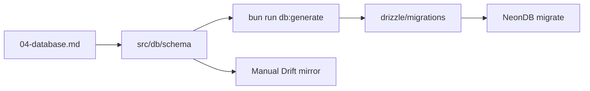

| Command | Purpose |
|---------|---------|
| `bun run db:generate` | Generate migration from schema diff |
| `bun run db:migrate` | Apply to NeonDB |
| `bun run db:studio` | Inspect data (dev only) |

### Rules

- Never edit applied migrations — new file per change
- Additive-first: nullable column → backfill → NOT NULL → constraint
- Breaking changes: ADR in [09-decisions.md](09-decisions.md)
- Neon branches: staging DB branch per environment

### Rollback

| Scenario | Action |
|----------|--------|
| Failed migrate | Fix forward with new migration (no down in prod) |
| Bad deploy | Neon point-in-time restore + redeploy prior API |
| Client incompatible | Block sync; force app update |

### Seed strategy

| Data | Strategy |
|------|----------|
| New business | `business_settings`, default `godown`, `document_number_sequences`, system `expense_categories` |
| Dev/staging | Seed script `scripts/seed-dev.ts` — sample items, parties |
| Production | No global seed; owner creates via onboarding |

---

## Consistency Review

| Check | Status |
|-------|--------|
| No duplicate entities per PRD feature | ✓ Single ownership in [Domain Entity Map](#domain-entity-map) |
| No duplicate tables per document type | ✓ Unified `sales_documents`, `purchase_documents` |
| No cyclic FK dependencies | ✓ Domains flow Identity → Business → CRM/Inventory → Transactions → Accounting |
| Normalization | ✓ Line items separated; polymorphic refs for ledger |
| Naming consistent | ✓ `snake_case`, plural tables, `sync_version` |
| Inventory event-sourced | ✓ `inventory_movements` → `stock_levels` |
| Double-entry ledger | ✓ `ledger_entries` debit/credit |
| Prisma removed | ✓ Drizzle ORM + Drizzle Kit |
| Mermaid diagrams | ✓ ERD + event flowcharts |
| Every PRD Phase 1 feature | ✓ See [01-architecture.md](01-architecture.md#phase-1-coverage-matrix) |

---

## Cross-References

| Topic | Document |
|-------|----------|
| Module boundaries | [01-architecture.md](01-architecture.md#module-responsibilities) |
| API endpoints | [05-api.md](05-api.md) |
| Drizzle ADR | [ADR-005](09-decisions.md#adr-005-why-drizzle) |
| Inventory ledger ADR | [ADR-016](09-decisions.md#adr-016-event-based-inventory-ledger) |
| Double-entry ADR | [ADR-017](09-decisions.md#adr-017-double-entry-accounting) |
