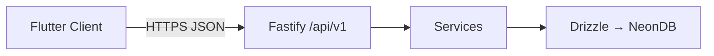
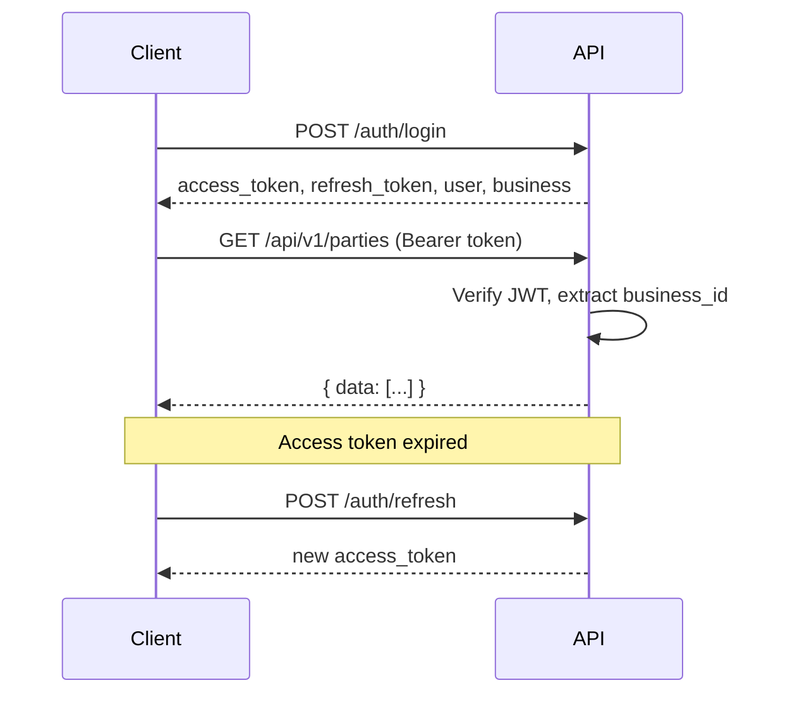
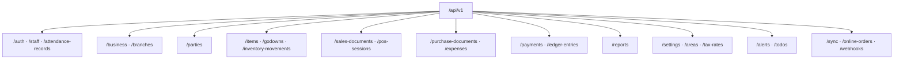
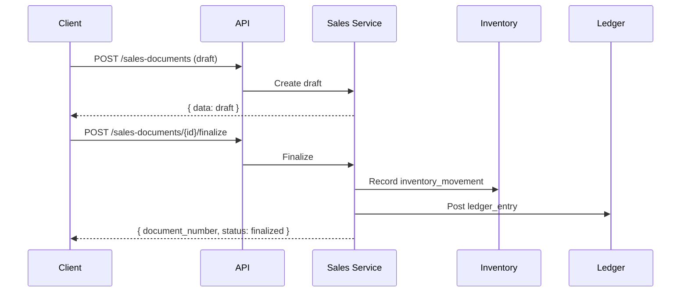
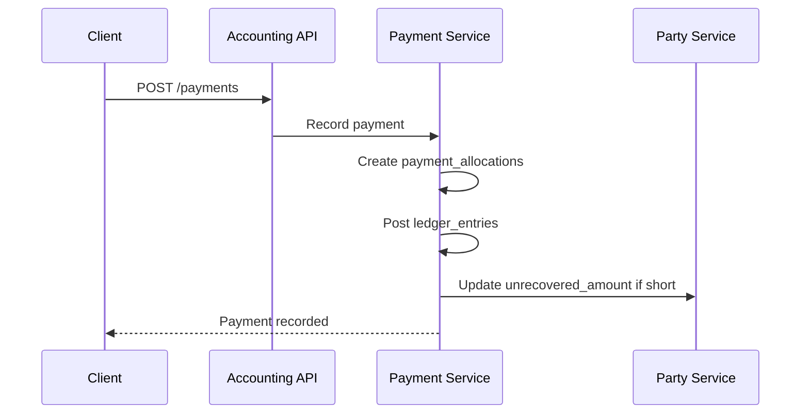
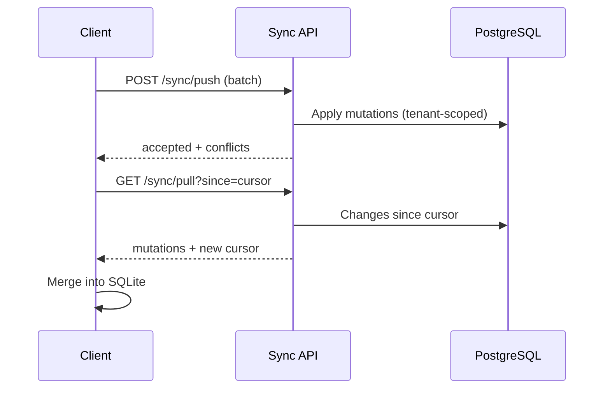

# API

## Purpose

Define the REST API contract for Billing Baba Phase 1 — authentication, business operations, sync, and Nazdikwala integration. This is the contract between Flutter clients and the Fastify API (Bun runtime).

## Scope

Phase 1 MVP endpoints. Phase 2 AI endpoints and third-party marketplace webhooks are listed under future sections only.

**Related docs:** [01-architecture.md](01-architecture.md) · [04-database.md](04-database.md) · [09-decisions.md](09-decisions.md)

## Table of Contents

- [REST Guidelines](#rest-guidelines)
- [Authentication](#authentication)
- [Authorization](#authorization)
- [Permission Model](#permission-model)
- [Response Format](#response-format)
- [Error Format](#error-format)
- [Pagination](#pagination)
- [Filtering](#filtering)
- [Sorting](#sorting)
- [Searching](#searching)
- [Versioning](#versioning)
- [Rate Limiting](#rate-limiting)
- [Validation](#validation)
- [API Naming](#api-naming)
- [Module Ownership](#module-ownership)
- [Endpoint Groups](#endpoint-groups)
- [Authentication APIs](#authentication-apis)
- [Business APIs](#business-apis)
- [Party APIs](#party-apis)
- [Inventory APIs](#inventory-apis)
- [Sales APIs](#sales-apis)
- [Purchase APIs](#purchase-apis)
- [Accounting APIs](#accounting-apis)
- [Reports APIs](#reports-apis)
- [Settings APIs](#settings-apis)
- [Notification APIs](#notification-apis)
- [Staff APIs](#staff-apis)
- [Offline Sync API](#offline-sync-api)
- [Webhook Strategy](#webhook-strategy)
- [Future WebSocket Strategy](#future-websocket-strategy)

---

## REST Guidelines

| Rule | Detail |
|------|--------|
| Base path | `/api/v1` |
| Protocol | HTTPS in production |
| Content-Type | `application/json` |
| Charset | UTF-8 |
| Dates | ISO 8601 (`2026-06-26T10:30:00Z`) |
| IDs | UUID strings in paths and bodies |
| Methods | GET (read), POST (create), PATCH (partial update), DELETE (soft delete) |
| Idempotency | `Idempotency-Key` header on payment and finalize endpoints |
| Nouns | Resource-oriented URLs — `/sales-invoices`, not `/createInvoice` |



---

## Authentication

| Method | Detail |
|--------|--------|
| Scheme | Bearer JWT |
| Header | `Authorization: Bearer <access_token>` |
| Access token | Short-lived (15 min default) |
| Refresh token | Long-lived; `POST /auth/refresh` |



Unauthenticated endpoints: `POST /auth/login`, `POST /auth/register`, `GET /health`.

Auth flow architecture: [01-architecture.md](01-architecture.md#authentication-flow).

---

## Authorization

Every authenticated request is scoped to the JWT's `business_id`. Cross-tenant access returns `403 Forbidden`.

| Layer | Responsibility |
|-------|----------------|
| Middleware | Validate JWT, attach `user_id`, `business_id`, `role` to request context |
| Service | Enforce role permissions and domain rules (e.g. credit limit) |
| Repository | All queries include `WHERE business_id = ?` |

---

## Permission Model

Phase 1 role-based access:

| Role | Capabilities |
|------|--------------|
| `owner` | Full access; settings; staff management; hidden ledger |
| `manager` | All operations except business deletion and role changes |
| `staff` | POS, invoices, parties (read/write); no settings; no staff admin |

| Permission area | Owner | Manager | Staff |
|-----------------|-------|---------|-------|
| Sales / POS | ✓ | ✓ | ✓ |
| Purchases | ✓ | ✓ | ✓ |
| Payments | ✓ | ✓ | ✓ |
| Reports | ✓ | ✓ | Read |
| Settings | ✓ | Read | ✗ |
| Staff / attendance | ✓ | ✓ | Clock self only |
| Hidden ledger view | ✓ | ✓ | ✗ |
| Credit limit bypass | ✓ | ✓ | ✗ |

Permission checks live in services — not route handlers. See [06-coding-standards.md](06-coding-standards.md).

---

## Response Format

### Single resource

```json
{
  "data": {
    "id": "a1b2c3d4-...",
    "name": "Sharma Traders",
    "created_at": "2026-06-26T10:30:00Z"
  }
}
```

### Collection

```json
{
  "data": [
    { "id": "...", "name": "..." }
  ],
  "meta": {
    "page": 1,
    "limit": 20,
    "total": 142
  }
}
```

### Action result (non-resource)

```json
{
  "data": {
    "success": true,
    "message": "Invoice finalized",
    "document_number": "INV-2026-0042"
  }
}
```

---

## Error Format

```json
{
  "error": {
    "code": "CREDIT_LIMIT_EXCEEDED",
    "message": "Invoice total exceeds party credit limit of ₹50,000"
  }
}
```

| HTTP Status | Usage |
|-------------|-------|
| `400` | Validation failure, bad request |
| `401` | Missing or invalid token |
| `403` | Forbidden — role or tenant |
| `404` | Resource not found |
| `409` | Conflict — version mismatch, duplicate number |
| `422` | Business rule violation (credit limit, stock) |
| `429` | Rate limit exceeded |
| `500` | Internal error — no stack trace in response |

Common error codes:

| Code | Meaning |
|------|---------|
| `VALIDATION_ERROR` | Zod schema failure |
| `UNAUTHORIZED` | Auth failure |
| `FORBIDDEN` | Permission denied |
| `NOT_FOUND` | Resource missing |
| `VERSION_CONFLICT` | Optimistic locking failure |
| `CREDIT_LIMIT_EXCEEDED` | Party credit blocked |
| `INSUFFICIENT_STOCK` | Stock below requested quantity |
| `PRICE_CONFLICT` | Historical price alert trigger |
| `DOCUMENT_ALREADY_FINALIZED` | Immutable document mutation |

---

## Pagination

| Parameter | Default | Max |
|-----------|---------|-----|
| `page` | 1 | — |
| `limit` | 20 | 100 |

Example: `GET /api/v1/parties?page=2&limit=50`

---

## Filtering

Filter via query parameters. Multiple filters are AND-combined.

| Pattern | Example |
|---------|---------|
| Equality | `?party_type=customer` |
| Enum | `?status=finalized` |
| Date range | `?from=2026-06-01&to=2026-06-30` |
| Foreign key | `?party_id=<uuid>` |
| Boolean | `?is_gst_formal=true` |

---

## Sorting

| Parameter | Example |
|-----------|---------|
| `sort` | Field name |
| `order` | `asc` or `desc` (default `desc` for dates) |

Example: `GET /api/v1/sales-documents?sort=document_date&order=desc`

---

## Searching

Global omni-search is client-side on SQLite for speed. API search for sync/bootstrap and admin:

| Parameter | Example | Fields searched |
|-----------|---------|-----------------|
| `q` | `?q=sharma` | Name, mobile, document number |
| Scoped | `GET /api/v1/items?q=atta` | Item name, barcode, HSN |

Search is case-insensitive prefix/substring match. Indexes: [04-database.md](04-database.md#indexes).

---

## Versioning

| Approach | Detail |
|----------|--------|
| URL prefix | `/api/v1` for all Phase 1 endpoints |
| Breaking changes | New major version `/api/v2` |
| Schema version | `X-Schema-Version` header in sync handshake |
| Deprecation | `Sunset` header on deprecated endpoints |

---

## Rate Limiting

| Tier | Limit | Scope |
|------|-------|-------|
| Auth | 10 req/min | `/auth/*` per IP |
| Standard | 120 req/min | Per `business_id` |
| Sync push | 30 req/min | `/sync/push` — batches preferred |
| Sync pull | 60 req/min | `/sync/pull` |

Response when exceeded: `429` with `Retry-After` header.

---

## Validation

| Layer | Tool | Responsibility |
|-------|------|----------------|
| Route | Zod schemas | Request body, query, path params |
| Service | Domain validators | Business rules (tax, stock, credit) |
| Database | Drizzle + PostgreSQL constraints | Integrity |

Validation errors return `400` with:

```json
{
  "error": {
    "code": "VALIDATION_ERROR",
    "message": "Invalid request",
    "details": [
      { "field": "mobile", "message": "Invalid phone number" }
    ]
  }
}
```

---

## API Naming

| Element | Convention | Example |
|---------|------------|---------|
| Paths | kebab-case, plural | `/sales-documents` |
| Path params | UUID | `/parties/{partyId}` |
| Query params | snake_case | `party_type` |
| JSON fields | snake_case | `total_amount` |
| Actions | POST sub-resource lifecycle | `POST /sales-documents/{id}/finalize` — see [Lifecycle Actions](#lifecycle-actions) |

---

## Module Ownership

Every route belongs to exactly one backend module. Cross-module reads use service calls — never route-to-route delegation.

| Module | Route prefix | Domain |
|--------|--------------|--------|
| `auth` | `/auth`, `/staff`, `/attendance-records` | Identity |
| `business` | `/business`, `/branches` | Business |
| `parties` | `/parties` | CRM |
| `inventory` | `/items`, `/brands`, `/categories`, `/godowns`, `/stock-levels`, `/inventory-movements`, `/item-locations` | Inventory |
| `sales` | `/sales-documents`, `/pos-sessions` | Sales |
| `purchases` | `/purchase-documents`, `/expenses`, `/expense-categories` | Purchases |
| `accounting` | `/payments`, `/ledger-entries` | Accounting |
| `reports` | `/reports` | Reports |
| `settings` | `/settings`, `/tax-rates`, `/document-sequences`, `/loyalty-rules`, `/areas` | Settings |
| `notifications` | `/alerts`, `/todos` | Notifications |
| `sync` | `/sync`, `/online-orders`, `/webhooks` | Sync |

### Lifecycle Actions

Document state transitions use `POST /{resource}/{id}/{action}` — not RPC function names. These are the only non-CRUD endpoints in Phase 1:

| Action | Endpoint | Module |
|--------|----------|--------|
| Finalize document | `POST /sales-documents/{id}/finalize` | sales |
| Convert document | `POST /sales-documents/{id}/convert` | sales |
| Cancel document | `POST /sales-documents/{id}/cancel` | sales |
| Brand swap | `POST /sales-documents/{id}/brand-swap` | sales |
| Finalize purchase | `POST /purchase-documents/{id}/finalize` | purchases |
| Bootstrap sync | `POST /sync/bootstrap` | sync |

All lifecycle endpoints require `Idempotency-Key` header.

---

## Endpoint Groups

Overview of all Phase 1 route groups:



---

## Authentication APIs

| Method | Path | Auth | Description |
|--------|------|------|-------------|
| POST | `/auth/register` | None | Register business + owner account |
| POST | `/auth/login` | None | Login; returns tokens + user + business |
| POST | `/auth/refresh` | Refresh token | Issue new access token |
| POST | `/auth/logout` | Bearer | Revoke refresh token |
| GET | `/auth/me` | Bearer | Current user profile |
| POST | `/auth/devices` | Bearer | Register device for sync |
| GET | `/health` | None | Health check |

### `POST /auth/login`

**Request:**

```json
{
  "email": "owner@shop.com",
  "password": "..."
}
```

**Response `200`:**

```json
{
  "data": {
    "access_token": "...",
    "refresh_token": "...",
    "expires_in": 900,
    "user": { "id": "...", "name": "...", "role": "owner" },
    "business": { "id": "...", "name": "...", "gstin": "..." }
  }
}
```

---

## Business APIs

| Method | Path | Description |
|--------|------|-------------|
| GET | `/business` | Business profile |
| PATCH | `/business` | Update profile (owner) |
| GET | `/branches` | List branches |
| POST | `/branches` | Create branch |
| PATCH | `/branches/{id}` | Update branch |

---

## Party APIs

**Module:** `parties` · **Domain:** CRM

| Method | Path | Description |
|--------|------|-------------|
| GET | `/parties` | List parties (`party_type`, `area_id`, `q`) |
| POST | `/parties` | Create party |
| GET | `/parties/{id}` | Party detail with balance summary |
| PATCH | `/parties/{id}` | Update party (includes `unrecovered_amount` for owner/manager) |
| DELETE | `/parties/{id}` | Soft delete |
| GET | `/parties/{id}/visits` | Visit history |
| POST | `/parties/{id}/visits` | Log visit |
| GET | `/parties/{id}/attachments` | List attachments |
| POST | `/parties/{id}/attachments` | Upload attachment |
| POST | `/parties/{id}/links` | Link related party |
| GET | `/parties/{id}/loyalty` | Loyalty balance |
| GET | `/parties/{id}/items/{itemId}/price-check` | Historical price conflict check (`unit_price` query) |
| POST | `/parties/{id}/reminders` | Trigger payment reminder (WhatsApp/SMS) |
| GET | `/party-tags` | List tags |
| POST | `/party-tags` | Create tag |
| PATCH | `/party-tags/{id}` | Update tag |
| DELETE | `/party-tags/{id}` | Soft delete tag |

**Hidden ledger:** `unrecovered_amount` returned only for `owner` and `manager`. Never in customer-facing exports.

**Price conflict check:** `GET /parties/{id}/items/{itemId}/price-check?unit_price=80`

Response: `{ "has_conflict": true, "previous_price": 75, "previous_date": "..." }`

Party ledger reads: `GET /ledger-entries?party_id={id}` (Accounting module).

---

## Inventory APIs

**Module:** `inventory` · **Domain:** Inventory

### Items

| Method | Path | Description |
|--------|------|-------------|
| GET | `/items` | List (`q`, `brand_id`, `category_id`) |
| POST | `/items` | Create item |
| GET | `/items/{id}` | Detail with tiers, units, images |
| PATCH | `/items/{id}` | Update item |
| DELETE | `/items/{id}` | Soft delete |
| POST | `/items/import` | CSV/Excel bulk upload |
| GET | `/items/{id}/price-history` | Price history for trend graph |
| GET | `/items/{id}/alternatives` | Brand-swap alternatives (`brand_id` query) |
| GET | `/items/{id}/images` | List images |
| POST | `/items/{id}/images` | Upload image |
| PATCH | `/items/{id}/images/{imageId}` | Reorder / set primary |
| DELETE | `/items/{id}/images/{imageId}` | Remove image |

### Brands, categories, godowns

| Method | Path | Description |
|--------|------|-------------|
| GET | `/brands` | List brands |
| POST | `/brands` | Create brand |
| PATCH | `/brands/{id}` | Update brand |
| GET | `/categories` | List categories |
| POST | `/categories` | Create category |
| PATCH | `/categories/{id}` | Update category |
| GET | `/godowns` | List godowns |
| POST | `/godowns` | Create godown |
| PATCH | `/godowns/{id}` | Update godown |

### Stock

| Method | Path | Description |
|--------|------|-------------|
| GET | `/stock-levels` | Stock levels (`item_id`, `godown_id`, `low_stock=true`) |
| GET | `/stock-levels/{id}` | Single stock level row |
| GET | `/inventory-movements` | Movement audit (`item_id`, `godown_id`, date range) |
| POST | `/inventory-movements` | Record movement (opening, adjustment) |
| GET | `/item-locations` | Shelf locations (`item_id`, `godown_id`) |
| POST | `/item-locations` | Create location |
| PATCH | `/item-locations/{id}` | Update location + photo |
| DELETE | `/item-locations/{id}` | Soft delete |

## Sales APIs

**Module:** `sales` · **Domain:** Sales

| Method | Path | Description |
|--------|------|-------------|
| GET | `/sales-documents` | List (`document_type`, `status`, `party_id`, dates) |
| POST | `/sales-documents` | Create draft (`document_type` in body) |
| GET | `/sales-documents/{id}` | Document with lines |
| PATCH | `/sales-documents/{id}` | Update draft |
| DELETE | `/sales-documents/{id}` | Soft delete draft |
| POST | `/sales-documents/{id}/finalize` | Finalize — inventory + ledger |
| POST | `/sales-documents/{id}/cancel` | Cancel finalized (if allowed) |
| POST | `/sales-documents/{id}/convert` | Convert estimate/challan/kaccha → invoice |
| POST | `/sales-documents/{id}/brand-swap` | Bulk brand swap (`brand_id` in body) |
| GET | `/sales-documents/{id}/lines` | List lines |
| POST | `/sales-documents/{id}/lines` | Add line |
| PATCH | `/sales-documents/{id}/lines/{lineId}` | Update line |
| DELETE | `/sales-documents/{id}/lines/{lineId}` | Remove line |
| GET | `/pos-sessions` | List POS sessions |
| POST | `/pos-sessions` | Open POS session |
| GET | `/pos-sessions/{id}` | Session detail |
| PATCH | `/pos-sessions/{id}` | Close session (`ended_at`, `closing_cash`) |
| GET | `/pos-sessions/{id}/sales-documents` | Session invoices |

### Document type → `document_type` enum

| UI label | API value | Stock on finalize |
|----------|-----------|-------------------|
| Estimate / Quotation | `estimate` | No |
| Sale Order | `sale_order` | No |
| Delivery Challan | `delivery_challan` | Yes |
| Tax Invoice (Pakka) | `tax_invoice` | Yes |
| Bill of Supply | `bill_of_supply` | Yes |
| Normal Invoice (Kaccha) | `normal_invoice` | Yes |
| POS | `pos` | Yes |
| Sales Return | `sales_return` | Restores stock |



### Kaccha → Pakka conversion

`POST /sales-documents/{id}/convert`

```json
{
  "target_type": "tax_invoice",
  "apply_gst": true
}
```

Duplicates record, applies GST, assigns formal number. Does not double-deduct stock. See PRD Section 7.3.

---

## Purchase APIs

**Module:** `purchases` · **Domain:** Purchases

| Method | Path | Description |
|--------|------|-------------|
| GET | `/purchase-documents` | List (`document_type`, `status`, `party_id`, dates) |
| POST | `/purchase-documents` | Create draft |
| GET | `/purchase-documents/{id}` | Detail with lines |
| PATCH | `/purchase-documents/{id}` | Update draft |
| DELETE | `/purchase-documents/{id}` | Soft delete draft |
| POST | `/purchase-documents/{id}/finalize` | Finalize — inventory + payable |
| GET | `/purchase-documents/{id}/lines` | List lines |
| POST | `/purchase-documents/{id}/lines` | Add line |
| PATCH | `/purchase-documents/{id}/lines/{lineId}` | Update line |
| DELETE | `/purchase-documents/{id}/lines/{lineId}` | Remove line |
| GET | `/expenses` | List expenses |
| POST | `/expenses` | Record expense |
| GET | `/expenses/{id}` | Expense detail |
| PATCH | `/expenses/{id}` | Update expense |
| DELETE | `/expenses/{id}` | Soft delete |
| GET | `/expense-categories` | List categories |
| POST | `/expense-categories` | Create category |
| PATCH | `/expense-categories/{id}` | Update category |

| `document_type` | Description |
|-----------------|-------------|
| `purchase_order` | No stock impact on create |
| `purchase_bill` | Increases stock + payable on finalize |
| `purchase_return` | Decreases stock + payable |

---

## Accounting APIs

**Module:** `accounting` · **Domain:** Accounting

### Payments

| Method | Path | Description |
|--------|------|-------------|
| GET | `/payments` | List (`party_id`, `direction`, date range) |
| POST | `/payments` | Record payment (with optional allocations) |
| GET | `/payments/{id}` | Payment detail with allocations |
| PATCH | `/payments/{id}` | Update payment notes |
| DELETE | `/payments/{id}` | Soft delete (owner only, unreconciled) |
| GET | `/payments/{id}/allocations` | List allocations |
| POST | `/payments/{id}/allocations` | Add allocation |
| DELETE | `/payments/{id}/allocations/{allocationId}` | Remove allocation |

### Ledger

| Method | Path | Description |
|--------|------|-------------|
| GET | `/ledger-entries` | List (`party_id`, `entry_date`, `entry_type`) |
| GET | `/ledger-entries/{id}` | Single entry |
| POST | `/ledger-entries` | Opening balance entry (owner) |

### Short payment handling

When `paid_amount < invoice_total`, include in `POST /payments`:

```json
{
  "party_id": "...",
  "amount": 10000,
  "direction": "received",
  "payment_mode": "cash",
  "allocations": [{ "sales_document_id": "...", "allocated_amount": 9850 }],
  "short_payment_handling": "unrecovered"
}
```

`short_payment_handling`: `official_balance` or `unrecovered` (hidden ledger on CRM party).



---

## Reports APIs

**Module:** `reports` · **Domain:** Reports (read-only)

| Method | Path | Description |
|--------|------|-------------|
| GET | `/reports/gstr-1` | GSTR-1 export (`from`, `to`) |
| GET | `/reports/gstr-2` | GSTR-2 export |
| GET | `/reports/gstr-3b` | GSTR-3B summary |
| GET | `/reports/profit-loss` | P&L (`from`, `to`) |
| GET | `/reports/stock-summary` | Stock valuation (FIFO/average) |
| GET | `/reports/day-book` | Day book (`date`) |
| GET | `/reports/party-outstanding` | Receivable / payable summary |
| GET | `/reports/sales-by-area` | Area heatmap data |

Response format: JSON `data` or `Content-Type: application/csv` when `?format=csv`.

---

## Settings APIs

**Module:** `settings` · **Domain:** Settings

| Method | Path | Description |
|--------|------|-------------|
| GET | `/settings` | Business settings bundle |
| PATCH | `/settings` | Update settings |
| GET | `/tax-rates` | GST rate slabs |
| POST | `/tax-rates` | Create rate |
| PATCH | `/tax-rates/{id}` | Update rate |
| DELETE | `/tax-rates/{id}` | Soft delete |
| GET | `/document-sequences` | Number sequences |
| PATCH | `/document-sequences/{id}` | Update prefix/next |
| GET | `/loyalty-rules` | Loyalty configuration |
| PATCH | `/loyalty-rules` | Update rules |
| GET | `/areas` | List delivery areas |
| POST | `/areas` | Create area |
| PATCH | `/areas/{id}` | Update area |
| DELETE | `/areas/{id}` | Soft delete |

---

## Notification APIs

**Module:** `notifications` · **Domain:** Notifications

| Method | Path | Description |
|--------|------|-------------|
| GET | `/alerts` | System alerts |
| PATCH | `/alerts/{id}` | Mark read (`is_read: true`) |
| GET | `/todos` | Dashboard todos |
| POST | `/todos` | Create todo |
| GET | `/todos/{id}` | Todo detail |
| PATCH | `/todos/{id}` | Update / complete |
| DELETE | `/todos/{id}` | Soft delete |

---

## Staff APIs

**Module:** `auth` · **Domain:** Identity

| Method | Path | Description |
|--------|------|-------------|
| GET | `/staff` | List users |
| POST | `/staff` | Create staff account |
| GET | `/staff/{id}` | Staff detail |
| PATCH | `/staff/{id}` | Update staff |
| DELETE | `/staff/{id}` | Deactivate staff |
| GET | `/attendance-records` | List (`user_id`, date range) |
| POST | `/attendance-records` | Clock in (`user_id`, `clock_in_at`) |
| PATCH | `/attendance-records/{id}` | Clock out (`clock_out_at`, `status`) |

## Offline Sync API

**Module:** `sync` · **Domain:** Sync

Primary cloud interface for offline-first operation. See [01-architecture.md](01-architecture.md#offline-sync-overview).

| Method | Path | Description |
|--------|------|-------------|
| POST | `/sync/push` | Push batched local mutations |
| GET | `/sync/pull` | Pull changes since cursor |
| GET | `/sync/status` | Last sync time, pending count |
| POST | `/sync/bootstrap` | Initial full dataset download |
| GET | `/sync/schema-version` | Current schema version |
| GET | `/online-orders` | List Nazdikwala orders (`status`) |
| GET | `/online-orders/{id}` | Order detail |
| PATCH | `/online-orders/{id}` | Accept/reject (`status`, creates sales doc on accept) |

### `POST /sync/push`

**Request:**

```json
{
  "device_id": "...",
  "mutations": [
    {
      "entity_type": "sales_documents",
      "entity_id": "...",
      "operation": "create",
      "sync_version": 1,
      "payload": { ... },
      "client_updated_at": "2026-06-26T10:30:00Z"
    }
  ]
}
```

**Response:**

```json
{
  "data": {
    "accepted": ["entity_id_1"],
    "conflicts": [
      {
        "entity_type": "sales_documents",
        "entity_id": "...",
        "server_sync_version": 3,
        "server_payload": { ... }
      }
    ],
    "errors": []
  }
}
```

### `GET /sync/pull`

**Query:** `?since=2026-06-26T09:00:00Z&limit=500`

**Response:**

```json
{
  "data": {
    "mutations": [ ... ],
    "cursor": "2026-06-26T10:35:00Z",
    "has_more": false
  }
}
```



---

## Webhook Strategy

Phase 1 webhooks — Nazdikwala integration only.

| Direction | Endpoint | Event |
|-----------|----------|-------|
| Inbound | `POST /webhooks/nazdikwala/orders` | New online order |
| Inbound | `POST /webhooks/nazdikwala/order-status` | Order status update |
| Outbound | Nazdikwala catalog API | Item create/update/delete |
| Outbound | Nazdikwala stock API | Stock level change |

### Inbound security

| Mechanism | Detail |
|-----------|--------|
| Signature | `X-Nazdikwala-Signature` HMAC-SHA256 |
| Idempotency | `external_order_id` deduplication |
| Processing | Persist `online_orders`; client pulls via sync |

### Outbound triggers

Stock changes and catalog updates fan out after local write + successful sync push.

Future marketplace webhooks (Swiggy, Zomato): see [Future WebSocket Strategy](#future-websocket-strategy).

---

## Future WebSocket Strategy

Not Phase 1. Planned for real-time Nazdikwala order stream and multi-device live indicators.

| Use case | Channel | Fallback |
|----------|---------|----------|
| New online order | `ws://.../orders` | Poll `GET /online-orders?status=pending` |
| Sync conflict alert | `ws://.../sync` | Next pull cycle |
| Marketplace inventory | `ws://.../marketplace` | REST webhook (Phase 2+) |

WebSocket auth: JWT in connection handshake. Reconnect with exponential backoff.

---

## Cross-References

| Topic | Document |
|-------|----------|
| Entity schemas | [04-database.md](04-database.md) |
| Sync architecture | [01-architecture.md](01-architecture.md) |
| Technology ADRs | [09-decisions.md](09-decisions.md) |
| Coding standards | [06-coding-standards.md](06-coding-standards.md) |
