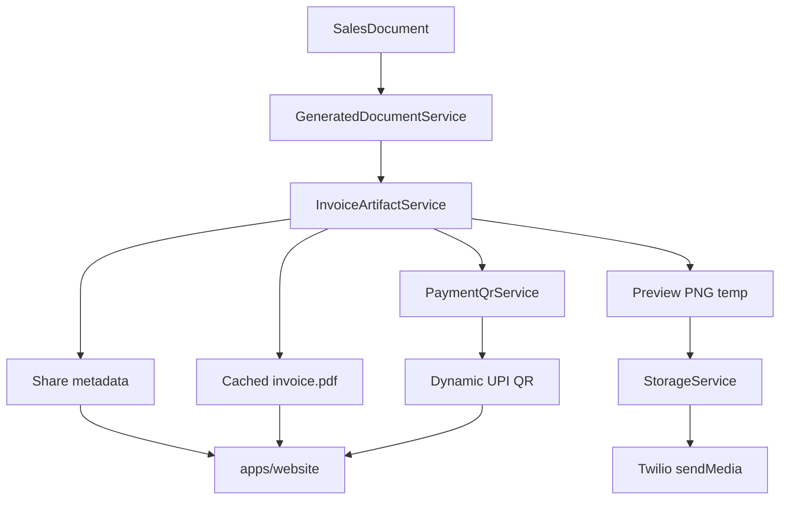

# Architecture Decision Records

## Purpose

Record significant architectural and technical decisions for Billing Baba. ADRs provide context for why the system is built the way it is.

## Scope

Phase 1 decisions. Superseded decisions will be marked when stack changes occur.

**Related docs:** [01-architecture.md](01-architecture.md) · [04-database.md](04-database.md) · [05-api.md](05-api.md) · [11-sync-api-contract.md](11-sync-api-contract.md)

## Table of Contents

- [ADR Index](#adr-index)
- [ADR-001: Why PostgreSQL](#adr-001-why-postgresql)
- [ADR-002: Why UUID](#adr-002-why-uuid)
- [ADR-003: Why Modular Monolith](#adr-003-why-modular-monolith)
- [ADR-004: Why REST](#adr-004-why-rest)
- [ADR-005: Why Drizzle](#adr-005-why-drizzle)
- [ADR-006: Why Flutter](#adr-006-why-flutter)
- [ADR-007: Offline First](#adr-007-offline-first)
- [ADR-008: Soft Delete](#adr-008-soft-delete)
- [ADR-009: Single Source of Truth](#adr-009-single-source-of-truth)
- [ADR-010: Business Domain Separation](#adr-010-business-domain-separation)
- [ADR-011: Why Fastify](#adr-011-why-fastify)
- [ADR-012: Why Drift](#adr-012-why-drift)
- [ADR-013: Why Riverpod](#adr-013-why-riverpod)
- [ADR-014: Unified Sales Documents](#adr-014-unified-sales-documents)
- [ADR-015: Unified Purchase Documents](#adr-015-unified-purchase-documents)
- [ADR-016: Event-based Inventory Ledger](#adr-016-event-based-inventory-ledger)
- [ADR-017: Double Entry Accounting](#adr-017-double-entry-accounting)
- [ADR-018: OTP Authentication and Accounts Identity](#adr-018-otp-authentication-and-accounts-identity)
- [ADR-019: Sale Order Document Type](#adr-019-sale-order-document-type)
- [ADR-020: Job Work Out Domain](#adr-020-job-work-out-domain)
- [ADR-021: Sales Document Attachments](#adr-021-sales-document-attachments)
- [ADR-022: Provider-Agnostic Outbound Notifications](#adr-022-provider-agnostic-outbound-notifications)
- [ADR-023: Provider-Agnostic Object Storage](#adr-023-provider-agnostic-object-storage)
- [ADR-024: Invoice Artifact System](#adr-024-invoice-artifact-system)
- [ADR-025: Sync Contract (Hybrid + LOCAL Remap + Command Idempotency)](#adr-025-sync-contract-hybrid-local-remap-command-idempotency)
- [ADR-026: MVP Sync Simplicity (No Client Registry)](#adr-026-mvp-sync-simplicity-no-client-registry)
- [ADR-027: Phase 2 Command Sync Foundation](#adr-027-phase-2-command-sync-foundation)
- [ADR-041: Allow Negative Stock on Sales](#adr-041-allow-negative-stock-on-sales)

---

## ADR Index

| ID | Title | Date | Status |
|----|-------|------|--------|
| ADR-001 | Why PostgreSQL | June 2026 | Accepted |
| ADR-002 | Why UUID | June 2026 | Accepted |
| ADR-003 | Why Modular Monolith | June 2026 | Accepted |
| ADR-004 | Why REST | June 2026 | Accepted |
| ADR-005 | Why Drizzle | June 2026 | Accepted |
| ADR-006 | Why Flutter | June 2026 | Accepted |
| ADR-007 | Offline First | June 2026 | Accepted |
| ADR-008 | Soft Delete | June 2026 | Accepted |
| ADR-009 | Single Source of Truth | June 2026 | Accepted |
| ADR-010 | Business Domain Separation | June 2026 | Accepted |
| ADR-011 | Why Fastify | June 2026 | Accepted |
| ADR-012 | Why Drift | June 2026 | Accepted |
| ADR-013 | Why Riverpod | June 2026 | Accepted |
| ADR-014 | Unified Sales Documents | June 2026 | Accepted |
| ADR-015 | Unified Purchase Documents | June 2026 | Accepted |
| ADR-016 | Event-based Inventory Ledger | June 2026 | Accepted |
| ADR-017 | Double Entry Accounting | June 2026 | Accepted |
| ADR-018 | OTP Authentication and Accounts Identity | July 2026 | Accepted |
| ADR-019 | Sale Order Document Type | July 2026 | Accepted |
| ADR-020 | Job Work Out Domain | July 2026 | Accepted |
| ADR-021 | Sales Document Attachments | July 2026 | Superseded |
| ADR-022 | Provider-Agnostic Outbound Notifications | July 2026 | Accepted |
| ADR-023 | Provider-Agnostic Object Storage | July 2026 | Accepted |
| ADR-024 | Invoice Artifact System | July 2026 | Accepted |
| ADR-025 | Sync Contract (Hybrid + LOCAL Remap + Command Idempotency) | July 2026 | Accepted |
| ADR-026 | MVP Sync Simplicity (No Client Registry) | July 2026 | Accepted |
| ADR-027 | Phase 2 Command Sync Foundation | July 2026 | Accepted |
| ADR-041 | Allow Negative Stock on Sales | July 2026 | Accepted |

---

## ADR-001: Why PostgreSQL

| Field | Value |
|-------|-------|
| **Date** | June 2026 |
| **Status** | Accepted |
| **Author** | Technical Lead |

### Context

Billing Baba requires a cloud database for multi-device sync, backup, and relational integrity across parties, inventory, sales documents, ledger entries, and payments. The PRD defines complex B2B workflows with foreign keys, transactional consistency (finalize invoice = stock + ledger), and Indian GST reporting.

### Decision

Use **PostgreSQL** as the cloud database, hosted on **NeonDB** (serverless PostgreSQL with branching for staging).

### Consequences

**Positive:**

- ACID transactions for finalize flows (stock movement + ledger + document status in one transaction)
- Mature indexing, constraints, and JSON columns for `online_orders.order_payload`
- Strong ecosystem with Drizzle, NeonDB branching, and backup tooling
- NeonDB serverless scaling and database branching for preview environments
- Row-level tenant isolation via `business_id` without per-tenant databases in Phase 1

**Negative:**

- Requires managed hosting and migration discipline
- SQLite (client) and PostgreSQL schemas must stay aligned manually via Drift + Drizzle

### Alternatives Considered

| Alternative | Rejected because |
|-------------|------------------|
| MongoDB | Poor fit for ledger and document-line relational model; reporting queries are relational |
| MySQL | Comparable to PostgreSQL; PostgreSQL has stronger JSON and constraint tooling |
| Firebase/Firestore | Offline sync model conflicts with custom sync requirements; query limitations for reports |
| Per-device cloud only | No multi-device sync or centralized backup |

**References:** [04-database.md](04-database.md), [01-architecture.md](01-architecture.md#system-overview)

---

## ADR-002: Why UUID

| Field | Value |
|-------|-------|
| **Date** | June 2026 |
| **Status** | Accepted |
| **Author** | Technical Lead |

### Context

Offline-first clients create records without server contact. Auto-increment integers collide when two devices create invoices or parties simultaneously. Sync must merge records without ID remapping.

### Decision

Use **UUID v4** primary keys for all synced business entities. Sequential `document_number` is separate from PK.

### Consequences

**Positive:**

- Client-generated IDs safe for offline creates
- No ID remapping on sync — reduces complexity and bugs
- Globally unique references in `inventory_movements.reference_id` and `ledger_entries.reference_id`

**Negative:**

- Larger indexes than integers (16 bytes vs 4–8)
- UUIDs are not human-readable — UI uses `document_number` for display
- Random UUIDs reduce index locality vs sequential IDs (acceptable at Phase 1 scale)

### Alternatives Considered

| Alternative | Rejected because |
|-------------|------------------|
| Auto-increment (server only) | Offline creates cannot obtain next ID without network |
| Composite device prefix + local counter | Fragile; harder to query and index |
| ULID | Valid option; UUID v4 sufficient and widely supported in Flutter/Node |

**References:** [04-database.md](04-database.md#primary-keys), [04-database.md](04-database.md#uuid-strategy)

---

## ADR-003: Why Modular Monolith

| Field | Value |
|-------|-------|
| **Date** | June 2026 |
| **Status** | Accepted |
| **Author** | Technical Lead |

### Context

Phase 1 team is small. The PRD covers many domains (sales, purchases, inventory, parties, accounting, reports) but deployment and operational complexity must stay low for MVP velocity.

### Decision

Build a **modular monolith** — single Fastify deployable with domain-aligned modules (`auth`, `sales`, `parties`, etc.). No microservices in Phase 1.

### Consequences

**Positive:**

- Single deployment, single database, simple debugging
- Module boundaries match business domains — extraction path exists if needed
- Shared transactions across domains (finalize invoice touches Sales + Inventory + Accounting)
- Lower infrastructure cost for MVP

**Negative:**

- All modules scale together horizontally (acceptable at Phase 1 load)
- Discipline required to prevent cross-module spaghetti — enforced via dependency rules

### Alternatives Considered

| Alternative | Rejected because |
|-------------|------------------|
| Microservices | Operational overhead exceeds team capacity for MVP |
| Serverless functions | Poor fit for long sync batches and transactional finalize flows |
| Separate sync service | Premature; Sync module within monolith is sufficient |

**References:** [01-architecture.md](01-architecture.md#bounded-contexts), [01-architecture.md](01-architecture.md#module-responsibilities)

---

## ADR-004: Why REST

| Field | Value |
|-------|-------|
| **Date** | June 2026 |
| **Status** | Accepted |
| **Author** | Technical Lead |

### Context

The API serves Flutter clients performing batch sync, CRUD operations, and occasional cloud-only actions (bootstrap, webhooks). Real-time POS does not depend on the API.

### Decision

Use **REST** over HTTP with JSON. Base path `/api/v1`. WebSockets deferred to future phase.

### Consequences

**Positive:**

- Predictable resource URLs for each entity group
- Batch sync via `/sync/push` and `/sync/pull` fits REST naturally
- Easy to test, document, and debug
- CDN and standard HTTP tooling compatible

**Negative:**

- No built-in real-time push — Nazdikwala orders use webhook + sync pull in Phase 1
- Multiple round trips for complex reads — mitigated by client SQLite as primary read path

### Alternatives Considered

| Alternative | Rejected because |
|-------------|------------------|
| GraphQL | Added complexity; sync batch model doesn't benefit from flexible queries |
| gRPC | Poor browser/tooling fit; Flutter support adds friction |
| WebSockets (primary) | POS is offline-first; REST sufficient for sync cadence |

**References:** [05-api.md](05-api.md), [05-api.md](05-api.md#future-websocket-strategy)

---

## ADR-005: Why Drizzle

| Field | Value |
|-------|-------|
| **Date** | June 2026 |
| **Status** | Accepted |
| **Author** | Technical Lead |

### Context

The API needs type-safe PostgreSQL access on NeonDB, schema migrations, and SQL-transparent queries for ERP reports (GSTR, day book, ledger). Team uses TypeScript with Fastify and Bun. Prisma was initially considered but rejected for better SQL control and lighter runtime.

### Decision

Use **Drizzle ORM** with **Drizzle Kit** for schema definitions, migrations, and queries. Schema lives in `src/db/schema/`; migrations in `drizzle/migrations/`.

### Consequences

**Positive:**

- SQL-like query builder — complex reports use raw SQL or Drizzle joins without abstraction leak
- Lightweight runtime; fits Bun and long-running sync workers
- `drizzle-kit generate` / `migrate` integrates with NeonDB
- Zod integration via `drizzle-zod` for API validation alignment
- Schema is TypeScript — same language as services

**Negative:**

- Client uses Drift — two schemas must be kept in sync manually against [04-database.md](04-database.md)
- Migration UX less visual than Prisma Studio — `drizzle-kit studio` for dev

### Alternatives Considered

| Alternative | Rejected because |
|-------------|------------------|
| Prisma | Heavier runtime; opaque SQL for complex GST reports; superseded |
| Raw SQL + pg | No type safety at 40+ tables |
| TypeORM | Less active ecosystem for new TypeScript projects |

**References:** [04-database.md](04-database.md#migration-strategy), [01-architecture.md](01-architecture.md#technology-decisions)

---

## ADR-006: Why Flutter

| Field | Value |
|-------|-------|
| **Date** | June 2026 |
| **Status** | Accepted |
| **Author** | Technical Lead |

### Context

PRD targets **desktop (Windows, macOS)** as primary platform with **mobile (Android, iOS)** support. POS requires keyboard-first operation, fast rendering, and offline SQLite. Vyapar-inspired UI must feel native on desktop.

### Decision

Use **Flutter** for the client with Riverpod, GoRouter, and Drift.

### Consequences

**Positive:**

- Single codebase for four platforms — critical for small team
- Strong desktop support for keyboard POS (Tab, Enter, F-keys, Alt shortcuts)
- Drift provides type-safe SQLite — aligns with offline-first
- Rich widget ecosystem for sparklines, drag-and-drop dashboard widgets

**Negative:**

- Flutter desktop still maturing — occasional platform-specific issues
- Larger app binary than native
- Team must learn Dart if not already familiar

### Alternatives Considered

| Alternative | Rejected because |
|-------------|------------------|
| React Native | Desktop support insufficient for primary POS use case |
| Electron + web | Higher memory footprint; offline SQLite less integrated |
| Native per platform | 4× development and maintenance cost |
| .NET MAUI | Smaller mobile ecosystem in target market |

**References:** [01-architecture.md](01-architecture.md#client-architecture), [00-project.md](00-project.md)

---

## ADR-007: Offline First

| Field | Value |
|-------|-------|
| **Date** | June 2026 |
| **Status** | Accepted |
| **Author** | Technical Lead |

### Context

PRD explicitly requires offline-first resilience: shopkeepers execute 50+ daily transactions, often with spotty internet. Sync indicator shows "Offline (Saving locally)" as normal state. POS must never block on network.

### Decision

**Offline-first architecture:** SQLite on device is the write path for all POS and billing operations. Cloud sync runs in background. API scope is auth, sync, backup — not real-time POS.

### Consequences

**Positive:**

- Uninterrupted billing during network outages — core PRD requirement
- Sub-millisecond local reads for omni-search and POS
- Graceful degradation — app fully functional offline

**Negative:**

- Sync complexity: conflict resolution, tombstones, schema versioning
- Two databases to maintain (Drift + Drizzle)
- Initial bootstrap download can be large for established businesses

### Alternatives Considered

| Alternative | Rejected because |
|-------------|------------------|
| Online-first with local cache | Network dependency violates PRD; POS fails when offline |
| Read offline / write online | Writes blocked without network — unacceptable for billing |
| PouchDB/CouchDB sync | Less control over conflict rules and Indian ERP domain logic |

**References:** [01-architecture.md](01-architecture.md#offline-sync-overview), [05-api.md](05-api.md#offline-sync-api)

---

## ADR-008: Soft Delete

| Field | Value |
|-------|-------|
| **Date** | June 2026 |
| **Status** | Accepted |
| **Author** | Technical Lead |

### Context

Deleted records must propagate to all synced devices. Hard deletes cause orphan references in offline queues and ledger audit trails. GST compliance requires transaction history retention.

### Decision

Use **soft delete** via `deleted_at` timestamp on all mutable business entities. Sync propagates tombstones.

### Consequences

**Positive:**

- Remote devices receive delete events via sync pull
- Audit and compliance — historical reports still reference deleted parties/items
- Recoverable mistakes — unset `deleted_at` if needed (owner action)

**Negative:**

- Queries must filter `deleted_at IS NULL` consistently
- Unique constraints may need partial indexes `(business_id, mobile) WHERE deleted_at IS NULL`
- Storage grows — acceptable; archived data compresses well

### Alternatives Considered

| Alternative | Rejected because |
|-------------|------------------|
| Hard delete + sync delete op only | Offline devices may miss delete if sync fails; orphans remain |
| Archive tables | Doubles schema complexity for marginal benefit in Phase 1 |
| Status flag `is_deleted` | Equivalent to `deleted_at`; timestamp enables conflict ordering |

**References:** [04-database.md](04-database.md#soft-delete), [04-database.md](04-database.md#sync-metadata)

---

## ADR-009: Single Source of Truth

| Field | Value |
|-------|-------|
| **Date** | June 2026 |
| **Status** | Accepted |
| **Author** | Technical Lead |

### Context

Dual-database architecture risks confusion about which store is authoritative for operational vs cloud data. PRD Section 10 describes cloud as integration hub, but POS must not depend on cloud latency.

### Decision

| Context | Source of truth |
|---------|-----------------|
| **Operational (POS, billing)** | Local SQLite on each device |
| **Multi-device reconciliation** | PostgreSQL after successful sync push |
| **Backup / disaster recovery** | PostgreSQL |
| **Nazdikwala catalog** | PostgreSQL → outbound sync to marketplace |

Local writes are immediate. Cloud reconciles on sync. Conflict resolution: last-write-wins with version check; stock reconciled from movement ledger.

### Consequences

**Positive:**

- Clear mental model for engineers: write local, sync cloud
- POS latency independent of network
- Cloud remains integration point for Nazdikwala without blocking sales

**Negative:**

- Brief inconsistency between devices until sync completes
- Engineers must never read PostgreSQL for client UI logic

### Alternatives Considered

| Alternative | Rejected because |
|-------------|------------------|
| Cloud as sole source of truth | POS blocked without network |
| Eventual consistency without version | Harder to detect and resolve conflicts |
| Per-entity source assignment | Too complex for team and debugging |

**References:** [01-architecture.md](01-architecture.md#architecture-principles), [01-architecture.md](01-architecture.md#offline-sync-overview)

---

## ADR-010: Business Domain Separation

| Field | Value |
|-------|-------|
| **Date** | June 2026 |
| **Status** | Accepted |
| **Author** | Technical Lead |

### Context

Billing Baba spans sales, purchases, inventory, parties, accounting, payments, and reports. Without clear boundaries, business logic leaks into widgets and route handlers — unmaintainable for an ERP.

### Decision

Organize code by **business domain** — not by screen or technical layer alone.

**Backend:** `src/modules/{domain}/` with routes, services, db per module.

**Client:** `lib/features/{domain}/` with presentation, domain, data layers.

Domains: Identity, Business, CRM, Inventory, Sales, Purchases, Accounting, Reports, Settings, Notifications, Sync.

Payments belong to the **Accounting** domain (module `accounting`). Catalog capabilities belong to **Inventory** (module `inventory`).

Cross-domain calls go through **service interfaces** only. Routes and widgets stay thin.

### Consequences

**Positive:**

- Parallel development — teams can own domains
- Testable services isolated from HTTP and UI
- Extraction to microservices possible at module boundaries
- Aligns with PRD feature groupings

**Negative:**

- Requires discipline — shared utilities must not become a junk drawer
- Some workflows cross domains (finalize invoice) — orchestration in Sales service with explicit Inventory/Accounting calls

### Alternatives Considered

| Alternative | Rejected because |
|-------------|------------------|
| Layer-only structure (`controllers/`, `models/`) | Domains scattered; hard to navigate ERP-scale codebase |
| Screen-based features only | Duplicates catalog logic across sales and purchases screens |
| Shared anemic domain model | Business rules spread across handlers |

**References:** [01-architecture.md](01-architecture.md#business-domains), [01-architecture.md](01-architecture.md#dependency-rules), [06-coding-standards.md](06-coding-standards.md)

---

## ADR-011: Why Fastify

| Field | Value |
|-------|-------|
| **Date** | June 2026 |
| **Status** | Accepted |
| **Author** | Technical Lead |

### Context

The API requires a performant Node.js HTTP framework for REST endpoints, JWT auth, rate limiting, and modular routing aligned to business domains. Runtime is **Bun** for development and production scripts.

### Decision

Use **Fastify** with TypeScript for the REST API server.

### Consequences

**Positive:**

- High throughput for sync batch endpoints
- Schema-based validation via `@fastify/type-provider-typebox` or Zod wrappers
- Plugin ecosystem: JWT, CORS, rate limit, Swagger
- Modular routing via encapsulated plugins per domain module
- Native Bun compatibility with `tsx` / Bun runtime

**Negative:**

- Different plugin patterns than Express — team onboarding required
- Must use async handlers consistently

### Alternatives Considered

| Alternative | Rejected because |
|-------------|------------------|
| Express | Slower; less schema-native validation; Fastify chosen for sync throughput |
| Hono | Smaller plugin ecosystem for ERP middleware needs |
| NestJS | DI overhead excessive for modular monolith MVP |

**References:** [01-architecture.md](01-architecture.md#backend-architecture), [05-api.md](05-api.md)

---

## ADR-012: Why Drift

| Field | Value |
|-------|-------|
| **Date** | June 2026 |
| **Status** | Accepted |
| **Author** | Technical Lead |

### Context

Offline-first requires type-safe SQLite access on Flutter with migrations, queries, and schema parity with cloud PostgreSQL. Raw `sqflite` lacks compile-time safety at ERP scale.

### Decision

Use **Drift** (formerly Moor) as the Flutter SQLite ORM with code-generated DAOs and migrations.

### Consequences

**Positive:**

- Type-safe queries and compile-time table definitions
- Migration system mirrors Drizzle Kit workflow on cloud
- Stream-based queries for reactive UI (Riverpod integration)
- Strong SQLite performance on desktop and mobile

**Negative:**

- Code generation step in build pipeline
- Schema must be manually kept in sync with Drizzle cloud schema
- Learning curve for developers new to Drift

### Alternatives Considered

| Alternative | Rejected because |
|-------------|------------------|
| sqflite raw | No type safety; unmaintainable at 40+ tables |
| Isar | Different query model; less SQL-transparent for report queries |
| Hive | Not relational — unsuitable for ERP joins and ledger |

**References:** [04-database.md](04-database.md), [ADR-007](09-decisions.md#adr-007-offline-first)

---

## ADR-013: Why Riverpod

| Field | Value |
|-------|-------|
| **Date** | June 2026 |
| **Status** | Accepted |
| **Author** | Technical Lead |

### Context

Flutter client needs testable, composable state management across 10+ feature domains without `setState` spaghetti. POS and dashboard require granular rebuilds and provider composition.

### Decision

Use **Riverpod** for all application and feature state. GoRouter for navigation.

### Consequences

**Positive:**

- Compile-safe provider references
- Easy testing — override providers in widget tests
- `AsyncValue` pattern for loading/error/empty states (PRD requirement)
- Provider composition for cross-domain dashboard reads

**Negative:**

- Team must avoid business logic in providers — delegate to services
- Riverpod 2.x patterns require onboarding

### Alternatives Considered

| Alternative | Rejected because |
|-------------|------------------|
| Bloc | More boilerplate for CRUD-heavy ERP screens |
| Provider | Less compile safety than Riverpod |
| setState | Forbidden for feature state per architecture rules |

**References:** [01-architecture.md](01-architecture.md#client-architecture), [06-coding-standards.md](06-coding-standards.md)

---

## ADR-014: Unified Sales Documents

| Field | Value |
|-------|-------|
| **Date** | June 2026 |
| **Status** | Accepted |
| **Author** | Technical Lead |

### Context

PRD defines seven outward document types (estimate, challan, tax invoice, bill of supply, normal invoice, POS, sales return) sharing identical structure: header, lines, party, tax, totals, conversion chain. Separate tables per type would duplicate schema, sync, and API surface.

### Decision

Single polymorphic table `sales_documents` with `document_type` enum and shared `sales_document_lines`. POS uses `document_type = pos` with optional `pos_session_id`.

### Consequences

**Positive:**

- One API resource (`/sales-documents`) with type filter
- Unified sync entity type
- Convert estimate→invoice, challan→invoice, kaccha→pakka via `converted_from_id` without cross-table joins
- Single index strategy for omni-search by document number

**Negative:**

- Some columns nullable depending on type (e.g. `party_id` for walk-in POS)
- Service layer must enforce per-type rules (stock impact, GST formalization)

### Alternatives Considered

| Alternative | Rejected because |
|-------------|------------------|
| Table per document type | 7 header + 7 line tables; sync and API duplication |
| Single table without type enum | Cannot enforce per-type business rules |
| JSON lines embedded in header | Poor query performance for GSTR line reports |

**References:** [04-database.md](04-database.md#sales_documents), [05-api.md](05-api.md#sales-apis)

---

## ADR-015: Unified Purchase Documents

| Field | Value |
|-------|-------|
| **Date** | June 2026 |
| **Status** | Accepted |
| **Author** | Technical Lead |

### Context

PRD defines purchase orders, purchase bills, and purchase returns with shared header/line structure. Expenses are separate (non-inventory operational costs) but remain in Purchases domain.

### Decision

Single polymorphic table `purchase_documents` with `document_type` enum and shared `purchase_document_lines`. Expenses use separate `expenses` table.

### Consequences

**Positive:**

- Mirrors sales document pattern — consistent mental model
- One finalize flow with type-specific stock and ledger rules
- Reduced migration and sync surface

**Negative:**

- Purchase orders and bills share table — status/type guards required in service layer

### Alternatives Considered

| Alternative | Rejected because |
|-------------|------------------|
| Separate tables per purchase type | Duplication without distinct schema needs |
| Merge expenses into purchase_documents | Expenses have no line items or supplier invoice structure |

**References:** [04-database.md](04-database.md#purchase_documents), [05-api.md](05-api.md#purchase-apis)

---

## ADR-017: Purchase Fixed Assets — Batch + Asset Lines

| Field | Value |
|-------|-------|
| **Date** | July 2026 |
| **Status** | Accepted |

### Decision

Purchase Fixed Assets use `purchase_fa_batches` (header) and `purchase_fixed_assets` (line rows). Each form save creates one batch with N asset lines, matching the existing multi-line FA UI without extending `purchase_documents`.

### Consequences

- List API returns batches; detail includes asset lines.
- Serial number uniqueness enforced per business on asset lines.

---

## ADR-016: Event-based Inventory Ledger

| Field | Value |
|-------|-------|
| **Date** | June 2026 |
| **Status** | Accepted |
| **Author** | Technical Lead |

### Context

Multi-device offline sync causes stock quantity conflicts. Updating `stock_levels.quantity` directly loses audit history and makes reconciliation impossible. PRD requires opening stock, movement tracking, and FIFO/average valuation.

### Decision

Use append-only **`inventory_movements`** as the stock event ledger. `stock_levels` is a **derived cache** updated on each movement. Sync conflicts reconcile by replaying movements.

### Consequences

**Positive:**

- Full audit trail — every sale, purchase, return, challan, adjustment recorded
- Conflict resolution replays movement ledger instead of overwriting quantity
- Supports per-godown stock with `godown_id` on movements
- GSTR and stock valuation reports query movements for cost basis

**Negative:**

- Must never update or delete movements — only append
- `stock_levels` can drift if update fails — periodic reconciliation job recommended

### Alternatives Considered

| Alternative | Rejected because |
|-------------|------------------|
| Update stock_levels only | No audit; sync conflicts corrupt quantity |
| stock_movements name | Renamed to `inventory_movements` for domain clarity |
| Event sourcing full replay on every read | Too slow for POS; cache `stock_levels` for reads |

**References:** [04-database.md](04-database.md#inventory_movements), [01-architecture.md](01-architecture.md#event-flow-diagram)

---

## ADR-019: Business Unit Dictionary

| Field | Value |
|-------|-------|
| **Date** | July 2026 |
| **Status** | Accepted |

### Context

The Flutter Units tab manages a business-wide unit list with conversions. The original schema only had `item_units` (per-item alternate units) and `items.base_unit` (free text). Global unit CRUD requires persistent business-scoped definitions.

### Decision

Add **`unit_definitions`** (business unit dictionary: `full_name`, `short_name`) and **`unit_conversions`** (directed pairs with `conversion_factor`). Items continue to reference units via `items.base_unit` text matching `short_name`. Per-item `item_units` remains for item-specific alternate units at sale time.

### Consequences

- Units tab maps to `unit_definitions` + `unit_conversions` APIs
- Item create validates `base_unit` against active unit definitions
- Two unit models coexist: global dictionary vs per-item `item_units`

---

## ADR-017: Double Entry Accounting

| Field | Value |
|-------|-------|
| **Date** | June 2026 |
| **Status** | Accepted |
| **Author** | Technical Lead |

### Context

PRD requires party ledger, receivable/payable tracking, day book, GSTR, and P&L. Indian B2B shops expect Vyapar-style running balances per party. Single-column "amount" fields cannot represent debit/credit semantics.

### Decision

Use **`ledger_entries`** with explicit `debit` and `credit` columns. Each entry has exactly one non-zero side. Party running balance in `balance_after`. Payments post credit against receivable; sales post debit.

Phase 1 uses **single-sided party ledger** (not full GL with account heads). Cash/bank tracked via `payment_mode` enum — no separate cash/bank account tables.

### Consequences

**Positive:**

- Vyapar-compatible party ledger and day book
- Clear receivable (debit balance) vs payable (credit balance) semantics
- GSTR and P&L aggregate from ledger and documents
- Append-only — no mutation of posted entries

**Negative:**

- Not full double-entry with chart of accounts — sufficient for Phase 1 SME scope
- `balance_after` must be computed transactionally to avoid races

### Alternatives Considered

| Alternative | Rejected because |
|-------------|------------------|
| Single `amount` signed column | Ambiguous for reports; poor Vyapar parity |
| Full chart of accounts | PRD does not require GL accounts in Phase 1 |
| Separate cash/bank tables | PRD payment modes sufficient; adds scope |

**References:** [04-database.md](04-database.md#ledger_entries), [05-api.md](05-api.md#accounting-apis)

---

## ADR-018: OTP Authentication and Accounts Identity

| Field | Value |
|-------|-------|
| **Date** | July 2026 |
| **Status** | Accepted |
| **Author** | Technical Lead |

### Context

Phase 1 authentication uses phone OTP via MSG91 on the Flutter client. The backend must verify every login server-side, issue JWT sessions, and support accounts with zero, one, or many business memberships. The existing `users` table is business-scoped and required `password_hash`, which does not fit OTP-only global login.

### Decision

1. Add a server-only `accounts` table (`phone` unique) as the global identity anchor.
2. Link `users.account_id` → `accounts.id`; make `password_hash` nullable for OTP-only users.
3. Public login endpoint is `POST /auth/login` with `{ access_token }` (MSG91 widget token). MSG91 verification is internal to `AuthService`.
4. Access JWT lifetime 15 minutes; opaque refresh tokens (30 days) stored as SHA-256 hashes in `refresh_tokens` with `account_id`.
5. Business scoping: single membership auto-scopes JWT; multiple memberships use account-level JWT until client calls `POST /auth/refresh` with `business_id`.
6. **Device trust (Remember for 30 days):** Optional login checkbox issues a separate opaque `device_trust_token` (30-day absolute TTL, SHA-256 hash in server-only `device_trust_tokens`). Trust survives `POST /auth/logout` (refresh revocation only). `POST /auth/login-with-device-trust` re-issues a session without MSG91 OTP when phone + device id + trust token match. Unchecked OTP login revokes trust for that device.

### Consequences

**Positive:**

- Client is decoupled from auth provider (MSG91 → swappable without API changes)
- Supports multi-company selection and zero-business onboarding
- Refresh token rotation and revocation without exposing secrets

**Negative:**

- Schema migration required; `users.account_id` mandatory for new rows
- Multi-business flow requires an extra refresh call after business selection

### Alternatives Considered

| Alternative | Why rejected |
|-------------|--------------|
| Password login on `users` only | Phase 1 scope is OTP-only |
| `POST /auth/verify-msg91` | Leaks provider into public API |
| Separate `select-business` endpoint | Reuses `/auth/refresh` with optional `business_id` |

**References:** [05-api.md](05-api.md#authentication-apis), [01-architecture.md](01-architecture.md#authentication-flow)

---

## ADR-019: Sale Order Document Type

| Field | Value |
|-------|-------|
| **Date** | July 2026 |
| **Status** | Accepted |
| **Author** | Technical Lead |

### Context

The Flutter Sales UI has a dedicated Sale Order page. Purchase documents already use `purchase_order` as a distinct type with no stock impact on finalize. The architecture doc describes sale order as a committed step before dispatch but did not originally include a `sales_document_type` enum value.

### Decision

Add `sale_order` to `sales_document_type`. Sale orders behave like purchase orders: no inventory or ledger impact on finalize; convertible to delivery challan or invoice via `converted_from_id`.

### Consequences

**Positive:**

- Mirrors purchase order mental model
- Dedicated list/filter in API without overloading `estimate`
- UI maps 1:1 to persisted type

**Negative:**

- One additional enum value and per-type service rules

### Alternatives Considered

| Alternative | Rejected because |
|-------------|------------------|
| Treat as confirmed `estimate` | UI and workflow treat sale order as distinct committed step |
| Separate `sale_orders` table | Violates ADR-014 unified documents pattern |

**References:** [04-database.md](04-database.md#sales_documents), [ADR-014](#adr-014-unified-sales-documents)

---

## ADR-020: Job Work Out Domain

| Field | Value |
|-------|-------|
| **Date** | July 2026 |
| **Status** | Accepted |
| **Author** | Technical Lead |

### Context

Job Work Out (subcontract manufacturing) has a full Flutter UI with finished goods, raw material lines, and additional costs. It does not fit the `sales_documents` polymorphic model — no party invoice structure, different line semantics (raw materials consumed vs goods sold).

### Decision

Introduce a separate domain with tables `job_work_orders`, `job_work_raw_material_lines`, and `job_work_additional_costs`. API module at `apps/api/src/modules/job-work/`. Status enum: `open`, `closed`, `cancelled`.

### Consequences

**Positive:**

- Schema matches UI model (finished good + raw materials + costs)
- Avoids polluting `sales_document_lines` with non-sale semantics
- Independent sync entity type for future offline support

**Negative:**

- Additional module surface; not part of unified sales documents API
- Stock impact rules (raw material issue) deferred to service layer in Phase 5

### Alternatives Considered

| Alternative | Rejected because |
|-------------|------------------|
| Store in `sales_documents.notes` | No structured lines, no reporting |
| Embed raw materials as JSON on header | Poor query and sync characteristics |

**References:** [04-database.md](04-database.md)

---

## ADR-021: Sales Document Attachments

| Field | Value |
|-------|-------|
| **Date** | July 2026 |
| **Status** | Superseded |
| **Author** | Technical Lead |
| **Superseded by** | Polymorphic `document_attachments` + Phase 6 storage integration |

### Context

Flutter sales forms include `SaleFormAttachment` for images and documents. CRM has `party_attachments` but no sales-document attachment table existed when ADR-021 was accepted.

### Original decision (deferred)

Defer sales document attachment persistence to post-MVP until blob storage strategy and table design were finalized.

### Superseded decision (Phase 6)

- Polymorphic `document_attachments` table binds `media_assets` to transactions via `entity_type` + `entity_id`.
- Supported entities: sale, purchase, estimate, sale_order, purchase_order, delivery_challan, payment_in, payment_out, expense, job_work.
- `DocumentAttachmentService` uses **StorageService only** (presigned intent → PUT → complete).
- API: `GET/POST /document-attachments`, `GET /document-attachments/:id/url`, `PATCH/DELETE /document-attachments/:id`.
- Flutter forms use file picker, preview/download, and offline metadata store for pending uploads.

**References:** [04-backend/storage.md](04-backend/storage.md) · [ADR-023](#adr-023-provider-agnostic-object-storage) · [ADR-014](#adr-014-unified-sales-documents)

---

## ADR-022: Provider-Agnostic Outbound Notifications

| Field | Value |
|-------|-------|
| **Date** | July 2026 |
| **Status** | Accepted |
| **Author** | Engineering |

### Context

Collaboration invitations and future customer messaging (payment reminders, invoice share) need WhatsApp delivery. Hardcoding Twilio in business services would couple domain logic to one vendor and block console/dev fallbacks.

### Decision

- Introduce `NotificationProvider` with `sendText()` (and reserved `sendMedia` / `sendTemplate`).
- Business modules call `NotificationService` only.
- Select provider via `NOTIFICATION_PROVIDER=console|twilio`.
- Keep user-visible copy in shared templates under `src/notifications/`.
- Public invoice sharing uses cryptographically random `invoice_share_tokens` and website route `/invoice/:token`.
- WhatsApp invoice notify calls `InvoiceArtifactService` to ensure the PDF and attach a **temporary preview PNG** (not the PDF). See [ADR-024](#adr-024-invoice-artifact-system).

### Consequences

**Positive:**

- Twilio can be swapped without touching invitation/payment/sales services
- Console provider keeps local/dev and CI safe without credentials

**Negative:**

- Template changes require API deploy (acceptable for Phase 1)

### Alternatives Considered

| Alternative | Rejected because |
|-------------|------------------|
| Call Twilio SDK from InvitationService | Vendor lock-in; crashes business flows on API errors |
| Meta Cloud API only | Extra app review; Twilio already provisioned |

---

## ADR-023: Provider-Agnostic Object Storage

| Field | Value |
|-------|-------|
| **Date** | July 2026 |
| **Status** | Accepted |
| **Author** | Engineering |

### Context

Billing Baba needs logos, item images, party documents, expense receipts, and (later) WhatsApp/PDF media. Hardcoding the AWS SDK in business modules would couple domain logic to Railway S3 and block future R2/MinIO/GCS swaps. Proxying file bytes through Fastify would waste bandwidth and memory.

### Decision

- Introduce `StorageProvider` (presigned upload/download, head, delete, copy, move, exists) with `RailwayS3Provider` as the first implementation.
- Business modules call `StorageService` only — never import `@aws-sdk/*`.
- Clients upload **directly** to Railway via presigned PUT; the API only creates intents and verifies via HEAD on complete.
- Registry table `media_assets` stores metadata (`storage_key`, purpose, visibility, MIME, size, etag, owner, status). Soft delete.
- Generic HTTP surface: `/storage/uploads`, `/storage/uploads/complete`, `/storage/files/:id`, `/storage/files/:id/url`, `DELETE /storage/files/:id`.
- Domain uploads (logo, items, parties, …) bind in later phases — not in the foundation PR.

### Consequences

**Positive:**

- One upload pipeline for every future module
- Provider can be swapped without touching sales/inventory/parties
- API never proxies large binaries

**Negative:**

- Clients must support two-step upload (intent → PUT → complete)
- Incomplete S3 env fails startup (all-or-nothing); empty env disables storage with 503

### Alternatives Considered

| Alternative | Rejected because |
|-------------|------------------|
| Multipart upload through Fastify | Memory pressure; duplicates Railway bandwidth |
| Store blobs in PostgreSQL/SQLite | Poor fit for large binaries; sync cost |
| Per-module S3 helpers | Duplicates policy and path rules |

**References:** [04-backend/storage.md](04-backend/storage.md) · [ADR-022](#adr-022-provider-agnostic-outbound-notifications)

---

## ADR-024: Invoice Artifact System

| Field | Value |
|-------|-------|
| **Date** | July 2026 |
| **Status** | Accepted |
| **Author** | Engineering |

### Context

Invoice sharing needs a Vyapar-like experience: WhatsApp preview image, public webpage, PDF download, and Scan-to-Pay UPI QR. Duplicating PDF/image/QR logic across notify, share, and website paths would drift from a single source of truth.

### Decision

- Introduce **`InvoiceArtifactService`** as the facade for PDF ensure, temporary preview PNG, share metadata, and payment QR orchestration.
- The **PDF remains the only permanent document** (cached via `GeneratedDocumentService`).
- Preview PNGs are generated on demand (SVG → sharp), uploaded temporarily, sent via Twilio `sendMedia`, then deleted (plus `*/previews/*` 24h lifecycle).
- **`PaymentQrService`** builds `upi://pay` payloads from current `businesses.upi_id` and invoice due amount — never stored.
- Public HTML is not stored; `apps/website` renders `/invoice/:token` from JSON.
- Share tokens support expiry, revocation, and regeneration (one active token per invoice).

### Consequences

**Positive:**

- Business modules never generate invoice images/QR directly
- WhatsApp gets a compact preview; customers open the full invoice for PDF/pay
- Public page stays light and token-gated

**Negative:**

- Preview rendering adds CPU cost on notify (target under 500ms)
- Companies must set text `upi_id` for Scan to Pay (separate from uploaded UPI QR image)

### Alternatives Considered

| Alternative | Rejected because |
|-------------|------------------|
| Attach PDF on WhatsApp | Poor mobile preview; not Vyapar-like |
| Screenshot PDF for preview | Fragile, slow, layout-dependent |
| Store HTML/QR permanently | Unnecessary; stale risk; storage cost |
| Server-rendered public HTML | Website SPA already owns public UX |

**References:** [generated-documents.md](04-backend/generated-documents.md) · [notifications.md](04-backend/notifications.md) · [public-invoices.md](04-backend/public-invoices.md) · [storage.md](04-backend/storage.md)

---

## ADR-012: Tier-Based Pricing API (tier_4 + default_price_tier alias)

| Field | Value |
|-------|-------|
| **Date** | 2026-07-13 |
| **Status** | Accepted |
| **Author** | Engineering |

#### Context

Frontend tier pricing uses four tiers (Retail, Wholesale, Dealer, Distributor) mapped to `tier_1`–`tier_4`. The API already stored party `pricing_tier` and `item_tier_prices` but only supported three enum values and lacked a `default_price_tier` alias on party responses.

#### Decision

- Extend PostgreSQL `pricing_tier` enum with `tier_4` (migration `0012`).
- Centralize tier normalization and price resolution in `apps/api/src/shared/pricing/pricing-tier.ts`.
- Expose `default_price_tier` on party API responses as an alias of stored `pricing_tier`; accept either `pricing_tier` or `default_price_tier` (plus human labels) on create/update.
- Accept `tier_prices` on item PATCH; include `tier_label` on tier price records.
- Fall back to `sale_price` when resolving a tier price that is missing or zero (`resolveTierPrice`).

#### Consequences

- Existing clients using `pricing_tier` continue to work unchanged.
- New clients can use semantic labels (`retail`, `wholesale`, etc.) in requests.
- Invoice line pricing remains client-resolved; backend stores explicit `unit_price` on documents.

#### Alternatives Considered

- Separate `default_price_tier` DB column — rejected; duplicates `pricing_tier` with no independent lifecycle.

---

## ADR-013: Reserved Quantity from Unfulfilled Sale Orders

| Field | Value |
|-------|-------|
| **Date** | 2026-07-14 |
| **Status** | Accepted |
| **Author** | Engineering |

#### Context

Inventory list and detail views showed inconsistent stock numbers because the client derived `availableForSale` from physical quantity alone while catalog seed data introduced phantom reserved splits. Sale orders finalize without deducting stock, so reserved quantity must be computed server-side for a single source of truth.

#### Decision

- Physical stock remains `SUM(stock_levels.quantity)` per item.
- `reserved_quantity` = sum of quantities on finalized `sale_order` lines minus quantities already fulfilled via descendant documents in the conversion chain (`delivery_challan`, `tax_invoice`, etc.).
- `available_for_sale` = `quantity - reserved_quantity` (floored at 0), computed in `inventory-item-stock.ts` and exposed on item list/detail API responses.
- Client `itemStockMetricsProvider` reads API fields; all UI surfaces (list, detail, POS, sales autocomplete) use the same pipeline.

#### Consequences

- Sale order finalize reduces available stock without changing physical quantity until invoice/challan fulfillment.
- Conversion chain logic is shared between stock reservation and sales finalize skip rules.

#### Alternatives Considered

| Alternative | Rejected because |
|-------------|------------------|
| Client-side reservation in Drift only | Breaks multi-device sync and API-backed views |
| Dedicated `reserved_qty` column on `stock_levels` | Sale orders are document-level; conversion math belongs in reporting layer |

---

## ADR-014: Payment Source Provenance for Party Ledger Display

| Field | Value |
|-------|-------|
| **Date** | 2026-07-14 |
| **Status** | Accepted |
| **Author** | Engineering |

#### Context

Cash sale finalization posts a sale ledger row and a separate payment row, producing duplicate-looking entries in party history (Vyapar shows a single Paid invoice row). Payments must still appear in Cash Book, Day Book, and dashboard reports.

#### Decision

- Add `payments.source` enum: `manual` (default) | `document_finalize`.
- Set `document_finalize` when the client auto-records payment during sale/purchase finalize.
- Party ledger endpoint filters out `payment` rows where `source = document_finalize`; all other reporting endpoints include them.
- Sale/purchase ledger rows expose `payment_status` (Paid / Partial / Unpaid) from document total vs allocated payments, including hidden auto-finalize allocations in balance math.

#### Consequences

- Party timeline shows one row per cash sale; manual Payment In/Out dialogs unchanged.
- Day book and cash book continue to show payment activity.

#### Alternatives Considered

| Alternative | Rejected because |
|-------------|------------------|
| UI-only hide payment rows | Stale balances, duplicate client logic |
| Skip payment creation on cash finalize | Breaks cash book / allocation audit trail |

---

## ADR-015: Document-First Party Transaction Timeline

| Field | Value |
|-------|-------|
| **Date** | 2026-07-14 |
| **Status** | Accepted |
| **Author** | Engineering |

#### Context

The party details page showed only `ledger_entries`-backed rows (invoices, bills, manual payments). Estimates, sale orders, delivery challans, purchase orders, FA batches, job work, and expenses were missing — unlike Vyapar's complete party document history.

#### Decision

- Introduce `buildPartyTimeline()` with a registry of per-module sources (`sales_documents`, `purchase_documents`, `payments`, `expenses`, `sale_fa_batches`, `purchase_fa_batches`, `job_work_orders`).
- `GET /parties/:id/ledger` returns timeline rows from source tables; accounting summary (`outstanding`, totals) still uses `buildPartyLedgerReport()`.
- Include finalized and converted documents; exclude drafts, cancelled, and soft-deleted records.
- Sort timeline by `created_at DESC`.
- Hide `document_finalize` payments from timeline only (see ADR-014).
- Client consumes via `partyTimelineProvider` (same endpoint).

#### Consequences

- Party page becomes the unified document history without client-side multi-fetch.
- New document modules register a timeline source instead of hardcoding types in the UI.
- Party statement / day book / outstanding continue using ledger engine unchanged.

#### Alternatives Considered

| Alternative | Rejected because |
|-------------|------------------|
| Post all documents to `ledger_entries` on create | Pollutes accounting; estimates/orders are not ledger events |
| Client-side merge of module list APIs | N+1 fetches, inconsistent sort, duplicate cache logic |

---

### ADR-2026-03-20: Media processing staging and variant model

| Field | Value |
|-------|-------|
| **Date** | 2026-03-20 |
| **Status** | Accepted |
| **Author** | Engineering |

#### Context

Phase 9 required production-grade image optimization without exposing raw uploads permanently. The initial `ImageService` implementation kept originals and used four derivative sizes under a separate `derivatives/` path.

#### Decision

- Introduce **`MediaProcessingService`** with policy-driven **`ImagePipeline`** (sharp).
- Image uploads land on **staging keys**; after successful processing, the **canonical source is replaced** with the optimized original and staging is deleted.
- Variants reduced to **`thumbnail` (256px), `medium` (800px), `original` (policy max)**.
- Processed keys use UUID naming: `{assetId}-{thumb|medium|original}.webp` under the purpose directory.
- Processing hooks live in **`StorageService.completeUpload`** — business modules stay unaware.
- `media_assets` extended with processing metadata (`processing_status`, `staging_storage_key`, compression fields).

#### Consequences

- Smaller storage footprint and faster client loads (especially POS/list views).
- Failed processing does not fail uploads; staging remains until retry.
- Breaking change: `media_image_variant` enum drops `small` / `large` (pre-release data only).
- PDFs and document-like assets skip processing via policy.

#### Alternatives Considered

| Alternative | Rejected because |
|-------------|------------------|
| Keep raw originals forever | Conflicts with storage cost and privacy (EXIF) goals |
| Domain modules call `ImageService` directly | Duplicated scheduling, easy to miss upload paths |
| Four variant sizes (150–1280) | Spec targets three tiers; extra sizes add cost with diminishing returns |

---

## ADR-036: Item Management Enhancements

| Field | Value |
|-------|-------|
| **Date** | 2026-07-22 |
| **Status** | Accepted |

#### Context

Items needed richer catalog metadata (short names, aliases, keywords), alternative-item suggestions during invoice search, per-business tier pricing labels, and configurable/default GST rates without breaking existing invoices.

#### Decision

- Extend `items` with nullable `short_name`, `alias`, `search_keywords`, `default_tax_rate`.
- Add `item_alternatives` junction table for directed alternative relationships.
- Extend `business_settings` with `pricing_tier_labels` (JSON) and `default_invoice_tax_rate`.
- Expose commerce settings at `GET/PATCH /api/v1/business/commerce-settings` and alternatives index at `GET /api/v1/inventory/items/alternatives-index`.
- Client search index includes short name, alias, and keywords as alias tokens; invoice lines keep tax on the line (unchanged schema).

#### Consequences

- Existing invoices remain valid; new item fields are optional.
- Search remains client-side indexed for performance; API list `q` also searches new columns for server-side queries.
- Recent invoice GST rate is remembered per business in local preferences when no item/default rate applies.

---

## ADR-037: Stock Movement History Notes

| Field | Value |
|-------|-------|
| **Date** | 2026-07-22 |
| **Status** | Accepted |

#### Context

Product item details needed an immutable stock update history showing who changed stock, when, and why. Manual adjustments lacked a reason field; movement list responses did not include user display names.

#### Decision

- Add nullable `notes` to `inventory_movements` (append-only ledger; no update/delete endpoints).
- Enrich movement list/detail responses with `created_by_name` via join to `users`.
- Accept optional `notes` on `POST /inventory/movements` for adjustments.
- Client product detail shows a dedicated **Stock History** table (date/time, user, change, balance, godown, reference, notes) and last-update summary in the header.

#### Consequences

- Historical movements without notes or user attribution display em dash; new adjustments can capture reasons.
- No new item-scoped API route; existing `GET /inventory/movements?item_id=` is reused to avoid duplicate fetches.

---

## ADR-038: Annual Plan Purchase Infrastructure (Phase 1)

| Field | Value |
|-------|-------|
| **Date** | 2026-07-24 |
| **Status** | Accepted |

#### Context

Billing Baba needs cloud-backed plan purchase and storage for Gold and Platinum annual plans before any licensing or feature gating. This is a one-time annual purchase (365 days), not recurring Razorpay Subscriptions.

#### Decision

- Add normalized tables: `subscription_plans`, `subscriptions`, `subscription_payments`, `subscription_history`.
- Denormalize current state on `businesses`: `current_plan`, `plan_status`, `plan_expires_at` (default `no_plan` / `active`).
- Integrate Razorpay **Orders API** only. Primary activation via `POST /subscription/verify` after Razorpay Checkout.js returns payment credentials; Flutter verifies server-side via Dio (never trusts WebView callbacks alone). Webhooks (`payment.captured`, `order.paid`) remain secondary reconciliation for missed or duplicate events.
- No Billing Baba-hosted checkout page and no external browser. `POST /subscription/create-order` returns `{ paymentUuid, razorpayOrderId, razorpayKey, amount, currency, businessName, businessEmail, businessPhone }`. Payment credentials are passed from the page to Flutter via a JavaScript bridge; Flutter calls `/verify` with `payment_id`, `order_id`, and `signature` and refreshes subscription state automatically.
- Daily idempotent scheduler expires `ACTIVE` subscriptions past `expires_at` and downgrades business to `no_plan`.
- No feature restrictions, license validation, or API authorization by plan in this phase.

#### Consequences

- Future licensing can read `businesses.current_plan` and subscription history without changing payment flow.
- Plan prices are seeded in `subscription_plans` and updatable in DB.
- Addon/seat licensing and auto-renewal remain out of scope.

---

## ADR-039: Client Checkout Rebuild — Clean WebView, No DOM Hacks

| Field | Value |
|-------|-------|
| **Date** | 2026-07-25 |
| **Status** | Accepted |

#### Context

The first client implementation of the checkout WebView (built alongside ADR-038) accumulated CSS injection, `MutationObserver` re-styling, viewport-forcing guards, retry-keyed WebView rebuilds, and an unfinished macOS transparency native channel — all attempting to force Razorpay's Standard Checkout to look edge-to-edge inside the WebView. This made the flow fragile and hard to reason about, so it is being rebuilt from scratch rather than patched further.

#### Decision

- Rebuild the client `subscription` feature as a layered `domain/application/data/presentation` (with `desktop/mobile/shared` presentation split) feature, mirroring the CRM feature's structure.
- `checkout.html` is minimal: load `checkout.js`, construct a `Razorpay` instance from a config object injected once via `runJavaScript`/`loadStringContent`, forward `payment_started` / `payment_success` / `payment_failed` / `payment_cancelled` events to Flutter over a single bridge channel (`PaymentBridge` on macOS, `chrome.webview.postMessage` on Windows). No injected CSS, no `MutationObserver`, no iframe manipulation, no viewport forcing, no retry-keyed rebuilds, no native transparency channel. Razorpay renders its own native checkout overlay inside the WebView unmodified.
- The payment host UI is a custom transparent `PageRouteBuilder` overlay (not a `Dialog`/`showDialog`), giving a Vyapar-like dimmed, centered, rounded, shadowed panel that hosts the WebView plus Billing Baba's own loading/success/failure/cancel chrome.
- Payment progress is modeled as an explicit Riverpod state machine (`Idle → CreatingOrder → OpeningCheckout → PaymentStarted → PaymentSuccess → Verifying → ActivatingLicense → Completed`, with `Failed`/`Cancelled` branches) instead of ad-hoc dialog state + timers.
- "License" (current plan, expiry, remaining days, device access, license type) is a client-side domain concept mapped onto the existing Subscription API responses — no backend changes beyond the ADR-038 module. A static per-plan metadata overlay (features, badge, `isPopular`, device limit, license type, duration label) is merged onto the live price/duration from `subscription_plans` so the UI is data-driven even though only `gold`/`platinum` × 365-day duration are purchasable today.

#### Consequences

- The old `desktop_payment_webview_*`, `subscription_payment_dialog.dart`, `subscription_payment_host_audit.dart`, and native `TransparentWebViewChannel.swift` approach is fully retired and not reused.
- Adding real duration variants or device-limit tiers later only requires new `subscription_plans` rows; the client's plan-metadata overlay is the single seam to extend.
- Purchase History and Additional License Purchase ship as state-ready UI backed by mock/local data in this phase; wiring to real endpoints is future work.

---

## ADR-040: Adaptive Presentation Split (Desktop / Mobile)

| Field | Value |
|-------|-------|
| **Date** | 2026-07-25 |
| **Status** | Accepted |

#### Context

Billing Baba targets Windows, macOS, Linux, Android, and iOS from one Flutter client. Desktop UI is complete; mobile UI will be built separately. Business logic must stay shared while presentation diverges.

#### Decision

- Centralize OS detection in `AppPlatform` (`lib/core/platform/app_platform.dart`). No `Platform.isXXX` checks outside its detector.
- Use `AdaptivePage` (`lib/core/widgets/adaptive_page.dart`) to select desktop vs mobile widgets from `AppPlatform.family`.
- Feature presentation layout: `presentation/common/`, `presentation/desktop/`, `presentation/mobile/`, plus a public Adaptive entry page per route (e.g. `ItemsPage`) that GoRouter imports. Router never references `Desktop*` / `Mobile*` pages.
- Riverpod providers and other UI-independent application code live under `application/` (not `presentation/` or a top-level `providers/` folder).
- Existing desktop UI was moved under `presentation/desktop/` without intentional visual/behavior changes. Mobile pages start as navigation-preserving placeholders.

#### Consequences

- Mobile UI can be rebuilt feature-by-feature without touching domain/application/data or GoRouter paths.
- Import paths for former `providers/` modules now use `application/`.
- App shells live in `core/shell/` (`DesktopShell`, `MobileShell`). Desktop and mobile each have a dedicated GoRouter in `core/routing/` (`desktop_router.dart`, `mobile_router.dart`); `appRouterProvider` selects by `AppPlatform`. Both routers navigate only to public Adaptive feature pages.
- Public Adaptive entries live directly under `features/<feature>/presentation/` (not nested `pages/` / `screens/` folders).

---

## ADR-025: Sync Contract (Hybrid + LOCAL Remap + Command Idempotency)

| Field | Value |
|-------|-------|
| **Date** | July 2026 |
| **Status** | Accepted |
| **Author** | Technical Lead |

### Context

Offline-first sync must move writes through Drift → queue → Sync Engine → API without duplicating ERP invariants on the client. Document numbers, stock, and ledger posting already run in Fastify domain transactions. Retries after timeouts must not double-finalize or double-post. A thin “mutations-only” sketch in early API docs was insufficient for production.

### Decision

1. **Hybrid push model** — Masters and draft documents sync as **row** mutations (`create` / `update` / `delete` with `base_sync_version`). Invariant operations sync as **commands** (`finalize_sale`, `finalize_purchase`, `record_payment`, `record_receipt`, `stock_adjustment`, `stock_transfer`, `post_journal_entry`, `finalize_credit_note`, `finalize_debit_note`, …) that invoke existing server domain services.
2. **Temporary document number remapping (MVP)** — Entity UUID is permanent. Offline display numbers use `LOCAL-######`. On finalize ack, server returns `local_document_number` → `server_document_number`; client updates display only. Lease ranges may be added later via `numbering_strategy` without changing UUIDs.
3. **Command idempotency** — Every command includes a client-generated `command_id` (UUID). Server persists `(business_id, command_id)` → result and returns the original success payload on replay (`replayed[]`), never re-executing stock/ledger/number allocation.

Normative protocol: [11-sync-api-contract.md](11-sync-api-contract.md). Summary index: [05-api.md](05-api.md#offline-sync-api).

### Consequences

**Positive:**

- Server remains authority for financial and inventory side effects
- Safe client retries after network loss
- Clear migration path to leased numbering later
- Flutter SyncEngine and Fastify `sync` module share one contract

**Negative:**

- Offline-printed `LOCAL-*` documents may need regeneration after remap
- Push batch schema is richer than simple CRUD
- Server must store command idempotency records indefinitely in v1

### Alternatives Considered

| Alternative | Rejected because |
|-------------|------------------|
| Rows-only push (client sends movements/ledger) | Duplicates invariants; easy to diverge from Fastify services |
| Commands-only for all entities | Verbose for masters; poor fit for simple CRUD |
| Per-device number leases in MVP | More ops complexity; deferred |
| Online-only finalize | Blocks offline POS goal |

**References:** [11-sync-api-contract.md](11-sync-api-contract.md), [10-offline-first-architecture-audit.md](10-offline-first-architecture-audit.md), [ADR-007](#adr-007-offline-first)

---

## ADR-026: MVP Sync Simplicity (No Client Registry)

| Field | Value |
|-------|-------|
| **Date** | 2026-07-27 |
| **Status** | Accepted |
| **Author** | Engineering |

### Context

Early sync scaffolding added plan/session/runner/worker layers, a 4-deep queue stack, and a multi-entity server registry before the client had proven offline for more than categories. That slowed shipping and onboarding.

### Decision

For Billing Baba MVP:

1. **Keep only:** SyncEngine, SyncCoordinator, SyncQueue, SyncApi, SyncState, SyncJob, Device Identity, Sync Metadata.
2. **Client entity apply:** `switch (entityType)` — copy the pattern for each master (`categories`, `parties`, `items`, `unit_definitions`, `tax_rates`, `godowns`, `business_settings`, …). No client registry/adapter/mapper framework.
3. **Two sync modes only:** row (masters) and command (financial/inventory ops). Media deferred.
4. **Bootstrap:** if local DB has no cursor → pull from epoch until `has_more=false` → store cursor. No chunk planner / bootstrap session state machine. `POST /bootstrap` may return `initial_cursor` only.
5. **Conflicts:** optimistic `base_sync_version` gate; on conflict mark queue job, keep local row, show later. No merge framework.
6. **Triggers:** app startup, connectivity restored, manual refresh, periodic while app open. No OS background workers.
7. **Server:** register only entities the client syncs (currently `categories`, `parties`, `items`, `unit_definitions`, `tax_rates`, `godowns`, `business_settings`). Status/Zod advertise registered types only.

### Consequences

**Positive:** smaller codebase, easier debugging, faster entity cutovers via duplication.

**Negative:** adding the Nth entity means a bit of copy-paste until a later refactor is justified.

### Alternatives Considered

| Alternative | Rejected because |
|-------------|------------------|
| Client SyncEntityRegistry / adapters | Premature for <10 entities |
| Chunked bootstrap jobs | Speculative; pull-from-epoch is enough |
| Silent LWW without version check | Unsafe for multi-device edits |

**References:** [11-sync-api-contract.md](11-sync-api-contract.md), [ADR-025](#adr-025-sync-contract-hybrid-local-remap-command-idempotency)

---

## ADR-027: Phase 2 Command Sync Foundation

| Field | Value |
|-------|-------|
| **Date** | July 2026 |
| **Status** | Accepted |
| **Author** | Technical Lead |

### Context

Phase 2 requires offline-capable sales and purchase invoices without redesigning the frozen Row Sync engine. Transactional finalize operations (number allocation, stock, ledger) must remain server-authoritative and idempotent.

### Decision

1. **Hybrid ADR-025 model** for Phase 2 scope: `tax_invoice` and `purchase_bill` drafts sync as **row** mutations; `finalize_sale` and `finalize_purchase` sync as **commands**.
2. **Command layer outside `core/sync/`** — `CommandSyncRunner` composes after row sync; uses existing `SyncQueue.enqueueCommand` without queue redesign.
3. **`sync_command_acks`** stores `(business_id, command_id)` with request-hash mismatch detection.
4. **LOCAL-###### numbering** on client; server returns `document_number_remap` on finalize ack.
5. **Projection pull deferred** — stock/ledger projections remain a follow-up; finalize ack + document row pull is sufficient for foundation.

### Consequences

- Row Sync engine stays frozen; document entities register via established coordinator switches only.
- Client `SalesInvoiceCommandRepository` / `PurchaseBillCommandRepository` never call REST for draft/finalize enqueue.
- Full offline stock display awaits projection pull milestone.

**References:** [11-sync-api-contract.md](11-sync-api-contract.md), [ADR-025](#adr-025-sync-contract-hybrid-local-remap-command-idempotency)

---

## ADR-028: Client `.biba` Backup Format v1

| Field | Value |
|-------|-------|
| **Date** | 2026-07-27 |
| **Status** | Accepted |
| **Author** | Billing Baba team |

### Context

Offline-first clients need out-of-band full-device backup and restore (per [10-offline-first-architecture-audit.md](10-offline-first-architecture-audit.md)) without redesigning sync v1. Restore must preserve `sync_device_id`, pull cursor, and the full `sync_queue` (including completed jobs) so server idempotency replays already-applied `command_id`s.

### Decision

1. **`.biba` is a ZIP archive** with extension `.biba`, format version `1`, tied to Drift schema version `16`.
2. **Contents:** `manifest.json` (checksums + metadata), `database.sqlite` (full Drift DB after `PRAGMA wal_checkpoint(FULL)`), and `meta/*.json` for sync cursor, device id, business prefs, document counters, and queue snapshot.
3. **Client-only** — export/restore runs in Flutter; no cloud upload in v1.
4. **Restore replaces the SQLite file**, reapplies sync metadata and device identity, then triggers `CommandAwareSyncEngine.syncNow()` without clearing bootstrap state unless schema is incompatible.
5. **Excludes** auth tokens and other businesses' data.

### Consequences

- Users can migrate devices or recover from data loss without duplicate finalized documents when cursor and command ids are preserved.
- Format version and schema version gates allow safe rejection of incompatible backups.
- Backup module lives under `features/backup/` with exporter/importer services and a settings UI at `/settings/backup`.

**References:** [11-sync-api-contract.md](11-sync-api-contract.md) (out-of-band backup scope)

---

## ADR-041: Allow Negative Stock on Sales

| Field | Value |
|-------|-------|
| **Date** | 2026-07-30 |
| **Status** | Accepted |
| **Author** | Billing Baba team |

### Context

Sale invoices showed an out-of-stock warning for zero-stock items, but clicking **Continue Anyway** could clear the line due to a form-state race (tax fallback provider reset) and clubbing logic treating name-only rows as confirmed lines. Even when the UI allowed override, the API rejected finalize with `INSUFFICIENT_STOCK` when stock would go below zero.

### Decision

1. **Sales may oversell** — finalize deducts stock even when quantity goes negative; negative balances are shown in inventory reports and UI.
2. **Remove server hard block** — `recordMovementAndUpdateStock` no longer throws `INSUFFICIENT_STOCK` for `newQty < 0`.
3. **Keep out-of-stock dialog** as a warning with alternatives and **Continue Anyway**; fix client flow so the selected item is applied reliably (no `ref.watch` tax provider in form `build()`, await `selectCatalogItem`, resolve line by id after async).
4. **Client local stock** already allowed negative quantities; no schema change.

### Consequences

- Businesses can bill items before purchase/receipt; stock reflects backorders as negative quantity.
- Sync no longer fails on oversold finalize; users must reconcile stock via purchases or adjustments.
- POS cart still blocks adding beyond available stock (unchanged in this ADR).

**References:** [05-api.md](05-api.md), [ADR-016: Event-based Inventory Ledger](#adr-016-event-based-inventory-ledger)

---

## ADR-042: Item Suppliers Junction Table

| Field | Value |
|-------|-------|
| **Date** | 2026-08-04 |
| **Status** | Accepted |

#### Context

Items can be sourced from multiple supplier parties. The client previously stored item↔supplier links in local-only preferences with no API or sync support.

#### Decision

- Add `item_suppliers` junction table (`business_id`, `item_id`, `party_id`, `is_default`, `sort_order`) with standard sync columns and soft delete.
- Unique active constraint on `(business_id, item_id, party_id)`; at most one `is_default` per item enforced in the API service layer.
- Expose `GET` and `PUT /inventory/items/:itemId/suppliers` (replace-set semantics).
- Register `item_suppliers` for offline sync push/pull.

#### Consequences

- Client can migrate from local-only supplier links to synced storage.
- Supplier parties must be `supplier` or `both` party types when assigned via API.
- Default supplier is optional; reordering uses `sort_order`.

---

## ADR-043: Item Manufacturing BOM

| Field | Value |
|-------|-------|
| **Date** | 2026-08-04 |
| **Status** | Accepted |

#### Context

Product items can define a bill of materials (raw materials + additional manufacturing costs) for cost estimation. The Add Item UI existed but BOM data was not persisted or synced.

#### Decision

- Add `item_bom_materials` (`item_id`, `raw_item_id`, `qty`, `unit_id`, `purchase_price` snapshot, `sort_order`) and `item_bom_costs` (`item_id`, `description`, `amount`, `sort_order`) with standard sync columns.
- Unique active constraint on `(business_id, item_id, raw_item_id)` for materials.
- Expose `GET` and `PUT /inventory/items/:itemId/bom` (replace-set semantics for both child collections).
- Register `item_bom_materials` and `item_bom_costs` for offline sync push/pull.
- Client stores BOM in Drift, queues row mutations, and saves from Add Item form (desktop tab + mobile manufacturing screen).

#### Consequences

- Finished goods cannot reference themselves as raw materials (API validation).
- Raw material and unit IDs must exist and be active when saved via API.
- Purchase price on BOM lines is a snapshot; item master price changes do not auto-update BOM lines.

---

## ADR-044: Mobile Inventory Phase Complete

| Field | Value |
|-------|-------|
| **Date** | 2026-08-04 |
| **Status** | Accepted (amended 2026-08-04 — finalization sprint) |
| **Author** | Engineering |

#### Context

Mobile inventory had multiple P0 gaps: delete UI, brands/godowns screens, suppliers and manufacturing prototypes (SharedPreferences / form-only), tier pricing and alternatives without offline sync, and list/reports polish items (mock data, single-select filters, desktop dialogs on mobile).

A production readiness audit then found release blockers: `item_alternatives` missing from client push allowlist, incomplete delete cascade, missing sync pull indexes / partial unique on tier prices, weak RBAC on mobile, and incomplete backend validation.

#### Decision

Declare **Phase 1 — Inventory** production-ready after the Inventory Completion Roadmap **and** the Inventory Finalization Sprint:

- **Sprint 1–3:** Delete item UI; mobile brands/godowns CRUD; `item_suppliers` full stack; tier/alternatives/BOM offline sync; stock sheet; Products/Services tabs; multi-select filters.
- **Finalization:**
  - Push `item_alternatives` offline mutations.
  - Repository-level delete cascade (tiers, suppliers, BOM, owned + reverse alternatives).
  - Migration `0051_item_sync_indexes` (sync pull indexes + partial unique on tier prices).
  - Mobile `PermissionGate` / permission checks on create/edit/delete for items and master data.
  - Default supplier selection; brand/category filters; manufacturing setting gate; mobile list lazy load.
  - Backend: required default supplier, positive BOM qty, circular BOM detection, item delete guards, godown single-default.
  - Remove deprecated SharedPreferences providers and debug report mock fallbacks.

**Still deferred:** Stock Transfer route (`ComingSoonPage`), P2 custom/additional item fields, full desktop ComingSoon replacements for brands/godowns/categories/units detail routes (desktop uses split-panel for items).

#### Consequences

- Inventory module is frozen unless fixing bugs; new inventory work requires a new ADR or explicit scope expansion.
- Legacy `local_item_suppliers_*` / `local_item_tier_prices_*` SharedPreferences keys are migrated then purged.
- Stock Transfer and custom item fields remain future work.

---

## ADR-041: Razorpay Payment Gateway for Invoice Collections (Mobile)

| Field | Value |
|-------|-------|
| **Date** | 2026-08-05 |
| **Status** | Accepted |
| **Author** | Engineering |

#### Context

Businesses need to collect customer payments online (UPI, cards, net banking) against invoices and Payment In records. Subscription Razorpay already exists for SaaS billing; invoice collection requires a separate gateway flow integrated with accounting `payments`.

#### Decision

- New API module at `/api/v1/payments` (`payment-gateway`): `create-order`, `verify`, `status/:id`, `webhook`.
- Platform Razorpay keys (same env as subscription); no per-business merchant keys in v1.
- Shared payment infrastructure under `apps/api/src/shared/payments/` (`razorpay_client`, `razorpay_signature`, `payment-mode.mapper`, `PaymentValidationService`).
- `gateway_payment_intents` table with debug fields (`business_name`, `customer_name`, etc.), `intent_payload_version`, and granular statuses (`created` → `checkout_open` → `callback_received` → `verifying` → `verified`).
- Webhooks enqueue `gateway_reconciliation_jobs`; background worker processes asynchronously (respond 200 immediately).
- On verify: HMAC signature → fetch payment from Razorpay → `PaymentValidationService` → `PaymentService.createPayment` with `source: razorpay_gateway`.
- Flutter `features/payments/`: `PaymentController` → `PaymentCheckoutService` → native `razorpay_flutter` → `PaymentRepository` → API. Never mark success without backend verify.
- Local `gateway_payment_sessions_local` for offline verification retry; recovery on app resume, reconnect, and 5-minute poll.
- Feature flags: `razorpayNative`, `razorpayWebViewFallback`, `paymentRecoveryEnabled`, `paymentWebhookRecovery`, `paymentLoggingVerbose`.

#### Consequences

- Invoice payments are online-authoritative; accounting payment row created only after server verification.
- Subscription and gateway share Razorpay client code; future gateways (PhonePe, Cashfree) extend `shared/payments/`.
- WebView checkout remains fallback behind flag; mobile default is native SDK.

#### Alternatives Considered

- Client-side signature verification — rejected (security).
- Synchronous webhook processing — rejected (reliability under load).
- Per-business Razorpay accounts — deferred to follow-up.

---

## ADR Template

Use for future decisions. Do not remove.

### ADR-025: Dashboard Todos as Offline-First Sync Entity

| Field | Value |
|-------|-------|
| **Date** | 2026-08-06 |
| **Status** | Accepted |
| **Author** | Engineering |

#### Context

Dashboard todos (personal reminders on Home → Alerts) were stored as JSON blobs in SharedPreferences per business. They did not sync across devices, were excluded from backup, and diverged from the offline-first architecture used by parties, inventory, and CRM entities.

#### Decision

Promote todos to a first-class row-sync entity:

- Extend Postgres `todos` with client fields (`is_pinned`, `category`, `reminder_at`, document link FKs, `attachment_ids`).
- Register `todos` in the API row-sync registry (`/sync/push`, `/sync/pull`).
- Add Drift table `todos_local` and client `TodoMasterRepository` + `TodoSync`.
- Expose REST CRUD at `/api/v1/todos` for hydration fallback only.
- Migrate legacy `dashboard_tasks_{businessId}` SharedPreferences JSON into Drift on first load, enqueue create mutations, then delete legacy keys.

#### Consequences

- Todos sync automatically with the existing SyncCoordinator (no parallel sync path).
- Desktop and mobile share the same todo list per business when online.
- Company-switch warm reads todos from Drift instead of SharedPreferences.
- Schema migration required on API (`0054_todos_sync_fields.sql`) and client (Drift v27).

#### Alternatives Considered

- **REST-only fetch on load:** Faster to ship but not offline-first; rejected.
- **Keep SharedPreferences + periodic upload:** Duplicate sync mechanism; rejected.

---

### ADR-<ID>: <Title>

## ADR-045: Account movements passbook projection

| Field | Value |
|-------|-------|
| **Date** | 2026-03-15 |
| **Status** | Accepted |

#### Context

Bank/cash passbook needs a single authoritative timeline per `bank_accounts` row without duplicating party ledger logic or scanning payments by ad-hoc `bank_name` filters.

#### Decision

- Sync **`bank_accounts`** to clients; keep **`account_movements`** server-only.
- All money writers call **`AccountMovementService`** in the same transaction as the source row.
- Statement API reads movements + opening balance (IST), not a SQL union of payments/expenses.

#### Consequences

- Consistent balances and statement rows; backfill required for history.
- Movements are online-only on the client (not in Drift sync).

See [bank-accounts-architecture.md](bank-accounts-architecture.md).

---

### Other income and loan accounts (Vyapar-aligned)

| Field | Value |
|-------|-------|
| **Date** | 2026-03-26 |
| **Status** | Accepted |
| **Author** | Engineering |

#### Context

Vyapar tracks non-invoice cash inflows as **Other Income** and bank borrowings as **Loan Accounts** with increase / repayment / charges. Billing Baba already had expense and bank-account movement patterns; reports and loan statement were stubbed or party-ledger based.

#### Decision

- **Separate synced tables** (`income_categories`, `income_items`, `other_incomes`, `loan_accounts`, `loan_transactions`) — not a `kind` column on `expenses`.
- **Other income:** receipt posts `account_movements` (`other_income`, deposit). **No** `ledger_entries` or party outstanding.
- **Loans:** `increase` → deposit (`loan_received`); `repayment` → single withdrawal of principal + interest (`loan_repayment`); `charges` → withdrawal (`loan_charges`). P&amp;L includes **interest + charges** from `loan_transactions` only; principal affects loan statement and balance sheet liability.
- **Loan statement** is built from `loan_transactions` + opening outstanding (`buildLoanStatement`); API `loan_account` is a **loan_accounts UUID**, not a supplier party.
- **`account_movement_type`** extended via migration; clients sync masters/transactions, not movements.

#### Consequences

- Expense and party-ledger flows unchanged when features unused.
- Financial reports (P&amp;L, balance sheet, day book, all transactions) include other income and loan cash legs additively.
- Legacy party-based loan statement is replaced; optional data migration from parties is out of scope for v1.

#### Alternatives Considered

- Reuse `expenses` with a type flag — rejected (high regression risk, wrong semantics for P&amp;L and party ledger).
- Model loans as supplier parties — rejected (conflates payable with financing).

---

## ADR-032: Ephemeral Party Contact Import Sessions

| Field | Value |
|-------|-------|
| **Date** | 2026-03-26 |
| **Status** | Accepted |

#### Context

Desktop cannot read phone address books. Vyapar-style “import from phone” needs a paired handoff (QR / SMS link → mobile contact picker → parties on the business) without bypassing offline-first party creation on the desktop client.

#### Decision

- Add **server-only** tables `party_contact_import_sessions` and `party_contact_import_staging_rows` (not sync entities).
- Phone uploads normalized contact rows to a short-lived session; **desktop** previews and commits using the existing local `createParty` path (same as Excel import).
- `POST .../commit` only marks the session completed after the client has created parties locally.

#### Consequences

- No sync schema churn; staging data expires with the session.
- Import handoff requires network on desktop and phone for the session API only.

#### Alternatives Considered

- Phone creates parties via API immediately — rejected for this release (desktop review/commit chosen).
- Sync staging rows as `parties` drafts — rejected (unnecessary complexity and conflict with local-first writes).

---

## ADR-033: Utilities Recycle Bin (90-day retention)

| Field | Value |
|-------|-------|
| **Date** | 2026-10-15 |
| **Status** | Accepted |

#### Context

Users delete invoices, bills, payments, expenses, other income, and loan transactions. Finalized sales and purchases affect stock and party ledger; deletes must reverse those effects while keeping a restorable tombstone for a limited time.

#### Decision

- Soft-delete supported transaction types into a **recycle bin** with **90-day** retention (`deleted_at` + `is_deleted`).
- **Draft** sales/purchase documents: soft-delete only (no stock/ledger reversal).
- **Finalized** sales/purchase documents: reverse inventory movements and post ledger reversal, then soft-delete.
- Payments, expenses, other income, and loan transactions use existing delete side-effects; **restore** re-applies movements/ledger where applicable; **purge** hard-deletes tombstones.
- Offline sync uses `delete_transaction` and `restore_transaction` **commands** (idempotent) delegating to the same server lifecycle service.
- REST: `GET /api/v1/recycle-bin`, `POST .../restore`, `DELETE ...` (purge).

#### Consequences

- Cancelled-document status remains distinct from recycle-bin deletion.
- Retention enforcement is server-side; expired items cannot be restored.
- Client lists merge remote API results with a local Drift union when offline.

#### Alternatives Considered

- Hard-delete finalized documents immediately — rejected (no recovery, higher support risk).
- Row-only sync deletes for finalized invoices — rejected (cannot safely reverse stock/ledger in row applier alone).

---

## ADR-034: Desktop update version comparison (semver OR build)

| Field | Value |
|-------|-------|
| **Date** | 2026-10-17 |
| **Status** | Accepted |

#### Context

Desktop clients read a public `version.json` manifest. Previously only `latest_build` was compared to the installed build number, so a semver bump with a lower build (e.g. `1.0.1+1` vs installed `1.0.0+2`) never offered an update. CI published manifests only on `v*` tag builds, so branch pushes produced artifacts without updating hosting.

#### Decision

- Treat a manifest as newer when **either** `latest_version` is greater (semver) **or** `latest_build` is greater than the installed build (`update_version_policy.dart`).
- [`build-demo.yml`](../.github/workflows/build-demo.yml) publishes installer + `version.json` on every run where `UPDATE_DOWNLOAD_BASE_URL` and `UPDATE_MANIFEST_URL` are set (branch pushes to `demo`/`develop`/`main`, tags, and manual dispatch). GitHub Releases remain tag-only.

#### Consequences

- Installed apps on older semver see updates as soon as hosting is updated, without requiring a monotonic build-only bump.
- Higher build on a lower semver can still trigger an update (rare); ship coherent `version:` lines in `pubspec.yaml`.

#### Alternatives Considered

- Build-only comparison — rejected (semver bumps with reset build numbers).
- Tag-only publish — rejected (branch CI artifacts did not update the live manifest).
