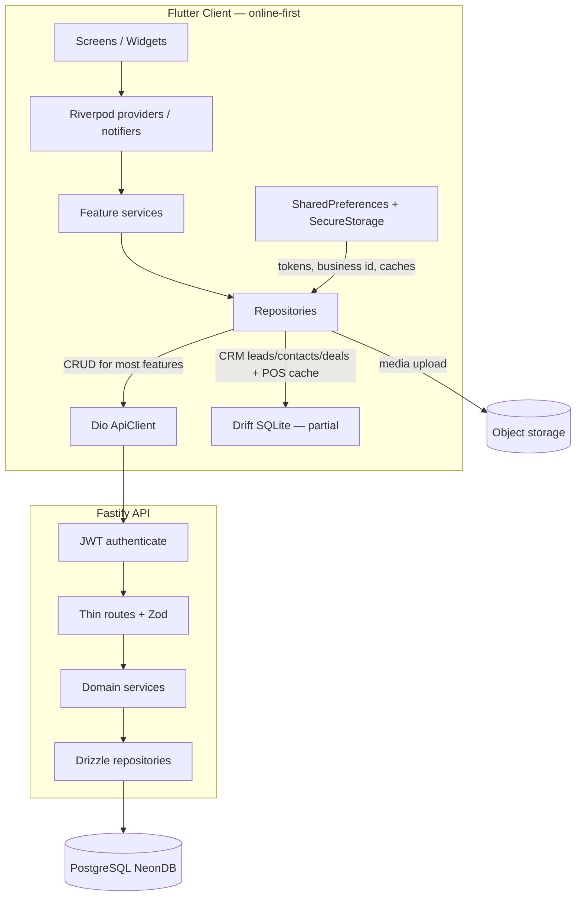
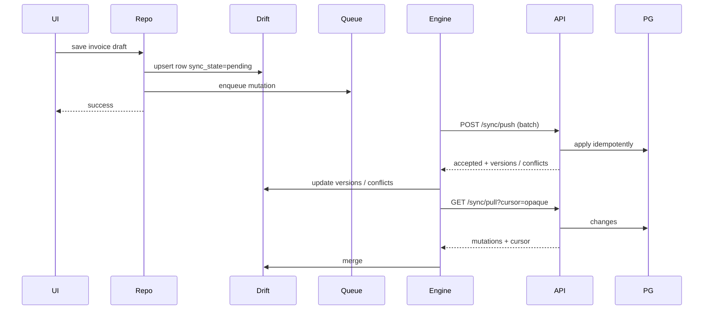

# Offline-First Architecture Audit

**Status:** Audit complete — design blueprint only (no offline engine implementation)  
**Date:** 2026-07-26  
**Scope:** Flutter client (`apps/client`) · Fastify API (`apps/api`) · PostgreSQL (Drizzle) · Drift (partial)  
**Related:** [01-architecture.md](01-architecture.md) · [04-database.md](04-database.md) · [05-api.md](05-api.md) · [09-decisions.md](09-decisions.md) · [11-sync-api-contract.md](11-sync-api-contract.md) (normative sync protocol) · [ADR-025](09-decisions.md#adr-025-sync-contract-hybrid-local-remap-command-idempotency)

---

## Executive Verdict

Billing Baba is **architecturally designed** for offline-first (ADRs, schema columns, docs) but **operationally online-first** today.

| Layer | Design intent | Current reality |
|-------|---------------|-----------------|
| Client writes | Local SQLite first | Almost all features write via Dio → API |
| Drift | Full business schema parity | Partial: CRM + POS cache + `sync_queue` only |
| Sync API | `/sync/push|pull|bootstrap` | Module stub — **not implemented** |
| PostgreSQL | UUID + soft delete + `sync_version` | Present on most business tables |
| Document numbers | Offline-safe allocation | Assigned **server-side on finalize** |
| Repositories | Local + Remote sources | Stubs / unused for inventory & sales; CRM is the prototype |

This document is the blueprint for implementing the offline engine without guessing.

---

## 1. Current Architecture

### 1.1 System shape (as running today)



**Intended** architecture (docs) puts Drift + sync queue on the write path. **Actual** architecture puts Postgres via REST on the write path, with Drift used as:

1. CRM local mirror + enqueue prototype  
2. POS post-success local cache / held bills  
3. Empty `SyncQueue` table with no flush worker to a live sync API  

### 1.2 Client application layers (documented vs used)

| Layer | Location | Role today |
|-------|----------|------------|
| Presentation | `features/*/presentation/` | Desktop + mobile screens |
| Application | Riverpod providers / notifiers | Orchestration, form state, list controllers |
| Domain | `domain/services`, Freezed models | Partial — stronger in CRM/POS |
| Data | `*Repository`, `*_remote_data_source`, `*_local_data_source` | Remote dominant |
| Infrastructure | `core/network`, `core/database`, `core/storage`, `core/attachments` | Dio, Drift shell, media upload |

Typical **online** feature flow (parties, inventory, sales documents):

```
UI → Riverpod → Service (optional) → Repository → RemoteDataSource → Dio → API
```

CRM **offline-shaped** flow (leads / contacts / deals):

```
UI → Riverpod → Repository → LocalSource (Drift upsert + SyncQueue enqueue)
                          ↘ RemoteSource (Dio) — available but sync flush unfinished
```

### 1.3 Backend module map

Registered under `/api/v1` (`apps/api/src/modules/index.ts`):

| Prefix | Module | Notes |
|--------|--------|-------|
| `/auth` | auth | OTP login, refresh, logout, me |
| `/businesses`, `/business` | business | CRUD + profile + branding |
| `/parties` | parties | CRM parties |
| `/crm` | crm | leads, contacts, deals |
| `/inventory` | inventory | categories, brands, units, items, stock, movements |
| `/sales` | sales | documents, POS sessions, sequences, sale FA |
| `/job-work` | job-work | job work orders |
| `/purchases` | purchases | documents, expenses, purchase FA, parse |
| `/accounting` | accounting | payments |
| `/hidden-ledger` | hidden-ledger | unrecovered amounts |
| `/dashboard` | dashboard | aggregates |
| `/reports` | reports | GST / P&L / stock / ledgers |
| `/settings` | settings | loyalty rules (partial settings surface) |
| `/storage` | storage + images | media assets / variants |
| `/document-attachments` | document-attachments | entity attachments |
| `/generated-documents` | generated-documents | invoice artifacts |
| `/sync` | sync | **TODO stub — no routes** |
| `/collaboration` | collaboration | members, invitations, directory |
| `/notifications` | notifications | outbound notify |
| `/subscription` | subscription | plans / payments |
| `/public/...` | public invoice / generated docs | unauthenticated share |

~285 route registrations exist. Sync push/pull/bootstrap exist only in docs.

---

## 2. Phase 1 — Client Architecture Audit

### 2.1 Repository pattern

#### Repositories that exist

| Feature | Repository | Access style | Local ready? |
|---------|------------|--------------|--------------|
| Auth | `AuthRepository` | Dio (own Dio, no auth interceptor) | N/A (identity) |
| Business | `BusinessRepository`, `BusinessBrandingRepository` | Dio | Partial prefs cache |
| Parties | `PartyRepository`, `PartyProfileImageRepository`, `PartyDeleteStatusRepository` | Dio | Prefs cache + pending ops keys |
| Inventory | `InventoryRepository`, `ItemMediaRepository`, `ItemAlternativesRepository` | Remote DS; local DS **stub** | No |
| Sales | `SalesRepository`, `SaleFaRepository`, `JobWorkRepository` | Remote; local DS unused | No |
| Purchases | `PurchaseRepository`, `PurchaseFaRepository`, `ExpenseRepository` | Remote (+ local DS files exist) | Incomplete |
| POS | `PosRepository` / `ApiPosRepository` | Service → API; local cache after success | Partial cache only |
| CRM | `LeadRepository`, `ContactRepository`, `DealRepository` | **Local + Remote** | **Yes (prototype)** |
| Dashboard | `DashboardRepository` | Remote + local DS | Weak |
| Reports | `ReportsRepository` | Remote | No |
| Collaboration | `CollaborationRepository` (+ Fake / Backend) | Abstract interface | Fake prefs store |
| Subscription | `SubscriptionRepository` | Dio | No |
| Hidden ledger | `HiddenLedgerRepository` | Dio | No |
| Loyalty | `LoyaltyRepository` | Dio | No |
| Print / settings | Print, WhatsApp, notifications, message settings | Mix Dio + prefs | Prefs only |
| Attachments | `DocumentAttachmentRepository` | Dio + MediaUploadClient | Metadata prefs only |
| Search / tasks | `SearchRepository`, `TaskRepository` | Prefs / local | Local UX only |
| Generated docs | `GeneratedDocumentsRepository` | Dio | No |

#### Pattern summary

1. **Dominant:** concrete `*Repository(Dio)` or `*Repository(RemoteDataSource)` — online only.  
2. **Emerging:** `LocalSource` + `RemoteSource` injection (CRM).  
3. **Placeholder:** `InventoryLocalDataSource` / `SalesLocalDataSource` marked “Phase 2” / unused (`// ignore: unused_field`).  
4. **Interface rare:** `PosRepository`, `CollaborationRepository` are the main abstract ports.

**Suitable for Local + Remote today without redesign:** CRM repositories (copy this shape).  
**Need redesign before offline:** Parties, Inventory, Sales, Purchases, Accounting/Payments, Reports (read from local), Settings.

### 2.2 Data flow (concrete)

**Inventory (online):**

```
ItemsScreen → inventory providers → InventoryRepository
  → InventoryRemoteDataSource → Dio GET/POST /api/v1/inventory/items
  → InventoryLocalDataSource (injected, never called)
```

**Sales document (online):**

```
Add/Edit sale UI → sales providers → SalesRepository
  → SalesRemoteDataSource → /api/v1/sales/documents
  → finalize → POST .../finalize (server assigns number + stock + ledger)
```

**CRM lead (local-first prototype):**

```
LeadsScreen → leads providers → LeadRepository.saveLead
  → LeadLocalSource.upsertLead (Drift)
  → LeadLocalSource.enqueueSyncOperation (sync_queue)
  → (no production SyncWorker flushing to /sync/push)
```

**POS:**

```
POS UI → PosSaleService.completeSale → API create/finalize
  → on success PosLocalDataSource.saveSale (Drift mirror)
  → HeldBillsLocal for hold/recall (true local)
```

### 2.3 Authentication flow

| Step | Implementation |
|------|----------------|
| Login | Phone OTP via MSG91 (`OtpService`) → backend `POST /auth/login` with provider token (`AuthRepository`) |
| Dev login | Optional `POST /auth/dev-login` when enabled |
| OTP verify | Client-side MSG91 then backend exchange |
| Session | `AuthSession`: access_token, refresh_token, expires_in, user, businesses |
| Persistence | `StorageService` secure keys: `access_token`, `refresh_token`; prefs for business/profile caches |
| Business selection | `AuthService.selectBusiness` → refresh JWT scoped with `business_id` |
| Token refresh | `AuthInterceptor` on 401 → refresh callback → single retry |
| Business switch | Re-select business (JWT reissue); providers invalidated via business scope helpers |
| Logout | `POST /auth/logout` + clear secure + session caches |

JWT payload (`JwtAccessPayload`): `account_id`, `phone`, optional `user_id`, `business_id`, `role`.  
Tenant scope is **JWT-embedded**, not an `X-Business-Id` header.

### 2.4 Business scope

| Concern | Mechanism |
|---------|-----------|
| Selected business | `StorageKeys.selectedBusinessId`, `lastOpenedBusinessId` |
| Injection into API | Access token claim `business_id` → `request.businessId` in Fastify |
| Multi-company | Account can own/join multiple businesses; one active JWT scope at a time |
| Client cleanup | `business_local_data_cleanup`, session cache cleanup on switch/logout |
| Drift scoping | CRM + POS tables filter by `businessId` (schema v8 added businessId to POS tables) |

### 2.5 API client

| Piece | File | Behavior |
|-------|------|----------|
| `ApiClient` | `core/network/api_client.dart` | Dio baseUrl, timeouts, JSON headers |
| Auth | `auth_interceptor.dart` | Bearer attach; 401 refresh + one retry (new Dio without interceptor chain) |
| JSON body | `interceptors.dart` | Avoid Fastify empty JSON body errors |
| Logging | `http_logging_interceptor.dart` | Diagnostics-gated |
| Errors | `api_error_parser.dart`, `network_exception_classifier.dart` | Map Dio → app errors |
| Endpoints | `api_endpoints.dart` | Path constants including unused `sync` |
| Retry | None beyond 401 refresh | No exponential backoff / idempotent retry policy |

### 2.6 Storage

| Store | Usage |
|-------|-------|
| FlutterSecureStorage | Tokens (macOS falls back to SharedPreferences — keychain entitlement note in code) |
| SharedPreferences | Business cache, party cache, pending party/business ops, UI prefs, collaboration fake store, attachment offline metadata, tier prices, settings |
| Drift SQLite (`billing_baba`) | CRM entities, POS sales cache, held bills, sync_queue |
| File / cache dirs | Media bytes during upload; no durable attachment blob store for offline |
| Image cache | Network image caching packages; not a sync-aware media vault |

Notable prefs keys already hint at offline ambitions: `pendingPartyOperations`, `pendingBusinessCreates`, `attachment_meta_*`.

### 2.7 Connectivity

| Capability | Status |
|------------|--------|
| Connectivity package / stream | Not a first-class sync trigger |
| `NetworkDiagnosticsService` | Manual reachability / diagnostics |
| Dio offline classification | Connection/timeout → user-facing offline messages in places |
| Auth preflight | Health check before login |
| Background reconnect sync | **Missing** |

### 2.8 Attachments

- Online path: intent → presigned PUT → complete (`MediaUploadClient`).  
- Repository: list/upload/delete/rename/download URL.  
- Offline: `AttachmentOfflineMetadataStore` keeps **metadata JSON in prefs** until entity save — **not** durable binary storage or sync queue entries.  
- Server table: `document_attachments` with `syncedBusinessColumns` + `media_asset_id`.

### 2.9 Images / media

- Registry: `media_assets`, variants in `media_image_variants`.  
- Upload via storage/images APIs; processing pipeline generates variants.  
- Item images, party profile, branding (logo/signature/stamp), account avatar.  
- URLs are storage/presigned or public object paths — **server-generated after upload**. Offline creates must stage local files and upload on sync.

### 2.10 Existing Drift database

**File:** `apps/client/lib/core/database/database.dart`  
**Schema version:** 8  

| Table | Purpose |
|-------|---------|
| `SalesLocal` / `SalesLineLocal` | Cache of successful POS/API sales |
| `HeldBillsLocal` | True offline hold bills |
| `Leads`, `LeadActivities` | CRM local |
| `Contacts`, `ContactActivities` | CRM local |
| `Deals` | CRM local |
| `SyncQueue` | Local mutation queue (autoincrement id) |

**Missing vs docs:** parties, items, sales_documents, purchase_documents, payments, ledger, stock, settings, godowns, sequences, media, etc.

**DAOs:** Drift generated managers; no dedicated domain DAO layer beyond sources.  
**Providers:** AppDatabase via Riverpod (CRM/POS wiring).  
**SyncQueue columns:** `businessId`, `entityType`, `entityId`, `operation`, `payload`, `createdAt` — **no** `sync_version`, `device_id`, `retry_count`, `status`, `last_error`.

---

## 3. Phase 2 — Backend Audit

### 3.1 PostgreSQL schema (business tables)

Common synced columns (`syncedBusinessColumns` in `db/schema/columns.ts`):

`id` (UUID) · `business_id` · `created_at` · `updated_at` · `deleted_at` · `is_deleted` · `created_by` · `updated_by` · `sync_version` · `device_id`

**Domains / tables (non-exhaustive but complete for Phase 1 entities):**

| Domain | Tables |
|--------|--------|
| Identity | `accounts`, `users`, `devices`, `refresh_tokens`, `attendance_records` |
| Business | `businesses`, `branches` |
| CRM / Parties | `parties`, `party_phones`, `party_links`, `party_visits`, `party_attachments`, `party_tags`, `party_tag_assignments`, `party_loyalty_balances`, `loyalty_transactions`, `leads`, `lead_activities`, `contacts`, `contact_activities`, `deals`, `hidden_ledger_*` |
| Inventory | `categories`, `brands`, `unit_definitions`, `unit_conversions`, `items`, `item_images`, `item_units`, `item_tier_prices`, `item_price_history`, `godowns`, `item_locations`, `stock_levels`, `inventory_movements`, `item_alternatives` |
| Sales | `pos_sessions`, `sales_documents`, `sales_document_lines`, `sale_fa_*`, `invoice_share_tokens` |
| Purchases | `purchase_documents`, `purchase_document_lines`, `expenses`, `expense_categories`, `purchase_fa_*` |
| Job work | `job_work_orders`, lines, costs |
| Accounting | `ledger_entries`, `payments`, `payment_allocations` |
| Settings | `areas`, `business_settings`, `tax_rates`, `document_number_sequences`, `loyalty_rules` |
| Notifications | `alerts`, `todos`, `notification_send_log` |
| Sync | `online_orders` only |
| Storage | `media_assets`, `media_image_variants` |
| Attachments | `document_attachments` |
| Generated docs | `generated_documents` |
| Collaboration | `company_members`, `invitations` |
| Subscription | plans, subscriptions, payments, history |
| Meta | `schema_version` |

Migrations: `0000` … `0038` under `apps/api/drizzle/migrations/`.

### 3.2 IDs

- **UUID v4** via `uuid().primaryKey().defaultRandom()` / `gen_random_uuid()` for business entities.  
- **No** auto-increment business PKs.  
- Collaboration uses `company_id` (= `businesses.id`).  
- Queue-style local Drift `SyncQueue.id` is integer autoincrement (local only).

### 3.3 Timestamps & soft delete

| Pattern | Where |
|---------|-------|
| Full sync columns | Most domain tables via `syncedBusinessColumns` |
| Soft delete | `deleted_at` + `is_deleted`; queries typically filter `is_deleted = false` |
| Immutable-ish | `inventory_movements`, `item_price_history`, `ledger_entries` — prefer append; still may carry sync columns depending on table |
| Reduced | `accounts`, `refresh_tokens` (server-only) |
| Partial | `media_assets` / variants: timestamps + soft delete, **no** `sync_version` / `device_id` / `created_by` |

### 3.4 Versioning

- **`sync_version` integer** on synced business tables — intended for optimistic concurrency.  
- **No ETag / HTTP revision** on entity APIs.  
- Conflict API shape documented for `/sync/push` but unused.  
- Services increment `sync_version` on some updates (e.g. document sequences).

### 3.5 Multi-company isolation

- Row-level `business_id` on tenant data.  
- JWT `business_id` required for scoped operations.  
- Collaboration members map accounts → companies.  
- No Postgres RLS observed; isolation is application-enforced.

### 3.6 Multi-user

- `users.role` (`userRoleEnum`), collaboration roles.  
- `created_by` / `updated_by` on synced rows.  
- Permission gates on client (`permission_gate.dart`) + collaboration services.  
- Devices table exists (`devices`) with `last_sync_at` — registration path exists in schema; sync engine not wired.

### 3.7 APIs (patterns)

| Pattern | Status |
|---------|--------|
| CRUD | Dominant per resource |
| Pagination | `page` / `limit` + `meta` |
| Filtering / search | Query params (`q`, status, dates, party_id, …) |
| Bulk | Limited (alternatives reorder, brand-swap, tier upsert) — **not** a general bulk sync API |
| Finalize | Sales/purchases transactional finalize endpoints |
| Share / public | Invoice share tokens |
| Sync | Documented only |

### 3.8 Transactions

Used heavily for correctness:

- Sales finalize (number + stock movements + ledger)  
- Purchase finalize  
- Payments + allocations  
- Item mutations with related rows  
- Business create / auth account flows  
- Hidden ledger recovery  
- Subscription activation  

Offline engine must either **replay equivalent transactional apply on server** during push, or expose **idempotent command APIs** that encapsulate finalize.

### 3.9 Attachment APIs

- Document attachments module: list/upload intent/complete/delete/rename/url.  
- Storage uploads + image variants.  
- Generated documents for printable artifacts.

---

## 4. Phase 3 — Offline readiness by feature

| Feature | Offline workable? | Reads | Writes | Server-generated / blockers |
|---------|-------------------|-------|--------|-----------------------------|
| **Inventory** | Not today | Items, stock, units, prices from API | CRUD + movements via API | Stock levels derived; movements append-only; media URLs |
| **Sales** | Not today | Documents from API | Create/update/finalize online | **Document number on finalize**; stock+ledger side effects |
| **Purchases** | Not today | Same pattern | Finalize side effects | Document numbers; stock+ledger |
| **Parties** | Partial prefs cache | List/detail API | CRUD API | Soft-delete rules; profile media |
| **Reports** | Cache-only possible | Heavy SQL on server | None | Needs local ledger/stock parity |
| **Settings** | Partial prefs | Mix API/prefs | Sequences are server-critical | Number sequences concurrency |
| **POS** | Hold bills yes; complete sale no | Items/parties from API | Sale finalize online | Same as sales + payments |
| **Subscriptions** | No | Plans/status API | Payments | Payment gateway |
| **Dashboard** | Aggregates online | API | Widget prefs local | Needs local aggregates |
| **CRM leads/deals** | Closest | Drift | Drift + queue | Queue flush missing |
| **Collaboration** | No | Members API | Invites | Token/SMS |
| **Auth** | Session cache only | — | Login requires network | OTP provider |
| **Attachments** | Metadata only | API | Presigned upload | Object storage |

---

## 5. Phase 4 — Sync readiness by entity

Legend: **Local ID** = client UUID OK · **Create/Edit/Delete offline** = capability after engine exists.

| Entity | PK | FKs (main) | Local ID? | Create | Edit | Delete | Server-only / races |
|--------|----|------------|-----------|--------|------|--------|---------------------|
| parties | UUID | area, business | Yes | Yes* | Yes* | Soft* | Credit/loyalty aggregates |
| items | UUID | brand, category, units | Yes | Yes* | Yes* | Soft* | Barcode uniqueness per business |
| stock_levels | UUID | item, godown | Yes | Derived | Recompute | — | **Race:** concurrent stock |
| inventory_movements | UUID | item, refs | Yes | Append* | No | No | Must be append-only; conflict = replay |
| sales_documents | UUID | party, converted_from | Yes | Draft* | Draft* | Soft* | **Number on finalize**; finalize races |
| sales_document_lines | UUID | document, item | Yes | With parent | With parent | Soft* | Totals consistency |
| purchase_documents | UUID | party | Yes | Draft* | Draft* | Soft* | Same numbering/stock |
| payments | UUID | party | Yes | Yes* | Limited | Soft* | Allocations races |
| ledger_entries | UUID | party, reference | Yes | Via finalize | No | No | Append-only |
| document_number_sequences | UUID | business, series, FY | Yes | Rare | **Hot** | — | **Critical race across devices** |
| media_assets | UUID | business optional | Yes | Stage local | Meta | Soft | Upload URL/checksum server |
| document_attachments | UUID | entity, media | Yes | Stage* | Meta | Soft* | Depends on media sync |
| leads/contacts/deals | UUID | business | Yes | Already local | Yes | Soft | Needs push/pull |
| users/devices | UUID | business, account | Partial | Device register | Sync cursor | — | Server authority |
| subscriptions | UUID | business | No offline pay | — | — | — | Online only |

\*After repository cutover + sync apply rules.

---

## 6. Phase 5 — Database design review

### Required on every **synced mutable** business row

| Column | PG today | Drift today | Recommendation |
|--------|----------|-------------|----------------|
| `id` | Yes | Partial tables | Keep UUID; client-generate on create |
| `business_id` / `company_id` | Yes (`business_id`) | Partial | Standardize name `business_id` everywhere (alias company in collab) |
| `created_at` / `updated_at` | Yes | Partial | Required; pull cursor on `updated_at` |
| `deleted_at` / `is_deleted` | Yes | CRM yes | Required tombstones |
| `sync_version` | Yes on synced cols | **Missing on Drift CRM?** verify | Required for push conflicts |
| `device_id` | Yes (nullable) | Missing locally | Set on write; store registered device |
| `updated_by` / `created_by` | Yes | Often missing locally | Fill from session user |
| `sync_state` | **No** (local-only concept) | No | Add **local-only** column: `pending|synced|conflict` |
| Queue extras | N/A | Minimal | Add retry_count, status, last_error, client_mutation_id |

### Tables needing sync-column alignment

| Table | Gap |
|-------|-----|
| `media_assets`, `media_image_variants` | Add `sync_version`, `device_id`, actor cols **or** treat as non-row-sync (blob protocol) |
| `company_members`, `invitations` | Not using `syncedBusinessColumns`; online collaboration OK initially |
| `subscription_*` | Online-only; exclude from device sync |
| `accounts`, `refresh_tokens` | Server-only; never sync |
| `invoice_share_tokens` | Server-only or pull-only |
| `notification_send_log` | Server-only |
| Drift POS cache tables | Not sync entities — cache/projection |

### Immutable ledgers

Do **not** soft-delete or edit `inventory_movements` / `ledger_entries` in conflict merges. Prefer compensating movements/entries.

---

## 7. Phase 6 — Sync engine requirements

### 7.1 Queue

- Persist every local mutation: `client_mutation_id` (UUID), entity_type, entity_id, op (`create|update|delete|command`), payload, `sync_version` base, `business_id`, `device_id`, created_at, status, retries.  
- Support **commands** (e.g. `finalize_sales_document`) not only row CRUD — required for transactional side effects.  
- Deduplicate by `client_mutation_id` on server (idempotency).

### 7.2 Conflict resolution

| Case | Policy (recommended Phase 1) |
|------|------------------------------|
| Row update vs update | Reject if `sync_version` stale; return server row; LWW optional for low-risk masters (party notes) with audit |
| Stock | Never LWW quantities — apply movements; rebuild `stock_levels` |
| Document finalize vs finalize | First apply wins; loser gets conflict + new draft number path |
| Delete vs update | Tombstone wins if delete version ≥ update |
| Sequences | Server authoritative allocator (see numbering) |

### 7.3 Scheduler / connectivity / background

- Watch connectivity; on reconnect: push → pull → media drain.  
- Desktop: timer + lifecycle; mobile: background fetch / WorkManager (platform-specific later).  
- Exponential backoff with jitter; pause on auth failure.  
- Sync status in shell header (already envisioned in architecture docs).

### 7.4 Incremental vs snapshot

| Mode | Use |
|------|-----|
| Snapshot bootstrap | First device login / restore / schema major bump — `POST /sync/bootstrap` |
| Incremental pull | `GET /sync/pull?since=cursor` ordered by `(business_id, updated_at, id)` |
| Push batch | `POST /sync/push` max N mutations / bytes |

### 7.5 Device registration

- Upsert `devices` on first sync; persist `device_id` locally.  
- Track `last_sync_at`, platform, app version.  
- Optional: revoke device → stop pull.

### 7.6 Company isolation

- Every push/pull filtered by JWT `business_id`.  
- Switching business switches local DB partition (same SQLite file with `business_id` filters **or** per-business DB files — recommend **single DB + strict filters** + cleanup on leave).

### 7.7 Merge strategy

1. Apply push accepted rows → set local `sync_state=synced`, bump versions from ack.  
2. For conflicts → mark `conflict`, surface UI, keep server payload.  
3. Pull applies remote rows if remote `sync_version` ≥ local **or** local not pending.  
4. Pending local rows never silently overwritten without conflict record.

### 7.8 Attachment / image sync

- Stage blobs in app documents dir keyed by local media id.  
- Queue: `upload_media` then `upsert_document_attachment`.  
- After upload, replace local path with remote URLs/variants.  
- Pull downloads missing blobs lazily (thumbnail first).

### 7.9 Numbering (critical design)

**Current:** `assignDocumentNumber` during finalize in DB transaction.  

**Locked (ADR-025 / [11-sync-api-contract.md](11-sync-api-contract.md)):** temporary `LOCAL-######` on device; UUID stable; server assigns real number on `finalize_*` command ack and returns remap. Lease ranges deferred (`numbering_strategy` capability).

---

## 8. Phase 7 — Backup (`.biba`) requirements

| Content | Include? | Notes |
|---------|----------|-------|
| SQLite DB | Yes | Primary business data |
| Images / attachments | Yes | Relative paths under `media/` |
| Manifest | Yes | schema_version, app_version, business_id(s), created_at, device_id, content hashes |
| Settings / prefs subset | Yes | Print, tax prefs — not tokens |
| Sync queue | Optional | Include pending ops or require flush-before-backup |
| Checksums | Yes | Per-file SHA-256 in manifest |
| Version | Yes | `.biba` format version |
| Encryption | Ready | Envelope encryption with user passphrase / business key — design now, can ship later |
| Compression | Yes | zip/zstd container |
| Exclude | Tokens, MSG91 secrets, other accounts’ data | |

**Restore:** verify checksums → migrate schema → replace DB → optional cloud reconcile pull.

**Vyapar import:** separate importer mapping into Drift tables — out of band from `.biba` but share entity mapping layer.

---

## 9. Problems preventing Offline-First

1. **Sync module not implemented** — documented API only.  
2. **Repositories online-bound** — local sources stubs for core ERP.  
3. **Drift schema incomplete** — cannot host parties/items/docs.  
4. **Finalize/numbering/stock/ledger are server transactions** — no offline command replay.  
5. **No SyncWorker** — CRM queue writes never flush.  
6. **Media requires network** — no blob vault.  
7. **Reports/dashboard compute on Postgres**.  
8. **Connectivity not wired to sync lifecycle**.  
9. **Auth/OTP always online** (acceptable) but app blocks core UX without API.  
10. **Docs vs code drift** — risk of implementing against aspirational docs without this audit.

---

## 10. Required changes (checklist)

### 10.1 Backend

- [ ] Implement `/sync/bootstrap`, `/push`, `/pull`, `/status`, `/schema-version`  
- [ ] Idempotent mutation apply + conflict responses  
- [ ] Command handlers for `finalize_sales`, `finalize_purchase`, `record_payment`  
- [ ] Device register/list/revoke endpoints  
- [ ] Numbering strategy endpoint (lease or assign-on-push)  
- [ ] Ensure all synced tables expose `updated_at` indexes `(business_id, updated_at)`  
- [ ] Align media sync protocol (metadata rows vs blob API)  
- [ ] Reject cross-tenant mutations strictly  

### 10.2 Flutter

- [ ] Introduce `SyncEngine` (queue drain, pull, status)  
- [ ] Connectivity listener + shell indicator  
- [ ] Cut repositories to local-first systematically  
- [ ] Durable media staging  
- [ ] Conflict UI  
- [ ] Bootstrap on business open  
- [ ] Expand `StorageKeys` / secure device id  

### 10.3 Drift

- [ ] Generate tables mirroring synced PG schema (parity with `04-database.md`)  
- [ ] Local-only: `sync_queue`, `sync_cursor`, `media_blob`, `conflict_log`  
- [ ] Migrations strategy matching server schema_version  
- [ ] DAOs per domain; repositories call DAOs only for reads/writes  

### 10.4 PostgreSQL

- [ ] Confirm indexes for pull cursors  
- [ ] Optional `client_mutation_id` unique table for idempotency  
- [ ] Media sync columns or explicit exclusion list  
- [ ] Sequence leasing table if chosen  

### 10.5 API

- [ ] Freeze sync DTO contracts in OpenAPI  
- [ ] Batch size limits / rate limits (already sketched in docs)  
- [ ] Keep REST CRUD for admin/web; clients prefer sync for hot path  

### 10.6 Repository

- [ ] Standard port: `watch/get` from local; `save` local+enqueue; remote only via sync  
- [ ] Promote CRM pattern to parties → inventory → sales drafts → finalize commands  
- [ ] Delete unused “unimplemented” local sources by replacing with real ones  

---

## 11. Sync architecture proposal

**Normative protocol:** [11-sync-api-contract.md](11-sync-api-contract.md) (protocol v1).  
**Locked decisions ([ADR-025](09-decisions.md#adr-025-sync-contract-hybrid-local-remap-command-idempotency)):** hybrid row+command push · `LOCAL-*` → server number remap on finalize · `command_id` idempotency with `replayed[]`.



**Entity sync vs command sync:** masters (party/item) and drafts as row mutations; financial finalize / payments / stock as commands with server transaction reuse (`sales-finalize.service`) and stable `command_id`.

---

## 12. Backup architecture proposal

```
name.biba
├── manifest.json          # version, business_id, schema_version, checksums, created_at
├── database.sqlite        # Drift export
├── media/
│   ├── {asset_id}/original
│   └── {asset_id}/thumb
└── meta/
    ├── device.json
    └── pending_queue.json # optional
```

Pipeline: flush or snapshot queue → checkpoint DB → copy media → hash → compress → optional encrypt → write `.biba`.

---

## 13. Conflict resolution proposal

1. **Masters (party, item, settings):** `sync_version` check; on conflict show field-level UI later; MVP take server + notify.  
2. **Documents draft:** allow merge if non-overlapping fields; else server wins + keep local fork.  
3. **Finalize command:** single winner; loser reopens as draft.  
4. **Stock:** movement replay; never absolute qty push.  
5. **Attachments:** last upload wins per `sort_order`/`label`; blob hash compare.

---

## 14. Migration strategy

| Stage | Goal |
|-------|------|
| M0 | This audit + ADR lock (numbering, command sync) |
| M1 | Implement sync API + device registration (no client cutover) |
| M2 | Drift parity for parties + items + settings (read path from local after bootstrap) |
| M3 | Local-first writes for masters + CRM completion (flush worker) |
| M4 | Sales/purchase **drafts** offline; finalize online-or-queued command |
| M5 | Payments + ledger projections local; POS offline complete |
| M6 | Media/attachment sync |
| M7 | `.biba` backup/restore |
| M8 | Reports fully local; remove hot-path REST dependency |

Dual-run: keep REST CRUD working; feature-flag sync per business.

---

## 15. Risks

| Risk | Impact | Mitigation |
|------|--------|------------|
| Document number collisions | Legal/GST | Server authority / leases |
| Stock double-sell offline | Financial | Soft stock, reconcile movements, warn |
| Large bootstrap | UX | Pagination, compressed snapshot, incremental |
| Schema drift Drift vs Drizzle | Sync bugs | Single schema source / codegen later |
| Partial queue flush | Corrupt state | Transactional apply + idempotency keys |
| Multi-device finalize | Conflicts | Commands + version checks |
| macOS secure storage fallback | Token exposure | Prefer keychain entitlements |
| Scope creep (Vyapar, websockets) | Delay | Explicit non-goals for engine MVP |

---

## 16. Recommended implementation order

1. **Sync contract + ADR-025** — done: [11-sync-api-contract.md](11-sync-api-contract.md).  
2. **Backend sync MVP:** bootstrap/push/pull/status/devices + `command_id` idempotency table (conform to contract).  
3. **Client SyncEngine + queue schema upgrade** (flush CRM first as dogfood).  
4. **Drift: parties + items + tax/settings** + bootstrap.  
5. **Repository cutover** for parties/inventory reads/writes.  
6. **Sales/purchase drafts local** + finalize command (`LOCAL-*` remap).  
7. **POS offline** using same finalize command.  
8. **Payments / stock projections**.  
9. **Media sync** (`/sync/media/*`).  
10. **Backup/restore** (`.biba`).  
11. **Reports local**.  

---

## 17. Appendix — Evidence map

| Claim | Evidence |
|-------|----------|
| Sync stub | `apps/api/src/modules/sync/index.ts` TODO |
| Sync API docs | `docs/11-sync-api-contract.md` (authoritative); `docs/05-api.md` summary |
| Sync decisions | ADR-025 — hybrid, LOCAL remap, command_id |
| Drift partial | `apps/client/lib/core/database/database.dart` |
| Inventory local stub | `inventory_local_data_source.dart` |
| Sales local unused | `SalesRepository` `// ignore: unused_field` |
| CRM local+queue | `lead_repository.dart` |
| JWT business scope | `auth.middleware.ts`, `auth.types.ts` |
| Number on finalize | `sales-finalize.service.ts` → `assignDocumentNumber` |
| Sync columns | `db/schema/columns.ts` `syncedBusinessColumns` |
| Media upload | `media_upload_client.dart` |
| Attachment offline meta | `attachment_offline_metadata_store.dart` |
| Architecture intent | `docs/01-architecture.md`, ADR-007/012 |

---

## 18. Non-goals for the next implementation slice

- Full Vyapar import  
- Real-time WebSocket sync  
- Per-tenant Postgres databases  
- Editing immutable ledger/movement history  
- Offline subscription purchase  

---

*End of audit. Use this document as the implementation blueprint; do not treat `01-architecture.md` alone as as-built.*
