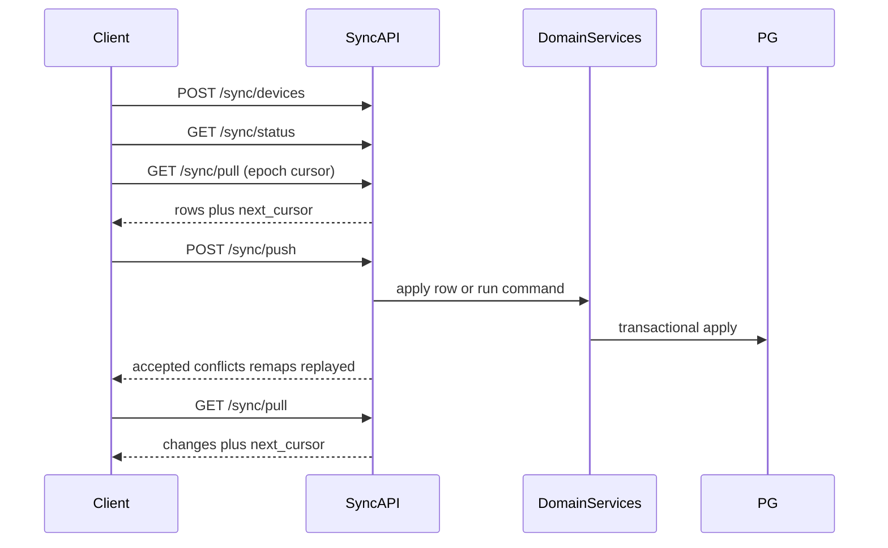
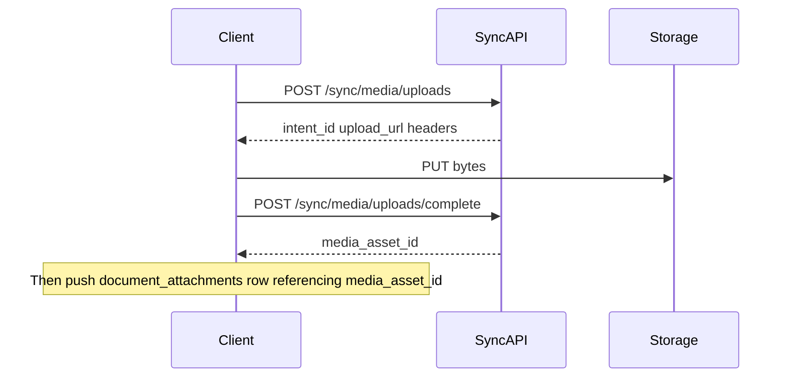

# Sync API Contract

**Status:** Normative protocol — design only (not yet implemented)  
**Protocol version:** `1`  
**Date:** 2026-07-26  
**Transport:** HTTPS JSON over Fastify (`/api/v1`)  
**Related:** [05-api.md](05-api.md) · [10-offline-first-architecture-audit.md](10-offline-first-architecture-audit.md) · [09-decisions.md](09-decisions.md) (ADR-025) · [04-database.md](04-database.md)

---

## Purpose

Authoritative synchronization contract between the Flutter client (Drift + Sync Queue + Sync Engine) and the Fastify API (PostgreSQL). Both sides implement this protocol. Existing REST CRUD remains for admin/online paths; the offline hot path uses these sync endpoints.

---

## Locked decisions (normative)

| Decision | Rule |
|----------|------|
| **Hybrid push** | Masters and drafts use **row** mutations. Financial / inventory-invariant operations use **commands**. |
| **Document numbers (MVP)** | Entity `id` (UUID) never changes. Display number may be `LOCAL-######` offline. Server assigns the real number on finalize and returns a **remap** in the ack. |
| **Command idempotency** | Every command includes a client-generated `command_id` (UUID). Server stores `(business_id, command_id)` → result and returns the original success payload on replay. |

These decisions are also recorded in [ADR-025](09-decisions.md#adr-025-sync-contract-hybrid-local-remap-command-idempotency).

---

## Table of contents

1. [Protocol overview](#1-protocol-overview)
2. [Entity catalog](#2-entity-catalog)
3. [Common conventions](#3-common-conventions)
4. [Authentication](#4-authentication)
5. [Device registration](#5-device-registration)
6. [Sync status](#6-sync-status)
7. [Bootstrap sync](#7-bootstrap-sync)
8. [Push sync](#8-push-sync)
9. [Pull sync](#9-pull-sync)
10. [Conflict response](#10-conflict-response)
11. [Document number remapping](#11-document-number-remapping)
12. [Media sync](#12-media-sync)
13. [Error codes](#13-error-codes)
14. [Retry matrix](#14-retry-matrix)
15. [Future compatibility](#15-future-compatibility)
16. [Normative examples](#16-normative-examples)

---

## 1. Protocol overview

### Goals

- First-device / new-device bootstrap of a full business snapshot
- Reliable upload of local changes (rows + commands) with partial success
- Incremental download of remote changes with a durable cursor
- Safe retries without double-posting stock, ledger, or document numbers
- Separate blob protocol for images and attachments

### Non-goals (protocol v1)

- Real-time WebSocket transport (capability reserved)
- Per-device leased document number ranges (capability reserved)
- Cross-business sync in one session
- Syncing auth secrets, refresh tokens, or subscription payment rails

### High-level flow



### Versioning

| Header | Value | Meaning |
|--------|-------|---------|
| `X-Sync-Protocol-Version` | `1` | Required on all sync routes |
| Schema version | integer from `/sync/status` | Drift ↔ PostgreSQL logical schema generation |

Mismatch → `PROTOCOL_MISMATCH` or `SCHEMA_MISMATCH`.

---

## 2. Entity catalog

### Sync kinds

| Kind | Meaning |
|------|---------|
| `row` | Client may create/update/delete via push; included in bootstrap/pull |
| `command_result` | Produced only by server commands; appears on pull as projections |
| `server_only` | Never in bootstrap/push from client |
| `blob` | Binary via media sync; metadata may appear on pull |

### Row entities (masters and drafts)

| `entity_type` | Notes |
|---------------|-------|
| `areas` | Settings |
| `business_settings` | Settings |
| `tax_rates` | Settings |
| `loyalty_rules` | Settings |
| `document_number_sequences` | Metadata only; **allocation is server-side on finalize** — clients must not bump `next_number` via row push |
| `parties` | Includes customers/suppliers |
| `party_phones` | Child of party |
| `party_links` | |
| `party_tags` / `party_tag_assignments` | |
| `party_visits` | |
| `categories` | Inventory |
| `brands` | |
| `unit_definitions` / `unit_conversions` | |
| `items` | |
| `item_units` / `item_tier_prices` | |
| `item_alternatives` | |
| `godowns` | Warehouses |
| `item_locations` | |
| `users` | Business-scoped staff (no password hashes in sync payloads) |
| `branches` | |
| `leads` / `lead_activities` | CRM |
| `contacts` / `contact_activities` | |
| `deals` | |
| `sales_documents` | **Draft / non-finalized only** via row push |
| `sales_document_lines` | With parent draft |
| `purchase_documents` | Draft only via row push |
| `purchase_document_lines` | |
| `expense_categories` | |
| `expenses` | Non-posted / as defined by domain |
| `pos_sessions` | Open sessions |
| `job_work_orders` (+ child lines as row types) | Draft until posted per domain rules |
| `document_attachments` | Metadata after media complete; may reference `media_asset_id` |

### Command-only operations (never invent side-effect rows on client)

| `command` | Server authority |
|-----------|------------------|
| `finalize_sale` | Number + stock + ledger + status |
| `finalize_purchase` | Same for purchases |
| `finalize_credit_note` | Sales return finalize |
| `finalize_debit_note` | Purchase return finalize |
| `record_payment` | Payment out / payable settlement |
| `record_receipt` | Payment in / receivable settlement |
| `stock_adjustment` | Movement + stock_levels |
| `stock_transfer` | Inter-godown movements |
| `post_journal_entry` | Ledger posting |

### Command result / projection entities (pull only)

| `entity_type` | Rule |
|---------------|------|
| `inventory_movements` | **Not** client-authored creates |
| `stock_levels` | Derived; overwritten from server on pull |
| `ledger_entries` | **Not** client-authored creates |
| `payment_allocations` | Created by payment/receipt commands |
| `payments` | May appear after `record_payment` / `record_receipt` |
| `item_price_history` | Append-only server projection |
| `party_loyalty_balances` / `loyalty_transactions` | Server projection |
| `hidden_ledger_entries` | Server projection |

### Server-only (excluded from sync)

`accounts`, `refresh_tokens`, `subscription_*`, `invoice_share_tokens`, `notification_send_log`, collaboration invite tokens, raw OTP state.

### Blob

`media_assets` metadata may sync on pull; bytes via [Media sync](#12-media-sync).

---

## 3. Common conventions

### Base path

All routes: `/api/v1/sync/...`

### Response envelope

Success:

```json
{ "data": { } }
```

Error:

```json
{
  "error": {
    "code": "VALIDATION_FAILED",
    "message": "Human-readable summary",
    "details": { }
  }
}
```

### Common headers

| Header | Required | Description |
|--------|----------|-------------|
| `Authorization` | Yes | `Bearer <access_token>` |
| `X-Device-Id` | Yes (except device register body also carries it) | Stable device UUID |
| `X-App-Version` | Yes | Semver string, e.g. `1.4.0` |
| `X-Sync-Protocol-Version` | Yes | `1` |
| `Content-Type` | Yes on bodies | `application/json` |
| `Accept-Encoding` | Optional | `gzip` for bootstrap/pull |
| `Idempotency-Key` | Optional on push | Echo of `client_batch_id` |

### Timestamps

ISO 8601 UTC with `Z` suffix, e.g. `2026-07-26T10:30:00.000Z`.

### IDs

UUID v4 strings. Client generates entity IDs and `command_id` / `mutation_id` / `client_batch_id` / `client_media_id` offline.

---

## 4. Authentication

### Purpose

Scope every sync call to an authenticated account and a single `business_id`.

### Rules

1. Access token MUST include `business_id` for sync routes. Missing → `403` / `BUSINESS_REQUIRED`.
2. `request.businessId` from JWT is the sole tenant scope. Client MUST NOT send a conflicting `business_id` in mutation payloads for another tenant.
3. On `401`, client calls existing `POST /api/v1/auth/refresh`. On refresh failure → treat as `AUTH_EXPIRED`, clear session, stop sync, require re-login.
4. After business switch, obtain a new access token with the new `business_id` before sync.
5. Refresh tokens MUST NOT appear in sync request/response bodies.
6. If JWT `business_id` does not match the local sync partition the device is flushing → `BUSINESS_CHANGED`.

### Token refresh during sync

| Step | Behavior |
|------|----------|
| Access expired mid-batch | Pause; refresh once; retry same batch with same ids |
| Refresh succeeds | Continue sync |
| Refresh fails | Abort; surface `AUTH_EXPIRED` |

---

## 5. Device registration

### 5.1 Register / heartbeat

#### Purpose

Register a device for a business or refresh heartbeat metadata before bootstrap/push/pull.

#### HTTP

`POST /api/v1/sync/devices`

#### Headers

Common headers. `X-Device-Id` MUST equal `device_id` in body.

#### Authentication

Bearer JWT with `business_id`.

#### Request JSON

```json
{
  "device_id": "7f1a2b3c-4d5e-6f70-8192-a3b4c5d6e7f8",
  "platform": "windows",
  "app_version": "1.4.0",
  "device_name": "Counter PC 1"
}
```

| Field | Type | Notes |
|-------|------|-------|
| `device_id` | UUID | Client-stable; persisted for life of install |
| `platform` | string | `windows` \| `macos` \| `android` \| `ios` \| `linux` |
| `app_version` | string | Semver |
| `device_name` | string | Human label |

#### Response JSON (`200`)

```json
{
  "data": {
    "device_id": "7f1a2b3c-4d5e-6f70-8192-a3b4c5d6e7f8",
    "business_id": "aaaaaaaa-bbbb-cccc-dddd-eeeeeeeeeeee",
    "platform": "windows",
    "app_version": "1.4.0",
    "device_name": "Counter PC 1",
    "last_sync_at": null,
    "registered_at": "2026-07-26T04:00:00.000Z"
  }
}
```

Upsert on `(business_id, device_id)`.

#### Status codes

| Code | When |
|------|------|
| `200` | Registered or updated |
| `400` | Validation |
| `401` | Auth |
| `403` | `BUSINESS_REQUIRED` |
| `409` | `PROTOCOL_MISMATCH` |

#### Error codes

`VALIDATION_FAILED`, `AUTH_EXPIRED`, `BUSINESS_REQUIRED`, `PROTOCOL_MISMATCH`

#### Idempotency

Safe to retry. Same `device_id` updates metadata.

#### Retry

Network/5xx: retry with backoff. No duplicate devices created.

#### Notes

Push/pull/bootstrap require a registered device or return `DEVICE_NOT_REGISTERED`.

### 5.2 List devices

#### Purpose

List devices for the current business (owner/admin UX).

#### HTTP

`GET /api/v1/sync/devices`

#### Response JSON (`200`)

```json
{
  "data": {
    "devices": [
      {
        "device_id": "7f1a2b3c-4d5e-6f70-8192-a3b4c5d6e7f8",
        "platform": "windows",
        "app_version": "1.4.0",
        "device_name": "Counter PC 1",
        "last_sync_at": "2026-07-26T05:00:00.000Z",
        "registered_at": "2026-07-26T04:00:00.000Z"
      }
    ]
  }
}
```

---

## 6. Sync status

### Purpose

Report sync health, server capabilities, schema version, and minimum client version before bootstrap or push.

### HTTP

`GET /api/v1/sync/status`

### Headers

Common headers. Device should be registered.

### Authentication

Bearer JWT with `business_id`.

### Request

No body. Optional query: none in v1.

### Response JSON (`200`)

```json
{
  "data": {
    "protocol_version": 1,
    "schema_version": 38,
    "min_client_version": "1.4.0",
    "min_protocol_version": 1,
    "server_time": "2026-07-26T05:10:00.000Z",
    "numbering_strategy": "temp_local_remap",
    "compression": ["gzip"],
    "max_push_mutations": 100,
    "max_push_bytes": 1048576,
    "pull_limit_default": 200,
    "pull_limit_max": 500,
    "bootstrap_chunk_max_bytes": 2097152,
    "supported_commands": [
      "finalize_sale",
      "finalize_purchase",
      "finalize_credit_note",
      "finalize_debit_note",
      "record_payment",
      "record_receipt",
      "stock_adjustment",
      "stock_transfer",
      "post_journal_entry"
    ],
    "capabilities": {
      "channels": ["http"],
      "selective_sync": true,
      "websocket": false,
      "number_leases": false,
      "cloud_backup_ack": false
    },
    "device": {
      "device_id": "7f1a2b3c-4d5e-6f70-8192-a3b4c5d6e7f8",
      "last_sync_at": "2026-07-26T05:00:00.000Z"
    }
  }
}
```

### Status codes

`200`, `401`, `403`, `404` (`DEVICE_NOT_REGISTERED`), `409` (`PROTOCOL_MISMATCH` / `SCHEMA_MISMATCH` when client advertises incompatible versions via headers)

### Error codes

`AUTH_EXPIRED`, `BUSINESS_REQUIRED`, `DEVICE_NOT_REGISTERED`, `PROTOCOL_MISMATCH`, `SCHEMA_MISMATCH`

### Idempotency

Read-only.

### Retry

Safe.

### Notes

Client MUST refuse to push if `schema_version` or `min_client_version` is unsupported. `numbering_strategy` is `temp_local_remap` in v1; future `leased_ranges` does not break v1 clients that ignore unknown values if they only finalize via commands.

---

## 7. Bootstrap sync

### Purpose

Initial full dataset download after first login (or reinstall) for the JWT business.

### Strategy (MVP)

**Preferred client path:** if local Drift has no pull cursor / is empty:

1. Register device + fetch `/sync/status`.
2. `GET /sync/pull?cursor=<epoch>` paginating until `has_more=false`.
3. Apply rows into Drift via `switch(entityType)`.
4. Persist `next_cursor` and mark bootstrapped.

No chunk planner. No multi-chunk bootstrap session on the client.

### 7.1 Optional bootstrap handshake

#### HTTP

`POST /api/v1/sync/bootstrap`

Returns an `initial_cursor` (and schema/protocol metadata). Does **not** require downloading chunked snapshot jobs in MVP.

#### Request JSON

```json
{
  "device_id": "7f1a2b3c-4d5e-6f70-8192-a3b4c5d6e7f8",
  "schema_version": 38,
  "include_media_metadata": false
}
```

#### Response JSON (`202` or `200`)

```json
{
  "data": {
    "initial_cursor": "<opaque>",
    "schema_version": 38,
    "protocol_version": 1,
    "server_time": "2026-07-26T06:00:00.000Z",
    "estimated_rows": 0
  }
}
```

Chunked `GET /bootstrap/{id}/chunks/{index}` is **deferred** (not part of MVP). Clients must not depend on it.

#### Status codes

| Code | When |
|------|------|
| `200` / `202` | Cursor ready |
| `400` | Validation |
| `401` / `403` | Auth / business |
| `404` | Device not registered |
| `409` | `SCHEMA_MISMATCH` / `PROTOCOL_MISMATCH` |
| `429` | Rate limited |

#### Error codes

`DEVICE_NOT_REGISTERED`, `SCHEMA_MISMATCH`, `PROTOCOL_MISMATCH`, `VALIDATION_FAILED`, `RATE_LIMITED`, `AUTH_EXPIRED`, `BUSINESS_REQUIRED`

#### Idempotency

Safe to call again; client may ignore the body and still pull from epoch.

#### Retry

Safe to retry.

## 8. Push sync

### Purpose

Upload batched local changes: **row** mutations and **commands**.

### HTTP

`POST /api/v1/sync/push`

### Headers

Common headers. Recommended: `Idempotency-Key: <client_batch_id>`.

### Authentication

Bearer JWT with `business_id`. Device registered. `X-Device-Id` MUST match body `device_id`.

### Request JSON

```json
{
  "device_id": "7f1a2b3c-4d5e-6f70-8192-a3b4c5d6e7f8",
  "client_batch_id": "c0ffeeee-0000-4000-8000-000000000001",
  "mutations": [
    {
      "mutation_id": "m1111111-1111-4111-8111-111111111111",
      "kind": "row",
      "entity_type": "parties",
      "entity_id": "p2222222-2222-4222-8222-222222222222",
      "operation": "create",
      "base_sync_version": 0,
      "payload": {
        "name": "New Party",
        "party_type": "customer",
        "mobile": "9876543210"
      },
      "client_updated_at": "2026-07-26T05:01:00.000Z"
    },
    {
      "mutation_id": "m3333333-3333-4333-8333-333333333333",
      "kind": "command",
      "command": "finalize_sale",
      "command_id": "9c6d8d2d-3c62-4b3c-a1cb-7a8d7d8c4d1f",
      "payload": {
        "document_id": "550e8400-e29b-41d4-a716-446655440000",
        "local_document_number": "LOCAL-000001",
        "godown_id": "g4444444-4444-4444-8444-444444444444"
      },
      "client_updated_at": "2026-07-26T05:02:00.000Z"
    }
  ]
}
```

#### Row mutation fields

| Field | Required | Description |
|-------|----------|-------------|
| `mutation_id` | Yes | UUID; stable across retries |
| `kind` | Yes | `row` |
| `entity_type` | Yes | Catalog name |
| `entity_id` | Yes | Row UUID |
| `operation` | Yes | `create` \| `update` \| `delete` |
| `base_sync_version` | Yes | Last known server version (`0` on create) |
| `payload` | Yes | Full or patch document; empty object allowed on delete |
| `client_updated_at` | Yes | Client clock UTC |

Optimistic concurrency: server rejects update/delete when `base_sync_version !=` current server `sync_version` → conflict.

#### Command mutation fields

| Field | Required | Description |
|-------|----------|-------------|
| `mutation_id` | Yes | UUID for batch accounting |
| `kind` | Yes | `command` |
| `command` | Yes | From `supported_commands` |
| `command_id` | Yes | **Idempotency key** for the business command |
| `payload` | Yes | Command-specific |
| `client_updated_at` | Yes | |

### Response JSON (`200`) — partial success allowed

HTTP `200` means the batch was processed. Individual items may fail.

```json
{
  "data": {
    "client_batch_id": "c0ffeeee-0000-4000-8000-000000000001",
    "server_time": "2026-07-26T05:02:30.000Z",
    "accepted": [
      {
        "mutation_id": "m1111111-1111-4111-8111-111111111111",
        "kind": "row",
        "entity_type": "parties",
        "entity_id": "p2222222-2222-4222-8222-222222222222",
        "sync_version": 1,
        "server_updated_at": "2026-07-26T05:02:30.000Z"
      },
      {
        "mutation_id": "m3333333-3333-4333-8333-333333333333",
        "kind": "command",
        "command": "finalize_sale",
        "command_id": "9c6d8d2d-3c62-4b3c-a1cb-7a8d7d8c4d1f",
        "sync_version": 4,
        "server_updated_at": "2026-07-26T05:02:30.000Z",
        "result": {
          "document_id": "550e8400-e29b-41d4-a716-446655440000",
          "status": "finalized",
          "document_number_remap": {
            "local_document_number": "LOCAL-000001",
            "server_document_number": "INV-2026-000452"
          }
        }
      }
    ],
    "replayed": [],
    "conflicts": [],
    "errors": []
  }
}
```

#### `replayed[]`

When `command_id` was already processed successfully:

```json
{
  "mutation_id": "m3333333-3333-4333-8333-333333333333",
  "kind": "command",
  "command": "finalize_sale",
  "command_id": "9c6d8d2d-3c62-4b3c-a1cb-7a8d7d8c4d1f",
  "idempotent_replay": true,
  "result": {
    "document_id": "550e8400-e29b-41d4-a716-446655440000",
    "status": "finalized",
    "document_number_remap": {
      "local_document_number": "LOCAL-000001",
      "server_document_number": "INV-2026-000452"
    }
  }
}
```

If the same `command_id` is sent with a **different** payload → `IDEMPOTENCY_PAYLOAD_MISMATCH` in `errors[]` (not a silent replay).

### Command idempotency store (server requirement)

| Key | Value |
|-----|-------|
| `(business_id, command_id)` unique | `{ status, result_json, request_hash, processed_at, device_id }` |

- Financial commands retained indefinitely in v1 (no TTL).
- Replay returns stored `result_json` without re-executing domain services.

### Status codes

| Code | When |
|------|------|
| `200` | Batch processed (check per-item arrays) |
| `400` | Whole-batch validation failure |
| `401` / `403` | Auth |
| `404` | `DEVICE_NOT_REGISTERED` |
| `409` | Protocol/schema mismatch for whole batch |
| `413` / `400` | `BATCH_TOO_LARGE` |
| `429` | Rate limited |

Whole-batch failure means **no** mutation applied (except pure validation rejects before apply). Prefer per-item errors inside `200` once apply starts; implementations MAY use transactional batch-all-or-nothing only if documented — **v1 requires per-mutation partial success**.

### Error codes (batch or per-item)

See [Error codes](#13-error-codes). Per-item errors appear in `errors[]` with `mutation_id`.

### Idempotency behavior

| Key | Behavior |
|-----|----------|
| `client_batch_id` | Optional dedupe of identical batch submission within a short window; prefer relying on `mutation_id` / `command_id` |
| `mutation_id` | Row apply should be idempotent for identical create/update |
| `command_id` | **Strong** idempotency for commands |

### Retry behavior

- Retry only mutations not in `accepted` or `replayed`.
- Never change `command_id` or `mutation_id` on retry.
- Conflicts: do not blind-retry; resolve first.

### Notes

- Order within a batch: server SHOULD apply in array order so draft rows precede finalize commands referencing them.
- Client MUST push draft document rows before `finalize_*` for that `document_id` in the same or a prior successful batch.
- `device_id` on applied rows SHOULD be set from the pushing device.

### Command payload sketches

**`finalize_sale` / `finalize_purchase` / `finalize_credit_note` / `finalize_debit_note`**

```json
{
  "document_id": "uuid",
  "local_document_number": "LOCAL-000001",
  "godown_id": "uuid?",
  "payment": {
    "amount": "1000.0000",
    "payment_mode": "cash",
    "short_payment_handling": "unrecovered?",
    "shortfall_amount": "100.0000?"
  }
}
```

Omit the `payment` block for credit sales with zero received amount (invoice remains unpaid). When `payment` is present, the server records payment + allocation atomically inside the finalize transaction and returns `paid_amount` / `payment_mode` in the command ack `result`.

**`record_payment` / `record_receipt`**

```json
{
  "payment_id": "uuid",
  "party_id": "uuid",
  "amount": "1000.0000",
  "payment_mode": "upi",
  "allocations": [
    { "document_id": "uuid", "document_entity": "sales_documents", "amount": "1000.0000" }
  ],
  "paid_at": "2026-07-26T05:00:00.000Z"
}
```

**`stock_adjustment`**

```json
{
  "adjustment_id": "uuid",
  "godown_id": "uuid",
  "lines": [{ "item_id": "uuid", "quantity_delta": "-2.0000", "reason": "damage" }]
}
```

**`stock_transfer`**

```json
{
  "transfer_id": "uuid",
  "from_godown_id": "uuid",
  "to_godown_id": "uuid",
  "lines": [{ "item_id": "uuid", "quantity": "5.0000" }]
}
```

**`post_journal_entry`**

```json
{
  "entry_group_id": "uuid",
  "lines": [
    { "account_ref": "...", "debit": "100.0000", "credit": "0" },
    { "account_ref": "...", "debit": "0", "credit": "100.0000" }
  ],
  "entry_date": "2026-07-26"
}
```

---

## 9. Pull sync

### Purpose

Download incremental server changes since the client's cursor (including tombstones).

### HTTP

`GET /api/v1/sync/pull`

### Query parameters

| Param | Required | Description |
|-------|----------|-------------|
| `cursor` | Yes (except first pull after bootstrap uses `initial_cursor`) | Opaque string |
| `limit` | No | Default `200`, max `500` |
| `entity_types` | No | Comma-separated filter (selective sync) |

### Headers

Common headers.

### Authentication

Bearer JWT with `business_id`. Device registered.

### Response JSON (`200`)

```json
{
  "data": {
    "changes": [
      {
        "entity_type": "parties",
        "entity_id": "p1111111-1111-1111-1111-111111111111",
        "sync_version": 5,
        "updated_at": "2026-07-26T05:05:00.000Z",
        "is_deleted": false,
        "deleted_at": null,
        "device_id": "other-device-uuid",
        "payload": { "name": "Asha Traders Updated" }
      },
      {
        "entity_type": "parties",
        "entity_id": "p9999999-9999-4999-8999-999999999999",
        "sync_version": 2,
        "updated_at": "2026-07-26T05:06:00.000Z",
        "is_deleted": true,
        "deleted_at": "2026-07-26T05:06:00.000Z",
        "device_id": null,
        "payload": null
      },
      {
        "entity_type": "inventory_movements",
        "entity_id": "mov-uuid",
        "sync_version": 1,
        "updated_at": "2026-07-26T05:02:30.000Z",
        "is_deleted": false,
        "deleted_at": null,
        "payload": { "item_id": "...", "quantity": "-1.0000" }
      }
    ],
    "next_cursor": "eyJ0IjoiMjAyNi0wNy0yNlQwNTowNjowMC4wMDBaIiwiaSI6InA5OTk5OTk5LTk5OTktNDk5OS04OTk5LTk5OTk5OTk5OTk5OSJ9",
    "has_more": false,
    "server_time": "2026-07-26T05:10:00.000Z"
  }
}
```

### Cursor semantics

- Opaque; clients MUST NOT parse it.
- Encodes continuity on `(updated_at, id)` (or equivalent) to avoid skips/duplicates.
- Empty change set still MAY advance `next_cursor` to `server_time` watermark — v1: if `changes` empty and `has_more` false, client keeps prior cursor unless server returns a new `next_cursor` (server SHOULD return same cursor).

### Deleted rows

Soft deletes appear as changes with `is_deleted: true` and `deleted_at` set. Client applies tombstones locally.

### Status codes

`200`, `400` (`INVALID_CURSOR`), `401`, `403`, `404` (`DEVICE_NOT_REGISTERED`), `409`, `429`

### Error codes

`INVALID_CURSOR`, `DEVICE_NOT_REGISTERED`, `AUTH_EXPIRED`, `BUSINESS_REQUIRED`, `PROTOCOL_MISMATCH`, `SCHEMA_MISMATCH`, `RATE_LIMITED`

### Idempotency

Read-only. Repeating pull with same cursor returns the same logical window (cursor may be exclusive start).

### Retry

Safe. On `INVALID_CURSOR`, re-bootstrap or reset from last known good snapshot.

### Notes

After push, client SHOULD pull to receive command projections (`inventory_movements`, `ledger_entries`, updated `stock_levels`, remapped documents from other devices).

---

## 10. Conflict response

### Purpose

Describe conflicts when a row mutation loses optimistic concurrency or a command cannot apply.

### Row conflict object (in `conflicts[]`)

```json
{
  "mutation_id": "m1111111-1111-4111-8111-111111111111",
  "code": "CONFLICT",
  "entity_type": "parties",
  "entity_id": "p1111111-1111-1111-1111-111111111111",
  "incoming_sync_version": 2,
  "server_sync_version": 5,
  "server_payload": {
    "name": "Server Wins Name",
    "mobile": "9000000000"
  },
  "server_updated_at": "2026-07-26T04:50:00.000Z",
  "suggested_resolution": "accept_server",
  "conflict_id": "cf111111-1111-4111-8111-111111111111"
}
```

| `suggested_resolution` | Client action |
|------------------------|---------------|
| `accept_server` | Replace local with `server_payload`; drop mutation |
| `retry_with_server_version` | Rebase local edits on server payload; resubmit with `base_sync_version = server_sync_version` |
| `manual` | Surface UI; wait for user |

### Command conflict object

```json
{
  "mutation_id": "m3333333-3333-4333-8333-333333333333",
  "code": "DOCUMENT_ALREADY_FINALIZED",
  "command": "finalize_sale",
  "command_id": "9c6d8d2d-3c62-4b3c-a1cb-7a8d7d8c4d1f",
  "entity_type": "sales_documents",
  "entity_id": "550e8400-e29b-41d4-a716-446655440000",
  "incoming_sync_version": null,
  "server_sync_version": 4,
  "server_payload": {
    "status": "finalized",
    "document_number": "INV-2026-000450"
  },
  "suggested_resolution": "accept_server",
  "conflict_id": "cf222222-2222-4222-8222-222222222222"
}
```

Use `COMMAND_CONFLICT` for generic command failures that are concurrency-related; use specific codes when available (`DOCUMENT_ALREADY_FINALIZED`, `INSUFFICIENT_STOCK` as validation/business errors in `errors[]` instead of conflicts when no competing version exists).

### HTTP

Conflicts do **not** force HTTP `409` for the whole batch in v1. They appear inside `200` `data.conflicts`. Whole-request `409` is reserved for protocol/schema mismatch.

---

## 11. Document number remapping

### Rule

1. Offline draft/finalize display may use `LOCAL-000001`, `LOCAL-000002`, … (zero-padded, per device or per business — client choice; uniqueness only required among pending locals).
2. Primary key `document_id` is UUID and **never** remapped.
3. On successful `finalize_*`, ack includes:

```json
{
  "document_id": "550e8400-e29b-41d4-a716-446655440000",
  "local_document_number": "LOCAL-000001",
  "server_document_number": "INV-2026-000452",
  "sync_version": 4
}
```

4. Client updates Drift `document_number` (display) only.
5. Printed copies produced offline with `LOCAL-*` SHOULD be regenerated or marked provisional after remap.
6. Future `numbering_strategy: leased_ranges` extends `/status` without changing UUID stability.

---

## 12. Media sync

### Purpose

Upload/download images and attachments with checksums and safe retries, separate from row push.

### Flow



### 12.1 Upload intent

#### HTTP

`POST /api/v1/sync/media/uploads`

#### Request JSON

```json
{
  "device_id": "7f1a2b3c-4d5e-6f70-8192-a3b4c5d6e7f8",
  "client_media_id": "media-client-uuid",
  "mime_type": "image/jpeg",
  "file_size": 245678,
  "checksum_sha256": "d2d2d2d2d2d2d2d2d2d2d2d2d2d2d2d2d2d2d2d2d2d2d2d2d2d2d2d2d2d2d2d2",
  "purpose": "document_attachment",
  "filename": "bill.jpg"
}
```

#### Response JSON (`200`)

```json
{
  "data": {
    "intent_id": "intent-uuid",
    "client_media_id": "media-client-uuid",
    "upload_url": "https://storage.example/presigned...",
    "headers": { "Content-Type": "image/jpeg" },
    "expires_at": "2026-07-26T05:30:00.000Z"
  }
}
```

If `client_media_id` already completed → return existing asset (idempotent short-circuit) with `media_asset_id` and `already_uploaded: true`.

### 12.2 Upload complete

#### HTTP

`POST /api/v1/sync/media/uploads/complete`

#### Request JSON

```json
{
  "intent_id": "intent-uuid",
  "client_media_id": "media-client-uuid",
  "checksum_sha256": "d2d2d2d2d2d2d2d2d2d2d2d2d2d2d2d2d2d2d2d2d2d2d2d2d2d2d2d2d2d2d2d2"
}
```

#### Response JSON (`200`)

```json
{
  "data": {
    "media_asset_id": "asset-uuid",
    "client_media_id": "media-client-uuid",
    "checksum_sha256": "d2d2...",
    "variants_status": "pending"
  }
}
```

Checksum mismatch → `MEDIA_CHECKSUM_MISMATCH`.

### 12.3 Download URL

#### HTTP

`GET /api/v1/sync/media/{asset_id}/url`

#### Query

`variant` optional: `thumbnail` \| `medium` \| `original` (default `original`)

#### Response JSON (`200`)

```json
{
  "data": {
    "asset_id": "asset-uuid",
    "variant": "thumbnail",
    "url": "https://...",
    "expires_at": "2026-07-26T06:00:00.000Z"
  }
}
```

### Media status / errors / retry

| Topic | Rule |
|-------|------|
| Auth | Same as sync; business-scoped assets only |
| Idempotency | `client_media_id` unique per business |
| Retry | Re-use same `client_media_id`; new intent if expired |
| Pull | `media_assets` metadata may appear as pull changes; blobs fetched lazily |

### Status codes

`200`, `400`, `401`, `403`, `404`, `409` (`MEDIA_CHECKSUM_MISMATCH`), `429`

---

## 13. Error codes

### Normative sync error codes

| Code | HTTP (typical) | Meaning |
|------|----------------|---------|
| `CONFLICT` | in `conflicts[]` / 200 | Row version mismatch |
| `COMMAND_CONFLICT` | in `conflicts[]` | Command lost concurrency race |
| `DOCUMENT_ALREADY_FINALIZED` | in `conflicts[]` or `errors[]` | Finalize not applicable |
| `INVALID_CURSOR` | 400 | Pull cursor unknown/corrupt |
| `SCHEMA_MISMATCH` | 409 | Client schema_version unsupported |
| `PROTOCOL_MISMATCH` | 409 | `X-Sync-Protocol-Version` unsupported |
| `DEVICE_NOT_REGISTERED` | 404 | Missing device registration |
| `BUSINESS_CHANGED` | 403 | JWT business ≠ mutation scope |
| `BUSINESS_REQUIRED` | 403 | JWT missing `business_id` |
| `AUTH_EXPIRED` | 401 | Access/refresh unusable |
| `VALIDATION_FAILED` | 400 | Schema/payload invalid |
| `IDEMPOTENCY_PAYLOAD_MISMATCH` | 409 / errors[] | Same `command_id`, different body |
| `BATCH_TOO_LARGE` | 400 / 413 | Exceeds mutation or byte limits |
| `BOOTSTRAP_EXPIRED` | 410 | Bootstrap id past `expires_at` |
| `MEDIA_CHECKSUM_MISMATCH` | 409 | Upload bytes ≠ declared hash |
| `RATE_LIMITED` | 429 | Too many sync requests |
| `UNSUPPORTED_COMMAND` | 400 | Unknown `command` name |
| `INSUFFICIENT_STOCK` | errors[] | Business rule on command |
| `UNAUTHORIZED` | 401 | Generic auth failure |

Domain codes from [05-api.md](05-api.md) (`CREDIT_LIMIT_EXCEEDED`, etc.) MAY appear in push `errors[]` for commands.

### Error object (per-item)

```json
{
  "mutation_id": "m1111111-1111-4111-8111-111111111111",
  "code": "VALIDATION_FAILED",
  "message": "mobile must be 10 digits",
  "details": { "field": "mobile" }
}
```

---

## 14. Retry matrix

| Scenario | Client action | Preserve ids? |
|----------|---------------|---------------|
| Network timeout / 5xx on push | Exponential backoff + jitter; resubmit failed mutations only | Yes — `client_batch_id`, `mutation_id`, `command_id` |
| `200` with mixed accepted/errors | Drop accepted from queue; retry errors if transient; fix validation permanently | Yes for retries |
| `200` with conflicts | Apply suggested resolution; do not auto-retry same base version | New `mutation_id` only after rebase |
| `401` | Refresh token once; retry batch | Yes |
| Refresh fails | Stop sync; `AUTH_EXPIRED` UX | N/A |
| `INVALID_CURSOR` | Re-bootstrap or restore backup | New bootstrap |
| `BOOTSTRAP_EXPIRED` | Start new bootstrap | New `bootstrap_id` |
| Media PUT fail | New intent if expired; same `client_media_id` | Yes |
| `IDEMPOTENCY_PAYLOAD_MISMATCH` | Bug — do not retry; generate new `command_id` only for a **new** business intent | Never reuse id for different intent |
| `RATE_LIMITED` | Honor `Retry-After` | Yes |
| `SCHEMA_MISMATCH` | Force app update / migration | N/A |

Backoff guideline: 1s, 2s, 4s, 8s, 16s, 32s (cap), ±20% jitter.

---

## 15. Future compatibility

Extension points reserved in `/sync/status` `capabilities` and optional fields. v1 clients MUST ignore unknown capability keys.

| Extension | Mechanism |
|-----------|-----------|
| WebSocket / realtime | `capabilities.channels` includes `websocket`; change events reuse pull `changes[]` schema |
| Selective sync | `entity_types` on pull (already in v1 query); future per-entity cursors |
| Number leases | `numbering_strategy: leased_ranges` + lease endpoints (not defined in v1) |
| Cloud backup ack | Future `POST /api/v1/sync/backup/complete` for `.biba` upload receipts |
| Protocol v2 | Bump `X-Sync-Protocol-Version`; keep v1 readable until min version raised |

`.biba` backup/restore remains an **out-of-band** file format (see audit doc); not required for sync v1.

---

## 16. Normative examples

### 16.1 Hybrid push batch (party create + finalize sale)

See request under [Push sync](#8-push-sync). This example is normative for client SyncEngine tests.

### 16.2 Finalize remap ack

```json
{
  "mutation_id": "m3333333-3333-4333-8333-333333333333",
  "kind": "command",
  "command": "finalize_sale",
  "command_id": "9c6d8d2d-3c62-4b3c-a1cb-7a8d7d8c4d1f",
  "sync_version": 4,
  "server_updated_at": "2026-07-26T05:02:30.000Z",
  "result": {
    "document_id": "550e8400-e29b-41d4-a716-446655440000",
    "status": "finalized",
    "document_number_remap": {
      "local_document_number": "LOCAL-000001",
      "server_document_number": "INV-2026-000452"
    }
  }
}
```

Client SQL logical effect: `UPDATE sales_documents SET document_number = 'INV-2026-000452', sync_version = 4 WHERE id = '550e8400-...'`.

### 16.3 Idempotent command replay after timeout

1. Client sends `finalize_sale` with `command_id = 9c6d…`.
2. Server finalizes; response lost on network.
3. Client retries identical command mutation.
4. Response places item in `replayed[]` with the **same** `document_number_remap` and does not allocate `INV-2026-000453`.

### 16.4 Row conflict payload

See [Conflict response](#10-conflict-response).

### 16.5 Bootstrap chunk flow

```text
POST /sync/bootstrap
  → bootstrap_id=B, chunk_count=12

GET .../chunks/0  → business_settings
GET .../chunks/1  → tax_rates, areas
GET .../chunks/2  → categories, brands, units
GET .../chunks/3  → parties (page 1)
GET .../chunks/3?page=2 → parties (page 2)
…
GET .../chunks/11 → _bootstrap_complete + initial_cursor=C

Store C; subsequent GET /sync/pull?cursor=C
```

### 16.6 Offline sale lifecycle

```text
Offline:
  create sales_documents id=550e… number=LOCAL-000001 (row queue)
  create lines (row queue)
  enqueue command finalize_sale command_id=9c6d… payload.local_document_number=LOCAL-000001

Online:
  push rows → accepted
  push command → accepted + remap LOCAL-000001 → INV-2026-000452
  pull → inventory_movements + ledger_entries + stock_levels
```

---

## Endpoint index

| Method | URL | Section |
|--------|-----|---------|
| `POST` | `/api/v1/sync/devices` | [5.1](#51-register--heartbeat) |
| `GET` | `/api/v1/sync/devices` | [5.2](#52-list-devices) |
| `GET` | `/api/v1/sync/status` | [6](#6-sync-status) |
| `POST` | `/api/v1/sync/bootstrap` | [7.1](#71-start-bootstrap) |
| `GET` | `/api/v1/sync/bootstrap/{bootstrap_id}/chunks/{chunk_index}` | [7.2](#72-fetch-chunk) |
| `POST` | `/api/v1/sync/push` | [8](#8-push-sync) |
| `GET` | `/api/v1/sync/pull` | [9](#9-pull-sync) |
| `POST` | `/api/v1/sync/media/uploads` | [12.1](#121-upload-intent) |
| `POST` | `/api/v1/sync/media/uploads/complete` | [12.2](#122-upload-complete) |
| `GET` | `/api/v1/sync/media/{asset_id}/url` | [12.3](#123-download-url) |

---

## Implementation note

This document is the protocol specification only. The Fastify `sync` module and Flutter SyncEngine MUST conform to it when implemented. Until then, the module remains a stub and clients continue to use online REST for production traffic.
